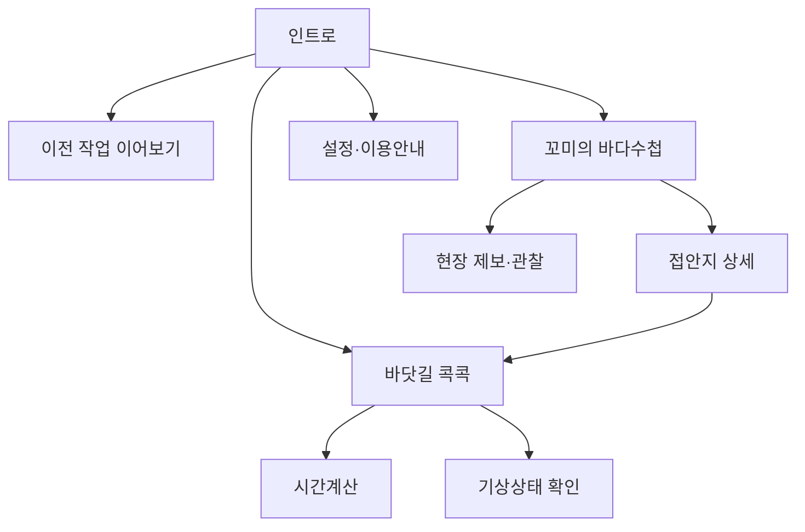
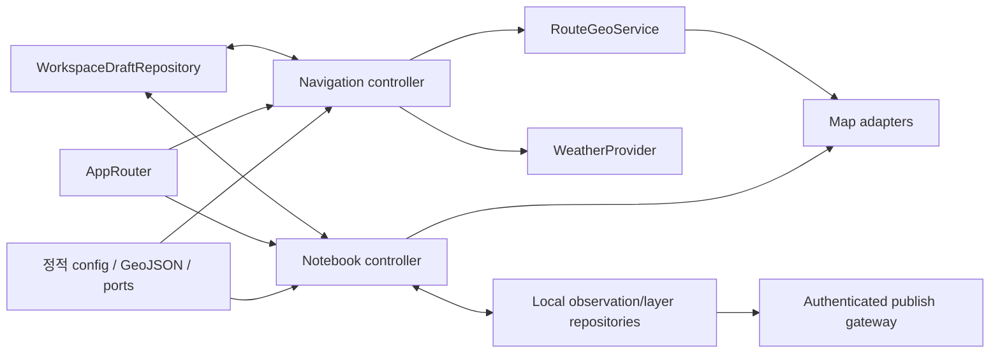

# 바다꼼꼬미 v2.2 페이지 디자인 통합 구현 설계서

- 문서 상태: **구현 전 검토 요청본 (REVIEW REQUIRED)**
- 기준일: 2026-11-10 (Asia/Seoul)
- 기준 커밋: `3c346e0`
- 대상: 인트로, 꼬미의 바다수첩, 바닷길 콕콕, 공통 설정/이용안내
- 제외: **꼬미의 달력 기능·데이터·화면 구현**
- 산출물 원칙: 이 문서가 이번 페이지 디자인 연구·팩트체크·구현 설계의 단일 정본이다.

> [!IMPORTANT]
> 현재 작업 트리에는 v2.2 라이트 테마 변경이 이미 적용되어 있으나 아직 커밋·배포된 상태가 아니다. 이 문서는 현재 구현(`AS-IS`), 검증된 사실(`VERIFIED`), 구현 제안(`PROPOSED`), 사용자 결정 필요(`DECISION REQUIRED`)를 분리한다. 문서 검토 승인은 코드 구현·원격 배포 승인을 자동으로 의미하지 않는다.

## 1장. 현상태 분석 및 팩트체크 리포트

### 1.1. 검토 범위와 판정 기준

아키텍처, QA·리팩토링, UI/UX·접근성 전문 관점으로 2026-11-09~10 커밋과 현재 작업 트리를 교차 검토했다. 대상은 다음과 같다.

- 내부 문서: [`ROUTE_NAVIGATION_DESIGN.md`](./ROUTE_NAVIGATION_DESIGN.md), [`SETTINGS_DESIGN.md`](./SETTINGS_DESIGN.md), 기존 본 문서
- 디자인 입력: [`intro_page.png`](../public/dev/design_pages/intro_page.png), [`ocean_notebook.png`](../public/dev/design_pages/ocean_notebook.png), [`ocean_route.png`](../public/dev/design_pages/ocean_route.png)
- 브랜드 참고: [`깃대종_NPIP_알로.pdf`](./references/깃대종_NPIP_알로.pdf) (`AS 920~923`, 4쪽)
- 구현: `src/`, `public/data/`, `vite.config.ts`, `scripts/verify-integrity.mjs`, 배포 워크플로
- 검증 명령: `npm run lint`, `npm run build`, `npm run verify`

판정 우선순위는 다음과 같다.

1. 안전·보안·외부 서비스 정책과 공식 문서
2. 현재 동작하는 기능 및 데이터 계약
3. 승인된 제품 범위와 사용자 결정
4. 디자인 시안의 시각 언어

따라서 디자인 시안은 **픽셀 복제 대상이 아니라 시각적 방향**이고, 현재 코드의 유효 기능은 **기능 계약**이다. 시안에 없는 기능을 근거 없이 제거하지 않는다.

### 1.2. 다중 전문 검토 결과

| 관점 | 확인 결과 | 판정 |
| :--- | :--- | :--- |
| 아키텍처 | `App.tsx` 약 2,212줄과 `MapView.tsx` 약 1,097줄에 라우팅, 네트워크, 지도, 기능 상태, 모달 상태가 집중되어 있다. `App`에서 `MapView`로 전달되는 props도 과도하다. | 단계적 기능 분리가 필요하다. 한 번에 재작성하지 않고 특성화 테스트 후 추출한다. |
| UI/UX | 인트로 시안은 브랜드·주요 기능 계층이 명확하다. 바닷길 시안은 `탭 → 지도 → 속력 → 예상시간` 순서가 좋지만 현재 고급 기능을 담지 못한다. | 인트로는 방향 승인 가능, 바닷길은 접이식 단계 공개가 필요하다. |
| 디자인 입력 | `ocean_notebook.png`와 `ocean_route.png`는 크기 `434×887`, 디코딩된 RGBA 픽셀이 전부 동일하다. SHA 차이는 PNG 인코딩/메타데이터 차이다. | **바다수첩 고유 시안이 부재한다.** 해당 이미지를 바다수첩 설계 근거로 사용하지 않는다. |
| QA | `npm run lint`와 `npm run build`는 통과했다. 빌드는 2,237 modules, SW precache 50 entries를 생성했다. | 소스 컴파일과 정적 검사만 통과했다. UI·라우팅·모달·오프라인 회귀 검증 완료를 의미하지 않는다. |
| 무결성 | `npm run verify`는 `public/dev` 4개 파일 때문에 실패한다. 이 파일 1,871,958 bytes가 `dist/dev`에도 그대로 복사된다. | 현재 작업 트리는 CI 배포 가능 상태가 아니다. |
| 테스트 | 단위·컴포넌트·E2E 테스트 러너와 테스트 파일이 없다. | 과거 문서의 “100% 검증 완료” 표현을 현재 증거로 재사용하지 않는다. |
| 보안 | GitHub write 토큰을 Vite 환경변수 또는 `localStorage`에서 읽어 브라우저가 저장소에 직접 쓰는 경로가 있다. | 최우선 구조 개선 대상이다. 토큰 존치·폐기는 사용자 소유 작업이다. |
| 운영 | 기상은 온라인 API, 원격 레이어 동기화는 GitHub, 실시간 지도는 외부 타일에 의존한다. | “완전한 오프라인 앱”이 아니라 “오프라인 사용 가능한 앱 셸·정적 데이터·로컬 기록”으로 표현한다. |

### 1.3. 페이지 시안 분석

#### 1.3.1. 인트로

좋은 점은 운영기관, 제품명, 캐릭터, 2×2 메뉴가 한 화면에서 이해되고 밝은 해양 톤이 일관된다는 것이다. 현재 `HomeScreen`도 같은 시각 방향을 이미 상당 부분 구현했다.

다만 실제 구현에는 시안보다 온라인/오프라인, 설치, 빠른 실행, 이전 작업 재개가 추가되어 정보밀도가 높다. `10px~11px`, `h-8` 중심의 보조 조작부는 WCAG 최소 기준을 일부 충족하더라도 선박 이동, 젖은 손, 장갑, 직사광선 환경에 충분하다고 검증되지 않았다.

달력은 이번 범위에서 제외되었지만 시안과 현재 코드에 비활성 카드가 남아 홈 면적의 약 25%를 차지한다. 권장 정보구조는 다음과 같다.

- 1차 과업: `꼬미의 바다수첩`, `바닷길 콕콕`을 동등한 대형 카드로 배치
- 유틸리티: `설정·이용안내`를 전폭 행으로 분리
- 달력: 기능 설계에서 제외하고 카드 존치/제거는 사용자 승인 후 확정

#### 1.3.2. 바닷길 콕콕

시안의 가장 좋은 점은 핵심 과업이 `시간계산/기상판정 → 경로 확인 → 속력 입력 → 총 예상 소요시간` 순으로 읽힌다는 것이다. `45분` 결과도 충분히 강조되어 있다.

그러나 현재 구현은 복수 경유지, 실행 취소, 출발·도착 반전, 방향 화살표, 항포구 표시, 구간 포커스, 구간 기상 확인, 브리핑 복사까지 제공한다. 시안을 문자 그대로 구현하면 기능 회귀가 발생한다. 다음 구조로 조정한다.

- 지도 경로는 밝은 위성영상에서도 보이도록 어두운 외곽선과 밝은 코어의 이중 스트로크를 유지한다.
- 하단 시트는 `요약 → 중간 → 전체` 3단 상태를 제공한다.
- 요약: 예상시간, 거리, 속력, 계산 기준시각, 데이터 상태
- 중간: 속력 변경, 출발·경유·도착 목록, 구간별 시간
- 전체: 지점 편집, 실행 취소, 반전, 경유지 정렬, 기상·경고
- 결과에는 항상 `추정치`, `항해 안전을 보증하지 않음`, 최신 계산시각을 표시한다.

#### 1.3.3. 꼬미의 바다수첩

현재 고유 시안이 없으므로 아래는 **승인 전 잠정 명세**다.

- 바닷길 화면과 다른 고유 제목·아이콘·작업 어휘를 사용한다.
- 기본 화면은 위험 접안지 우선 지도이며 `위험 우선 / 전체 접안지 / 공간 레이어`를 주요 진입점으로 둔다.
- 접안지 선택 시 수심, 위험요소, 좌표, 사진, 최신 확인일을 담은 바텀시트를 연다.
- 상태는 색상만이 아니라 아이콘, 텍스트, 형태로 중복 표현한다.
- 현장 제보와 상괭이 관찰은 접안지 핵심정보와 구분되는 보조 작업으로 둔다.
- 바닷길의 속력·경로·시간 계산 UI를 재사용하지 않는다. 단, 접안지를 바닷길 목적지로 넘기는 도메인 브리지는 유지한다.

### 1.4. 내부 문서·코드 팩트체크

| ID | 기존 주장 또는 상태 | 현재 확인 결과 | 문서 조치 |
| :--- | :--- | :--- | :--- |
| `FC-01` | 다크 테마, 전역 `user-select:none`이 현재 문제 | 현재 작업 트리는 `color-scheme: light`, 라이트 HUD/모달이며 선택 차단도 국소화되었다. | 과거 문제와 현재 구현을 분리한다. |
| `FC-02` | `LayerControlModal`, `Roadview3DModal`이 `div[role=dialog]`와 `useEscapeKey` 사용 | 두 컴포넌트는 네이티브 `<dialog>`로 전환됐고 훅은 삭제 상태다. 다만 `MapView`의 Kakao 진단창은 여전히 커스텀 modal이다. | “전 모달 100% 완료” 표현을 제거한다. |
| `FC-03` | 참고 PDF가 `public/dev`에 있음 | 실제 파일은 `docs/references/깃대종_NPIP_알로.pdf`다. IDE의 과거 탭 경로는 현재 파일 위치가 아니다. | 링크를 현재 위치로 정정한다. |
| `FC-04` | `public/dev` 클린, SW 51 entries | 현재 4개 파일이 있고 verify가 실패한다. 최근 빌드는 precache 50 entries다. | 실측 상태로 정정한다. |
| `FC-05` | 앱 버전 정합 | `package.json`과 `APP_VERSION`은 `2.2.0`, `package-lock.json` 루트는 `1.3.0`이다. | lockfile 검증을 추가한다. |
| `FC-06` | 이어보기는 작업 상태를 보존 | 같은 탭의 React 메모리만 보존한다. 새로고침/SW 갱신 시 항로·필터·뷰포트가 소실될 수 있다. | “인메모리 세션 보존”으로 낮추고 초안 저장소를 설계한다. |
| `FC-07` | GPS 실패 시 자동 대체 좌표 | 권한거부·타임아웃·신호실패를 구분하지 않고 통영 예시 좌표로 대체될 수 있다. | 실제 위치 오인을 막는 오류 분기와 명시적 데모 모드를 설계한다. |
| `FC-08` | 추가 외부 권한 작업 0건 | Kakao 앱 키/도메인/쿼터, GitHub 동기화 권한, 브랜드 사용 승인이 필요하다. | 3장 사용자 작업으로 이동한다. |

### 1.5. 공식 외부 문서 팩트체크

외부 문서는 2026-11-10에 확인했다.

| 영역 | 공식 근거 | 확인한 사실 | 설계 반영 |
| :--- | :--- | :--- | :--- |
| KRDS | [KRDS 소개](https://www.krds.go.kr/html/site/utility/utility_01.html), [KRDS 색상](https://www.krds.go.kr/html/site/style/style_02.html), [KRDS 컴포넌트](https://www.krds.go.kr/html/site/component/component_summary.html) | 토큰 계층, 60-30-10 색상 비율, 상태별 의미, 색상 외 텍스트·아이콘 보완, 접근성·플랫폼 고려를 안내한다. | 브랜드색은 토큰화하고 상태는 색상만으로 전달하지 않는다. |
| WCAG 2.2 | [WCAG 2.2](https://www.w3.org/TR/WCAG22/), [Target Size](https://www.w3.org/WAI/WCAG22/Understanding/target-size-minimum), [Focus Appearance](https://www.w3.org/WAI/WCAG22/Understanding/focus-appearance.html) | 일반 텍스트 4.5:1, UI 경계·상태 3:1, AA 포인터 타깃 24×24 CSS px, 드래그 대안, 가시적 포커스가 필요하다. | 자동 대비 검사, 키보드·단일 포인터 대안, 2px 이상 포커스 표시를 게이트로 둔다. |
| 현장 터치 | [Android 접근성](https://developer.android.com/guide/topics/ui/accessibility/apps), [Apple HIG Buttons](https://developer.apple.com/design/human-interface-guidelines/buttons) | Android는 48×48dp, Apple은 44×44pt 수준의 터치 영역을 권장한다. | 현장 내부 기준은 주요 조작 48×48 CSS px, 보조 조작 최소 44×44 CSS px로 둔다. |
| 네이티브 dialog | [MDN `<dialog>`](https://developer.mozilla.org/en-US/docs/Web/HTML/Reference/Elements/dialog), [showModal](https://developer.mozilla.org/en-US/docs/Web/API/HTMLDialogElement/showModal) | `showModal()`은 top layer, backdrop, 배경 inert, Escape 동작을 제공한다. 초기 포커스와 명시적 닫기 버튼은 별도 설계가 필요하다. | 단순 팝오버와 진짜 모달을 구분하고, 모달만 `<dialog>`를 사용한다. |
| Vite public | [Vite Static Asset Handling](https://vite.dev/guide/assets) | `public/` 파일은 빌드 시 `dist/` 루트로 그대로 복사된다. | Workbox `globIgnores`가 배포 제외를 의미하지 않음을 명시한다. |
| PWA 캐시 | [web.dev Assets and Data](https://web.dev/learn/pwa/assets-and-data), [Caching](https://web.dev/learn/pwa/caching) | 최소 앱 셸을 precache하고, 불필요한 자산 캐시는 저장공간·대역폭·구버전 위험을 만든다. | 앱 셸·정적 데이터·현장 이미지와 외부 지도/온라인 API 전략을 분리한다. |
| OSM 타일 | [OSMF Tile Usage Policy](https://operations.osmfoundation.org/policies/tiles/) | 표준 타일의 오프라인 사용·prefetch는 금지되고, 정확한 URL·표시 귀속·서버 캐시 헤더 준수가 요구된다. | 현재 `[abc].tile.openstreetmap.org` 30일 CacheFirst를 오프라인 기능으로 홍보하지 않는다. 정책 적합한 공급자 결정 전 제거 후보로 둔다. |
| Kakao Maps | [Kakao Maps 이해하기](https://developers.kakao.com/docs/ko/kakaomap/common), [Kakao Maps BI 가이드](https://developers.kakao.com/tool/resource/static/pdf/map/kakaomap_design_guidelines.pdf) | 앱 생성, 지도 API 활성화, JavaScript 키와 도메인 등록이 필요하며 최신 쿼터 정책 확인이 필요하다. | 콘솔 설정은 사용자 작업이다. 타일의 서비스워커 영속 캐시는 명시 허용 근거 확인 전 보류한다. |
| 해상기상 | [Open-Meteo ECMWF API](https://open-meteo.com/en/docs/ecmwf-api), [Marine Weather API](https://open-meteo.com/en/docs/marine-weather-api) | ECMWF IFS·WAM 모델을 제공하지만 연안 정확도 한계가 있고 해안 항해를 대체하지 않는다고 명시한다. | 모델·발행시각·조회시각·미확인 상태를 표시하고 출항 안전 보증 표현을 금지한다. |
| 항해계획 | [IMO Resolution A.893(21)](https://wwwcdn.imo.org/localresources/en/KnowledgeCentre/IndexofIMOResolutions/AssemblyDocuments/A.893%2821%29.pdf) | 항해계획은 평가, 계획, 실행, 모니터링과 선장 승인을 포함하며 기상, 조석, 장비 신뢰성 등을 고려한다. | 본 앱을 해도·ECDIS·선장 승인 절차의 대체물이 아닌 보조 계산 도구로 한정한다. |

#### NPIP 매뉴얼 확인 결과

PDF는 텍스트 레이어가 없는 4쪽 스캔 문서여서 전 페이지를 이미지 렌더링해 확인했다.

- `AS 920`: 팔색조 기본형과 10개 Pantone/CMYK/RGB 색상
- `AS 921`: 갈색·하늘색 단축형. 수치 색상값은 문서에 표기되지 않는다.
- `AS 922`: 한려해상국립공원 캐릭터 엠블럼. 수치 색상값은 문서에 표기되지 않는다.
- `AS 923`: 환영, 산불조심, 금지계도, 안내, 최고, 자연보호, 조사, 안전주의 응용동작

공식 수치로 사용할 수 있는 색상은 `AS 920`에 직접 적힌 값으로 한정한다.

| Pantone | RGB | HEX | 제안 역할 |
| :--- | :--- | :--- | :--- |
| 301C | `0, 51, 96` | `#003360` | 제목·핵심 텍스트 |
| 7466C | `0, 167, 157` | `#00A79D` | 그래픽·보조 강조. 흰색 텍스트 배경 금지 |
| 321C | `0, 132, 108` | `#00846C` | 주요 액션·선택 상태 후보 |
| 7528C | `167, 157, 135` | `#A79D87` | 샌드 계열 그래픽·틴트 원색 |
| 7540C | `72, 72, 67` | `#484843` | 보조 본문 |
| 215C | `135, 11, 65` | `#870B41` | 고위험 텍스트·강조 |
| 7423C | `178, 65, 95` | `#B2415F` | 위험 보조색 |
| 7634C | `174, 86, 92` | `#AE565C` | 경고 그래픽 |
| 4745C | `197, 180, 175` | `#C5B4AF` | 중립 그래픽 |
| 4715C | `139, 94, 60` | `#8B5E3C` | 자연·목재 그래픽 |

`AS 921/922`에서 눈으로 추출한 색은 공식 HEX가 아니다. 또한 이 PDF는 팔색조 `알로` 매뉴얼이며 현재 시안의 곰 캐릭터 `꼬미/반달이` 사용 권한을 증명하지 않는다.

현재 주요 색 대비 재계산 결과도 기존 문서 수치와 달랐다.

| 조합 | 실제 대비 | 판정 |
| :--- | ---: | :--- |
| `#003360 / #FFFFFF` | `12.79:1` | 일반 텍스트 사용 가능 |
| `#00846C / #FFFFFF` | `4.65:1` | 일반 텍스트 AA 경계 이상 |
| `#00A79D / #FFFFFF` | `2.994:1` | 3:1 미달. 흰 글자·필수 UI 경계에 단독 사용 금지 |
| `#94A3B8 / #FFFFFF` | `2.56:1` | 필수 입력 경계 3:1 기준에 부적합 |
| `#B2415F / #FFFFFF` | `5.51:1` | 일반 텍스트 AA 이상 |

### 1.6. 근본 원인과 재발 방지

| ID | 근본 원인 | 영향 | 재발 방지 |
| :--- | :--- | :--- | :--- |
| `RC-DESIGN-01` | 파일명만 다르고 픽셀은 같은 시안을 별도 페이지 입력으로 간주 | 바다수첩·바닷길 화면을 잘못 동일 설계할 수 있음 | 이미지 픽셀 해시와 디자인 ID를 문서·CI에서 기록 |
| `RC-STATE-01` | 문서가 현재 구현, 완료 보고, 미래 제안을 같은 시제로 표현 | 미구현을 완료로 또는 구현 완료를 미구현으로 오판 | 모든 요구에 `AS-IS/VERIFIED/PROPOSED/DECISION REQUIRED` 상태 사용 |
| `RC-ARCH-01` | 루트 컴포넌트에 기능 상태와 어댑터가 집중 | 변경 범위 확대, 회귀 위험, 테스트 어려움 | 기능별 controller/repository 추출과 계약 테스트 |
| `RC-PWA-01` | Workbox precache 제외와 Vite 배포 제외를 혼동 | 개발 시안 1.79 MiB 배포, verify 실패 | 비런타임 자산은 `public` 밖에 저장하고 dist 금지 경로 검사 |
| `RC-OFFLINE-01` | 방문 타일 캐시를 오프라인 지도 보장으로 해석 | 정책 위반 및 현장 기대 불일치 | 공급자 정책 승인 전 타일 영속 캐시 금지, 오프라인 범위 UI 명시 |
| `RC-SEC-01` | 브라우저에 GitHub write credential을 저장하고 보호 브랜치에 직접 쓰는 구조 | XSS·확장 프로그램·공유 단말·오작동으로 저장소 변경 가능 | 서버측 GitHub App/게이트웨이, 최소권한, SHA 동시성 검사, PR 흐름 |
| `RC-SAFETY-01` | 경로·기상 추정치를 안전 판정처럼 보이게 하는 표현 | 현장 판단 오인 | `추정/미확인/온라인 필요/항해 판단 대체 아님`을 결과와 함께 표시 |
| `RC-QA-01` | lint/build/정적 개수 검사를 사용자 흐름 검증으로 확대 해석 | 회귀를 놓치고 과장된 완료 주장 | unit/component/E2E/a11y/실기기 게이트를 분리 |

## 2장. 통합 구현 설계 및 개선 명세서

### 2.1. 제품 방향과 범위

이번 구현의 목표는 **친근한 국립공원 해양 브랜드와 현장 판단의 명료함을 결합한 지도 중심 PWA**다.

| 범위 | 상태 | 구현 원칙 |
| :--- | :--- | :--- |
| 인트로 | 설계 가능 | 두 핵심 과업 우선, 설정 분리, 재방문 작업 재개 강조 |
| 바닷길 콕콕 | 설계 가능 | 현재 기능 보존, 3단 하단 시트, 추정치·데이터 상태 명시 |
| 꼬미의 바다수첩 | 조건부 | 고유 시안 수신 또는 코드 기반 신규 시안 설계 승인 필요 |
| 설정·이용안내 | 기존 설계 계승 | 기상 기준·버전·안전 한계·데이터 출처를 제공 |
| 꼬미의 달력 | 범위 제외 | 기능·데이터 설계하지 않음. 홈 카드 존치 여부만 사용자 결정 |

### 2.2. 목표 정보구조와 사용자 흐름



기존 깊은 링크 계약은 유지한다.

- `?screen=notebook`
- `?screen=navigation&panel=route`
- `?screen=navigation&panel=weather`

`useAppRoute`와 `App.tsx`의 중복 `popstate` 동기화는 한 소유자로 통합한다. 홈 오버레이, 마지막 작업공간, URL 화면 상태가 서로 다른 진실 소스가 되지 않도록 `WorkspaceSession`으로 묶는다.

### 2.3. 목표 컴포넌트·상태 아키텍처

```text
AppShell
├─ AppRouter
├─ NetworkAndUpdateStatus
├─ HomePage
└─ WorkspacePage
   ├─ WorkspaceHeader
   ├─ MapWorkspace
   │  ├─ KakaoMapAdapter
   │  └─ LeafletMapAdapter
   ├─ NotebookWorkspace
   │  ├─ NotebookToolbar
   │  ├─ DockingDetailSheet
   │  ├─ FieldReportDialog
   │  └─ ObservationDialog
   └─ NavigationWorkspace
      ├─ NavigationTabs
      ├─ RoutePlannerSheet
      └─ MarineWeatherSheet
```

상태는 수명과 보안 경계별로 나눈다.

| 계층 | 예시 | 저장 위치 |
| :--- | :--- | :--- |
| URL 상태 | 화면, 시간계산/기상 탭 | History API/query |
| 세션 상태 | 선택 접안지, 열린 패널, 임시 포커스 | feature reducer |
| 사용자 초안 | 항로 지점, 속력, 필터, 지도 뷰포트 | versioned `WorkspaceDraftRepository` |
| 로컬 운영 데이터 | 사용자 레이어, 상괭이 관찰 | IndexedDB/localStorage repository |
| 원격 데이터 | 기상, GitHub 발행 | adapter/gateway |

빅뱅 리팩토링은 금지한다. 현재 컴포넌트의 외부 동작을 특성화 테스트로 고정한 뒤 `WorkspaceShell → NotebookWorkspace → NavigationWorkspace` 순으로 추출한다.

### 2.4. 데이터 흐름



#### 바다수첩

`docking_points.geojson + operational layers → filter selector → map markers → docking detail → report/observation repository`

- 접안지 데이터는 스키마 검증 후 로드한다.
- 위험도·수심·좌표·최근 확인일의 출처와 갱신시각을 표시한다.
- GitHub 발행은 로컬 저장 성공과 분리한다. 원격 실패가 로컬 초안을 지우면 안 된다.

#### 바닷길

`ports/waypoints → RouteDraft reducer → RouteGeoService → RouteSummary → map + sheet`

- 계산 엔진은 UI에서 분리된 순수 함수로 유지한다.
- 결과는 거리, 시간, 구간, 적용 속력, 계산시각, 제약·경고를 함께 반환한다.
- GPS 오류는 `permission_denied`, `timeout`, `unavailable`로 구분한다. 예시 좌표는 사용자가 명시적으로 데모 모드를 켠 경우에만 사용한다.

#### 기상

`coordinates → WeatherProvider(Open-Meteo) → timestamp alignment → threshold evaluator → unknown-safe UI`

- `navigator.onLine`은 힌트일 뿐 요청 성공 증거가 아니다.
- 실패·결측·오래된 캐시는 모두 `미확인`으로 수렴한다.
- 모델, 격자 해상도, 예보 기준시각, 조회시각, 위치를 결과에 포함한다.

### 2.5. 페이지별 구현 명세

#### 2.5.1. 인트로

| 영역 | 명세 |
| :--- | :--- |
| 운영기관 | 공식 CI는 승인된 원본만 사용하고 제품명과 분리한다. |
| 주 기능 | 바다수첩·바닷길 두 대형 카드. 카드 전체를 하나의 48px 이상 타깃으로 제공한다. |
| 빠른 실행 | 위험 우선, 전체 접안지, 시간계산, 기상판정은 카드 내부 보조 액션으로 제공하되 44px 이상 타깃을 확보한다. |
| 설정 | 전폭 유틸리티 행으로 분리하고 기상기준·이용안내를 명시한다. |
| 상태 | 온라인/오프라인과 설치 가능 상태는 텍스트+아이콘으로 표시한다. |
| 달력 | 설계하지 않는다. 카드 제거 여부는 3장 승인을 따른다. |

#### 2.5.2. 바닷길 콕콕

| 영역 | 명세 |
| :--- | :--- |
| 헤더 | 뒤로가기, 페이지 제목, 상태/설정. 장식 캐릭터는 핵심 제목·버튼을 밀어내지 않는다. |
| 탭 | 시간계산/기상판정을 `tablist/tab/tabpanel` 의미로 구현하고 색상 외 굵기·아이콘·표시선을 병행한다. |
| 지도 | 출발·경유·도착을 번호, 형태, 명칭으로 구분한다. 경로는 이중 스트로크와 방향 표시를 사용한다. |
| 지도 도구 | 전체항로, 확대/축소, 지점추가, 초기화에 단일 포인터 조작을 제공한다. |
| 하단 시트 | 3단 높이와 드래그가 아닌 버튼 대안을 함께 제공한다. 키보드 포커스가 시트에 가려지지 않게 자동 스크롤한다. |
| 속력 | 유효범위, 단위 `kn`, 기본값의 출처, 직접 입력·프리셋을 제공한다. |
| 결과 | 총 시간, `NM/km`, 예상 도착시각, 계산시각, 데이터 상태, `추정치`를 한 묶음으로 표시한다. |

#### 2.5.3. 꼬미의 바다수첩

바다수첩 시안 확정 전에는 다음 기능 계약만 고정한다.

1. 지도와 접안지 상태가 첫 화면의 중심이다.
2. 위험주의 접안지는 기본 진입 또는 명확한 원터치 필터로 제공한다.
3. 상세 시트는 위험요소를 사진·편의정보보다 먼저 제시한다.
4. 좌표·안전수칙은 선택·복사가 가능하다.
5. 현장 제보·관찰·레이어 관리는 각기 다른 작업이므로 상세 정보와 시각적으로 구분한다.
6. 접안지에서 바닷길 목적지로 이동할 때 컨텍스트와 뒤로가기 경로를 보존한다.

### 2.6. 디자인 토큰·접근성 규칙

토큰은 `primitive → semantic → component`로 나눈다. Pantone 원색을 UI에 직접 흩뿌리지 않는다.

```text
primitive: npip-navy-301, npip-teal-7466, npip-green-321, npip-sand-7528
semantic: text-primary, action-primary, border-strong, surface-info, status-danger
component: button-primary-bg, route-line-core, sheet-border, focus-ring
```

필수 규칙:

- 일반 텍스트 4.5:1, 큰 텍스트·필수 그래픽·UI 상태 3:1 이상
- 주요 터치 48×48 CSS px, 보조 터치 44×44 CSS px
- 본문 16px 이상, 현장 보조정보 14px 이상을 기본 목표로 하고 10px~11px 정보는 제거·확대
- `:focus-visible` 2px 이상 고대비 외곽선
- 위험/주의/양호는 색상+아이콘+상태명 병행
- 모든 드래그 조작에 클릭/버튼 대안 제공
- `prefers-reduced-motion`에서 비필수 모션 제거
- 200% 확대, 320 CSS px 폭, 세로·가로 화면에서 기능 손실 금지
- 밝은 배경과 위성지도 양쪽에서 각각 대비 검사

### 2.7. PWA·외부 API·MCP 최적화

#### PWA 캐시 경계

| 자원 | 목표 전략 | 사용자 표시 |
| :--- | :--- | :--- |
| 앱 셸·아이콘 | precache | 오프라인 가능 |
| app config·GeoJSON | NetworkFirst + 검증된 마지막 정상본 | 데이터 기준시각 표시 |
| 현장 이미지 | StaleWhileRevalidate + 예산 | 캐시 여부·실패 대체 UI |
| 기상 API | network required, 실패 시 `미확인` | 마지막 성공 시각과 오래됨 표시 |
| GitHub 발행 | network required | 로컬 저장/원격 발행 상태 분리 |
| Kakao/OSM 타일 | 정책 승인 전 영속 캐시 보장 금지 | 오프라인 지도 미보장 명시 |

`autoUpdate + skipWaiting`은 항로 초안이 비영속인 상태에서 작업 중 앱을 교체할 수 있다. `WorkspaceDraftRepository` 저장 성공 후 업데이트하거나 사용자 확인형 업데이트로 전환한다.

#### 외부 API adapter

Kakao, Open-Meteo, GitHub를 컴포넌트에서 직접 호출하지 않고 adapter 계약으로 격리한다.

- 공통: timeout, `AbortController`, 오류 taxonomy, `lastUpdated`, source attribution
- 기상: online/unknown/stale 상태 분리
- 지도: SDK 실패와 도메인 미등록을 구분
- 발행: 브라우저 PAT 제거, 서버측 GitHub App 또는 인증된 서버리스 gateway 사용

#### MCP와 개발 도구

현재 런타임 앱에는 MCP 의존이 없다. MCP는 런타임에 넣지 않고 개발·검증 계층에서만 사용한다.

- 공식 문서 조회: URL, 조회일, 적용 결론을 문서에 남김
- 디자인 비교: 기준 시안의 픽셀/구조 차이를 자동 리포트
- 브라우저 자동화: Playwright로 모바일 핵심 흐름과 오프라인 셸 확인
- 접근성: axe-core, Lighthouse, 키보드 탐색, Android Accessibility Scanner
- 데이터: JSON Schema, GeoJSON 검증, 고정 fixture 기반 경로 불변식 검사
- 보안: secret scan, 번들 내 `VITE_*TOKEN` 금지 검사

### 2.8. 보안·운영 구조 개선

현재 브라우저 GitHub write 토큰 방식은 구현 전에 설계를 확정해야 한다.

권장 흐름:

```text
브라우저 로컬 초안
  → 인증된 publish gateway
  → schema/권한/repo/branch/expected SHA 검증
  → 보호 브랜치용 PR 생성
  → 사용자 또는 운영자 승인
  → 배포
```

- 기존 토큰이 실제 사용됐다면 사용자가 GitHub에서 직접 revoke/rotate한다.
- 클라이언트에는 write token을 번들·localStorage·IndexedDB 어디에도 저장하지 않는다.
- gateway는 저장소·브랜치 allowlist, 최소 `contents` 권한, 만료, 감사 로그를 적용한다.
- `main` 직접 커밋 대신 PR 또는 보호 브랜치 워크플로를 기본값으로 한다.

### 2.9. 단계별 구현 순서와 승인 게이트

| 단계 | 작업 | 완료 조건 | 승인 |
| :--- | :--- | :--- | :--- |
| Gate 0 | 3장 결정사항 확정 | 바다수첩 시안, 달력 카드, 브랜드, 지도 정책, GitHub 발행 결정 | **사용자 필수** |
| 1 | 기준선 복구 | `public/dev` 정책과 lockfile 버전 정합, verify 통과 | 에이전트 구현 후 사용자 검토 |
| 2 | 특성화 테스트 | 현재 핵심 흐름·계산·저장 계약 고정 | 테스트 결과 검토 |
| 3 | 아키텍처 추출 | WorkspaceShell/Notebook/Navigation 단계적 분리 | 기능 회귀 0건 |
| 4 | 인트로·바닷길 UI | 승인 시안의 시각 언어와 접근성 반영 | 스크린샷·E2E·a11y 통과 |
| 5 | 바다수첩 UI | 고유 시안 승인 후 구현 | 도메인 기능·시각 검수 통과 |
| 6 | 보안·PWA | publish gateway, 초안 복구, 캐시 경계 적용 | 보안·오프라인 테스트 통과 |
| 7 | 실기기 검증 | 갑판/직사광선/네트워크 단절/장갑 시나리오 | **사용자 현장 확인 필수** |

### 2.10. 테스트·품질 게이트

권장 CI 순서:

```text
npm ci
→ verify:source
→ lint
→ unit/component tests
→ build
→ verify:dist
→ Playwright smoke/a11y/link checks
```

필수 테스트:

- `useAppRoute`: 뒤로가기, 딥링크, 홈 오버레이, 탭 전환
- `routeGeoService`: 고정 fixture, 거리·시간, 경유지 순서, 육지 관통 금지 불변식
- 설정: 임계값 역전 방지와 저장 migration
- 모달: 초기 포커스, Escape, 닫기 후 트리거 복귀, 배경 inert
- 인트로: 두 핵심 기능과 설정 진입, 이어보기
- 바닷길: 지점 추가·삭제·실행취소·반전·기상 이동
- 오프라인: 앱 셸·정적 데이터 사용 가능, 기상/발행 `미확인·대기` 처리
- 접근성: axe 위반 0, 키보드 전체 사용, 200% 확대, 색각 시뮬레이션
- 빌드: `dist/dev` 금지, SW 중복 URL 0, 번들 예산, sourcemap/secret 검사

현재 실측 기준선:

| 명령 | 결과 |
| :--- | :--- |
| `npm run lint` | 통과 |
| `npm run build` | 통과, 2,237 modules, SW precache 50 entries |
| `npm run verify` | **실패**: `public/dev` 4개 파일 |
| 단위/컴포넌트/E2E | 인프라 없음, 미검증 |

### 2.11. 레거시 청산 명세

레거시는 대체 경로와 회귀 검증이 준비된 뒤 제거한다. 감사 이력은 Git에 남기되 활성 문서·설정에서 오래된 주장을 제거한다.

| ID | 대상 | 조치 | 전제 |
| :--- | :--- | :--- | :--- |
| `LEG-13` | `public/dev/design_pages`, `public/dev/characters` | 비배포 문서 자산 경로로 이동하거나 명시적 배포 자산으로 정책 변경 | 사용자 결정 |
| `LEG-14` | `package-lock.json` root `1.3.0` | `npm install --package-lock-only` 등 정상 절차로 2.2.0 동기화, verify 추가 | 구현 승인 |
| `LEG-15` | README의 삭제된 `useEscapeKey.ts` 트리 | 현재 구조로 정정 | 구현 승인 |
| `LEG-16` | `MapView` 커스텀 modal/popup 의미 혼용 | Kakao 진단은 native dialog, 지도유형은 non-modal popover로 분리 | 회귀 테스트 |
| `LEG-17` | OSM `[abc]` 타일 CacheFirst와 오프라인 보장 문구 | 정책 적합 공급자 전환 전 제거·완화 | 지도 공급자 결정 |
| `LEG-18` | 브라우저 GitHub PAT 및 `main` 직접 쓰기 | publish gateway 전환 후 클라이언트 credential 코드 제거 | 사용자 토큰 폐기·백엔드 결정 |
| `LEG-19` | 과장된 “100% 검증 완료”, 고정 precache 수치 | 재현 가능한 테스트 결과와 상태 기반 표현으로 교체 | 문서 검수 |
| `LEG-20` | 대형 단일 `App`/`MapView` 책임 | 단계적 기능 컴포넌트 추출 | 특성화 테스트 |

## 3장. 사용자 필수 실행 요청 목록 (Action Items)

다음 항목은 에이전트가 임의로 우회하거나 결정하지 않는다. 답변을 받은 뒤에만 구현 단계로 넘어간다.

| 우선순위 | 사용자 결정/수행 요청 | 권장안 | 결정하지 않을 경우 |
| :--- | :--- | :--- | :--- |
| **필수 1** | **바다수첩 고유 시안을 다시 제공할지, 현재 기능 계약으로 신규 시안을 설계하도록 승인할지 결정** | 잘못 중복된 `ocean_notebook.png`를 교체 | 바다수첩 UI 구현 보류 |
| **필수 2** | **달력 제외의 의미 확정**: 기능만 제외하고 출시예정 카드를 유지할지, 홈 카드도 제거할지 결정 | 홈 카드 제거, `2개 주 기능 + 설정 전폭 행` | 현재 비활성 카드 유지 |
| **필수 3** | **디자인 자산 위치 결정**: `public/dev` 배포 1.79 MiB를 수용할지, `docs/assets` 등 비배포 경로로 이동할지 결정 | 비배포 경로로 이동하고 `dist/dev` 금지 유지 | `npm run verify` 실패·CI 배포 불가 지속 |
| **필수 4** | **KNPS CI와 꼬미·반달이·알로 캐릭터의 원본 출처 및 앱 사용 승인 확인** | 브랜드 담당자의 사용 범위·변형 허용·표기 규칙 확인 | 공식 브랜드로 단정하거나 배포하지 않음 |
| **필수 5** | **바닷길의 법적·운영 의미 확정**: 안전 항로인지 시간 추정 보조선인지 결정 | `시간 추정 보조선`, 항해 판단 대체 아님 | 안전 항로 표현 금지 |
| **필수 6** | **GitHub PAT 직접 저장 방식 폐기 및 기존 토큰 revoke/rotate 수행** | GitHub App/서버리스 publish gateway + PR 흐름 | 원격 레이어 쓰기 기능 구현·배포 보류 |
| **필수 7** | **Kakao Developer Console에서 앱 활성화, JavaScript 키 도메인, 무료/유료 쿼터 확인** | 실제 배포 도메인과 preview 도메인 모두 등록·검증 | Kakao 지도 운영 보장 불가 |
| **필수 8** | **오프라인 지도 공급자 정책 결정** | OSM 표준 타일 오프라인 캐시 제거, 허용 라이선스 공급자 또는 자체 호스팅 검토 | 외부 타일 오프라인 보장 금지 |
| **필수 9** | **작업 초안 보존 범위 결정**: 항로, 필터, 지도 뷰포트, 작성 중 제보와 보존기간 | 버전 스키마·사용자 초기화가 있는 기기 로컬 저장 | 현재 탭 메모리만 보존 |
| **필수 10** | **테스트 의존성 추가 승인**: Vitest, Testing Library, Playwright, axe-core | 구현 전 최소 테스트 게이트 구성 | 리팩토링 범위 축소, 완료 판정 보류 |
| **필수 11** | **주 사용 기기·최소 화면 폭·장갑 사용 여부와 실기기 현장 검증 참여 가능 여부 제공** | 360/390/430px + 실제 업무 기기·갑판 직사광선 검증 | 데스크톱 에뮬레이션 결과만 보고, 현장 적합성 미확정 |
| **필수 12** | **43.2MB NPIP PDF 보존 방식 결정** | 원본 공식 URL이 있으면 링크+checksum, 아니면 Git LFS 검토 | 일반 Git 저장소 비대화 가능 |

### 최종 검토 요청

구현 착수 전 최소한 다음 다섯 가지에 답변이 필요하다.

1. 바다수첩 시안을 교체해 주실지, 제가 현재 기능을 기준으로 새 시안을 설계해도 되는지 -> 시안 기반 및 참고하되, 현재 기능을 기준 설계 작업.

위 결정을 받은 뒤 구현 범위와 순서를 확정하고 코드 변경을 시작한다.
