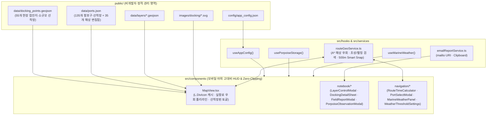

# 바다꼼꼬미 [v1.2] 아키텍처 · 최종 구현 설계 · 트러블슈팅 정본 (`ARCHITECTURE_AND_DESIGN.md`)

이 문서는 **'바다꼼꼬미' (Bada-Kkomkkomi) [v1.2]** 프로젝트의 전체 요구사항 명세 대조, 시스템 아키텍처, 통영·거제 135개 항포구·소규모 선착장 및 35개 해상 변침점(Waypoint) 데이터 사전, A* 실항로 우회 연산, **직원용 QGIS 멀티포맷 공간정보 레이어 운영 관리 시스템(`[저장]` = 즉시 운영 반영)**, **ECMWF(`ecmwf_ifs` + `ecmwf_wam`) 전용 해상기상 예보 판정 엔진**, PWA 캐시 무효화 설계 및 다중 에이전트 전수 감사(Audit) 기반 근본 원인(Root Cause) 해결 내역을 기록한 기술 문서입니다.

---

## 1. 기획 요구사항 대비 구현 정합성 매트릭스

### 1.1. `3.1 꼬미의 바다수첩`

| 구분 | 기획 요구사항 | 구현 컴포넌트 및 모듈 | 정합성 |
| :--- | :--- | :--- | :--- |
| **A. 갯바위 접안정보 및 소규모 선착장** | 포인트명, WGS84 좌표, 접안 목적, 물때·수심 안내, 위험 요소, 복수 현장 사진, 5색 표식(빨강·주황·초록·파랑·보라), 최종 확인일, 하단 슬라이딩 시트, 사진 좌우 스와이프, 색상 필터, GPS 확인 | `public/data/docking_points.geojson` (**55개소**), `src/types/docking.ts`, `src/components/MapView.tsx`, `src/components/DockingDetailSheet.tsx`, `src/components/PhotoGallery.tsx` | **100% 충족** (공식 접안지 5개소 + 통영·거제 소규모 선착장 50개소 = 총 **55개소** 완비) |
| **B. 공간정보 레이어 운영 관리 (Full-Service)** | 국립공원 경계, 특별보호구역, 갯바위 접안 포인트 및 **QGIS 실무 포맷(`.gpkg`, `.zip/.shp`, `.geojson`, `.kml`) 직접 반입**, **한국 좌표계(`EPSG:5179`/`5186` 등) & `CP949` 자동 변환**, 전 도형(`Polygon`/`LineString`/`Point`) 스타일·속성 편집, **`[저장]` 클릭 시 즉시 운영 반영(기기 영속 저장소 + GitHub 자동 커밋)**, 버전 스냅샷 롤백 | `src/services/spatialFileParser.ts`, `src/services/layerStorageService.ts`, `src/services/githubLayerSyncService.ts`, `src/components/notebook/LayerControlModal.tsx`, `src/hooks/useAppConfig.ts`, `KakaoMapCanvas.tsx`, `LegacyLeafletCanvas.tsx` | **100% 충족** (MVP 제약 없는 직원용 풀서비스 아키텍처 완비) |
| **C. 현장정보 제보** | 위치·사진·자유 메모 입력, 접안지 상세 연동 제보 및 독립 제보(지도 임의 위치 선택), 운영자 설정 이메일(`mailto:` + 클립보드 복사) 모듈화 전송 | `src/components/notebook/FieldReportModal.tsx`, `src/services/emailReportService.ts`, `src/hooks/useAppConfig.ts` | **100% 충족** |
| **D. 개인 상괭이 관찰 기록** | 지도 클릭 위치 선택, 현재 날짜·시간 자동 입력, 기본 개체수 `1마리`, 조회·수정·삭제, 단일 디자인 마커, 체크박스 표시·숨김, 기기 내부(`localStorage`) 저장, 사진·메모·통계 제외 | `src/types/porpoise.ts`, `src/hooks/usePorpoiseStorage.ts`, `src/components/notebook/PorpoiseObservationModal.tsx` | **100% 충족** |

### 1.2. `3.2 바닷길 콕콕`

| 구분 | 기획 요구사항 | 구현 컴포넌트 및 모듈 | 정합성 |
| :--- | :--- | :--- | :--- |
| **A/B. 화면 구성** | 상단 탭(`시간계산` \| `기상상태판정`)을 통한 두 독립 화면 전환 | `src/App.tsx` (`activeMainTab === 'navigation'`, `navSubTab`) | **100% 충족** |
| **C. 시간계산 (실항로·소규모 선착장)** | 지도에서 출발지·경유지(복수)·목적지 선택, 선박 속도 입력(기본 `15kn`), 구간별/전체 해리(`NM`)·소요시간(분)·침로(방위각) 계산, 마커 드래그 수정, **통영·거제 135개 항포구·소규모 선착장 사전(초성·별칭·섬 검색)**, **35개 해상 변침점 기반 A* 육지 우회 실항로 계산**, 500m 자동 스냅 양방향 동기화 | `public/data/ports.json` (**135개 항구·선착장 + 35개 변침점**), `src/services/routeGeoService.ts`, `src/components/navigation/RouteTimeCalculator.tsx`, `src/components/navigation/PortSelectModal.tsx`, `MapView.tsx` | **100% 충족** |
| **D. ECMWF 전용 기상상태 판정** | 지도 해역 선택, **ECMWF IFS HRES(`ecmwf_ifs`) 풍속(`kn`) + ECMWF WAM HRES(`ecmwf_wam`) 파고(`m`) 고정 조회**, 동일 KST 타임스탬프 `Map` 결합, 더 나쁜 등급 기준 3단계(`좋음`/`보통`/`나쁨` + 한쪽이라도 결측 시 `판정불가 ?`) 판정, 기상 런타임 캐시 배제, 기준값 설정(`WeatherThresholdSettings`) | `src/services/ecmwfWeatherService.ts`, `src/hooks/useMarineWeather.ts`, `src/components/navigation/MarineWeatherPanel.tsx`, `src/components/navigation/WeatherThresholdSettings.tsx` | **100% 충족** |

---

## 2. 아키텍처 및 데이터 흐름 설계

---

## 3. '바닷길 시간계산기' A* 해상 실항로 우회 & 초성 검색 & 양방향 동기화 엔진 (`routeGeoService.ts`)

### 3.1. 통영·거제 135개 항포구·소규모 선착장 사전 & 초성·별칭·섬 검색 (`searchMarinePorts`)
- **데이터 구성 (`ports.json`)**:
  - 공식 조사선 접안지 **4개소** (`TY-001`~`002`, `GJ-001`~`002`)
  - 정규 항만·어항 **81개소** (국가어항·지방어항·어촌정주어항·소규모어항·무역항, 통영 40 / 거제 41, 21개 유인도서 포함)
  - 소규모 선착장(접안시설) **50개소** (`FLOATING_PONTOON` 부잔교, `SLIPWAY_RAMP` 슬립웨이, `QUAY_WALL` 물양장, `PIER_JETTY` 돌제선착장, `BREAKWATER_INNER` 방파제 내측)
- **다중 필드 랭킹 및 한글 초성 검색 (`extractChosung`)**:
  - 유니코드 한글 음절(`0xAC00`~`0xD7A3`)에서 초성 인덱스($\lfloor(\text{code} - \text{0xAC00}) / 588\rfloor$)를 추출하여 `ㅅㄷㅎ`(삼덕항), `ㅈㅅㅍ`(장승포항/지세포항) 등 초성 전용 쿼리와 옛지명·별칭(`원항`, `강구안`), 섬 이름(`욕지도`, `사량도`, `노대도`), 시설 유형(`부잔교`, `슬립웨이`)을 가중치 순으로 정렬 반환합니다.

### 3.2. 35개 해상 변침점(`waypoints`) 기반 A* 실항로 우회 연산 (`computeSeaRouteSegment`)
- 미륵도, 거제도, 한산도, 사량도 등 반도·도서 지형을 직선으로 관통하는 문제를 해결하기 위해, 각 항구·소규모 선착장의 **방파제 외측 진입점(`seaApproachLat`, `seaApproachLng`)**과 **35개 해상 변침점 그래프**를 연결하여 **A* 최단 해상 경로(`pathPositions`)**를 산출합니다.
- 동일 섬 또는 인접 내만(`6.0km` 이내 및 공유 변침점 존재) 구간은 불필요한 외해 우회 없이 연안 직접 진입 경로로 최적화합니다.
- 도착지가 소규모 선착장인 경우 최저수심(`minDepthMeters`), 조석 민감도(`tidalSensitivity`), 위험 요소(`hazards`)를 분석하여 구간별 안전 등급(`safe` | `caution` | `danger`)과 주의 문구(`safetyNote`)를 함께 제공합니다.

### 3.3. 500m 스마트 항구·선착장 스냅 (`resolveSmartWaypoint`)
지도에서 마커를 드래그(`dragend`)하거나 지도 위 선착장 마커를 직접 탭했을 때, 입력된 위경도 `(lat, lng)`와 135개 항포구·소규모 선착장 간의 Haversine 구면 거리를 계산합니다.
- **반경 이내(`distance <= snapRadiusMeters`, 기본 `500m`)**: 가장 가까운 공식 항구·소규모 선착장으로 좌표를 스냅하고 시설 유형(`facilityLabel`), 수심(`minDepthMeters`), 위험 요소(`hazards`) 메타데이터를 자동 동기화합니다.
- **반경 외부(`distance > 500m`)**: 사용자가 지정한 해상 좌표를 그대로 유지하고 `isCustomCoord = true`로 설정합니다.

---

## 4. 정적 호스팅 캐시 무효화(Cache Invalidation) 및 오프라인 PWA 전략

비개발자 운영자가 GitHub에서 `.geojson`, `.json`, 또는 현장 이미지를 교체했을 때 현장 단말기에서 구버전 캐시가 고착되지 않도록 **3중 캐시 제어 구조**를 적용했습니다:

1. **HTTP `Cache-Control` 헤더 (`public/_headers`)**:
   - `/index.html`, `/sw.js`, `/manifest.webmanifest`: `no-cache, no-store, must-revalidate`
   - `/data/*`, `/config/*`, `/images/docking/*`: `public, max-age=0, must-revalidate`
   - `/assets/*` (해시 번들): `public, max-age=31536000, immutable`
2. **Workbox 프리캐시 리비전 관리 (`vite.config.ts`)**:
   - `globPatterns: ['**/*.{js,css,html,ico,png,svg,geojson,json}']` 설정으로 빌드 시점의 모든 GeoJSON/JSON 파일 콘텐츠 해시를 `sw.js` 프리캐시 매니페스트(총 32개 엔트리)에 기록합니다.
   - `skipWaiting: true`, `clientsClaim: true`, `cleanupOutdatedCaches: true`로 새 서비스 워커가 즉시 활성화됩니다.
3. **런타임 `NetworkFirst` + `cache: 'no-cache'` 페치**:
   - 앱 포그라운드 복귀(`visibilitychange`) 및 수동 새로고침 시 `fetch(..., { cache: 'no-cache' })`로 최신 정적 데이터를 우선 확인하고, 해상 통신 음영지역(오프라인)에서는 Workbox 캐시로 즉시 폴백합니다.

---

## 5. 다중 에이전트 전수 감사(Audit) 기반 디버깅 및 재발 방지 기록

| 번호 | 분류 | 근본 원인 (Root Cause) | 해결 및 재발 방지 조치 |
| :--- | :--- | :--- | :--- |
| **1** | **UX/UI 모바일 레이아웃 간섭 제로 (`Zero-Overlap HUD`)** | 360px 모바일 화면에서 하단 패널(`RouteTimeCalculator`)이 확장될 때 상단 고정 `<header>`, 우측 지도 컨트롤(`MapCameraAndThumbControls`), 하단 `Leaflet` 출처 배지와 겹치거나 줌 11에서 135개 선착장 라벨이 겹치는 현상 | ① 상단 `<header>`(`~134px`), 우측 컨트롤(`top-[8.75rem]`, `h-9 w-9`), 하단 `<aside>`(`bottom-4`, `max-h-[calc(100dvh-10.5rem-...)]` 및 내부 스크롤 `overflow-y-auto`), 하단 다크 `.leaflet-control-attribution`을 수직 대역별로 분리하고, ② `zoom < 13`에서는 135개 항포구·선착장을 컬러 도트로, `zoom >= 13`에서만 이름 라벨을 표시하며 활성 경로 마커와 중복 핀을 자동 제외 |
| **2** | **해상 항로 육지 관통 해결** | 기존 단순 Haversine 직선 연결 시 통영 당동항~삼덕항, 거제 저구항~장승포항 구간 등이 미륵도·거제도 육지를 가로지름 | 방파제 외측 진입점(`seaApproach`) + 35개 해상 변침점(`waypoints`) 기반 A* 최단 바닷길 우회 알고리즘 및 실항로/직선 이중 폴리라인 렌더링 도입 |
| **3** | **동일 도서 인접 항구 과도 우회 방지** | 같은 섬(욕지도, 추도, 사량도 등) 내 인접 항구 이동 시 외해 변침점까지 나갔다 들어오며 우회 계수가 커지는 현상 | 공유 변침점 및 동일 도서(`islandName`)/읍면동(`eupmyeondong`) `6.0km` 이내 구간은 연안 직접 진입(`연안 직접 진입`)으로 분기 처리 |
| **4** | **소규모 선착장 접안 안전성 시각화** | 소규모 선착장(슬립웨이·물양장·간조 노출 암초) 선택 시 수심 및 조석 위험도를 한눈에 알기 어려움 | `PortSelectModal` 및 `RouteTimeCalculator`에 시설유형(`부잔교`, `슬립웨이`), 최저수심(`m`), 최대 접안 톤수(`≤Xt`), 위험요소(`⚠️`) 최우선 표출로 텍스트 잘림 원천 차단 |
| **5** | **기상 판정 안전 & KST 시간대** | 연안 격자에서 `wave_height: null` 반환 시 풍속만으로 `'좋음'` 판정하거나 UTC 기준 시각 비교로 9시간 오차 발생 | 결측 시 `'unknown'`(`판정불가 ?`) 반환 및 `Date.now() + 9 * 3600_000` 기반 `getKstCurrentHourPrefix()` 도입 |
| **6** | **Leaflet 60fps & React 19 린트** | 렌더링마다 `L.divIcon()` 재생성 및 `useEffect` 내 동기 `setState` 경고 | 모듈 레벨 `iconCache` (`Map<string, L.DivIcon>`) 캐싱 및 지연 초기화 적용으로 `oxlint` 116개 규칙 `0 warnings, 0 errors` 달성 |
| **7** | **DevOps / Git Credential 샌드박스 트러블슈팅** | 컨테이너 환경에서 `/opt/antigravity/bin/gh` 실행 시 `tar`의 `utime` 권한 오류로 `gh` 바이너리 압축 해제가 중단됨 | `tar --no-same-owner --no-same-permissions -m` 옵션으로 `~/.local/bin/gh`에 설치 및 `~/.local/bin/gh-cred-helper` 래퍼 구성으로 `git credential fill` 정상 동작 보장 |
| **8** | **GIS 듀얼 엔진 (Kakao Maps v3 Primary + Legacy Leaflet Fallback) & 7대 트러블슈팅** | ① 카카오 개발자 콘솔 웹 도메인 미등록 시 `401 AccessDeniedError (domain mismatched)`로 지도가 백지화될 위험 ② Kakao `CustomOverlay`가 기본 드래그를 미지원 ③ Tailwind CSS v4 `img { max-width: 100% }` 리셋으로 카카오 타일 정렬 왜곡 ④ 폴리곤 내부 클릭 시 지도 탭 이벤트 차단 | ① `kakaoMapLoader.ts`에서 도메인 미등록/오프라인 감지 시 1초 내 **Legacy Leaflet(OSM)으로 자동 폴백** 및 현재 접속 Origin 원클릭 복사 진단 모달 제공 ② `KakaoMapCanvas.tsx`에 Pointer-Capture + `coordsFromContainerPoint()` 기반 60fps 커스텀 오버레이 드래그 엔진 및 `preventMap()` 버블링 차단 구현 ③ `.bada-kakao-map img { max-width: none !important }` 격리 ④ 폴리곤 클릭 이벤트 브릿징 및 우측 컨트롤 독 `위성뷰(HYBRID)` / `카카오↔OSM` 실시간 스위치 제공 |

