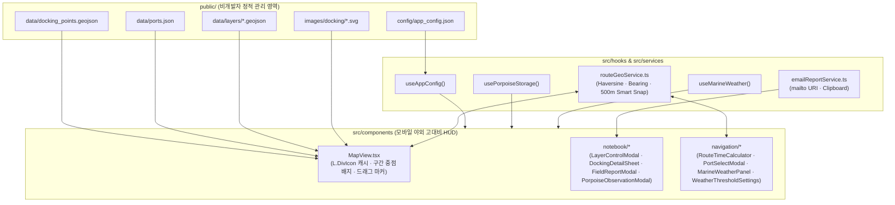

# 바다꼼꼬미 [Beta 0.3] 아키텍처 · 최종 구현 설계 · 트러블슈팅 정본 (`ARCHITECTURE_AND_DESIGN.md`)

이 문서는 **'바다꼼꼬미' (Bada-Kkomkkomi) [Beta 0.3]** 프로젝트의 전체 요구사항 명세 대조, 시스템 아키텍처, 데이터 사전(Data Dictionary), 양방향 동기화 알고리즘, PWA 캐시 무효화 설계 및 다중 에이전트 전수 감사(Audit) 기반 근본 원인(Root Cause) 해결 내역을 기록한 기술 문서입니다.

---

## 1. 기획 요구사항 대비 구현 정합성 매트릭스

### 1.1. `3.1 꼬미의 바다수첩`

| 구분 | 기획 요구사항 | 구현 컴포넌트 및 모듈 | 정합성 |
| :--- | :--- | :--- | :--- |
| **A. 갯바위 접안정보** | 포인트명, WGS84 좌표, 접안 목적, 물때 안내, 위험 요소, 복수 현장 사진, 5색 표식(빨강·주황·초록·파랑·보라), 최종 확인일, 하단 슬라이딩 시트, 사진 좌우 스와이프, 색상 필터, GPS 확인 | `public/data/docking_points.geojson`, `src/types/docking.ts`, `src/components/MapView.tsx`, `src/components/DockingDetailSheet.tsx`, `src/components/PhotoGallery.tsx` | **100% 충족** (`TY-001`~`TY-003`, `GJ-001`~`GJ-002` 5색 샘플 완비) |
| **B. 공간정보 레이어** | 국립공원 경계, 특별보호구역, 갯바위 접안 포인트 중첩 표시, 체크박스 개별 표시·숨김, 향후 레이어 무코드 확장 구조 | `public/config/app_config.json` (`layers` 배열), `public/data/layers/*.geojson`, `src/components/notebook/LayerControlModal.tsx`, `MapView.tsx` 동적 GeoJSON 로더 | **100% 충족** |
| **C. 현장정보 제보** | 위치·사진·자유 메모 입력, 접안지 상세 연동 제보 및 독립 제보(지도 임의 위치 선택), 운영자 설정 이메일(`mailto:` + 클립보드 복사) 모듈화 전송 | `src/components/notebook/FieldReportModal.tsx`, `src/services/emailReportService.ts`, `src/hooks/useAppConfig.ts` | **100% 충족** |
| **D. 개인 상괭이 관찰 기록** | 지도 클릭 위치 선택, 현재 날짜·시간 자동 입력, 기본 개체수 `1마리`, 조회·수정·삭제, 단일 디자인 마커, 체크박스 표시·숨김, 기기 내부(`localStorage`) 저장, 사진·메모·통계 제외 | `src/types/porpoise.ts`, `src/hooks/usePorpoiseStorage.ts`, `src/components/notebook/PorpoiseObservationModal.tsx` | **100% 충족** |

### 1.2. `3.2 바닷길 콕콕`

| 구분 | 기획 요구사항 | 구현 컴포넌트 및 모듈 | 정합성 |
| :--- | :--- | :--- | :--- |
| **A/B. 화면 구성** | 상단 탭(`시간계산` \| `기상상태판정`)을 통한 두 독립 화면 전환 | `src/App.tsx` (`activePrimaryTab === 'navigation'`, `activeNavSubTab`) | **100% 충족** |
| **C. 시간계산** | 지도에서 출발지·경유지(복수)·목적지 선택, 선박 속도 입력(기본 `15kn`), 구간별/전체 해리(`NM`)·소요시간(분)·침로(방위각) 계산, 마커 드래그 수정, 항구 사전 검색 및 500m 자동 스냅 양방향 동기화 | `public/data/ports.json`, `src/services/routeGeoService.ts`, `src/components/navigation/RouteTimeCalculator.tsx`, `src/components/navigation/PortSelectModal.tsx`, `MapView.tsx` | **100% 충족** |
| **D. 기상상태 판정** | 지도 해역 선택, 시간대별 풍속(`kn`)·파고(`m`) 조회, 더 나쁜 등급 기준 3단계(`좋음`/`보통`/`나쁨` + 결측 시 `판정불가`) 판정, 기준값 설정(`WeatherThresholdSettings`) | `src/hooks/useMarineWeather.ts`, `src/components/navigation/MarineWeatherPanel.tsx`, `src/components/navigation/WeatherThresholdSettings.tsx` | **100% 충족** |

---

## 2. 아키텍처 및 데이터 흐름 설계

---

## 3. '바닷길 시간계산기' 항구 & 좌표 양방향 동기화 엔진 (`routeGeoService.ts`)

### 3.1. 500m 스마트 항구 스냅 (`resolveSmartWaypoint`)
지도에서 마커를 드래그(`dragend`)하거나 지도를 직접 탭했을 때, 입력된 위경도 `(lat, lng)`와 통합 항구 카탈로그(`ports.json` + `docking_points.geojson`) 내 모든 지점 간의 Haversine 구면 거리를 계산합니다.
- **반경 이내(`distance <= snapRadiusMeters`, 기본 `500m`)**: 가장 가까운 공식 항구/접안지로 좌표를 스냅하고 `matchedPortId`를 부여하며 `isCustomCoord = false`로 설정합니다(UI에 `⚓ 항구 자동스냅` 배지 표시).
- **반경 외부(`distance > 500m`)**: 사용자가 지정한 해상 좌표를 그대로 유지하고 `해상 지정점 (34.8125°N, 128.4312°E)`과 같이 직관적인 좌표 명칭을 부여하며 `isCustomCoord = true`로 설정합니다.

### 3.2. 해리(`NM`), 전방 방위각(`Bearing`), 소요시간 연산 공식
1. **구면 거리 및 해리 변환**:
   - 지구 평균 반지름 $R = 6371\text{ km}$ 기준 Haversine 거리 $d_{\text{km}}$ 산출 후 $1\text{ NM} = 1.852\text{ km}$로 나누어 해리(`distanceNm`)를 계산합니다.
2. **초기 전방 방위각(Forward Bearing, $0^\circ \sim 359^\circ$) 및 8방위**:
   - $\theta = (\text{atan2}(\sin\Delta\lambda\cos\phi_2,\ \cos\phi_1\sin\phi_2 - \sin\phi_1\cos\phi_2\cos\Delta\lambda) \times \frac{180}{\pi} + 360) \bmod 360$
   - 8방위(`N`, `NE`, `E`, `SE`, `S`, `SW`, `W`, `NW`) 문자열과 함께 각 항로 구간 중점(`midLat`, `midLng`)에 캡슐 배지로 렌더링합니다.
3. **예상 소요시간(분)**:
   - $\text{durationMinutes} = \text{round}\left(\frac{\text{distanceNm}}{\text{speedKnots}} \times 60\right)$

---

## 4. 정적 호스팅 캐시 무효화(Cache Invalidation) 및 오프라인 PWA 전략

비개발자 운영자가 GitHub에서 `.geojson`, `.json`, 또는 현장 이미지를 교체했을 때 현장 단말기에서 구버전 캐시가 고착되지 않도록 **3중 캐시 제어 구조**를 적용했습니다:

1. **HTTP `Cache-Control` 헤더 (`public/_headers`)**:
   - `/index.html`, `/sw.js`, `/manifest.webmanifest`: `no-cache, no-store, must-revalidate`
   - `/data/*`, `/config/*`, `/images/docking/*`: `public, max-age=0, must-revalidate`
   - `/assets/*` (해시 번들): `public, max-age=31536000, immutable`
2. **Workbox 프리캐시 리비전 관리 (`vite.config.ts`)**:
   - `globPatterns: ['**/*.{js,css,html,ico,png,svg,geojson,json}']` 설정으로 빌드 시점의 모든 GeoJSON/JSON 파일 콘텐츠 해시를 `sw.js` 프리캐시 매니페스트(총 32개 엔트리)에 기록합니다.
   - `skipWaiting: true`, `clientsClaim: true`, `cleanupOutdatedCaches: true`로 새 서비스 워커가 즉시 활성화됩니다.
3. **런타임 `NetworkFirst` + `cache: 'no-cache'` 페치**:
   - 앱 포그라운드 복귀(`visibilitychange`) 및 수동 새로고침 시 `fetch(..., { cache: 'no-cache' })`로 최신 정적 데이터를 우선 확인하고, 해상 통신 음영지역(오프라인)에서는 Workbox 캐시로 즉시 폴백합니다.

---

## 5. 다중 에이전트 전수 감사(Audit) 기반 디버깅 및 재발 방지 기록

| 번호 | 분류 | 근본 원인 (Root Cause) | 해결 및 재발 방지 조치 |
| :--- | :--- | :--- | :--- |
| **1** | **UX/UI 뷰포트** | 360px 모바일 화면에서 하단 패널 우측 여백(`right-20`)과 우측 하단 줌 컨트롤이 겹쳐 패널 폭이 266px로 좁아지고 지도가 가려짐 | 우측 컨트롤을 `top-[10.5rem] right-3` 컴팩트 독(44×44px)으로 이동하고, 하단 패널은 `inset-x-3 bottom-3` 전체 폭 + `접기/펼치기` 토글 적용 |
| **2** | **기상 판정 안전** | 연안 격자에서 Open-Meteo Marine API가 `wave_height: null`(`unknown`)을 반환할 때 풍속만으로 `'좋음'` 판정을 내리는 결함 | `calculateOverallGrade`에서 풍속·파고 중 하나라도 `'unknown'`이면(`'bad'`가 아닌 한) 전체 등급을 `'unknown'`(`판정불가 ?`)으로 반환 |
| **3** | **KST 시간대** | `toISOString().slice(0, 13)`이 UTC 시각을 반환하여 `timezone=Asia/Seoul` 응답 배열에서 현재 시각이 9시간 어긋남 | `Date.now() + 9 * 3600_000` 기반 `getKstCurrentHourPrefix()` 도입 및 타임라인에 날짜+시각(`11/07 14시`) 표기 |
| **4** | **API 불필요 호출** | 기상 임계치(`thresholds`) 변경 시마다 `useEffect`가 재실행되어 Open-Meteo API를 재호출함 | 원시 응답(`rawHourly`) 상태와 임계치 등급 판정(`useMemo`)을 분리하여 기준값 변경 시 네트워크 호출 0회로 즉시 재계산 |
| **5** | **Leaflet 성능** | 렌더링마다 `L.divIcon()`을 새로 생성해 마커 DOM이 재마운트되고 레이어 GeoJSON이 중복 요청될 가능성 존재 | 모듈 레벨 `iconCache` (`Map<string, L.DivIcon>`) 캐싱 및 `fetchedLayerIdsRef` Set 가드 적용 |
| **6** | **React 19 린트** | `useEffect` 내부 동기 `setState` 호출로 인한 `oxlint` `react(set-state-in-effect)` 경고 | `useState(() => ...)` 지연 초기화 및 모달 `key` 리셋 패턴 도입으로 25개 전 파일 `0 warnings, 0 errors` 달성 |
| **7** | **기획 명세 정합** | 5번째 마커 색상(`purple`) 샘플 누락, 상괭이 모달 내 금지된 `note` 필드 존재, 독립 제보 시 지도 위치 선택 동선 부재 | `TY-003`(`purple`) 추가, 상괭이 `note` 필드 제거, 제보 모달 내 `지도에서 위치 선택` 및 수신 이메일 변경 UI 연결 |
