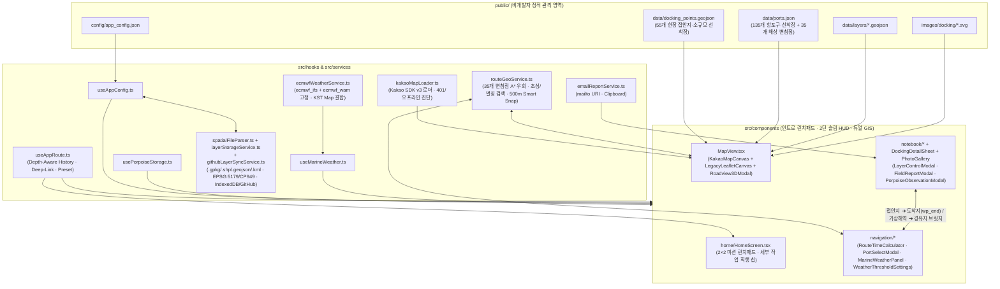

# 바다꼼꼬미 [v1.7] 아키텍처 · 최종 구현 설계 · 트러블슈팅 정본 (`ARCHITECTURE_AND_DESIGN.md`)

이 문서는 **'바다꼼꼬미' (Bada-Kkomkkomi) [v1.7]** 프로젝트의 전체 요구사항 명세 대조, 시스템 아키텍처, 핵심 도메인 엔진 설계, 공간·항해·기상 데이터 사전, PWA 캐시 무효화 전략 및 전수 감사(Audit) 기반 트러블슈팅 내역을 단일 정본(Single Source of Truth)으로 통합 기록한 기술 문서입니다.

---

## 1. 기획 요구사항 대비 구현 정합성 매트릭스

### 1.1. 공통 앱 쉘 & 인트로 허브 (`v1.1` ~ `v1.5`)

| 구분 | 기획 및 아키텍처 요구사항 | 구현 컴포넌트 및 모듈 | 정합성 |
| :--- | :--- | :--- | :--- |
| **A. 인트로 미션 런치패드 (`HomeScreen`)** | 초기 접속 시 지도 SDK 로드 없이 즉시 렌더링(`hasEnteredWorkspace` 지연 마운트), 2×2 기능 그리드(`꼬미의 바다수첩`, `바닷길 콕콕` 활성 + `꼬미의 달력`, `설정` 출시 예정 `disabled`), 세부 작업 원터치 직행 칩(`[🚨위험주의 9]`, `[🗺️전체 55]`, `[📦레이어]`, `[⏱️시간계산]`, `[🌊기상판정]`), 작업 중 복귀 배너 | [`src/components/home/HomeScreen.tsx`](../src/components/home/HomeScreen.tsx), [`src/hooks/useAppRoute.ts`](../src/hooks/useAppRoute.ts), [`src/App.tsx`](../src/App.tsx) | **100% 충족** |
| **B. 2단 슬림 HUD & 히스토리 라우터** | 모바일 뷰포트 상단 고정 바 점유율 12% 미만(`~92px` 2단 HUD), 1행 페이지 타이틀 + 상대 페이지 전환 칩, 인앱 진입 깊이에 따른 `[< 홈]` `history.back()` vs 딥링크 `replaceState('/')` 분기, 비활성 워크스페이스 `content-visibility: hidden` + `inert` | [`src/App.tsx`](../src/App.tsx), [`src/hooks/useAppRoute.ts`](../src/hooks/useAppRoute.ts) | **100% 충족** |
| **C. 듀얼 GIS 엔진 & 다중 배경지도·3D 로드뷰** | Kakao Maps SDK `v3` Primary + 도메인 미등록/오프라인 시 Legacy Leaflet(`OSM`) 자동 폴백, 베이스 맵 3종(`ROADMAP`/`SKYVIEW`/`HYBRID`) + 오버레이 5종(`TERRAIN`/`USE_DISTRICT`/`ROADVIEW`/`TRAFFIC`/`BICYCLE`), 360° 3D 현장 로드뷰(`Roadview3DModal`) | [`src/components/MapView.tsx`](../src/components/MapView.tsx), [`src/components/map/KakaoMapCanvas.tsx`](../src/components/map/KakaoMapCanvas.tsx), [`src/components/map/LegacyLeafletCanvas.tsx`](../src/components/map/LegacyLeafletCanvas.tsx), [`src/components/map/Roadview3DModal.tsx`](../src/components/map/Roadview3DModal.tsx), [`src/services/kakaoMapLoader.ts`](../src/services/kakaoMapLoader.ts) | **100% 충족** |

### 1.2. `3.1 꼬미의 바다수첩`

| 구분 | 기획 요구사항 | 구현 컴포넌트 및 모듈 | 정합성 |
| :--- | :--- | :--- | :--- |
| **A. 갯바위 접안정보 및 소규모 선착장 (Hazard-First)** | 포인트명, WGS84 좌표, 접안 목적, 물때·수심 안내, 위험 요소, 복수 현장 사진, 5색 표식(`red` 9 · `amber` 14 · `green` 13 · `blue` 12 · `purple` 7), 초기 진입 시 `red`(위험주의 9곳) 최우선 노출, 다중 등급·권역(`전체`/`통영`/`거제`)·검색어 필터, 하단 슬라이딩 시트, 3D 현장뷰, **`[🧭 이 접안지를 목적지로 바닷길 시간·기상 계산하기]` 도메인 브릿지** | [`public/data/docking_points.geojson`](../public/data/docking_points.geojson) (**55개소**), [`src/types/docking.ts`](../src/types/docking.ts), [`src/components/MapView.tsx`](../src/components/MapView.tsx), [`src/components/DockingDetailSheet.tsx`](../src/components/DockingDetailSheet.tsx), [`src/components/PhotoGallery.tsx`](../src/components/PhotoGallery.tsx) | **100% 충족** (공식 접안지 5개소 + 통영·거제 소규모 선착장 50개소 = 총 **55개소** 완비) |
| **B. 공간정보 레이어 운영 관리 (Full-Service)** | 국립공원 경계, 특별보호구역, 갯바위 접안 포인트 및 **QGIS 실무 포맷(`.gpkg`, `.zip/.shp`, `.geojson`, `.kml`) 직접 반입**, **한국 좌표계(`EPSG:5179`/`5186` 등) & `CP949` 자동 변환**, 전 도형(`Polygon`/`LineString`/`Point`) 스타일·속성 편집, **`[저장]` 클릭 시 즉시 운영 반영(기기 영속 저장소 + GitHub 자동 커밋)**, 버전 스냅샷 롤백 | [`src/services/spatialFileParser.ts`](../src/services/spatialFileParser.ts), [`src/services/layerStorageService.ts`](../src/services/layerStorageService.ts), [`src/services/githubLayerSyncService.ts`](../src/services/githubLayerSyncService.ts), [`src/components/notebook/LayerControlModal.tsx`](../src/components/notebook/LayerControlModal.tsx), [`src/hooks/useAppConfig.ts`](../src/hooks/useAppConfig.ts) | **100% 충족** (직원용 풀서비스 아키텍처 완비) |
| **C. 현장정보 제보** | 위치·사진·자유 메모 입력, 접안지 상세 연동 제보 및 독립 제보(지도 임의 위치 선택), 운영자 설정 이메일(`mailto:` + 클립보드 복사) 모듈화 전송 | [`src/components/notebook/FieldReportModal.tsx`](../src/components/notebook/FieldReportModal.tsx), [`src/services/emailReportService.ts`](../src/services/emailReportService.ts), [`src/hooks/useAppConfig.ts`](../src/hooks/useAppConfig.ts) | **100% 충족** |
| **D. 개인 상괭이 관찰 기록** | 지도 클릭 위치 선택, 현재 날짜·시간 자동 입력, 기본 개체수 `1마리`, 조회·수정·삭제, 단일 디자인 마커, 체크박스 표시·숨김, 기기 내부(`localStorage`) 저장, 사진·메모·통계 제외 | [`src/types/porpoise.ts`](../src/types/porpoise.ts), [`src/hooks/usePorpoiseStorage.ts`](../src/hooks/usePorpoiseStorage.ts), [`src/components/notebook/PorpoiseObservationModal.tsx`](../src/components/notebook/PorpoiseObservationModal.tsx) | **100% 충족** |

### 1.3. `3.2 바닷길 콕콕`

| 구분 | 기획 요구사항 | 구현 컴포넌트 및 모듈 | 정합성 |
| :--- | :--- | :--- | :--- |
| **A/B. 화면 구성** | 상단 2행 모드 스위치 바(`시간계산` \| `기상상태판정`, 실시간 소요시간·기상등급 배지 병기)를 통한 두 독립 화면 전환 | [`src/App.tsx`](../src/App.tsx) (`activeMainTab === 'navigation'`, `navSubTab`) | **100% 충족** |
| **C. 시간계산 (실항로·소규모 선착장)** | 지도에서 출발지·경유지(복수)·목적지 선택, 다중 채널 경유지 제어(지도 마커 인라인 `[×]` 취소 · `[↩ 실행취소]` · `[경유지 비우기]` · `[▲]/[▼]` 순서 변경 · `✋ 이동만` 안전 잠금), 선박 속도 입력(기본 `15kn`), 구간별/전체 해리(`NM`)·소요시간(분)·실항로 출항 침로(8방위)·**KST 예상 도착시각(`HH:MM 도착예정`)** 계산, **`[📋 브리핑복사]`(무전·단톡방 텍스트 공유)** 및 구간별 **`[🌊 기상]` 원터치 기상 확인**, 마커 드래그 수정(`4px` 이동 임계값), **통영·거제 136개 항포구·소규모 선착장 사전(초성·읍면동·별칭·섬 검색, `docking_points.geojson` 55개소 100% 1:1 정합)**, **35개 해상 변침점 기반 A* 육지 우회 실항로 계산**, 500m 자동 스냅 양방향 동기화 | [`public/data/ports.json`](../public/data/ports.json) (**136개 항구·선착장 + 35개 변침점**), [`src/services/routeGeoService.ts`](../src/services/routeGeoService.ts), [`src/components/navigation/RouteTimeCalculator.tsx`](../src/components/navigation/RouteTimeCalculator.tsx), [`src/components/navigation/PortSelectModal.tsx`](../src/components/navigation/PortSelectModal.tsx), [`src/components/MapView.tsx`](../src/components/MapView.tsx) | **100% 충족** |
| **D. ECMWF 전용 기상상태 판정** | 지도 해역 선택, 인근 항포구 해역명 자동 식별(`describeNearestPortArea`), **현재 항로 지점(출발·경유·도착) 원터치 기상 조회 칩 및 `[+ 이 해역을 경유지로 추가]` 역방향 브릿지**, **ECMWF IFS HRES(`ecmwf_ifs`) 풍속(`kn`) + ECMWF WAM HRES(`ecmwf_wam`) 파고(`m`) 고정 조회**, 동일 KST 타임스탬프 `Map` 결합, 더 나쁜 등급 기준 3단계(`좋음`/`보통`/`나쁨` + 결측·오프라인 시 상단 배지·패널 모두 `미확인(?)` / `판정불가 ?`) 판정, **활성 기준치 상시 요약 바 & `[현재시각으로]` 원터치 복귀**, 기준값 설정(`WeatherThresholdSettings`) | [`src/services/ecmwfWeatherService.ts`](../src/services/ecmwfWeatherService.ts), [`src/hooks/useMarineWeather.ts`](../src/hooks/useMarineWeather.ts), [`src/components/navigation/MarineWeatherPanel.tsx`](../src/components/navigation/MarineWeatherPanel.tsx), [`src/components/navigation/WeatherThresholdSettings.tsx`](../src/components/navigation/WeatherThresholdSettings.tsx) | **100% 충족** |

---

## 2. 시스템 아키텍처 및 데이터 흐름 설계 (`v1.5`)

---

## 3. 핵심 도메인 엔진 및 데이터 사전 상세 설계

### 3.1. 통영·거제 136개 항포구·소규모 선착장 사전 & 초성·별칭 검색 (`routeGeoService.ts`)
- **데이터 구성 ([`public/data/ports.json`](../public/data/ports.json))**:
  - **공식 조사선 접안지 (5개소)**: `TY-001`~`003`, `GJ-001`~`002` (`subCategory: "official_docking"`, `docking_points.geojson` 55개소와 100% 1:1 ID 정합)
  - **정규 항만·어항 (81개소, `subCategory: "port"`)**: 「항만법」 무역·연안항(통영항, 중화항, 장승포항, 옥포항, 고현항) 및 「어촌·어항법」 국가어항(삼덕항, 욕지항, 학림항, 달아항, 연명항, 영운항, 능양항, 호두항, 능포항, 지세포항, 다대다포항, 외포항, 구조라항 등)·지방어항·어촌정주어항·소규모항포구 (통영 40 / 거제 41, 21개 유인도서 포함). 현장 이명(`원항`↔`삼덕항`, `이운항`↔`영운항`, `강구안`↔`통영항`, `금평항`↔`진촌항`, 동음이의어 `사량/매물도/추도 대항`) 전수 매핑.
  - **비법정 소규모 선착장 (50개소, `subCategory: "small_berth"`)**: 통영권 26개소·거제권 24개소. 통영·거제 대조차(`2.6m ~ 3.2m`) 및 여유수심(UKC) 특성을 반영하여 5대 물리 구조로 분류:
    - `FLOATING_PONTOON`(부잔교/폰툰, DL 수심 `1.8~3.5m`, 조석 민감도 `LOW`)
    - `SLIPWAY_RAMP`(경사식 슬립웨이, DL 수심 `0.8~1.8m`, 조석 민감도 `HIGH`)
    - `QUAY_WALL`(소형 수직 물양장, DL 수심 `1.2~2.5m`, 조석 민감도 `MEDIUM~HIGH`)
    - `PIER_JETTY`(돌제식 잔교, DL 수심 `2.0~3.8m`, 조석 민감도 `LOW~MEDIUM`)
    - `BREAKWATER_INNER`(방파제 내측 계류부, DL 수심 `1.8~3.0m`, 조석 민감도 `LOW~MEDIUM`)
- **한글 유니코드 초성 추출 (`extractChosung`) 및 가중치 검색 (`searchMarinePorts`)**:
  - 유니코드 한글 음절(`0xAC00`~`0xD7A3`)에서 초성 인덱스($\lfloor(\text{code} - \text{0xAC00}) / 588\rfloor$)를 추출하여 `ㅅㄷㅎ`(삼덕항), `ㅈㅅㅍ`(장승포항/지세포항) 등 초성 쿼리와 접미사(`항|포구|선착장|부잔교|슬립웨이`) 정규화 명칭, 별칭(`aliases`), 섬 이름(`islandName`), 시설 유형(`facilityLabel`)을 가중치 순으로 정렬 반환합니다.

### 3.2. 해사 측지 수식 · 35개 해상 변침점 A* 우회 · 다중 채널 경유지 제어
- **IHO 해사 물리 단위 및 구면 삼각법 ([`src/services/routeGeoService.ts`](../src/services/routeGeoService.ts))**:
  - 국제수로기구(IHO) 표준 $1\text{ NM} = 1.852\text{ km}$, $1\text{ kn} = 1\text{ NM/h}$, WGS84 평균 반지름 $R = 6,371.0\text{ km}$ 기반 Haversine 대원 거리(`calculateHaversineKm`)를 산출합니다.
- **3단계 해상 진입(`lat/lng ↔ seaApproachLat/Lng ↔ Waypoint`) 및 A* 우회 (`computeSeaRouteSegment`)**:
  - 내륙/방파제 안쪽 접안점(`lat`, `lng`)에서 외해로 직선을 그을 때 방파제·양식장·반도(미륵도, 거제도, 한산도, 사량도 등)를 관통하는 문제를 막기 위해, **방파제 외곽 해상 진입점(`seaApproachLat`, `seaApproachLng`)**과 **35개 해상 변침점(`waypoints`) 무방향 연결 그래프**를 경유하는 A* 최단 해상 경로(`pathPositions`)를 산출합니다.
  - 구면 Haversine 휴리스틱 $h(n) \le g^*(n)$은 삼각부등식을 만족하므로 허용성(Admissible)과 일관성(Consistent)이 수학적으로 보장됩니다.
  - 우회 수로 구간에서는 직선 참고 방위(`directBearingDeg`)와 구분하여 첫 유효 해상 변침점(`stepKm >= 0.05km`)을 향하는 **실제 초기 출항 침로(`bearingDeg`, 8방위 `bearingToCardinal8`)**를 산출합니다.
- **다중 채널 경유지 제어 및 포인터 드래그 안전 가드**:
  - ① 지도 위 `[경유 N]` 마커 라벨 우측 인라인 `[×]` 취소 버튼(`data-remove-waypoint-id`), ② 최대 10단계 직전 경로 복구 `[↩ 실행취소]`(`routeUndoStack`), ③ `[경유지 비우기 (N)]`, ④ 하단 리스트 `[▲]`/`[▼]` 순서 변경 및 `[× 취소]`를 제공합니다.
  - 지도 탭 모드에 `✋ 이동만`(`pan_only`)을 기본/잠금 상태로 추가하고, `출발지 탭`/`목적지 탭` 1회 실행 후 자동으로 `pan_only`로 복귀합니다.
  - 카카오 `CustomOverlay` 포인터 드래그(`attachDraggableToCustomOverlay`) 시 자식 `<button>` 클릭 예외 처리 및 최소 이동 임계값(`Math.hypot(dx, dy) > 4px`)을 적용해 단순 탭 시 오작동을 차단합니다.

### 3.3. 500m 스마트 스냅 (`resolveSmartWaypoint`) & 최근접 해역 식별 (`describeNearestPortArea`)
- 지도에서 마커를 드래그(`dragend`)하거나 탭했을 때 135개 항포구·소규모 선착장과의 Haversine 거리가 `500m`(`snap_radius_meters`) 이내이면 가장 가까운 공식 항구·선착장으로 자동 스냅하고 시설유형·최저수심·위험요소 메타데이터를 동기화합니다.
- 해상기상 조회 좌표(`weather.lat, weather.lng`)에 대해 최근접 항포구로부터의 방위·거리(예: `삼덕항 전면 해역`, `욕지항 SE 1.8km 해역`)를 자동 생성합니다.

### 3.4. 직원용 QGIS 멀티포맷 공간정보 레이어 관리 & `[저장 = 즉시 운영 반영]` (`v1.2`)
- **멀티포맷 인앱 파서 ([`src/services/spatialFileParser.ts`](../src/services/spatialFileParser.ts))**:
  - `.gpkg`(OGC GeoPackage SQLite3 바이너리 및 GPB/WKB 도형, 복수 테이블 선택 반입), `.zip` / `.shp+.dbf+.prj+.cpg`(ESRI Shapefile), `.geojson`/`.json`, `.kml`/`.kmz` 포맷을 브라우저에서 직접 파싱합니다.
  - 내장 `proj4` 정의로 한국 공공측량 좌표계(`EPSG:5179`, `5186`, `5187`, `5185`, `5181`, `5174`, `3857`)를 `EPSG:4326`(WGS 84)으로 자동 재투영하고, `TextDecoder('euc-kr')` 폴백으로 `CP949` 한글 속성 깨짐을 자동 복원하며, Douglas-Peucker 모바일 단순화(`1m`/`5m`)를 지원합니다.
- **2계층 즉시 운영 반영 ([`src/services/layerStorageService.ts`](../src/services/layerStorageService.ts), [`src/services/githubLayerSyncService.ts`](../src/services/githubLayerSyncService.ts))**:
  - [`LayerControlModal.tsx`](../src/components/notebook/LayerControlModal.tsx)에서 **`[저장 (운영 반영)]`** 클릭 시 즉시 활성 지도(`Polygon`/`LineString`/`Point` 동적 스타일)와 기기 `IndexedDB`(`bada_kkomkkomi_layers_db_v1`, 최대 12개 버전 스냅샷 보관 및 롤백)에 반영되며, GitHub 토큰 설정 시 Git Data API를 통해 원격 `main` 브랜치에 단일 원자적 커밋으로 푸시됩니다.

### 3.5. ECMWF 전용 해상기상 예보 판정 엔진 (`v1.2`)
- **단일 모델 고정 ([`src/services/ecmwfWeatherService.ts`](../src/services/ecmwfWeatherService.ts))**:
  - `ECMWF_WEATHER_MODELS = { wind: 'ecmwf_ifs', wave: 'ecmwf_wam' }` 상수로 Open-Meteo Forecast API(`models=ecmwf_ifs`, 9km 10m 풍속 `kn`)와 Marine API(`models=ecmwf_wam`, 9km 유의파고 `m`)를 고정 호출하며, Best Match나 타 모델로 임의 폴백하지 않습니다.
- **KST 타임스탬프 `Map` 결합 및 안전 실패(`unknown`)**:
  - 동일 KST(`Asia/Seoul`) 타임스탬프 키로 풍속·파고를 결합하며, 두 값 중 하나라도 결측(`null`/`NaN`)이거나 네트워크 오류/오프라인 전환 시 과거 캐시를 재사용하지 않고 즉시 `판정불가 (?)`로 표시합니다.
  - 임계값 우선순위는 `사용자 로컬 설정` > `app_config.json (weather_defaults)` > `SAFE_DEFAULT_THRESHOLDS`(`풍속 14/20kn`, `파고 1.0/1.8m`) 순으로 적용됩니다.

### 3.6. Kakao `MapTypeId` 다중 배경지도·오버레이 및 360° 3D 현장 로드뷰 (`v1.3`)
- **베이스 맵 3종 & 오버레이 5종 원자적 동기화 ([`KakaoMapCanvas.tsx`](../src/components/map/KakaoMapCanvas.tsx))**:
  - 베이스 맵(`ROADMAP=1`, `SKYVIEW=2` 지명 없는 순수 위성사진, `HYBRID=3` 위성+라벨)과 중첩 오버레이(`TERRAIN=7` 2.5D 입체지형도, `USE_DISTRICT=10` 지적편집도, `ROADVIEW=5` 로드뷰 촬영선, `TRAFFIC=6` 교통정보, `BICYCLE=8`/`BICYCLE_HYBRID=9` 배경별 자동 스위칭 자전거길)를 Diff 방식으로 동기화하고 실무 프리셋 3종을 제공합니다.
- **360° 3D 구면 로드뷰 ([`Roadview3DModal.tsx`](../src/components/map/Roadview3DModal.tsx))**:
  - `RoadviewClient.getNearestPanoId`로 1차 `80m` → 2차 `200m` 확장 탐색을 수행하여 360° 회전·틸트·줌 현장 파노라마를 구동하고, 파노라마가 없는 무인도·외해에서는 `[순수 위성뷰(SKYVIEW) + 2.5D 지형도로 바로 보기]` 원터치 폴백을 제공합니다.

### 3.7. Hazard-First 다중 등급 필터 & Zero-Clipping 7대 CSS 불변 규칙 (`v1.4` ~ `v1.5`)
- **'위험주의(Red)' 최우선 노출 (`Hazard-First`)**:
  - `3.1 꼬미의 바다수첩` 초기 진입 시 `selectedColors = ['red']` (`위험주의 9개소`: 통영 6·거제 3)만 단독 활성화하며, `red` 마커에 `⚠️` 코드 배지·외곽 이중 경보 링(Double Hazard Halo)·비선택 최상위 `zIndex(380)`를 부여하고 하단 캐러셀을 위험도 순(`red→amber→green→blue→purple`)으로 정렬합니다.
  - 상단 `[+등급·권역 ▾]` 팝오버에서 5색 다중 선택, 권역(`전체`/`통영`/`거제`), 명칭·코드 검색어 필터 및 최소 1개 등급 활성 보장 가드를 제공합니다.
- **모바일 야외 Zero-Clipping 7대 불변 규칙**:
  - ① 상단 고정 바 뷰포트 12% 미만(`~92px` 2단 슬림 HUD), ② Flex/Grid 자식 `min-w-0`·`min-h-0`, ③ `100dvh` 및 Safe-Area 대응, ④ 부가 필터/지도유형 온디맨드 팝오버 수납, ⑤ 한국어 `break-keep` + 배지 `truncate`, ⑥ 전 수치 `tabular-nums` 고정폭 정렬, ⑦ 비활성 백그라운드 뷰 `[content-visibility:hidden]` + `inert` 격리.

---

## 4. 정적 호스팅 캐시 무효화(Cache Invalidation) 및 오프라인 PWA 전략

비개발자 운영자가 GitHub에서 `.geojson`, `.json`, 또는 현장 이미지를 교체했을 때 현장 단말기에서 구버전 캐시가 고착되지 않도록 **3중 캐시 제어 구조**를 적용했습니다:

1. **HTTP `Cache-Control` 헤더 ([`public/_headers`](../public/_headers))**:
   - `/index.html`, `/sw.js`, `/manifest.webmanifest`: `no-cache, no-store, must-revalidate`
   - `/data/*`, `/config/*`, `/images/docking/*`: `public, max-age=0, must-revalidate`
   - `/assets/*` (해시 번들): `public, max-age=31536000, immutable`
2. **Workbox 프리캐시 리비전 관리 ([`vite.config.ts`](../vite.config.ts))**:
   - `globPatterns: ['**/*.{js,css,html,ico,png,svg,webp,json,geojson,webmanifest}']` 및 `globIgnores: ['**/dev/**']` 설정으로 빌드 시점의 모든 운영 정적 에셋 해시를 `sw.js` 프리캐시 매니페스트에 기록합니다.
   - `skipWaiting: true`, `clientsClaim: true`, `cleanupOutdatedCaches: true`로 새 서비스 워커가 즉시 활성화됩니다.
3. **런타임 캐시 분리 정책**:
   - 정적 공간·설정 데이터(`*.geojson`, `*.json`)는 `NetworkFirst`(3초 타임아웃)로 최신 데이터를 우선 확인하고 오프라인 시 캐시로 폴백합니다.
   - Kakao Maps 및 OSM 지도 타일은 `CacheFirst`로 캐싱하여 한 번 열람한 해역은 해상 통신 음영지역에서도 즉시 렌더링합니다.
   - 해상기상 API(`open-meteo.com`)는 오래된 예보로 인한 오판을 막기 위해 서비스 워커 캐시에서 완전히 배제(`cache: 'no-store'`)합니다.

---

## 5. 다중 에이전트 전수 감사(Audit) 기반 디버깅 및 재발 방지 기록

| 번호 | 분류 | 근본 원인 (Root Cause) | 해결 및 재발 방지 조치 |
| :--- | :--- | :--- | :--- |
| **1** | **UX/UI 모바일 레이아웃 간섭 제로 (`Zero-Overlap 2-Row HUD`)** | 360px 모바일 화면에서 상단 3단 헤더(`142px`)와 하단 패널(`RouteTimeCalculator`), 우측 지도 컨트롤, 하단 출처 배지가 겹치거나 줌 11에서 135개 선착장 라벨이 겹치는 현상 | ① 상단 `<header>`를 **2단 슬림 HUD(`~92px`, 뷰포트 12% 미만)**로 압축하고 우측 컨트롤과 하단 `<aside>` 수직 대역을 분리, ② `zoom < 13`에서는 135개 항포구·선착장을 컬러 도트로, `zoom >= 13`에서만 이름 라벨을 표시하며 활성 경로 마커와 중복 핀을 자동 제외 |
| **2** | **해상 항로 육지 관통 및 출항 침로 왜곡 해결 (`v1.0` / `v1.5`)** | 단순 Haversine 직선 연결 시 미륵도·거제도 육지를 가로지르며, 우회 구간에서도 출발→도착 직선 방위각이 표시되는 현상 | 방파제 외측 진입점(`seaApproach`) + 35개 해상 변침점(`waypoints`) 기반 A* 최단 바닷길 우회 알고리즘, 첫 유효 해상 변침 구간(`>=50m`) 기준 출항 침로(`bearingDeg`) 산출, 동일 도서 `6.0km` 이내 연안 직접 진입 분기 적용 |
| **3** | **소규모 선착장 접안 안전성 시각화 (`v1.0`)** | 소규모 선착장(슬립웨이·물양장·간조 노출 암초) 선택 시 수심 및 조석 위험도를 한눈에 알기 어려움 | `PortSelectModal` 및 `RouteTimeCalculator`에 시설유형(`부잔교`, `슬립웨이`), 최저수심(`m`), 최대 접안 톤수(`≤Xt`), 위험요소(`⚠️`) 최우선 표출 |
| **4** | **GIS 듀얼 엔진 (Kakao Maps v3 Primary + Legacy Leaflet Fallback, `v1.1`)** | ① 카카오 콘솔 도메인 미등록/오프라인 시 지도 백지화 위험 ② Kakao `CustomOverlay` 기본 드래그 미지원 및 마커 내 버튼 클릭 간섭 ③ Tailwind CSS v4 `img { max-width: 100% }`로 카카오 타일 왜곡 ④ 폴리곤 내부 클릭 시 지도 탭 이벤트 차단 | ① `kakaoMapLoader.ts`에서 도메인 미등록/오프라인 감지 시 **Legacy Leaflet(OSM) 자동 폴백** 및 진단 모달 제공 ② `KakaoMapCanvas.tsx`에 `4px` 이동 임계값 및 `<button>` 예외 가드를 갖춘 Pointer-Capture 드래그 엔진 구현 ③ `.bada-kakao-map img { max-width: none !important }` 격리 ④ 폴리곤 클릭 이벤트 브릿징 적용 |
| **5** | **직원용 QGIS 멀티포맷 레이어 & ECMWF 기상 정합성 (`v1.2`)** | ① QGIS `.gpkg`/`.shp`(`EPSG:5179`, `CP949`) 파일을 직접 올릴 수 없고 새로고침 시 레이어 편집 상태가 초기화됨 ② Open-Meteo 기본 Best Match 사용 및 단순 인덱스 결합으로 시각 오결합 위험 | ① `spatialFileParser.ts` + `layerStorageService.ts` + `githubLayerSyncService.ts`로 멀티포맷 인앱 변환 및 `[저장]` 시 `IndexedDB` + GitHub 원격 즉시 반영 구현 ② `ecmwfWeatherService.ts`로 `ecmwf_ifs` + `ecmwf_wam` 모델 고정, KST 타임스탬프 `Map` 결합, 기상 런타임 캐시 제거 |
| **6** | **Kakao `MapTypeId` 10종 분리 & 360° 3D 현장 로드뷰 (`v1.3`)** | ① `skyview` 선택 시 `HYBRID(3)`만 호출되어 지명 없는 순수 위성뷰(`SKYVIEW=2`) 사용 불가 ② 스카이뷰 위 자전거 도로(`BICYCLE=8`) 시인성 저하 ③ 해상·도서 선착장 반경 내 로드뷰 부재 시 빈 화면 위험 | ① 베이스 맵 3종(`ROADMAP`/`SKYVIEW`/`HYBRID`) 1:1 매핑 및 배경에 따른 `BICYCLE(8) ↔ BICYCLE_HYBRID(9)` 자동 교체 ② `Roadview3DModal.tsx`에서 `80m → 200m` 2단계 파노라마 탐색 및 미존재 시 `SKYVIEW + TERRAIN` 원터치 폴백 제공 |
| **7** | **`MARKER_COLOR_MAP` '위험주의(Red)' 최우선 노출(Hazard-First, `v1.4`)** | ① 초기값 `all`(55개 동시 표출)로 인해 고위험 9개소가 일반 마커 46개에 묻힘 ② 상단 9개 버튼 나열로 모바일(360px)에서 등급 버튼이 우측 밖으로 잘림 | ① 초기 상태를 `selectedColors = ['red']`(`위험주의` 9개소 단독 표시)로 전환하고 상단 바를 `[레이어] [제보] [🐬상괭이] │ [🚨위험주의 9] [+등급·권역 ▾]` 컴팩트 1열로 압축 ② `red` 마커에 `⚠️` 배지·이중 경보 링·최상위 비선택 `zIndex(380)` 부여 |
| **8** | **인트로 미션 런치패드 · 히스토리 백 트랩 해소 · 다중 채널 경유지 제어 (`v1.5` ~ `v1.6`)** | ① 인트로에서 하위 작업 직행 불가 ② `[< 홈]` 클릭 시 `pushState` 호출로 뒤로가기 무한 루프(Back-Button Trap) 발생 ③ 지도 패닝 중 의도치 않은 경유지 추가 및 경유지 취소 경로 단절 ④ Kakao `setLevel({animate:true})` + `panTo` 동시 호출 시 `panTo`가 취소되는 레이스 컨디션 및 상단 소요시간 소수점 노출 | ① `HomeScreen.tsx`에 세부 기능 원터치 직행 칩(`<article>` 그룹 분리로 중첩 `<button>` 방지) 탑재 ② `useAppRoute.ts`에 `inAppDepthRef` 기반 `navigateHome()`(`history.back()` vs `replaceState`) 도입 ③ 지도 마커 인라인 `[×]` 취소, 10단계 `Undo` 스택(`[↩ 실행취소]`), `[경유취소(N)]` 일괄 비우기, `[▲]/[▼]` 경유지 순서 변경, `✋ 이동만`(`pan_only`) 잠금, `바다수첩 ↔ 바닷길 콕콕 ↔ 해상기상` 양방향 도메인 브릿지 완성 ④ `KakaoMapCanvas.tsx`에서 `setCenter` → `setLevel` 순서 확정 및 StrictMode 컨테이너 클린업(`container.innerHTML = ''`), `App.tsx` 상단/서브탭 소요시간 `Math.round()` 정수화 완료 |
| **9** | **전사 다중 에이전트 아키텍처·성능·세부기능·접근성 리팩토링 (`v1.7`)** | ① 초기 부팅 번들(`830.65 kB`)에 `spatialFileParser`(`proj4`+`fflate`), `Leaflet`, 7종 모달이 정적 결합되어 `HomeScreen` 초기 파싱 지연 발생 ② `KakaoMapCanvas` Effect #5/#8이 연속적인 `currentLeafletZoom` 숫자에 의존하여 줌 단계마다 수백 개 폴리곤·선착장 오버레이를 재구축하고 폴리곤 클릭 리스너가 누적됨 ③ 기상 데이터 미수신/오프라인(`grade: 'unknown'`) 시 상단 서브탭 배지가 `'정상운항'`(초록색)으로 오표시되는 안전 결함 ④ `TY-003`(매물도 당금항)이 `ports.json`에서 누락되어 500m 스냅 및 A* 우회 그래프 연결 단절 ⑤ 동일 좌표 기상 재조회 시 `isLoading: true` 무한 고착, React 19 StrictMode에서 `toggleLayer` 호출 시 `IndexedDB` 스냅샷 이중 저장, 사진 라이트박스 `Escape` 입력 시 부모 상세시트 동시 닫힘 | ① [`src/utils/geojsonMeta.ts`](../src/utils/geojsonMeta.ts) 경량 정규화 분리 + `App.tsx`/`MapView.tsx` `React.lazy` 지연 로딩 + `vite.config.ts` `manualChunks` 적용으로 **메인 초기 번들 `830.65 kB` → `300.98 kB` (63.8% 감축)** 달성 ② `KakaoMapCanvas.tsx`에서 불리언 임계값(`showSpatialLabels = zoom >= 11`, `showPortLabels = zoom >= 13`) 및 `parsedSpatialPrimitivesById` `useMemo` 캐싱, `removeListener(polygon, 'click', handler)` 클린업 적용 ③ `App.tsx` 기상 서브탭 배지에 `good`/`moderate`/`bad`/`unknown`(`조회중…`·`미확인(?)`) 4분기 명시 ④ `ports.json`에 `TY-003` 추가(**136개소**, `docking_points.geojson` 55개소와 100% 1:1 정합) 및 GitHub Actions CI 자동 무결성 검증 강화 ⑤ `useMarineWeather` `fetchNonce` 증가 및 `signal.aborted` 가드, `useAppConfig` 순수 업데이터 분리, 전역 `useEscapeKey` 훅 및 라이트박스 `<dialog>` 이벤트 버블링 차단, `RouteTimeCalculator` KST 도착예정시각·`[📋 브리핑복사]`·구간별 `[🌊 기상]` 확인 기능 추가 |
