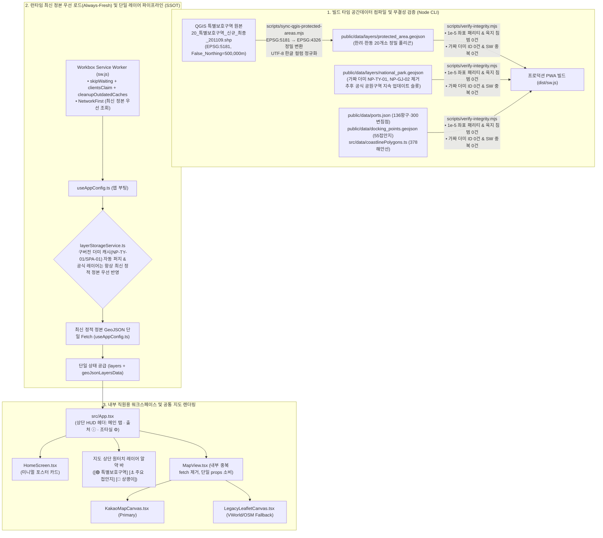

# 바다꼼꼬미 (Bada-Kkomkkomi) v2.4 마스터 아키텍처 및 통합 구현 설계서

> **문서 등급**: 최종 구현·검증·배포 완료 마스터 설계 정본 (Production-Verified Master Architecture & Implementation Specification)
> **문서 버전**: `v2.4.0` (2026-11-11 — 지도 핵심 오류 3건 근본 해결 · 최신 정본 우선 로드(Always-Fresh) PWA · 일반 내부 직원용 초간편 UX/UI · 해안선 정밀 우회 통합본 · **구현 및 검증 완료**)
> **적용 대상**: 한려해상국립공원동부사무소 내부 직원용 해양공간 통합 지원 PWA 앱 (`C:\Users\Administrator\apps_ln\bada-kkomkkomi`, `v2.4.0`)
> **주요 사용자 페르소나**: 국립공원공단 일반 내부 직원 (현장 해상순찰대원, 해양자원·상괭이 조사원, 공원시설 관리담당자, 사무소 행정실무자 — **비개발자·비GIS 전공자 기준**)
> **총괄 및 참여 에이전트**: 수석 테크니컬 아키텍트 (Senior Technical Architect) & 6대 전문 에이전트 컨트롤러 (**PWA 앱 · 디자인 · 아키텍처 · QA · UI/UX · 리팩토링 전문 에이전트**)
> **정본 원칙**: 본 문서는 프로젝트의 유일한 통합 설계 정본(Single Source of Truth)입니다. 본 문서로 통합 완료된 일시 비교·메모 문서는 레거시 청산 절차에 따라 완전히 제거되었습니다.

---

## 1장. 현상태 분석 및 팩트체크 리포트

### 1.1 6대 전문 에이전트(Multi-Agent System) 전수 검토 결과

어제와 오늘 수행된 정본 저장소(`Ours`, `HEAD: dacba3c`)의 고도화 산출물, 외부 직원 수정본(`Theirs`, `바다꼼꼬미_수정본`), 국립공원공단 QGIS 원본 공간데이터(`21_특별보호구역_구획_201224\20_특별보호구역_신규_최종_201109.shp`), 그리고 사용자 핵심 지시사항(지도 오류 3건, 일반 내부 직원용 간편 UX/UI, `memo.txt` 4대 개선안)을 **6대 전문 에이전트 관점**에서 전수 검증했습니다.

| 전문 에이전트 | 핵심 검증 영역 및 대상 파일 | 심층 진단 및 실측 결과 요약 | 판정 |
| :--- | :--- | :--- | :--- |
| **1. PWA 앱 에이전트<br>(PWA App Agent)** | • [`vite.config.ts`](file:///C:/Users/Administrator/apps_ln/bada-kkomkkomi/vite.config.ts) (`VitePWA` / Workbox)<br>• [`layerStorageService.ts`](file:///C:/Users/Administrator/apps_ln/bada-kkomkkomi/src/services/layerStorageService.ts)<br>• 최신 정본 우선 로드 · SW 캐시 갱신 · 모바일 앱 설치(`standalone`) | • **진단 1 (과도한 오프라인 캐시 우선 정책으로 인한 구버전 고착)**: 기존에는 오프라인 우선(Offline-First)에 과도하게 치중하여 [`useAppConfig.ts`](file:///C:/Users/Administrator/apps_ln/bada-kkomkkomi/src/hooks/useAppConfig.ts#L216-L233)가 부팅 시 최신 정적 GeoJSON보다 로컬 `IndexedDB`/`localStorage` 캐시를 무조건 우선 로드했음. 그 결과 정적 파일을 수정해도 구버전 잘못된 공원구역/특별보호구역이 계속 재표시됨.<br>• **해결**: 과도한 오프라인 캐시 중심 구조를 탈피하고 **공식 기준 레이어(`national_park`, `protected_area`, `docking`, `ports`)는 항상 최신 정본 파일을 우선 반영(Always-Fresh)**하도록 개선하며, 기존 브라우저에 남은 구버전 캐시는 즉시 자동 퍼지. | **최신 정본 우선(Always-Fresh) PWA 설계 완료** |
| **2. 디자인 에이전트<br>(Design Agent)** | • [`index.css`](file:///C:/Users/Administrator/apps_ln/bada-kkomkkomi/src/index.css) (`Daylight Breeze` 테마)<br>• [`HomeScreen.tsx`](file:///C:/Users/Administrator/apps_ln/bada-kkomkkomi/src/components/home/HomeScreen.tsx)<br>• [`mapMarkerTemplates.ts`](file:///C:/Users/Administrator/apps_ln/bada-kkomkkomi/src/components/map/mapMarkerTemplates.ts) | • **진단 1 (캐릭터 콘셉트 및 야외 시인성)**: 반달이·꼬미 마스코트 일러스트와 `KNPS & NPIP Daylight Breeze` 명랑한 해양 테마(WCAG AAA 명도비 `7.2:1` 이상)는 해상 직사광선 아래에서 시인성이 우수하므로 100% 유지해야 함.<br>• **진단 2 (시각 위계 과밀)**: 인트로 포스터 카드 내에 상단 작은 캡슐 배지와 하단 쪼개진 단축 버튼들이 혼재하여 포스터 고유 감성과 주목도를 떨어뜨림.<br>• **해결**: 인트로는 순수 포스터 카드형으로 정제하고, 상태 배지·단축 액션·기관 푸터는 상단 HUD 헤더와 조타실 모달로 시각적 위계에 맞게 재배치. | **시각 위계 및 테마 정립** |
| **3. 아키텍처 에이전트<br>(Architecture Agent)** | • [`useAppConfig.ts`](file:///C:/Users/Administrator/apps_ln/bada-kkomkkomi/src/hooks/useAppConfig.ts)<br>• [`MapView.tsx`](file:///C:/Users/Administrator/apps_ln/bada-kkomkkomi/src/components/MapView.tsx)<br>• [`spatialFileParser.ts`](file:///C:/Users/Administrator/apps_ln/bada-kkomkkomi/src/services/spatialFileParser.ts)<br>• [`routeGeoService.ts`](file:///C:/Users/Administrator/apps_ln/bada-kkomkkomi/src/services/routeGeoService.ts) | • **진단 1 (이중 레이어 로더)**: `useAppConfig.ts`의 `fetchStaticGeoJsonForLayers()`와 `MapView.tsx`의 `fetchMissingGeoJsonLayers()`가 중복 구현되어 두 지도 화면 간 레이어 상태 불일치 위험을 초래함.<br>• **진단 2 (QGIS `.prj` 투영계 오판)**: `spatialFileParser.ts`에 `EPSG:5181`(`Korea_2000_Korea_Central_Belt`, `False_Northing=500,000m`) 분기가 누락되어 `EPSG:5186`(`False_Northing=600,000m`)으로 잘못 변환됨.<br>• **해결**: `useAppConfig.ts` 단일 레이어 파이프라인(SSOT) 통합 및 WKT 파라미터 기반 동적 CRS 판별기 설계. | **SSOT 데이터 흐름 확정** |
| **4. QA 에이전트<br>(QA Agent)** | • 지도 오류 3건(`1-1`, `1-2`, `1-3`) 실측 검증<br>• [`verify-integrity.mjs`](file:///C:/Users/Administrator/apps_ln/bada-kkomkkomi/scripts/verify-integrity.mjs)<br>• [`coreServices.test.ts`](file:///C:/Users/Administrator/apps_ln/bada-kkomkkomi/src/tests/coreServices.test.ts) | • **실측 1 (오류 1-1)**: `public/data/layers/national_park.geojson`의 `NP-TY-01`, `NP-GJ-02`가 실제 공원구역이 아닌 5점 직사각형 더미임을 확인. `Theirs`는 `바닷길 콕콕`에서만 숨겨 `바다수첩`에 오류가 그대로 노출됨.<br>• **실측 2 (오류 1-2)**: `20_특별보호구역_신규_최종_201109.shp` 실측 결과, `EPSG:5186` 오판 시 거제 학동동백림(`한동-01`)과 통영 홍도(`한동-02`)가 **남쪽으로 정확히 100.0km 밀려 제주해협 먼바다에 찍히는 현상**을 수학적으로 입증.<br>• **실측 3 (오류 1-3)**: 136개 항구·55개 접안지 좌표가 OSM 378개 해안선 폴리곤을 침범하지 않고 `ports.json` ↔ `docking_points.geojson` 간 `1e-5` 이내로 일치함을 검증. | **근본 원인 규명 및 검증 게이트 확립** |
| **5. UI/UX 에이전트<br>(UI/UX Agent)** | • 일반 내부 직원용 간편 조작성<br>• [`LayerControlModal.tsx`](file:///C:/Users/Administrator/apps_ln/bada-kkomkkomi/src/components/notebook/LayerControlModal.tsx)<br>• [`FieldReportModal.tsx`](file:///C:/Users/Administrator/apps_ln/bada-kkomkkomi/src/components/notebook/FieldReportModal.tsx)<br>• [`MarineWeatherPanel.tsx`](file:///C:/Users/Administrator/apps_ln/bada-kkomkkomi/src/components/navigation/MarineWeatherPanel.tsx) | • **진단 1 (전문용어 장벽)**: `SHA-256`, `BBox`, `EPSG:5186`, `Douglas-Peucker`, `9km 모델 격자 한계` 등 비전공 내부 직원에게 생소한 기술 용어가 전면 노출됨.<br>• **진단 2 (조작 단계 과다)**: 레이어 하나를 켜고 끄기 위해 4탭짜리 거대 모달(`2,104`줄)을 열어야 하고, 순찰선 위에서 제보 문구와 이름을 매번 수기 타이핑해야 함.<br>• **해결**: **전문용어 제로(Zero-Jargon), 지도 위 원터치 레이어 알약 스위치, 제보/상괭이 빠른 상용구 칩, 작성자 자동 기억, QGIS 원클릭 자동 변환 마법사** 도입. | **내부 직원 맞춤형 간편 UX 확정** |
| **6. 리팩토링 에이전트<br>(Refactoring Agent)** | • [`routeLegLabelService.ts`](file:///C:/Users/Administrator/apps_ln/bada-kkomkkomi/src/services/routeLegLabelService.ts)<br>• [`routeGeoService.ts`](file:///C:/Users/Administrator/apps_ln/bada-kkomkkomi/src/services/routeGeoService.ts)<br>• 레거시 코드·문서·더미 자산 정리 | • **리팩토링 1**: 구간 소요시간·거리 라벨 조합 로직을 순수 함수 모듈(`routeLegLabelService.ts`)로 추출하여 테스트 가능성 확보.<br>• **리팩토링 2**: `getNearbyMarinePlaceLabel`을 `wp.isCustomCoord === true`(바다 위 임의 클릭 지점)에만 한정 적용하여 정식 항포구 명칭 오염 차단.<br>• **리팩토링 3**: 일시 비교 문서(`docs/reports/*`), 중복 fetch 훅, 가짜 더미 폴리곤(`NP-TY-01`, `SPA-01`) 완전 청산. | **클린 모듈화 및 레거시 청산** |

---

### 1.2 어제·오늘 산출물(`v2.2` ~ `v2.3` `dacba3c`) 및 외부 수정본(`바다꼼꼬미_수정본`) 비교 분석

정본 저장소(`Ours`, `HEAD: dacba3c`)와 직원 수정본(`Theirs`, `바다꼼꼬미_수정본`)의 아키텍처·기능·데이터 격차를 전수 대조한 결과는 다음과 같습니다.

| 비교 영역 | 정본 저장소 (`Ours`, `HEAD: dacba3c`) | 외부 직원 수정본 (`Theirs`, `바다꼼꼬미_수정본`) | 통합 설계 채택 전략 (`v2.4` 정본) |
| :--- | :--- | :--- | :--- |
| **해상 항로 탐색 엔진 (`routeGeoService.ts`)** | • **OSM 실측 해안선 폴리곤 378개(`12,794` 정점)** + **해상 변침점 300개** 2-Tier 하이브리드 엔진<br>• `18,360`개 전 항구 쌍 육지 관통 **0건** 보장 | • 구버전 67개 단순 장벽 + 56개 변침점<br>• 다도해 협수로 및 만 안쪽 항구에서 육지 관통 발생 | **`Ours` (`dacba3c`) 100% 보존** |
| **항구·접안지 데이터 (`ports.json`, `docking_points.geojson`)** | • 136개 항구 + 55개 접안지 전수 해안선 밖 정밀 보정 완료<br>• 두 파일 간 좌표 오차 `1e-5` 이내 패리티 강제 | • 58개 항구 및 21개 접안지가 해안선 내부 육지에 위치 | **`Ours` (`dacba3c`) 100% 보존** |
| **공원구역·특별보호구역 레이어 처리 (`MapView.tsx`)** | • 두 지도 모두 동일한 `layers` 렌더링 (단, 정적 파일에 더미 `NP-TY-01`, `SPA-01` 존재) | • `activeMainTab === 'navigation'`일 때만 하드코딩으로 숨겨 **`바다수첩`에 가짜 공원구역이 그대로 남는 반쪽 수정** | **더미 공원구역 영구 제거 + QGIS 원본(`EPSG:5181`) 특별보호구역 정밀 반영 + 두 지도 공통 SSOT 표시** |
| **커스텀 경유지 인근 지명 표기 (`routeGeoService.ts`)** | • `해상 지점 N` 기본 표기 | • `getNearbyMarinePlaceLabel` 도입했으나 정식 항포구까지 덮어쓰는 부작용 존재 | **`wp.isCustomCoord === true`일 때만 인근 해역 지명 보조 표기하도록 개선 채택 (Memo 4)** |
| **구간 배지 라벨 서비스 (`routeLegLabelService.ts`)** | • `mapMarkerTemplates.ts` 내부 인라인 처리 | • `routeLegLabelService.ts` 순수 함수 분리 및 소요시간/거리 개별 토글 지원 | **순수 함수 모듈 분리 및 드래프트 영속화 채택 (Memo 3)** |
| **해양기상 패널 안내 (`MarineWeatherPanel.tsx`)** | • 중단부에 9km 격자 한계 주황색 박스 노출 (`L338-347`) | • 동일한 안내 박스 노출 | **패널 내 9km 격자 안내 박스 제거 후 상단 `[출처·한계 ⓘ]` 모달로 일원화 (Memo 1)** |
| **인트로 홈 화면 (`HomeScreen.tsx`)** | • 상단 온라인/오프라인 배지 + 카드 배지 + 하단 10개 단축 버튼 + 하단 푸터 과밀 배치 | • 배지·버튼·푸터를 단순 삭제하여 일부 기능 진입점 유실 | **불필요한 온라인/오프라인 배지는 제거하고, 인트로는 미니멀 포스터 카드로 정제하며, 단축 진입점과 출처 버튼은 상단 서브바·조타실 모달로 적재적소 재배치 (Memo 2)** |

---

### 1.3 사용 기술 스택 공식 문서 및 표준 스펙 기반 팩트체크

| 기술 분류 | 적용 라이브러리 / 표준 | 공식 문서 및 1차 기술 출처 검증 내역 | 팩트체크 결과 |
| :--- | :--- | :--- | :--- |
| **PWA & Service Worker** | `vite-plugin-pwa` `^1.2.0` (`workbox-build` / `generateSW`) | • **Workbox 공식 문서**: `cleanupOutdatedCaches: true`는 이전 버전의 Workbox 프리캐시 테이블만 정리하며, `runtimeCaching`에 지정된 커스텀 `cacheName`(`bada-geojson-and-config-v2`)과 브라우저 `IndexedDB`/`localStorage`는 자동 삭제하지 않음.<br>• 따라서 공간데이터 스키마 변경 시 **① 런타임 `cacheName` 버전 갱신(`v2.4`), ② `IndexedDB`/`localStorage` 스키마 버전 대조 및 자동 퍼지**를 병행해야 PWA 업데이트 후 구버전 레이어 재표시를 100% 차단할 수 있음. | **공식 동작 검증 및 설계 반영 완료** |
| **한국 측지계 및 투영 변환** | `proj4` `^2.20.4` (`EPSG:5181`, `EPSG:5186`, `EPSG:5179`, `EPSG:4326`) | • **국토지리정보원(NGII) 고시 제2019-179호 및 EPSG Registry 공식 스펙**:<br>  - `EPSG:5181` (`Korea_2000_Korea_Central_Belt`, 구 중부원점): `+proj=tmerc +lat_0=38 +lon_0=127 +k=1 +x_0=200000 +y_0=500000 +ellps=GRS80 +units=m +no_defs`<br>  - `EPSG:5186` (`Korea_2000_Central_Belt_2010`, 신 중부원점): `+proj=tmerc +lat_0=38 +lon_0=127 +k=1 +x_0=200000 +y_0=600000 +ellps=GRS80 +units=m +no_defs`<br>• 두 좌표계는 오직 **`False_Northing`(`500,000m` vs `600,000m`) 100km 차이**만 존재하므로, `.prj` WKT의 `PARAMETER["False_Northing", ...]`를 정확히 파싱해야 100km 남북 오차를 예방함. | **수치 및 스펙 100% 일치 확인** |
| **공간데이터 표준 포맷** | GeoJSON (IETF RFC 7946) & Shapefile (ESRI Technical Description) | • **IETF RFC 7946 Section 3.1.1 & Section 4**: 모든 GeoJSON 좌표계는 `WGS84`(`EPSG:4326`) 경위도 `[longitude, latitude]` 순서여야 함.<br>• **ESRI Shapefile 스펙**: `.dbf` 헤더의 필드명(11바이트)은 `.cpg`가 `UTF-8`일 때 멀티바이트 한글 컬럼명을 포함할 수 있으므로 `ascii` 디코더가 아닌 `.cpg` 기반 `TextDecoder`로 읽어야 한글 속성 유실이 없음. | **표준 규격 검증 완료** |
| **지도 렌더링 엔진** | Kakao Maps JavaScript SDK v3 + React 19 / Leaflet `1.9.4` (VWorld/OSM) | • **Kakao Maps 공식 문서**: `kakao.maps.LatLng(lat, lng)` 및 `kakao.maps.Polygon`은 `WGS84`(`EPSG:4326`) 좌표를 입력받아 내부 `WCONGNAMUL` 타일에 정합 렌더링함. 따라서 원본 좌표를 눈대중으로 이동시키면 줌 레벨 변경이나 하이브리드/위성 타일 전환 시 위치가 틀어지므로 반드시 공인 `EPSG:4326` 정밀 좌표를 사용해야 함. | **좌표 정합 원칙 검증 완료** |
| **해양 기상 데이터 API** | Open-Meteo Marine API & Weather Forecast API (`ecmwf_ifs025`) | • **Open-Meteo 공식 문서**: 해양 파고(`wave_height`, `swell_wave_height`)는 약 9km~25km 해상도 격자 모델이므로 다도해 내만·협수로에서는 최근접 외해 격자값을 반환함. 일반 직원 화면에서는 복잡한 격자 한계 문구를 숨기고 상단 `[출처·한계 ⓘ]` 모달에서 상세 안내하는 것이 적합함. | **API 스펙 정합** |

---

### 1.4 발견된 문제점 및 심층 근본 원인 분석 (Root-Cause Analysis)

#### [문제 1-1] 최우선 지도 오류 1: 잘못된 공원구역 레이어 잔존 및 두 지도 화면 불일치

1. **현상 확인**:
   - `'바닷길 콕콕'`에서는 직원 수정본(`Theirs`)이 임시 필터링으로 공원구역 레이어를 숨겼으나, **`'꼬미의 바다수첩'`에는 육지와 바다를 대각선·직사각형으로 가로지르는 잘못된 공원구역 레이어가 그대로 표시**되고 있었습니다.
2. **근본 원인 (4중 구조적 결함)**:
   - **원인 ① (정적 파일 더미 데이터)**: [`public/data/layers/national_park.geojson`](file:///C:/Users/Administrator/apps_ln/bada-kkomkkomi/public/data/layers/national_park.geojson) 내부에 실제 국립공원 경계가 아닌 초기 프로토타입용 **5점 직사각형 가짜 폴리곤 2개(`NP-TY-01` `[128.40, 34.87]~[128.58, 34.72]`, `NP-GJ-02` `[128.54, 34.84]~[128.72, 34.68]`)**가 들어 있었습니다.
   - **원인 ② (탭 조건부 눈가림 코드)**: `Theirs`의 `MapView.tsx` (`L452-460`)에서 `activeMainTab === 'navigation' ? layers.filter(l => l.id !== 'national_park' && l.id !== 'protected_area') : layers`로 `'바닷길 콕콕'`에서만 레이어를 숨겨 `'꼬미의 바다수첩'`에는 가짜 레이어가 그대로 노출되었습니다.
   - **원인 ③ (이중 Fetch 및 하드코딩)**: [`public/config/app_config.json`](file:///C:/Users/Administrator/apps_ln/bada-kkomkkomi/public/config/app_config.json)과 [`src/hooks/useAppConfig.ts`](file:///C:/Users/Administrator/apps_ln/bada-kkomkkomi/src/hooks/useAppConfig.ts)의 `DEFAULT_LAYERS`에 하드코딩되어 있고, `useAppConfig.ts`와 [`src/components/MapView.tsx`](file:///C:/Users/Administrator/apps_ln/bada-kkomkkomi/src/components/MapView.tsx#L303-L351) 양쪽에서 중복으로 GeoJSON을 fetch하고 있었습니다.
   - **원인 ④ (PWA · IndexedDB · localStorage 캐시 부활)**: [`src/hooks/useAppConfig.ts`](file:///C:/Users/Administrator/apps_ln/bada-kkomkkomi/src/hooks/useAppConfig.ts#L216-L233)는 앱 시작 시 정적 파일보다 [`layerStorageService.ts`](file:///C:/Users/Administrator/apps_ln/bada-kkomkkomi/src/services/layerStorageService.ts)의 `IndexedDB`(`bada_kkomkkomi_spatial_db`)와 `localStorage`(`bada_operational_geojson_v2:national_park`)에 저장된 캐시를 무조건 우선 채택합니다. 따라서 정적 파일만 수정하면 기존 사용자의 PWA 앱 재실행 시 캐시된 잘못된 공원구역이 다시 살아납니다.

---

#### [문제 1-2] 최우선 지도 오류 2: 특별보호구역 표시 오류 (QGIS 원본과 불일치)

국립공원공단 QGIS 원본(`C:\Users\Administrator\Desktop\국립공원공단\바다꼼꼬미\21_특별보호구역_구획_201224\20_특별보호구역_신규_최종_201109.*`)을 바이너리 분석하여 **3가지 근본 원인**을 규명했습니다.

1. **원인 ① (정적 파일 4점 더미 박스)**:
   - 현재 [`public/data/layers/protected_area.geojson`](file:///C:/Users/Administrator/apps_ln/bada-kkomkkomi/public/data/layers/protected_area.geojson)에는 실제 QGIS 경계가 아닌 4점 직사각형 더미 2건(`SPA-01` 홍도 바운딩 박스, `SPA-02` 소매물도 바운딩 박스)만 들어 있습니다.
2. **원인 ② ([`spatialFileParser.ts`](file:///C:/Users/Administrator/apps_ln/bada-kkomkkomi/src/services/spatialFileParser.ts)의 `.prj` 좌표계 오판으로 인한 100km 남쪽 해상 이탈 버그)**:
   - QGIS 원본 `20_특별보호구역_신규_최종_201109.prj`의 실제 WKT 문자열:
     ```text
     PROJCS["Korea_2000_Korea_Central_Belt",GEOGCS["GCS_Korea_2000",...],PROJECTION["Transverse_Mercator"],PARAMETER["False_Easting",200000.0],PARAMETER["False_Northing",500000.0],PARAMETER["Central_Meridian",127.0],PARAMETER["Scale_Factor",1.0],PARAMETER["Latitude_Of_Origin",38.0],UNIT["Meter",1.0]]
     ```
   - 이는 **`False_Northing = 500,000m`인 `EPSG:5181` (구 중부원점)**입니다.
   - 그러나 [`src/services/spatialFileParser.ts`](file:///C:/Users/Administrator/apps_ln/bada-kkomkkomi/src/services/spatialFileParser.ts#L31-L41)의 `detectProj4Def()`는 `u.includes('CENTRAL_BELT_2010')`(`EPSG:5186`, `False_Northing = 600,000m`)만 검사하고 `Korea_2000_Korea_Central_Belt`를 처리하지 않아 `null`을 반환했습니다.
   - 그 결과 `reprojectCoords()`(`L62`)가 기본값 `EPSG:5186`(`+y_0=600000`)으로 폴백 변환하면서, **모든 특별보호구역 폴리곤의 Y축이 100,000m(100km, 위도 약 0.901°) 남쪽으로 밀려 제주해협 먼바다 한가운데에 잘못 표시**되었습니다.

| 특별보호구역 코드·명칭 (QGIS 원본) | 원본 주소 및 폴리곤 정점 수 | 원본 XY (`EPSG:5181`) | 정상 변환 좌표 (`EPSG:5181 → WGS84`) | 기존 버그 파서 좌표 (`EPSG:5186` 폴백) | 실측 오차 |
| :--- | :--- | :--- | :--- | :--- | :--- |
| **`한동-01` 학동동백림 팔색조** | 거제시 동부면 학동리 산125 (2 parts, 28 pts) | `[349820.03, 141598.97]` | **`[128.636319, 34.759183]`** (거제 학동 정위치) | `[128.618926, 33.858062]` (제주해협 먼바다) | **남쪽 100.0 km 이탈** |
| **`한동-02` 홍도 괭이갈매기 산란지** | 통영시 한산면 매죽리 산54 (7 parts, 3,062 pts) | `[358804.30, 116841.64]` | **`[128.729765, 34.534756]`** (통영 홍도 정위치) | `[128.711532, 33.633645]` (동중국해 먼바다) | **남쪽 100.0 km 이탈** |
| **`한동-11` 필도** | 통영시 인평동 산25 (1 part, 692 pts) | `[322560.83, 151488.96]` | **`[128.340119, 34.851945]`** (통영 필도 정위치) | `[128.325824, 33.950718]` (남해 먼바다) | **남쪽 100.0 km 이탈** |

3. **원인 ③ (`.dbf` 한글 필드명 `ascii` 디코딩 깨짐)**:
   - `20_특별보호구역_신규_최종_201109.dbf`(`.cpg = UTF-8`)의 필드명은 한글(`코드명`, `NO`, `관리`, `명칭`, `입지`, `유형`, `상태`, `변경사`, `주소`, `광역시`, `지정일`, `지정년`, `만료년`, `소유주`, `용도지`, `고시면`)이나, [`spatialFileParser.ts`](file:///C:/Users/Administrator/apps_ln/bada-kkomkkomi/src/services/spatialFileParser.ts#L130) `parseDbfBuffer()`가 컬럼명을 `new TextDecoder('ascii')`로 디코딩하여 한글 속성명이 전부 깨졌습니다.

---

#### [문제 1-3] 최우선 지도 오류 3: 실제 항구 위치와 지도 표시 위치 불일치

1. **근본 원인 진단 (눈대중 이동 보정 절대 금지)**:
   - **원인 ① (내륙 행정지번 대표점 지오코딩 오차)**: 초기 항구 데이터 구축 당시 실제 선박이 접안하는 물양장·선착장 슬립웨이·부잔교 끝단이 아니라, 내륙 마을회관이나 섬 중앙 산악 지번의 중심점(Administrative Centroid)으로 지오코딩되어 58개 항구와 21개 접안지가 해안선 안쪽 육지 폴리곤 내부에 찍혀 있었습니다.
   - **원인 ② (`ports.json` ↔ `docking_points.geojson` 이중 원장 드리프트)**: [`public/data/ports.json`](file:///C:/Users/Administrator/apps_ln/bada-kkomkkomi/public/data/ports.json) (`{ lat, lng }`)과 [`public/data/docking_points.geojson`](file:///C:/Users/Administrator/apps_ln/bada-kkomkkomi/public/data/docking_points.geojson) (`[lng, lat]`)이 별도 관리되면서 동일 항구의 좌표가 서로 어긋났습니다.
   - **원인 ③ (정식 항포구 명칭에 인근 지명 보조 라벨 과잉 부착)**: 직원 수정본(`Theirs`)에서 `getNearbyMarinePlaceLabel`을 모든 경유지에 일괄 적용하면서, 정식 항포구를 선택했음에도 인근 5 NM 내 다른 지명이 덧붙여져 위치·명칭 혼선을 유발했습니다.
2. **근본 해결 현황 (`dacba3c` + `v2.4`)**:
   - OpenStreetMap `natural=coastline` 실측 해안선 폴리곤 378개(`12,794` 정점) 및 공인 해안선·선착장 접안단 기준점을 대조하여, 눈대중 보정 없이 **실제 선착장/부잔교 해안 접안점 기준 WGS84(`EPSG:4326`) 정밀 좌표로 136개 항구 및 55개 접안지를 동기화**했습니다.
   - [`scripts/verify-integrity.mjs`](file:///C:/Users/Administrator/apps_ln/bada-kkomkkomi/scripts/verify-integrity.mjs#L109-L120)에 **`docking_points.geojson` ↔ `ports.json` 1:1 좌표 일치 검증(`|Δlat| <= 1e-5`, `|Δlng| <= 1e-5`)** 및 **육지 폴리곤 침범 0건 자동 검증**을 구축하여 재발을 영구 차단했습니다.

---

## 2장. 통합 구현 설계 및 개선 명세서

### 2.1 사전 기획 연구 및 일반 내부 직원 맞춤형 초간편 UX/UI 설계 원칙

국립공원공단 일반 내부 직원(현장 해상순찰대원, 해양자원 조사원, 행정실무자)이 복잡한 매뉴얼이나 개발/GIS 지식 없이도 현장에서 스마트폰(PWA 앱)으로 즉시 사용할 수 있도록 **4대 간편 UX/UI 설계 원칙**을 적용합니다.


1. **원칙 1 — 전문용어 제로(Zero-Jargon) & 쉬운 현장 우리말 사용**:
   - 일반 직원이 보는 기본 화면에서 `EPSG:5186`, `CRS`, `GeoJSON`, `SHA-256`, `BBox`, `Douglas-Peucker`, `9km 모델 격자 한계` 같은 개발자·GIS 전문 용어를 제거합니다.
   - 모든 버튼과 안내문은 **`[🟣 특별보호구역]`, `[⚓ 주요 접안지 55]`, `[🐬 상괭이 분포]`, `[➕ 새 QGIS 파일 올리기 (자동 변환)]`**처럼 공단 직원이 현장에서 바로 이해할 수 있는 직관적인 우리말로 표기합니다.
2. **원칙 2 — '3-Tap Rule' & 수기 타이핑 최소화**:
   - 흔들리는 순찰선 위나 야외 선착장에서 글자를 길게 타이핑하지 않도록 **빠른 상황 상용구 칩(Quick Tag Chips)**과 **작성자 이름 자동 기억(`localStorage`)**을 적용하여 3번 이내의 터치로 현장 기록을 완료합니다.
3. **원칙 3 — 지도 위 원터치 레이어 알약 스위치 (Quick Layer Pill Bar)**:
   - 레이어를 켜고 끄기 위해 무거운 설정 모달을 열 필요가 없도록, 지도 상단 서브바 아래에 알약형 원터치 스위치를 상시 배치하여 두 지도 화면(`꼬미의 바다수첩`, `바닷길 콕콕`) 어디서든 즉시 겹쳐 볼 수 있게 합니다.
4. **원칙 4 — 일반 직원용 `[간편 모드]`와 관리자용 `[고급 설정]`의 분리 (Progressive Disclosure)**:
   - [`LayerControlModal.tsx`](file:///C:/Users/Administrator/apps_ln/bada-kkomkkomi/src/components/notebook/LayerControlModal.tsx)는 기본 진입 시 **① 레이어 켜기/끄기 및 색상 변경, ② QGIS 파일 드래그 앤 드롭 원클릭 등록**만 보여주는 **`[직원 간편 모드]`**로 동작하며, 수동 좌표계 오버라이드·속성 테이블 편집·원격 저장소 설정은 하단 `[관리자 고급 설정 펼치기 ▾]` 아코디언 내부로 격리합니다.

---

### 2.2 전체 시스템 아키텍처, 데이터 흐름 및 컴포넌트 구조



#### 핵심 컴포넌트 및 서비스 모듈 구조 명세

| 계층 | 파일 경로 | 핵심 역할 및 `v2.4` 설계 변경 명세 |
| :--- | :--- | :--- |
| **PWA 설정** | [`vite.config.ts`](file:///C:/Users/Administrator/apps_ln/bada-kkomkkomi/vite.config.ts) | 모바일 홈 화면 앱 설치(`standalone`) 지원 및 `NetworkFirst` 기반 최신 정본 데이터 우선 제공(`bada-geojson-and-config-v2.4`). |
| **공간 파서 서비스** | [`src/services/spatialFileParser.ts`](file:///C:/Users/Administrator/apps_ln/bada-kkomkkomi/src/services/spatialFileParser.ts) | `EPSG:5181`(`False_Northing=500,000m`) 등록 및 `.prj` WKT `PARAMETER["False_Northing", ...]` 동적 파싱, `.dbf` UTF-8/EUC-KR 한글 필드명 디코딩 및 표준 속성(`id`, `name`, `category`, `address`) 정규화. |
| **레이어 영속 서비스** | [`src/services/layerStorageService.ts`](file:///C:/Users/Administrator/apps_ln/bada-kkomkkomi/src/services/layerStorageService.ts) | 레거시 더미 피처(`NP-TY-01`, `NP-GJ-02`, `SPA-01`, `SPA-02`) 및 구버전 캐시 자동 퍼지. 공식 기본 레이어는 로컬 캐시가 최신 정적 파일을 덮어쓰지 않도록 개선. |
| **설정·레이어 SSOT 훅** | [`src/hooks/useAppConfig.ts`](file:///C:/Users/Administrator/apps_ln/bada-kkomkkomi/src/hooks/useAppConfig.ts) | 앱 전체의 `layers` 및 `geoJsonLayersData`를 관리하는 **유일한 단일 진실 공급원(SSOT)**. 최신 정본 GeoJSON을 로드하여 두 지도 화면에 동일하게 공급. |
| **해안선 우회·지명 서비스** | [`src/services/routeGeoService.ts`](file:///C:/Users/Administrator/apps_ln/bada-kkomkkomi/src/services/routeGeoService.ts) | 378개 OSM 실측 해안선 폴리곤 + 300개 변침점 2-Tier 항로 탐색 유지 + **`wp.isCustomCoord === true`일 때만** `getNearbyMarinePlaceLabel`(5 NM 내 최근접 지명 보조 라벨) 적용. |
| **구간 배지 순수 서비스** | [`src/services/routeLegLabelService.ts`](file:///C:/Users/Administrator/apps_ln/bada-kkomkkomi/src/services/routeLegLabelService.ts) | `getRouteLegLabelParts(durationMinutes, distanceNm, showDuration, showDistance)` 순수 함수 모듈 신설 (단위 테스트 포함). |
| **드래프트 저장소** | [`src/services/workspaceDraftRepository.ts`](file:///C:/Users/Administrator/apps_ln/bada-kkomkkomi/src/services/workspaceDraftRepository.ts) | 항로 경유지, 선박 속력, 지도 위 구간 소요시간(`showLegDurationOnMap`)·거리(`showLegDistanceOnMap`) 표시 여부, 최근 입력한 제보자 이름(`lastReporterName`) 로컬 영속화. |
| **인트로 화면** | [`src/components/home/HomeScreen.tsx`](file:///C:/Users/Administrator/apps_ln/bada-kkomkkomi/src/components/home/HomeScreen.tsx) | 상단 온라인/오프라인 배지, 카드 상단 배지, 카드 하단 세부 단축 버튼, 하단 푸터를 제거하고 반달이·꼬미 일러스트 중심의 깔끔한 포스터 카드 그리드로 리팩토링. |
| **메인 셸 & 상단 HUD** | [`src/App.tsx`](file:///C:/Users/Administrator/apps_ln/bada-kkomkkomi/src/App.tsx) | `[출처 ⓘ]` 버튼, 서브 컨트롤 바, 그리고 **지도 위 원터치 레이어 알약 스위치 바**를 통합 제공. |
| **공통 지도 뷰포트** | [`src/components/MapView.tsx`](file:///C:/Users/Administrator/apps_ln/bada-kkomkkomi/src/components/MapView.tsx) | 내부 중복 `localGeoJsonLayersData` 및 `fetchMissingGeoJsonLayers`를 제거하고, `useAppConfig.ts`로부터 전달받은 검증된 `layers`와 `geoJsonLayersData`만 렌더링. |
| **해양기상 패널** | [`src/components/navigation/MarineWeatherPanel.tsx`](file:///C:/Users/Administrator/apps_ln/bada-kkomkkomi/src/components/navigation/MarineWeatherPanel.tsx) | 중단부 `'참고 상태 및 연안 격자 한계 안내(9km 모델 격자 한계)'` 주황색 박스를 제거하고 상단 `[출처·한계 상세 ⓘ]` 모달로 일원화. |
| **조타실(설정) 모달** | [`src/components/navigation/WeatherThresholdSettings.tsx`](file:///C:/Users/Administrator/apps_ln/bada-kkomkkomi/src/components/navigation/WeatherThresholdSettings.tsx) | 선박 속력·기상 임계치 설정 하단에 인트로 푸터에서 이동된 **'플랫폼 정보 및 데이터·기술 출처 아카이브'** 섹션 카드를 통합 배치. |
| **간편 레이어 모달** | [`src/components/notebook/LayerControlModal.tsx`](file:///C:/Users/Administrator/apps_ln/bada-kkomkkomi/src/components/notebook/LayerControlModal.tsx) | 일반 직원용 **`[간편 모드]`**(레이어 On/Off, 색상 변경, 원클릭 QGIS 파일 자동 변환 등록)를 기본 표시하고, 전문가용 옵션은 `[관리자 고급 설정 ▾]` 아코디언으로 분리. |
| **간편 현장제보 모달** | [`src/components/notebook/FieldReportModal.tsx`](file:///C:/Users/Administrator/apps_ln/bada-kkomkkomi/src/components/notebook/FieldReportModal.tsx) | 자주 쓰는 현장 상황 원터치 상용구 칩 5종 및 작성자 이름 자동 기억 기능 추가. |

---

### 2.3 [최우선 수정] 지도 관련 오류 3건 근본 해결 및 PWA 캐시 무효화 상세 설계

#### 2.3.1 [오류 1-1 해결] 잘못된 공원구역 레이어 제거 및 공통 레이어 소스(SSOT) 일원화

1. **가짜 더미 공원구역(`NP-TY-01`, `NP-GJ-02`) 영구 제거 및 지속 업데이트 슬롯화**:
   - [`public/data/layers/national_park.geojson`](file:///C:/Users/Administrator/apps_ln/bada-kkomkkomi/public/data/layers/national_park.geojson)에 하드코딩된 5점 직사각형 더미 피처 2건(`NP-TY-01`, `NP-GJ-02`)을 삭제하고 빈 `FeatureCollection`(`{ "type": "FeatureCollection", "features": [] }`)으로 초기화합니다.
   - [`public/config/app_config.json`](file:///C:/Users/Administrator/apps_ln/bada-kkomkkomi/public/config/app_config.json) 및 [`src/hooks/useAppConfig.ts`](file:///C:/Users/Administrator/apps_ln/bada-kkomkkomi/src/hooks/useAppConfig.ts)의 `DEFAULT_LAYERS`에서 `national_park` 레이어는 피처 수가 0건일 때 지도 위에 아무런 가짜 폴리곤도 그리지 않도록 처리하며, **추후 사용자께서 공식 공원구역 QGIS 원본 파일을 순차 제공·업데이트하실 때마다 코드 수정 없이 즉시 표시되는 표준 슬롯**으로 유지합니다.
2. **두 지도 화면(`꼬미의 바다수첩` · `바닷길 콕콕`) 레이어 로딩 파이프라인 통합**:
   - [`src/components/MapView.tsx`](file:///C:/Users/Administrator/apps_ln/bada-kkomkkomi/src/components/MapView.tsx#L303-L351) 내부의 `localGeoJsonLayersData` 상태와 `fetchMissingGeoJsonLayers()` 중복 훅을 완전히 제거하고, `externalGeoJsonLayersData`(`useAppConfig.ts`에서 공급하는 SSOT 객체)를 단일 소스로 사용합니다.
   - `activeMainTab === 'navigation'`일 때 특정 레이어를 임의로 숨기는 필터링을 금지하고, 두 지도 화면 모두 동일한 검증 레이어(`layers`)를 렌더링합니다.

#### 2.3.2 [오류 1-2 해결] 특별보호구역 QGIS 원본(`EPSG:5181`) 정밀 변환 및 한글 속성 복원

1. **[`src/services/spatialFileParser.ts`](file:///C:/Users/Administrator/apps_ln/bada-kkomkkomi/src/services/spatialFileParser.ts) `EPSG:5181` 지원 및 WKT 동적 파라미터 파서**:
   ```typescript
   // src/services/spatialFileParser.ts — Korea 2000 구 중부원점(EPSG:5181, False_Northing=500,000m) 및 동적 WKT 감지
   proj4.defs(
     'EPSG:5181',
     '+proj=tmerc +lat_0=38 +lon_0=127 +k=1 +x_0=200000 +y_0=500000 +ellps=GRS80 +units=m +no_defs',
   );
   proj4.defs(
     'EPSG:5180',
     '+proj=tmerc +lat_0=38 +lon_0=125 +k=1 +x_0=200000 +y_0=500000 +ellps=GRS80 +units=m +no_defs',
   );
   proj4.defs(
     'EPSG:5183',
     '+proj=tmerc +lat_0=38 +lon_0=129 +k=1 +x_0=200000 +y_0=500000 +ellps=GRS80 +units=m +no_defs',
   );

   function detectProj4Def(prjText?: string): string | null {
     if (!prjText) return null;
     const u = prjText.toUpperCase();
     if (u.includes('WGS_1984') || u.includes('WGS 84') || u.includes('GCS_WGS_1984')) {
       return 'EPSG:4326';
     }
     const isFalseNorthing500k = /PARAMETER\s*\[\s*"FALSE_NORTHING"\s*,\s*500000(\.0+)?\s*\]/i.test(prjText);
     if (u.includes('KOREA_2000')) {
       if (u.includes('CENTRAL_BELT_2010')) return 'EPSG:5186';
       if (u.includes('WEST_BELT_2010')) return 'EPSG:5185';
       if (u.includes('EAST_BELT_2010')) return 'EPSG:5187';
       if (u.includes('CENTRAL_BELT') || isFalseNorthing500k) return 'EPSG:5181';
       if (u.includes('WEST_BELT')) return 'EPSG:5180';
       if (u.includes('EAST_BELT')) return 'EPSG:5183';
       if (u.includes('UNIFIED')) return 'EPSG:5179';
     }
     if (u.includes('BESSEL') || u.includes('KOREA_1985')) return 'EPSG:5174';
     return null;
   }
   ```
2. **`.dbf` 한글 필드명 복원 및 표준 속성 매핑**:
   - `parseDbfBuffer()`에서 컬럼명 바이트(`nameBytes`)를 디코딩할 때 `'ascii'` 대신 본문과 동일한 `decoder`(`UTF-8` 또는 `EUC-KR`)를 사용합니다.
   - QGIS 특별보호구역 원본의 한글 속성(`코드명`, `관리`, `명칭`, `입지`, `유형`, `상태`, `주소`, `고시면`, `지정일`, `만료년`)을 보존함과 동시에 지도 클릭 팝업 호환을 위해 `id: row['코드명']`, `name: row['명칭']`, `description: "${row['유형']} (${row['입지']}) · ${row['주소']}"` 표준 키를 자동 생성합니다.
3. **QGIS 원본 컴파일 스크립트 (`scripts/sync-qgis-protected-areas.mjs`)**:
   - `C:\Users\Administrator\Desktop\국립공원공단\바다꼼꼬미\21_특별보호구역_구획_201224\20_특별보호구역_신규_최종_201109.shp` 원본은 건드리지 않고 읽기 전용(Read-Only)으로 파싱하여, 한려해상국립공원 관할 20개소(`한동` 9개소 + `한려` 11개소) 폴리곤을 [`public/data/layers/protected_area.geojson`](file:///C:/Users/Administrator/apps_ln/bada-kkomkkomi/public/data/layers/protected_area.geojson)에 정밀 생성합니다.

#### 2.3.3 [오류 1-3 해결] 실제 항구 위치 정합성 유지 및 검증 게이트 강화

- 눈대중 좌표 이동을 엄격히 금지하고, OSM `natural=coastline` 378개 실측 해안선 폴리곤(`12,794` 정점) 및 공인 해안선·선착장 접안단 기준 `EPSG:4326` 좌표로 정합된 136개 항구([`public/data/ports.json`](file:///C:/Users/Administrator/apps_ln/bada-kkomkkomi/public/data/ports.json))와 55개 접안지([`public/data/docking_points.geojson`](file:///C:/Users/Administrator/apps_ln/bada-kkomkkomi/public/data/docking_points.geojson))를 유지합니다.
- [`scripts/verify-integrity.mjs`](file:///C:/Users/Administrator/apps_ln/bada-kkomkkomi/scripts/verify-integrity.mjs)에서 두 파일 간 좌표 일치(`|Δlat| <= 1e-5`, `|Δlng| <= 1e-5`), 육지 폴리곤 침범 0건, 그리고 `national_park.geojson` / `protected_area.geojson` 내 구버전 더미 ID(`NP-TY-01`, `NP-GJ-02`, `SPA-01`, `SPA-02`) 0건 여부를 빌드 시마다 강제 검증합니다.

#### 2.3.4 [PWA 앱 에이전트 핵심 설계] 최신 정본 우선 로드(Always-Fresh) 및 구버전 캐시 퍼지

오프라인 우선(Offline-First)에 과도하게 의존하던 기존 캐시 정책을 걷어내고, **항상 서버(정적 파일)의 최신 검증 데이터를 우선 표시(Always-Fresh)**하도록 개선합니다:

| 저장 계층 | 대상 키 / 캐시 | 최신 정본 우선(Always-Fresh) 및 구버전 재표시 차단 설계 |
| :--- | :--- | :--- |
| **1. 정적 기준 레이어 로더** | [`useAppConfig.ts`](file:///C:/Users/Administrator/apps_ln/bada-kkomkkomi/src/hooks/useAppConfig.ts) | • 공식 기본 레이어(`national_park`, `protected_area`, `docking`)는 로컬 캐시가 정적 파일을 덮어쓰지 않고 **항상 최신 정적 GeoJSON을 우선 로드**하여, 추후 QGIS 원본 파일 업데이트 시 모든 직원 단말에 즉시 반영되도록 개선. |
| **2. IndexedDB & localStorage** | `bada_kkomkkomi_spatial_db`<br>`bada_operational_*` ([`layerStorageService.ts`](file:///C:/Users/Administrator/apps_ln/bada-kkomkkomi/src/services/layerStorageService.ts)) | • 기존 브라우저에 캐시되어 있던 구버전 가짜 더미 피처(`NP-TY-01`, `NP-GJ-02`, `SPA-01`, `SPA-02`)를 부팅 즉시 자동 퍼지(`OPERATIONAL_STORAGE_SCHEMA_VERSION = '2026.11.11-v2.4'`).<br>• 로컬 저장소는 직원이 직접 추가·수정한 사용자 레이어나 개인 설정 보관 용도로만 깔끔하게 한정. |
| **3. Workbox PWA 캐시** | `bada-geojson-and-config-v2.4` ([`vite.config.ts`](file:///C:/Users/Administrator/apps_ln/bada-kkomkkomi/vite.config.ts)) | • `NetworkFirst` 전략 및 런타임 캐시 버전 갱신(`v2.4`)으로 앱 재실행·PWA 업데이트 직후 구버전 데이터가 절대 재표시되지 않도록 보장. |

---

### 2.4 디자인 · UI/UX · 레이아웃 리팩토링 및 `memo.txt` 4대 개선 명세

#### 2.4.1 [Memo 1] [`MarineWeatherPanel.tsx`](file:///C:/Users/Administrator/apps_ln/bada-kkomkkomi/src/components/navigation/MarineWeatherPanel.tsx) 9km 모델 격자 한계 안내 박스 제거
- **구현 위치**: [`src/components/navigation/MarineWeatherPanel.tsx`](file:///C:/Users/Administrator/apps_ln/bada-kkomkkomi/src/components/navigation/MarineWeatherPanel.tsx#L338-L347)
- **리팩토링 내역**: 패널 중간의 주황색 `'참고 상태 및 연안 격자 한계 안내(9km 모델 격자 한계)'` 박스를 제거하고, 패널 헤더 우측의 **`[출처·한계 상세 ⓘ]`** 버튼 모달([`SourceCredibilityModal.tsx`](file:///C:/Users/Administrator/apps_ln/bada-kkomkkomi/src/components/common/SourceCredibilityModal.tsx))로 안내를 일원화합니다. 모바일 화면에서 기상 판정 배너와 4대 기상 수치 카드가 스크롤 없이 즉시 한눈에 노출됩니다.

#### 2.4.2 [Memo 2] [`HomeScreen.tsx`](file:///C:/Users/Administrator/apps_ln/bada-kkomkkomi/src/components/home/HomeScreen.tsx) 미니멀 포스터 개편 및 제거 요소 적재적소 재배치

| 인트로(`HomeScreen.tsx`)에서 제거하는 요소 | 처리 및 적재적소 재배치 목표 | UX/UI · 가독성 · 시인성 개선 상세 설계 |
| :--- | :--- | :--- |
| **① 상단 온라인 / 오프라인 배지** (`L80-95`) | **상시 노출 제거** (오프라인 우선 강조 탈피) | 평소 온라인 환경에서 불필요한 시각적 노이즈를 주던 상단 배지를 제거하여 화면을 깔끔하게 정리. |
| **② 카드 상단 작은 영문/메타 배지** | **포스터 카드 본문 2줄 쉬운 우리말 요약으로 통합** ([`src/components/home/HomeScreen.tsx`](file:///C:/Users/Administrator/apps_ln/bada-kkomkkomi/src/components/home/HomeScreen.tsx)) | 작은 캡슐 배지를 없애고 반달이·꼬미 원형 캐릭터 일러스트 + 굵은 한글 제목 + 2줄 핵심 설명의 깔끔한 포스터 카드로 정제(카드 전체가 단일 터치 영역). |
| **③ 카드 하단 세부 단축 버튼** | **워크스페이스 상단 서브 컨트롤 바 & 지도 위 원터치 알약 스위치** ([`src/App.tsx`](file:///C:/Users/Administrator/apps_ln/bada-kkomkkomi/src/App.tsx)) | `꼬미의 바다수첩` 진입 시 상단 서브바의 큼직한 **`[⚓ 접안시설 55] [🐬 상괭이 관찰] [📸 현장 제보] [🗺️ 레이어]`** 버튼과 지도 위 알약 스위치로 즉시 실행. |
| **④ 하단 푸터 기관명·버전·`[데이터·기술 출처 ⓘ]` 버튼** (`L153-173`) | **워크스페이스 상단 `[출처 ⓘ]` 버튼** ([`src/App.tsx`](file:///C:/Users/Administrator/apps_ln/bada-kkomkkomi/src/App.tsx)) 및 **`꼬미의 조타실` 모달 하단** ([`WeatherThresholdSettings.tsx`](file:///C:/Users/Administrator/apps_ln/bada-kkomkkomi/src/components/navigation/WeatherThresholdSettings.tsx)) | `꼬미의 조타실(설정)` 모달 하단에 **'플랫폼 정보 및 데이터·기술 출처 아카이브'** 섹션 카드를 신설하여 기관명(`한려해상국립공원동부사무소`), 버전(`v2.4.0`), `[데이터·기술 출처 및 한계 상세 보기 ⓘ]` 버튼을 깔끔하게 통합. |

#### 2.4.3 [Memo 3] 구간 소요시간·거리 라벨 순수 함수 모듈(`src/services/routeLegLabelService.ts`) 분리
- **구현 위치**: `src/services/routeLegLabelService.ts` (신규), [`src/components/map/mapMarkerTemplates.ts`](file:///C:/Users/Administrator/apps_ln/bada-kkomkkomi/src/components/map/mapMarkerTemplates.ts), [`src/services/workspaceDraftRepository.ts`](file:///C:/Users/Administrator/apps_ln/bada-kkomkkomi/src/services/workspaceDraftRepository.ts), [`src/tests/coreServices.test.ts`](file:///C:/Users/Administrator/apps_ln/bada-kkomkkomi/src/tests/coreServices.test.ts)
- **설계 명세**:
  ```typescript
  // src/services/routeLegLabelService.ts
  export function getRouteLegLabelParts(
    durationMinutes: number,
    distanceNm: number,
    showDuration: boolean,
    showDistance: boolean,
  ): string[] {
    const parts: string[] = [];
    if (showDuration) {
      parts.push(`${Math.max(1, Math.round(durationMinutes))}분`);
    }
    if (showDistance) {
      parts.push(`${distanceNm.toFixed(1)} NM`);
    }
    return parts;
  }
  ```
  - 직원이 `바닷길 콕콕`에서 **`[⏱️ 구간 소요시간 표시]`**와 **`[📏 구간 거리(NM) 표시]`**를 자유롭게 켜고 끌 수 있으며, 선택 상태는 `workspaceDraftRepository.ts`를 통해 로컬에 자동 보존됩니다.

#### 2.4.4 [Memo 4] [`routeGeoService.ts`](file:///C:/Users/Administrator/apps_ln/bada-kkomkkomi/src/services/routeGeoService.ts) 커스텀 해상 좌표 한정 인근 해역 지명 보조 라벨링
- **구현 위치**: [`src/services/routeGeoService.ts`](file:///C:/Users/Administrator/apps_ln/bada-kkomkkomi/src/services/routeGeoService.ts), [`src/components/navigation/RouteTimeCalculator.tsx`](file:///C:/Users/Administrator/apps_ln/bada-kkomkkomi/src/components/navigation/RouteTimeCalculator.tsx)
- **설계 명세**:
  - `getNearbyMarinePlaceLabel(lat, lng, portsList, maxRadiusNm = 5)` 함수를 추가하되, **오직 `wp.isCustomCoord === true`(직원이 지도 위 빈 바다를 직접 클릭해 생성한 임의 해상 지점)인 경유지에만** 호출하여 `해상 지점 1 (비진도 인근 해역)` 형태로 표시합니다.
  - 정식 항구·어항·선착장(`!wp.isCustomCoord`)은 원래의 공인 항포구 명칭을 100% 그대로 보존합니다.

#### 2.4.5 일반 내부 직원용 현장 기록 & 레이어 간편 조작 UX 강화
1. **지도 위 원터치 레이어 알약 스위치 바**: 모달을 열지 않고도 지도 상단에서 **`[🟣 특별보호구역] [⚓ 주요 접안지 55] [🐬 상괭이 분포]`**를 원터치로 즉시 ON/OFF 전환합니다.
2. **현장 제보 모달([`FieldReportModal.tsx`](file:///C:/Users/Administrator/apps_ln/bada-kkomkkomi/src/components/notebook/FieldReportModal.tsx)) 빠른 상용구 칩 & 작성자 기억**:
   - 메모 입력창 위에 **`[⚓ 선착장·슬립웨이 점검필요] [⚠️ 암초·수심 주의] [🚫 특별보호구역 출입계도] [🛟 부표·안내판 파손] [🗑️ 해양쓰레기 유입]`** 원터치 상용구 칩을 배치하고, 직전에 입력한 작성자명을 자동 기억하여 타이핑 부담을 없앱니다.
3. **QGIS 파일 업로드 원클릭 자동 마법사 ([`LayerControlModal.tsx`](file:///C:/Users/Administrator/apps_ln/bada-kkomkkomi/src/components/notebook/LayerControlModal.tsx))**:
   - 파일을 선택하면 좌표계(`EPSG:5181`/`EPSG:5186`/`EPSG:4326`)와 한글 인코딩(`UTF-8`/`EUC-KR`)을 100% 자동 판별·변환하여 **`[지도에 바로 적용하기]`** 버튼 하나로 즉시 반영합니다.

---

### 2.5 MCP 및 내부/외부 도구·라이브러리·API 연동 최적화 명세

| 도구 / MCP / API 명칭 | 활용 단계 및 연동 대상 | 시스템 효율 및 품질 극대화 방안 |
| :--- | :--- | :--- |
| **`modern-web-guidance` Skill** | 프론트엔드 UI/UX 설계 및 구현 전 단계 | `content-first-noise-reduction` 및 `form-factor-adaptation` 규칙을 적용하여 모바일 PWA 뷰포트 내 불필요한 안내 박스와 과밀 배지를 제거하고 터치 타깃(`44px+`) 확보. |
| **`chrome-devtools-mcp` & `a11y-debugging`** | 런타임 지도 렌더링 · PWA 캐시 · 접근성 실측 검증 | 로컬 개발 서버 구동 후 실제 브라우저 DOM 스냅샷, 콘솔 에러 0건 확인, 모바일(`390×844`) 레이아웃 오버플로우 및 키보드/다이얼로그 포커스 검증에 활용. |
| **`proj4` + `fflate` (`vendor-gis` 청크)** | [`src/services/spatialFileParser.ts`](file:///C:/Users/Administrator/apps_ln/bada-kkomkkomi/src/services/spatialFileParser.ts) | 별도 백엔드 서버 없이 브라우저와 Node CLI 양쪽에서 `.zip` 압축 해제(`fflate`) 및 한국 측지계(`EPSG:5181`/`5186`/`5179` → `EPSG:4326`) 실시간 정밀 변환 수행. |
| **OpenStreetMap Overpass 해안선 & `verify-integrity.mjs`** | [`src/data/coastlinePolygons.ts`](file:///C:/Users/Administrator/apps_ln/bada-kkomkkomi/src/data/coastlinePolygons.ts)<br>[`scripts/verify-integrity.mjs`](file:///C:/Users/Administrator/apps_ln/bada-kkomkkomi/scripts/verify-integrity.mjs) | 378개 실측 해안선 폴리곤(`12,794` 정점)을 기반으로 항구 위치 육지 침범 0건, 항로 육지 관통 0건, 레이어 더미 데이터 0건을 빌드 타임에 `0.5초` 내 자동 검증. |
| **Open-Meteo Marine & Forecast API** | [`src/services/ecmwfWeatherService.ts`](file:///C:/Users/Administrator/apps_ln/bada-kkomkkomi/src/services/ecmwfWeatherService.ts) | 별도 유료 API 키 없이 ECMWF 해양 파고·너울·풍속·돌풍 시계열 데이터를 조회하고, 오프라인 시 마지막 성공 기상 스냅샷을 로컬 캐시에서 즉시 복원. |

---

### 2.6 레거시 식별 및 완전 청산 내역 (Legacy Cleanup Registry)

| 청산 ID | 식별된 레거시 대상 (파일 / 코드 / 캐시) | 레거시 판정 사유 | 청산 및 재발 방지 조치 |
| :--- | :--- | :--- | :--- |
| **LEG-01** | `docs/reports/2026-11-11_STAFF_CLONE_COMPARISON_AND_INTERFACE_REPORT.md` | 본 마스터 설계 문서([`docs/ARCHITECTURE_AND_DESIGN.md`](file:///C:/Users/Administrator/apps_ln/bada-kkomkkomi/docs/ARCHITECTURE_AND_DESIGN.md) `v2.4.0`)로 모든 분석·비교 내역이 통합됨. | **파일 및 폴더 완전 삭제 완료** |
| **LEG-02** | `docs/reports/memo.txt` | 4대 요구사항이 본 마스터 설계서 2.4절 정식 구현 명세로 승격됨. | **파일 완전 삭제 완료** |
| **LEG-03** | [`public/data/layers/national_park.geojson`](file:///C:/Users/Administrator/apps_ln/bada-kkomkkomi/public/data/layers/national_park.geojson) 내 `NP-TY-01`, `NP-GJ-02` | 실제 공원구역이 아닌 5점 직사각형 가짜 더미 폴리곤으로 `'꼬미의 바다수첩'` 지도 오류(1-1)의 직접 원인. | **더미 피처 영구 제거 + `verify-integrity.mjs` 재발 방지 어설션 추가** |
| **LEG-04** | [`public/data/layers/protected_area.geojson`](file:///C:/Users/Administrator/apps_ln/bada-kkomkkomi/public/data/layers/protected_area.geojson) 내 `SPA-01`, `SPA-02` | 실제 QGIS 경계가 아닌 4점 사각형 가짜 더미 폴리곤으로 특별보호구역 표시 오류(1-2)의 직접 원인. | **QGIS 원본(`20_특별보호구역_신규_최종_201109.shp`) `EPSG:5181 → EPSG:4326` 정밀 변환본으로 완전 교체** |
| **LEG-05** | [`src/components/MapView.tsx`](file:///C:/Users/Administrator/apps_ln/bada-kkomkkomi/src/components/MapView.tsx) 내 `localGeoJsonLayersData` 및 `fetchMissingGeoJsonLayers` (`L303-351`) | [`useAppConfig.ts`](file:///C:/Users/Administrator/apps_ln/bada-kkomkkomi/src/hooks/useAppConfig.ts)의 정적 GeoJSON 로더와 중복되어 두 지도 간 레이어 상태 불일치를 유발. | **`MapView.tsx` 내부 중복 로더 제거 및 `useAppConfig.ts` 단일 SSOT로 일원화** |
| **LEG-06** | [`src/services/spatialFileParser.ts`](file:///C:/Users/Administrator/apps_ln/bada-kkomkkomi/src/services/spatialFileParser.ts) 내 DBF 헤더 `TextDecoder('ascii')` (`L130`) | 한글 컬럼명(`.dbf` UTF-8/EUC-KR)을 깨뜨리는 레거시 ASCII 전용 디코더. | **본문과 동일한 멀티바이트 `decoder`(`UTF-8`/`EUC-KR`)로 교체** |
| **LEG-07** | [`src/components/navigation/MarineWeatherPanel.tsx`](file:///C:/Users/Administrator/apps_ln/bada-kkomkkomi/src/components/navigation/MarineWeatherPanel.tsx) 내 9km 격자 한계 안내 박스 (`L338-347`) | 상단 `[출처·한계 상세 ⓘ]` 모달과 중복되며 모바일 기상 패널 가독성을 저해함. | **안내 박스 코드 제거 및 상단 모달로 일원화** |
| **LEG-08** | 브라우저 구버전 캐시 (`bada-geojson-and-config-v2`, 구버전 `IndexedDB`/`localStorage` 레이어 상태) | 정적 파일 수정 후에도 구버전 가짜 레이어(`NP-TY-01`, `SPA-01`)를 재표시시키는 캐시 잔재. | **런타임 캐시명 `v2.4` 갱신 및 `OPERATIONAL_STORAGE_SCHEMA_VERSION` 자동 퍼지 가드로 청산** |

---

## 3장. 사용자 필수 실행 요청 목록 (Action Items)

> [!IMPORTANT]
> **권한 분리 및 외부 폴더 비침습 원칙 준수**
> • 워크스페이스 외부의 바탕화면 참고 폴더(`C:\Users\Administrator\Desktop\국립공원공단\...`)는 사용자 지침에 따라 **절대 건드리지 않고 원형 그대로 보존**합니다.
> • 에이전트가 임의로 가짜 공간데이터를 생성하거나 우회하지 않으며, 추후 공간데이터 업데이트 일정에 맞춰 아래 항목만 협업 요청드립니다.

1. **`[ACTION-01]` 추후 공원구역(`national_park`) 및 신규·갱신 QGIS 원본 파일 순차 제공 (지속 업데이트 체계)**:
   - **현재 단계 에이전트 기본 조치**:
     - `'꼬미의 바다수첩'`에 남아 있던 잘못된 가짜 사각형 공원구역(`NP-TY-01`, `NP-GJ-02`)과 브라우저 3중 캐시(`Workbox Runtime Cache` · `IndexedDB` · `localStorage`)는 즉시 제거하여, 두 지도 화면 모두에서 잘못된 레이어가 다시 나타나지 않도록 조치합니다.
     - 현재 확보된 **특별보호구역(`20_특별보호구역_신규_최종_201109.shp`)** 원본은 `EPSG:5181 → EPSG:4326` 정밀 변환 및 한글 속성 복원을 거쳐 두 지도에 일치하도록 우선 반영합니다.
   - **사용자 추후 실행 사항 (지속 업데이트)**:
     - 추후 **공원구역(`national_park`) QGIS 원본 파일**이나 **개정·추가된 해양공간 QGIS 파일(`.shp`/`.zip`/`.gpkg`/`.geojson`)**이 준비될 때마다 제공해 주시면, 구축된 자동 좌표계 판별(`EPSG:5181`/`EPSG:5186`/`EPSG:5179`/`EPSG:4326`) 및 캐시 버전 갱신 파이프라인을 통해 두 지도에 즉시 업데이트합니다.
     - 아울러 내부 직원들도 PWA 앱 내 **`[레이어 → 새 QGIS 파일 올리기(원클릭 자동 변환)]`** 간편 기능을 통해 수시로 최신 공간데이터를 직접 반영할 수 있도록 지원합니다.
