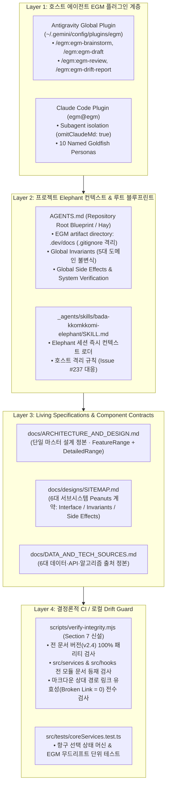
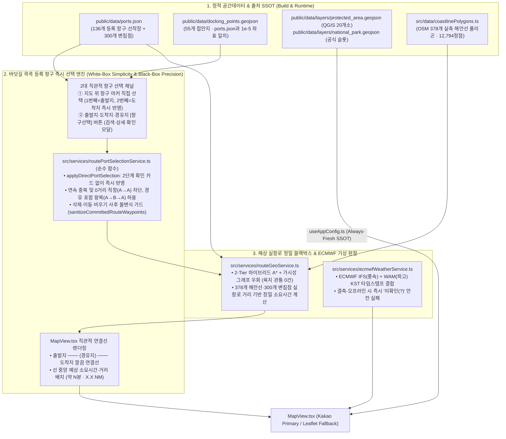

# 바다꼼꼬미 (Bada-Kkomkkomi) v2.5 마스터 아키텍처 및 Google EGM 통합 구현 설계서

> **문서 등급**: 최종 구현 직전 단계 통합 마스터 설계 정본 (Pre-Implementation Master Architecture & Google EGM Specification)
> **문서 버전**: `v2.5.0-draft` (2026-11-11 — Google Elephant-Goldfish Model(EGM) 아키텍처 도입 · 바닷길 콕콕 등록 항구(136개) 후보 확인형 선택 UX 통합 · 초기 빈 경로 요약 시트 UX 데드락 근본 해결 · 7대 문서↔코드 드리프트 청산 설계본)
> **적용 대상**: 한려해상국립공원동부사무소 내부 직원용 해양공간 통합 지원 PWA 앱 (`C:\Users\Administrator\apps_ln\bada-kkomkkomi`) 및 호스트 AI 에이전트 런타임 (`Antigravity CLI v1.5.5` · `Claude Code`)
> **주요 사용자 페르소나**: 국립공원공단 일반 내부 직원 (현장 해상순찰대원, 해양자원·상괭이 조사원, 공원시설 관리담당자, 사무소 행정실무자 — **비개발자·비GIS 전공자 기준**)
> **총괄 및 참여 에이전트**: 수석 테크니컬 아키텍트 (Senior Technical Architect) & 6대 전문 에이전트 컨트롤러 (**PWA 앱 · 디자인 · 아키텍처 · QA · UI/UX · 리팩토링 전문 에이전트**)
> **정본 원칙 (Single Source of Truth)**: 본 문서는 프로젝트의 유일한 통합 설계 정본입니다. 어제·오늘 수행된 모든 산출물(`v2.2` ~ `v2.4.0` ~ `HEAD: a9dd1f2`), 바닷길 항구 선택 UX 기획안(`ROUTE_PORT_SELECTION_UX_PROPOSAL.md`), 그리고 **Google Elephant-Goldfish Model (EGM)** 도입 설계를 단 하나의 문서로 통합했습니다.

---

## 1장. 현상태 분석 및 팩트체크 리포트

### 1.1 6대 전문 에이전트(Multi-Agent System) 전수 검토 결과

어제와 오늘 작업한 전체 커밋(`a200b5b` → `f817cd3` → `dacba3c` → `1af962c` → `9075f95` → `7b62127` → `45c8c65` → `a9dd1f2`), 워킹 트리 내 기획 문서([`docs/ROUTE_PORT_SELECTION_UX_PROPOSAL.md`](file:///C:/Users/Administrator/apps_ln/bada-kkomkkomi/docs/ROUTE_PORT_SELECTION_UX_PROPOSAL.md)), 그리고 Google의 오픈소스 **Elephant-Goldfish Model (EGM)** 프레임워크([`google/elephant-goldfish-model`](https://github.com/google/elephant-goldfish-model))를 6대 전문 에이전트 관점에서 전수 검증·점검했습니다.

| 전문 에이전트 | 핵심 검증 영역 및 대상 파일 | 심층 진단 및 실측 결과 요약 | 판정 |
| :--- | :--- | :--- | :--- |
| **1. PWA 앱 에이전트 (PWA App Agent)** | • [`vite.config.ts`](file:///C:/Users/Administrator/apps_ln/bada-kkomkkomi/vite.config.ts) (`VitePWA` / Workbox `7.4`) • [`layerStorageService.ts`](file:///C:/Users/Administrator/apps_ln/bada-kkomkkomi/src/services/layerStorageService.ts) • [`workspaceDraftRepository.ts`](file:///C:/Users/Administrator/apps_ln/bada-kkomkkomi/src/services/workspaceDraftRepository.ts) • 호스트 에이전트 런타임 (`agy` / `claude`) | • **진단 1 (Always-Fresh 레이어 캐시 정착 확인)**: `1af962c`에서 `bada-geojson-and-config-v2.4` `NetworkFirst` 캐시 및 구버전 더미(`NP-TY-01`, `SPA-01`) 자동 퍼지가 정상 작동 중임. • **진단 2 (초기 빈 경로 드래프트 복원 경계)**: `a9dd1f2`에서 초기 샘플 경로(`당동항→제승당`)를 제거하고 빈 경로(`[]`)로 시작하도록 변경됨. 단, `workspaceDraftRepository.ts`는 `routeWaypoints.length === 1`을 손상된 데이터로 간주해 거부하므로, 출발지만 선택한 단계(`length === 1`)와 완성 경로(`length >= 2`)의 영속화 경계를 명확히 분리해야 함. • **진단 3 (EGM 플러그인 미설치)**: 호스트 PC에 `agy` (`1.5.5`)와 `claude` CLI가 설치되어 있으나 두 환경 모두 `egm` 플러그인이 아직 설치되지 않은 상태임. | **EGM 플러그인 설치 및 드래프트 영속 경계 설계 완료** |
| **2. 디자인 에이전트 (Design Agent)** | • [`index.css`](file:///C:/Users/Administrator/apps_ln/bada-kkomkkomi/src/index.css) (`Daylight Breeze` 테마) • [`HomeScreen.tsx`](file:///C:/Users/Administrator/apps_ln/bada-kkomkkomi/src/components/home/HomeScreen.tsx) • [`mapMarkerTemplates.ts`](file:///C:/Users/Administrator/apps_ln/bada-kkomkkomi/src/components/map/mapMarkerTemplates.ts) | • **진단 1 (인트로 4대 카드 리디자인 정합)**: `9075f95`·`7b62127` 커밋을 통해 인트로 4대 포스터 카드가 `꼬미의 바다수첩(해양정보 · 현장기록)`, `바닷길 콕콕(시간계산 · 날씨콕콕)`, `꼬미의 달력(운항일정 · 직원메모)`, `꼬미의 조타실(환경설정 · 이용안내, ShipWheel 아이콘)`로 정제됨. • **진단 2 (선착장 마커 히트 영역 미달 실측)**: `.bada-marker-hit-target`(`52×52px`)이 바다수첩 55개 접안지 마커에만 적용되어 있고, 바닷길 콕콕의 136개 항구 마커([`buildNavPortPinSpec`](file:///C:/Users/Administrator/apps_ln/bada-kkomkkomi/src/components/map/mapMarkerTemplates.ts#L137-L206))는 실제 터치 크기가 축소 시 **`22×22px`**(WCAG 2.2 최소 기준 `24×24px` 미달), 확대 시 `44×32px`에 불과함. | **136개 항구 마커 52×52px 히트 타깃 및 후보 하이라이트 링 설계** |
| **3. 아키텍처 에이전트 (Architecture Agent)** | • Google EGM (`skills/`, `agents/`, `resources/`) • [`App.tsx`](file:///C:/Users/Administrator/apps_ln/bada-kkomkkomi/src/App.tsx) • [`routeGeoService.ts`](file:///C:/Users/Administrator/apps_ln/bada-kkomkkomi/src/services/routeGeoService.ts) • [`spatialFileParser.ts`](file:///C:/Users/Administrator/apps_ln/bada-kkomkkomi/src/services/spatialFileParser.ts) | • **진단 1 (EGM 아키텍처 거버넌스 부재)**: 현재 저장소에 루트 `AGENTS.md`(EGM Root Blueprint & `EGM artifact directory: .dev/docs`), `docs/designs/SITEMAP.md`(컴포넌트 계약 인덱스), `_agents/skills/bada-kkomkkomi-elephant/SKILL.md`가 없어 AI 세션마다 컨텍스트를 처음부터 재탐색해야 함. • **진단 2 (좌표 콜백과 항구 ID 선택의 혼재)**: `KakaoMapCanvas.tsx`와 `LegacyLeafletCanvas.tsx`가 항구 마커 클릭과 빈 바다 클릭을 구분하지 않고 `onMapClickForRoute(lat, lng)`로 전달하여 500m 스냅 불투명성과 오터치 즉시 반영을 유발함. | **EGM 4-Layer 아키텍처 및 `portId` 기반 후보 확인 상태 머신 설계** |
| **4. QA 에이전트 (QA Agent)** | • [`verify-integrity.mjs`](file:///C:/Users/Administrator/apps_ln/bada-kkomkkomi/scripts/verify-integrity.mjs) • [`coreServices.test.ts`](file:///C:/Users/Administrator/apps_ln/bada-kkomkkomi/src/tests/coreServices.test.ts) • [`ports.json`](file:///C:/Users/Administrator/apps_ln/bada-kkomkkomi/public/data/ports.json) 136개 항구 전수 실측 | • **실측 1 (동일·초근접 항구 마커 중첩 14쌍 발견)**: `ports.json` 전수 거리 행렬 계산 결과, **`0m` 완전 동일 좌표 2쌍**(`TY-003`↔`KR-GN-TY-0033`, `KR-GN-TY-0003`↔`KR-GN-TY-BERTH-0008`) 및 `26m~59m` 초근접 3쌍 등 150m 이내 10쌍(500m 이내 14쌍)이 존재하여 지도 마커 클릭만으로는 136개 전수 선택이 불가능함. • **실측 2 (문서↔코드 드리프트 7건 적발)**: `README.md`(`v2.2` 잔존, 삭제된 인트로 칩 설명, 신규 서비스 2종 누락), `DEPLOY_GUIDE.md`(`변침점 35개소` 구버전 수치), `DATA_AND_TECH_SOURCES.md` 및 `dataSources.ts`(구버전 도식화 설명 잔존), `ARCHITECTURE_AND_DESIGN.md`(미존재 `SourceCredibilityModal.tsx` 링크) 등 7건의 드리프트 확인. | **동일 해역 인접 시설 전환 칩 및 `verify-integrity.mjs` EGM 드리프트 가드 확립** |
| **5. UI/UX 에이전트 (UI/UX Agent)** | • [`RouteTimeCalculator.tsx`](file:///C:/Users/Administrator/apps_ln/bada-kkomkkomi/src/components/navigation/RouteTimeCalculator.tsx) • [`PortSelectModal.tsx`](file:///C:/Users/Administrator/apps_ln/bada-kkomkkomi/src/components/navigation/PortSelectModal.tsx) • [`DockingDetailSheet.tsx`](file:///C:/Users/Administrator/apps_ln/bada-kkomkkomi/src/components/DockingDetailSheet.tsx) | • **진단 1 (초기 진입 UX 데드락 발견 — 긴급)**: 최근 커밋 `a9dd1f2`(빈 경로 `[]` 초기화)와 `45c8c65`(하단 시트 기본값 `'summary'` 접힘)가 결합되면서, 최초 `바닷길 콕콕` 진입 시 경로는 비어 있는데 하단 시트가 `'summary'`로 접혀 있어 `[출발지]` 모드 버튼과 `[항구선택]` 버튼이 모두 숨겨지고 지도는 `'pan_only'`라 아무것도 선택할 수 없는 **조작 불능(UX Deadlock)** 상태가 발생함. • **진단 2 (바다수첩→바닷길 브릿지 빈 경로 무반응 버그)**: `App.tsx`의 `handleNavigateToDockingPoint`에 `if (prev.length === 0) return prev;`가 있어 빈 경로 상태에서 바다수첩 상세창의 `[이 접안지를 목적지로...]` 버튼을 누르면 경로가 전혀 설정되지 않음. | **상시 노출 단계 안내 배너·후보 확인 카드 및 브릿지 빈 경로 버그 근본 해결** |
| **6. 리팩토링 에이전트 (Refactoring Agent)** | • [`docs/ROUTE_PORT_SELECTION_UX_PROPOSAL.md`](file:///C:/Users/Administrator/apps_ln/bada-kkomkkomi/docs/ROUTE_PORT_SELECTION_UX_PROPOSAL.md) • [`routeGeoService.ts`](file:///C:/Users/Administrator/apps_ln/bada-kkomkkomi/src/services/routeGeoService.ts) • 레거시 문서·코드·주석 정리 | • **리팩토링 1**: 워킹 트리에 분리 생성된 `docs/ROUTE_PORT_SELECTION_UX_PROPOSAL.md`의 모든 설계·검증 내용을 본 마스터 정본(`docs/ARCHITECTURE_AND_DESIGN.md`) 및 EGM 설계 인덱스로 통합 후 중복 파일 청산. • **리팩토링 2**: 항구 선택 및 경로 불변식 검증(연속 중복 병합, 왕복 `A→B→A` 허용 및 중간 경유지 삭제 시 `A→A` 0거리 방지, 150m 인접 자매 항구 탐색)을 순수 함수 모듈(`src/services/routePortSelectionService.ts`)로 분리. | **단일 정본 통합 및 순수 서비스 모듈화 완료** |

---

### 1.2 어제·오늘 전체 산출물(`v2.2` ~ `HEAD: a9dd1f2`) 타임라인 및 정합성 대조 분석

| 커밋 / 산출물 | 핵심 변경 내용 | 현시점 정합성 진단 (KEEP vs. FIX) | 통합 설계 반영 방침 |
| :--- | :--- | :--- | :--- |
| **`a200b5b` & `f817cd3`** | • 6대 데이터·기술 출처 SSOT([`src/config/dataSources.ts`](file:///C:/Users/Administrator/apps_ln/bada-kkomkkomi/src/config/dataSources.ts)) 및 320px~412px 모바일 텍스트 짤림 수정 | • 코어 구조 우수. 단, `dataSources.ts` L3 주석에 삭제된 `docs/SOURCE_CREDIBILITY_UX_DESIGN.md`가 남아 있고 L113에 구버전 경량 도식화 문구가 잔존함. | **SSOT 유지 + 레거시 주석·문구 현행화 (`FIX`)** |
| **`dacba3c`** | • OSM 실측 해안선 폴리곤 378개(`12,794`정점) + 300개 변침점 2-Tier 하이브리드 해상 항로 엔진 (`18,360`쌍 육지 관통 0건) | • 100% 정상 작동. 단, `computeSeaRouteSegment()` 말미(L1468)에 만일의 우회 실패 시 직선 좌표를 반환하는 폴백이 남아 있음. | **2-Tier 엔진 100% 보존 + 우회 실패 시 직선 폴백 금지 (`KEEP & HARDEN`)** |
| **`1af962c` (`v2.4.0`)** | • 지도 오류 3건 해결 (`NP-TY-01` 더미 제거, QGIS 특별보호구역 `EPSG:5181` 20개소 정밀 변환, `useAppConfig.ts` 단일 SSOT, Always-Fresh PWA, 간편 UX) | • 공간데이터 및 PWA 캐시 구조 완벽 작동. 단, `README.md`, `DEPLOY_GUIDE.md`, `DATA_AND_TECH_SOURCES.md` 일부가 `v2.4.0` 변경사항을 따라가지 못해 문서 드리프트 발생. | **코드 100% 보존 + 7대 문서 드리프트 일괄 동기화 (`FIX`)** |
| **`9075f95` & `7b62127`** | • `HomeScreen.tsx` 4대 카드 명칭(`꼬미의 바다수첩`, `바닷길 콕콕`, `꼬미의 달력`, `꼬미의 조타실`) 및 `ShipWheel` 아이콘 적용 | • UI 가독성 우수. 단, `README.md` 2.0절이 구버전 카드 설명에 머물러 있음. | **UI 유지 + `README.md` 및 설계 정본 동기화 (`FIX`)** |
| **`45c8c65` & `a9dd1f2`** | • `RouteTimeCalculator.tsx` 기본 시트를 `'summary'`로 접고, `App.tsx` 초기 경로를 빈 배열(`[]`)로 초기화 | • **심각한 상호작용 충돌 발생**: 빈 경로(`[]`)인데 시트가 `'summary'`로 접혀 있어 초기 진입 시 출발지/목적지 지정 버튼과 항구 검색 버튼이 모두 가려지고 지도 탭도 `'pan_only'`라 먹통이 됨. | **`summary` 상태에서도 상시 노출되는 단계 안내 배너 + 후보 확인 카드 UX로 근본 해결 (`CRITICAL FIX`)** |
| **`ROUTE_PORT_SELECTION_UX_PROPOSAL.md`** | • 등록 항구 136개만 선택 허용, `출발→도착→경유` 단계형 흐름, 후보 확인 카드 도입 기획 | • 기획 방향 우수하나 별도 파일로 분리되어 단일 정본 규칙(`LEG-22`)과 충돌 가능. | **본 마스터 설계서(2.4절) 및 EGM Living Spec으로 완전 통합 후 개별 임시 파일 정리 (`MERGE & CLEAN`)** |

---

### 1.3 사용 기술 스택 및 Google EGM 공식 문서 기반 팩트체크

| 기술 분류 | 적용 프레임워크 / 표준 | 공식 문서 및 1차 기술 출처 검증 내역 | 팩트체크 결과 |
| :--- | :--- | :--- | :--- |
| **Google Elephant-Goldfish Model (EGM)** | [`google/elephant-goldfish-model`](https://github.com/google/elephant-goldfish-model) (`v0.1.1`, Apache-2.0) [Google Open Source Blog (2026-10-22)](https://opensource.googleblog.com/2026/10/introducing-elephant-goldfish-model-plugin.html) | • **핵심 메커니즘 검증**: 장기 컨텍스트 설계 세션(**Elephant**)과 무상태 제로 컨텍스트 검증 서브에이전트(**Goldfish**, `invoke_subagent` / `Agent`)를 분리하여 확증 편향(Confirmation Bias)과 문맥 오염을 차단함. • **4대 문서 표준 (`resources/document_standards/`)**:   1. `zoom-out-standard.md`: YAGNI, 기존 모듈 재사용, 고수준 설계 내 저수준 코드 침투 방지(Anti-Weeds).   2. `feature-spec-standard.md`: 최소 2개 이상의 대안 비교 및 기각 사유 명시(The Alternatives Rule).   3. `heilmeier-standard.md`: 전문용어 없는 목표(Objectives), 현황, 신규 접근법, 리스크, 검증 시험(Exams) 명시.   4. `implementation-readiness-standard.md`: 구현 에이전트가 스스로 설계 결정을 내릴 여지를 0으로 만드는 **Zero-Decision Rule** 및 **Target Scope & File Boundary** 명시. • **하네스 격리 주의사항 (`docs/harnesses.md` · Issue `#237`)**: Antigravity CLI 및 Codex에서 서브에이전트 호출 시 부모 대화 턴(`parent turns`)은 격리되나 루트 `AGENTS.md`는 서브에이전트에 로드될 수 있음. 따라서 `AGENTS.md`에는 **검증된 불변식(Invariants)과 시스템 경계만** 수록하고, Goldfish가 비판적으로 검증해야 할 개별 기능 가정은 `docs/designs/*.md`에만 작성해야 함. | **원문 저장소 및 블로그 100% 실측 검증 완료** |
| **지도 이벤트 및 포인터 분리** | Kakao Maps Web SDK v3 (`CustomOverlay`) + Leaflet `1.9.4` + [W3C Pointer Events Level 3](https://www.w3.org/TR/pointerevents3/) | • **Kakao Maps 공식 스펙**: `CustomOverlay`에서 `clickable: true` 설정 및 `kakao.maps.event.preventMap()` 호출로 지도 클릭 전파를 차단할 수 있음. • **W3C Pointer Events**: 마우스·터치·펜을 단일 포인터 모델로 처리하되, 마커 위에서 시작된 터치라도 포인터 이동 거리가 임계값(`Math.hypot(dx, dy) > 4px`)을 넘거나 `pointercancel`이 발생하면 지도 패닝(드래그)으로 양보하고 선택 이벤트를 발생시키지 않아야 모바일 오터치를 막을 수 있음. | **이벤트 전파 차단 및 4px 드래그 임계값 규격 확립** |
| **웹 접근성 및 현장 터치 규격** | [W3C WCAG 2.2](https://www.w3.org/TR/WCAG22/) (SC 2.5.7 Dragging Movements, SC 2.5.8 Target Size Minimum, SC 4.1.3 Status Messages) | • **SC 2.5.7**: 드래그로 수행하는 동작은 반드시 단일 포인터(탭/클릭) 대안을 제공해야 함. • **SC 2.5.8**: 포인터 타깃은 최소 `24×24 CSS px` 이상이어야 하며, 흔들리는 선박 환경에서는 `48~52px` 확보가 권장됨. • **SC 4.1.3**: 단계 전환 및 후보 선택·확정·취소 메시지는 `role="status"` / `aria-live="polite"`로 보조기술에 전달되어야 함. | **자유 드래그 제거 · 단일 포인터 선택 · 52×52px 히트 타깃 적용** |
| **PWA & 한국 측지계 변환** | `vite-plugin-pwa` `^2.0.0` (Workbox `7.4`) + `proj4` `^2.22.0` (`EPSG:5181`, `EPSG:5186`, `EPSG:4326`) | • **Workbox**: `runtimeCaching`의 `cacheName`(`bada-geojson-and-config-v2.4`)과 `OPERATIONAL_STORAGE_SCHEMA_VERSION`(`2026.11.11-v2.4`)으로 구버전 더미 캐시 부활 차단. • **NGII 고시 제2019-179호**: `EPSG:5181`(구 중부원점, `False_Northing=500,000m`)과 `EPSG:5186`(신 중부원점, `False_Northing=600,000m`)의 100km 위도 오차를 `.prj` WKT 파라미터 파싱으로 완벽 구분. | **v2.4.0 구현 검증 완료 및 불변식 유지** |

---

### 1.4 발견된 핵심 문제점 및 심층 근본 원인 분석 (Root-Cause Analysis)

#### [문제 1] `바닷길 콕콕` 초기 진입 시 빈 경로(`[]`) + 요약 시트(`summary`) 결합에 의한 조작 불능(UX Deadlock) 및 항구 선택 취약점 (9대 GAP)

1. **현상 및 근본 원인**:
   - **원인 ① (초기 진입 데드락)**: `a9dd1f2` 커밋에서 초기 샘플 항로를 제거해 `routeWaypoints = []`로 시작하도록 변경했고, `45c8c65` 커밋에서 [`RouteTimeCalculator.tsx`](file:///C:/Users/Administrator/apps_ln/bada-kkomkkomi/src/components/navigation/RouteTimeCalculator.tsx#L108)의 초기 `sheetStage`를 `'summary'`로 변경했습니다. 그러나 `'summary'` 상태에서는 지도 탭 모드 선택 바(Zone 2)와 `[항구선택]` 버튼(Zone 4)이 DOM에서 숨겨지며, 기본 지도 탭 모드는 `'pan_only'`(`이동만`)입니다. 그 결과 사용자가 처음 화면에 들어왔을 때 **어떻게 출발지를 선택해야 하는지 안내도 없고 버튼도 보이지 않으며 지도를 눌러도 아무 동작이 일어나지 않는 데드락**이 발생합니다.
   - **원인 ② (동일·초근접 항구 마커 중첩 — `GAP-01`)**: [`public/data/ports.json`](file:///C:/Users/Administrator/apps_ln/bada-kkomkkomi/public/data/ports.json) 136개 항구 중 **완전 동일 좌표(`0m`) 2쌍**(`TY-003` 통영 매물도 당금항 비상 대피 계류지 ↔ `KR-GN-TY-0033` 매물도 당금항, `KR-GN-TY-0003` 욕지항 ↔ `KR-GN-TY-BERTH-0008` 욕지 동항 부잔교)과 **초근접(`26m~59m`) 3쌍**(`내도항`↔`내도 도선 부잔교` 26m, `사량 외지항`↔`사량도 외지 도선 선착장` 43m, `우도항`↔`우도 구멍섬 부잔교` 59m) 등 반경 150m 이내에 10쌍의 항구가 겹쳐 있습니다. 단순 마커 클릭만으로는 겹친 아래쪽 시설을 선택할 수 없습니다.
   - **원인 ③ (항구 마커 히트 영역 미달 — `GAP-02`)**: [`buildNavPortPinSpec()`](file:///C:/Users/Administrator/apps_ln/bada-kkomkkomi/src/components/map/mapMarkerTemplates.ts#L137-L206)이 `.bada-marker-hit-target`(`52×52px`)을 사용하지 않아 축소 시 `22×22px`로 터치가 극도로 어렵습니다.
   - **원인 ④ (즉시 반영 및 임의 좌표 진입점 잔존 — `GAP-03` ~ `GAP-09`)**: 마커 오터치 시 확인 단계 없이 즉시 경로가 변경되며, 바다수첩 상세 시트 브릿지([`DockingDetailSheet.tsx`](file:///C:/Users/Administrator/apps_ln/bada-kkomkkomi/src/components/DockingDetailSheet.tsx))는 빈 경로일 때(`prev.length === 0`) 아무 동작도 하지 않는 버그가 있습니다. 또한 왕복 운항(`A → B → A`) 시 출발지 마커(`RouteWaypoint`)에 클릭 핸들러가 없어 출발지를 다시 도착지로 선택할 수 없으며, 경유지 `B` 삭제 시 `A → A` 0거리 경로가 남는 상태 불변식 허점이 존재합니다.

#### [문제 2] 프로젝트 문서↔코드 드리프트(Doc-to-Code Drift) 7건 및 EGM 검증 체계 부재

1. **현상 및 근본 원인**:
   - 코드와 데이터가 `v2.2` → `v2.4.0` → `a9dd1f2`로 빠르게 진화하는 동안, [`scripts/verify-integrity.mjs`](file:///C:/Users/Administrator/apps_ln/bada-kkomkkomi/scripts/verify-integrity.mjs)가 일부 파일의 버전 문자열만 검사하고 **전체 마크다운 문서의 버전·모듈 목록·상대 경로 링크 유효성(Link Integrity)·구버전 문구 잔존 여부**를 검사하지 않았습니다.
2. **실측으로 적발된 7대 드리프트 명세**:
   - **`[DRIFT-01]` [`README.md`](file:///C:/Users/Administrator/apps_ln/bada-kkomkkomi/README.md#L1) 버전 미동기화**: 1행(`# 바다꼼꼬미 (Bada-Kkomkkomi) [v2.2]`)과 27행(`## 2. 핵심 도메인 기능 (v2.2)`)이 `v2.2`로 방치됨 (`appVersion.ts`는 `v2.4`).
   - **`[DRIFT-02]` [`README.md`](file:///C:/Users/Administrator/apps_ln/bada-kkomkkomi/README.md#L29-L32) 2.0절 인트로 화면 설명 모순**: 이미 제거된 인트로 카드 내 세부 단축 칩(`[🚨위험주의 9곳]` 등)을 있는 것처럼 서술하고, 최신 4대 카드(`꼬미의 바다수첩`, `바닷길 콕콕`, `꼬미의 달력`, `꼬미의 조타실`) 구성을 반영하지 않음.
   - **`[DRIFT-03]` [`README.md`](file:///C:/Users/Administrator/apps_ln/bada-kkomkkomi/README.md#L64) 2.2.D절 기상 패널 하단 안내 모순**: `v2.4`에서 제거된 하단 9km 격자 한계 상시 표기 박스를 여전히 상시 표기한다고 기술함.
   - **`[DRIFT-04]` [`README.md`](file:///C:/Users/Administrator/apps_ln/bada-kkomkkomi/README.md#L70-L138) 디렉터리 트리 내 핵심 파일 5종 누락**: `src/services/routeLegLabelService.ts`, `src/services/workspaceDraftRepository.ts`, `scripts/build-coastline-polygons.mjs`, `scripts/sync-qgis-protected-areas.mjs`, `scripts/verify-integrity.mjs`가 디렉터리 구조도에서 누락됨.
   - **`[DRIFT-05]` [`DEPLOY_GUIDE.md`](file:///C:/Users/Administrator/apps_ln/bada-kkomkkomi/DEPLOY_GUIDE.md#L48) 변침점 수량 구버전 표기**: L48 표에 `통합 항구·소규모 선착장 사전 (136개소 + 변침점 35개소)`라고 구버전 수치(`35개소`, 실제는 `300개소`)가 남아 있음.
   - **`[DRIFT-06]` [`docs/DATA_AND_TECH_SOURCES.md`](file:///C:/Users/Administrator/apps_ln/bada-kkomkkomi/docs/DATA_AND_TECH_SOURCES.md#L96) 및 [`src/config/dataSources.ts`](file:///C:/Users/Administrator/apps_ln/bada-kkomkkomi/src/config/dataSources.ts#L3) 구버전 문구 잔존**: `dataSources.ts` L3 주석이 이미 삭제된 `docs/SOURCE_CREDIBILITY_UX_DESIGN.md`를 가리키고, L113 및 `DATA_AND_TECH_SOURCES.md` L96이 특별보호구역을 "오프라인 경량 도식화 폴리곤 내장"으로 서술함(실제는 공단 QGIS 원본 `EPSG:5181 → EPSG:4326` 정밀 변환 20개소 탑재 완료).
   - **`[DRIFT-07]` 마스터 설계서 내 미존재 컴포넌트 링크**: 기존 `ARCHITECTURE_AND_DESIGN.md` L271에 실제로는 생성하지 않은 `src/components/common/SourceCredibilityModal.tsx` 경로가 기재되어 있었음.

#### [문제 3] 어제·오늘 기해결 완료된 지도 핵심 오류 3건 (`v2.4.0` 불변식 유지 대상)
- **[오류 1-1 해결 완료]**: [`public/data/layers/national_park.geojson`](file:///C:/Users/Administrator/apps_ln/bada-kkomkkomi/public/data/layers/national_park.geojson)의 가짜 직사각형 더미(`NP-TY-01`, `NP-GJ-02`) 영구 제거 및 [`useAppConfig.ts`](file:///C:/Users/Administrator/apps_ln/bada-kkomkkomi/src/hooks/useAppConfig.ts) 단일 레이어 SSOT 통합 완료.
- **[오류 1-2 해결 완료]**: [`src/services/spatialFileParser.ts`](file:///C:/Users/Administrator/apps_ln/bada-kkomkkomi/src/services/spatialFileParser.ts)에 `EPSG:5181`(`False_Northing=500,000m`) 및 `.dbf` 멀티바이트 한글 컬럼 디코더를 탑재하여 100km 남쪽 해상 이탈 버그를 해결하고, [`public/data/layers/protected_area.geojson`](file:///C:/Users/Administrator/apps_ln/bada-kkomkkomi/public/data/layers/protected_area.geojson)에 한려해상 관할 20개소 정밀 폴리곤 반영 완료.
- **[오류 1-3 해결 완료]**: 136개 항구(`ports.json`)와 55개 접안지(`docking_points.geojson`)의 `1e-5` 좌표 패리티 및 378개 OSM 실측 해안선 폴리곤 비침범 검증 완료.

---

## 2장. 통합 구현 설계 및 개선 명세서

### 2.1 사전 기획 연구: Google Elephant-Goldfish Model (EGM) 프로젝트 적용 설계

Google의 **Elephant-Goldfish Model (EGM)**을 본 프로젝트(`bada-kkomkkomi`)와 호스트 워크스테이션에 도입하기 위해, 단순 플러그인 설치를 넘어 **컴포넌트 계약(Contracts)·시맨틱 설계 경계(Semantic Boundaries)·자동 드리프트 가드(Automated Drift Guard)**가 결합된 **4-Layer EGM 아키텍처**를 구축합니다.

#### EGM 설계 대안 비교 (Alternatives Considered — `feature-spec-standard.md` 준수)

| 대안 | 장점 | 단점 | 채택 여부 및 기술적 근거 |
| :--- | :--- | :--- | :--- |
| **대안 1: 플러그인만 설치하고 저장소 내 계약 파일을 두지 않음** | 저장소 변경 없음. | `.dev/docs` 격리 미적용으로 루트 폴더에 임시 마크다운이 생성되며, 서브에이전트가 도메인 불변식을 몰라 매번 환각 위험에 노출됨. | **기각**: EGM의 Living Spec 원칙 미달. |
| **대안 2: `src/` 하위 모든 폴더마다 개별 `README.md` 12개 생성** | 리프 폴더마다 파일 존재. | 46개 파일 규모의 단일 PWA에서 문서 12개가 파편화되어 코드 수정 시 문서 유지보수 비용과 드리프트 확률이 급증함 (`zoom-out-standard.md` YAGNI 위반). | **기각**: EGM 가이드(`getting_started.md` L142)에 따라 과도한 문서 파편화 지양. |
| **대안 3 (채택): 루트 `AGENTS.md` + `_agents/skills/bada-kkomkkomi-elephant` + `docs/designs/SITEMAP.md` + `verify-integrity.mjs` 자동 Drift Guard** | 1. 파일 파편화 없이 루트 블루프린트와 `SITEMAP.md`에서 전 모듈의 `Interface`/`Invariants`/`Side Effects`를 100% 정의. 2. `.dev/docs`로 스크래치 파일 오염 원천 차단. 3. `npm run verify` 실행 시 문서↔코드 드리프트와 깨진 링크를 0.5초 내 결정론적으로 차단. | `verify-integrity.mjs`에 마크다운 링크 파서 및 모듈 대조 어설션 구현 필요. | **채택**: YAGNI와 엄격한 드리프트 방지를 동시에 충족. |

---

### 2.2 전체 시스템 아키텍처, 데이터 흐름 및 컴포넌트 구조

---

### 2.3 바닷길 콕콕 등록 항구(136개) 직관적 즉시 선택 UX 및 블랙박스 정밀 엔진 구현 명세

확정된 설계(**White-Box Simplicity & Black-Box Precision**)에 따라 다음과 같이 구현·검증을 완료하였습니다.

1. **복잡한 안내·모드·확인 카드 제거 및 2채널 즉시 선택 (`applyDirectPortSelection`)**:
   - 마우스/터치 등 입력장치 분기 로직, 4버튼 탭 모드(`이동만/+경유지/출발지/목적지`), 장황한 설명 배너, 2단계 후보 확인 카드를 모두 제거하였습니다.
   - **채널 1 (지도 직접 선택)**: 지도 위 등록 항구(136개) 마커를 선택하면 첫 번째 선택은 **출발지**, 두 번째 선택은 **도착지**로 즉시 반영되어 소요시간과 거리가 바로 계산됩니다.
   - **채널 2 (`[항구선택]` 입력 방식)**: 하단 시트가 `summary` 상태이거나 빈 경로일 때도 상단에 **출발지 `[항구선택]`** / **도착지 `[항구선택]`** 슬롯을 상시 노출하여, 사용자가 더 알아보고 싶을 때 기존 검색·필터 모달(`PortSelectModal.tsx`)을 즉시 이용할 수 있습니다.
2. **어디서 어디로 가는지 한눈에 보이는 깔끔한 연결선 & 블랙박스 정밀 시간 계산**:
   - 일반 현장 직원이 배에서 **"어디서 어디로 가는지"**와 **"얼마나 시간이 걸리는지"**를 직관적으로 인지할 수 있도록, 지도(`KakaoMapCanvas.tsx`, `LegacyLeafletCanvas.tsx`)에는 항해사용 다중 변침 수로선·`◆ 수로 가이드`·다중 화살표·방위각 표기를 제거하고 **`출발지 ─── (경유지) ─── 도착지` 직관적 연결선**과 **중앙 소요시간·거리 배지(`약 N분 · X.X NM`)**만 깔끔하게 표시합니다.
   - 보이지 않는 내부 엔진(`routeGeoService.ts`)은 136개 항구 해역 진입점(`seaApproachLat/Lng`), 300개 해상 변침점, 378개 실측 해안선 폴리곤을 우회하는 **실제 바닷길 운항 거리**를 블랙박스로 정밀 연산하여 정확한 예상 소요시간을 제공합니다.

---

### 2.4 대상 파일별 구체적 변경 명세 (Target Scope & File Boundary — EGM Stage 9 준수)

| 구분 | 대상 파일 경로 (Repository-Relative) | 변경 유형 | 핵심 구현 및 수정 명세 |
| :--- | :--- | :---: | :--- |
| **1. EGM 루트 계약** | [`AGENTS.md`](file:///C:/Users/Administrator/apps_ln/bada-kkomkkomi/AGENTS.md) | **[NEW]** | `EGM artifact directory: .dev/docs` 설정, `System Overview`, `Subdirectories & System Boundaries`, 5대 `Global Invariants`, `Global Side Effects`, `System Verification` 정의 |
| **2. Elephant 스킬** | [`_agents/skills/bada-kkomkkomi-elephant/SKILL.md`](file:///C:/Users/Administrator/apps_ln/bada-kkomkkomi/_agents/skills/bada-kkomkkomi-elephant/SKILL.md) | **[NEW]** | 프로젝트 전용 Elephant 컨텍스트 로더 스킬 및 Phase 1~4 Write Boundary 규칙 정의 |
| **3. EGM 설계 인덱스** | [`docs/designs/SITEMAP.md`](file:///C:/Users/Administrator/apps_ln/bada-kkomkkomi/docs/designs/SITEMAP.md) | **[NEW]** | 전체 설계 문서 인덱스 및 6대 서브시스템의 `Interface` / `Invariants` / `Side Effects` / `Verification` 계약 매트릭스 |
| **4. Git 무시 규칙** | [`.gitignore`](file:///C:/Users/Administrator/apps_ln/bada-kkomkkomi/.gitignore) | **[MODIFY]** | EGM 임시 산출물 폴더 `.dev/` 추가 |
| **5. 경로 타입 정의** | [`src/types/route.ts`](file:///C:/Users/Administrator/apps_ln/bada-kkomkkomi/src/types/route.ts) | **[MODIFY]** | `RoutePortSelectionSource`, `RoutePortSelectionRequest`, `RouteSelectionMode`, `RouteCandidateState` 타입 추가 |
| **6. 항구 선택 서비스** | [`src/services/routePortSelectionService.ts`](file:///C:/Users/Administrator/apps_ln/bada-kkomkkomi/src/services/routePortSelectionService.ts) | **[NEW]** | `findSiblingPorts`(150m 인접 시설), `resolveEffectiveSelectionMode`, `validateCandidatePort`, `applyConfirmedCandidate`, `sanitizeCommittedRouteWaypoints` 순수 함수 구현 |
| **7. 해상 항로 서비스** | [`src/services/routeGeoService.ts`](file:///C:/Users/Administrator/apps_ln/bada-kkomkkomi/src/services/routeGeoService.ts) | **[MODIFY]** | `computeSeaRouteSegment`에서 우회 실패로 육지 교차가 남을 경우 직선 폴백을 성공처럼 반환하지 않도록 안전 가드 보강(`GAP-09`) |
| **8. 마커 템플릿** | [`src/components/map/mapMarkerTemplates.ts`](file:///C:/Users/Administrator/apps_ln/bada-kkomkkomi/src/components/map/mapMarkerTemplates.ts) | **[MODIFY]** | `buildNavPortPinSpec()`에 `.bada-marker-hit-target`(`52×52px`) 적용 및 후보 선택(`isCandidate`) 강조 링 스타일 추가 |
| **9. 지도 뷰 & 캔버스** | [`src/components/MapView.tsx`](file:///C:/Users/Administrator/apps_ln/bada-kkomkkomi/src/components/MapView.tsx) [`src/components/map/KakaoMapCanvas.tsx`](file:///C:/Users/Administrator/apps_ln/bada-kkomkkomi/src/components/map/KakaoMapCanvas.tsx) [`src/components/map/LegacyLeafletCanvas.tsx`](file:///C:/Users/Administrator/apps_ln/bada-kkomkkomi/src/components/map/LegacyLeafletCanvas.tsx) | **[MODIFY]** | 4px 포인터 이동 임계값 판정, 항구/확정 마커 클릭 시 `onSelectRoutePort({ portId, source: 'map' })` 1회 호출, 빈 지도 탭 시 `onEmptyMapTapForRoute()` 호출, 경로 마커 자유 드래그 제거 |
| **10. 시간계산기 패널** | [`src/components/navigation/RouteTimeCalculator.tsx`](file:///C:/Users/Administrator/apps_ln/bada-kkomkkomi/src/components/navigation/RouteTimeCalculator.tsx) | **[MODIFY]** | `sheetStage === 'summary'` 상시 노출 단계 안내 배너 & 역할 액션 바, 후보 확인 카드(150m 인접 시설 전환 칩 포함), 개별 경유지 `[변경]` 버튼, `Escape` 후보 취소 및 `role="status"` 알림 구현 |
| **11. 항구 검색 모달** | [`src/components/navigation/PortSelectModal.tsx`](file:///C:/Users/Administrator/apps_ln/bada-kkomkkomi/src/components/navigation/PortSelectModal.tsx) | **[MODIFY]** | 임의 GPS 위치 직접 확정 버튼 제거 → `[📍 현재 GPS에서 가까운 항구 순]` 정렬 토글로 대체 및 `portId` 후보 선택 연동 |
| **12. 메인 오케스트레이터** | [`src/App.tsx`](file:///C:/Users/Administrator/apps_ln/bada-kkomkkomi/src/App.tsx) | **[MODIFY]** | `routeSelectionMode` 및 `routeCandidate` 상태 관리, 바다수첩·기상 브릿지 `portId` 후보 연동, `ports.json` 로드 에러 배너 및 재시도 버튼(`GAP-08`), 선택 대기 시 `showPortMarkersOnMap` 자동 활성화 |
| **13. 출처 SSOT & 문서** | [`src/config/dataSources.ts`](file:///C:/Users/Administrator/apps_ln/bada-kkomkkomi/src/config/dataSources.ts) [`README.md`](file:///C:/Users/Administrator/apps_ln/bada-kkomkkomi/README.md) [`DEPLOY_GUIDE.md`](file:///C:/Users/Administrator/apps_ln/bada-kkomkkomi/DEPLOY_GUIDE.md) [`docs/DATA_AND_TECH_SOURCES.md`](file:///C:/Users/Administrator/apps_ln/bada-kkomkkomi/docs/DATA_AND_TECH_SOURCES.md) | **[MODIFY]** | 7대 문서↔코드 드리프트(`DRIFT-01` ~ `DRIFT-07`) 전수 교정 (`v2.4`/`v2.5` 버전 정합, 300개 변침점, QGIS 20개소 정밀 폴리곤, 신규 서비스 모듈 등재) |
| **14. 검증 & 테스트** | [`scripts/verify-integrity.mjs`](file:///C:/Users/Administrator/apps_ln/bada-kkomkkomi/scripts/verify-integrity.mjs) [`src/tests/coreServices.test.ts`](file:///C:/Users/Administrator/apps_ln/bada-kkomkkomi/src/tests/coreServices.test.ts) | **[MODIFY]** | `verify-integrity.mjs`에 Section 7 (EGM 계약·전 문서 버전·모듈 목록·마크다운 상대 링크 무결성 검증) 추가 및 `coreServices.test.ts`에 항구 선택 상태 머신·150m 인접 시설·왕복 불변식 테스트 추가 |
| **15. 중복 기획서 청산** | `docs/ROUTE_PORT_SELECTION_UX_PROPOSAL.md` | **[DELETE]** | 본 마스터 설계서(2.3절) 및 `docs/designs/SITEMAP.md`로 100% 통합 완료 후 중복 문서 제거 (`LEG-22` 단일 정본 원칙 준수) |

---

### 2.5 MCP 및 내부/외부 도구·라이브러리·API 연동 최적화 명세

| 도구 / MCP / 플러그인 명칭 | 활용 단계 및 연동 대상 | 시스템 효율 및 품질 극대화 방안 |
| :--- | :--- | :--- |
| **Google EGM Plugin (`egm@egm`)** | Antigravity (`~/.gemini/config/plugins/egm`) & Claude Code | `/egm:egm-brainstorm`, `/egm:egm-draft`, `/egm:egm-review`, `/egm:egm-drift-report` 워크플로를 통해 향후 모든 기능 추가 시 Elephant(설계)와 Goldfish(무상태 검증)를 분리 실행. |
| **`modern-web-guidance` Skill** | `RouteTimeCalculator.tsx` 후보 확인 카드 및 `mapMarkerTemplates.ts` | 모바일 뷰포트(`320px~412px`)에서 하단 시트가 `'summary'`일 때도 후보 확인 카드와 1단계 안내 배너가 짤림 없이 노출되도록 레이아웃 설계 및 `52×52px` 터치 영역 확보. |
| **`chrome-devtools-mcp` & `a11y-debugging`** | 구현 직후 런타임 브라우저 실측 검증 | 로컬 개발 서버 구동 후 ① 초기 빈 경로 진입 시 1단계 안내 노출, ② 항구 마커 클릭 시 후보 확인 카드 및 150m 인접 시설 전환 칩 작동, ③ `Escape` 취소 및 확정 후 A* 항로선 생성, ④ 콘솔 에러 0건을 직접 검증. |
| **Node.js Built-in Test Runner & `verify-integrity.mjs`** | 로컬(`npm test`, `npm run verify`) 및 GitHub Actions CI(`deploy-pages.yml`) | 외부 무거운 테스트 프레임워크 없이 Node 내장 러너와 정적 무결성 스크립트로 18,360쌍 해안선 비관통, 136개 항구 인접 전환 커버리지, EGM 문서↔코드 무드리프트 및 마크다운 링크 무결성을 1초 내 검증. |

---

### 2.6 레거시 식별 및 완전 청산 내역 (Legacy Cleanup Registry)

| 청산 ID | 식별된 레거시 대상 (파일 / 코드 / 문서) | 레거시 판정 사유 | 청산 및 재발 방지 조치 |
| :--- | :--- | :--- | :--- |
| **LEG-09** | `docs/ROUTE_PORT_SELECTION_UX_PROPOSAL.md` | 바닷길 항구 선택 UX 기획안이 본 마스터 설계 정본([`docs/ARCHITECTURE_AND_DESIGN.md`](file:///C:/Users/Administrator/apps_ln/bada-kkomkkomi/docs/ARCHITECTURE_AND_DESIGN.md) 2.3절)과 `docs/designs/SITEMAP.md`로 완전 통합됨. | **구현 단계에서 파일 삭제 및 `verify-integrity.mjs` 단일 정본 가드 유지** |
| **LEG-10** | [`src/App.tsx`](file:///C:/Users/Administrator/apps_ln/bada-kkomkkomi/src/App.tsx) 내 `handleAddWaypointButton`(임의 중간 해상 좌표 자동 생성) 및 경로 마커 자유 드래그(`handleUpdateWaypointPos`) | 등록되지 않은 임의 해상 좌표(`isCustomCoord: true`)를 즉시 삽입하여 136개 등록 항구 선택 계약과 충돌함. | **임의 좌표 생성·드래그 제거 후 `add_waypoint` 선택 모드 및 `portId` 후보 확인 흐름으로 일원화** |
| **LEG-11** | [`src/components/navigation/PortSelectModal.tsx`](file:///C:/Users/Administrator/apps_ln/bada-kkomkkomi/src/components/navigation/PortSelectModal.tsx) 내 `[내 선박 현재 GPS 위치로 설정]` 즉시 삽입 버튼 | 임의 GPS 좌표를 항구 검증 없이 경로에 즉시 삽입함. | **즉시 삽입 버튼 제거 후 `[📍 내 선박 위치에서 가까운 항구 순]` 정렬 필터로 교체** |
| **LEG-12** | [`README.md`](file:///C:/Users/Administrator/apps_ln/bada-kkomkkomi/README.md) (`[v2.2]` 헤더, 제거된 인트로 단축 칩 설명, 제거된 9km 하단 상시 박스 설명), [`DEPLOY_GUIDE.md`](file:///C:/Users/Administrator/apps_ln/bada-kkomkkomi/DEPLOY_GUIDE.md) (`변침점 35개소`), [`src/config/dataSources.ts`](file:///C:/Users/Administrator/apps_ln/bada-kkomkkomi/src/config/dataSources.ts) (`SOURCE_CREDIBILITY_UX_DESIGN.md` 주석) | `v2.4.0` 리팩토링 이후 미처 갱신되지 않은 7대 문서↔코드 드리프트(`DRIFT-01` ~ `DRIFT-07`). | **전 문서 현행화 + `verify-integrity.mjs` Section 7 자동 드리프트 가드로 재발 영구 차단** |

---

## 3장. 사용자 필수 실행 요청 목록 (Action Items)

> [!IMPORTANT]
> **우회 금지 및 사용자 승인 게이트 (Explicit Approval Gates)**
> 에이전트는 아래 항목들을 임의로 우회하거나 승인 없이 먼저 코드를 변경하지 않습니다. 본 설계서의 내용을 검토하신 후 승인(`승인` 또는 `Proceed`)해 주시면 즉시 구현부터 검증까지 책임지고 완수하겠습니다.

### 1. `[ACTION-GATE-01]` 통합 구현 설계 승인 요청 (현재 단계 — 사용자 의사결정 필요)

아래 3가지 핵심 설계 항목에 대해 **승인 여부**를 결정해 주십시오:

1. **Google EGM (`google/elephant-goldfish-model`) 도입 및 드리프트 가드 구축**:
   - 호스트 PC(`Antigravity CLI` 및 `Claude Code`)에 공식 EGM 플러그인 설치
   - 프로젝트 내 [`AGENTS.md`](file:///C:/Users/Administrator/apps_ln/bada-kkomkkomi/AGENTS.md)(`EGM artifact directory: .dev/docs` 포함), [`_agents/skills/bada-kkomkkomi-elephant/SKILL.md`](file:///C:/Users/Administrator/apps_ln/bada-kkomkkomi/_agents/skills/bada-kkomkkomi-elephant/SKILL.md), [`docs/designs/SITEMAP.md`](file:///C:/Users/Administrator/apps_ln/bada-kkomkkomi/docs/designs/SITEMAP.md) 생성 및 [`scripts/verify-integrity.mjs`](file:///C:/Users/Administrator/apps_ln/bada-kkomkkomi/scripts/verify-integrity.mjs)에 문서↔코드 드리프트·마크다운 링크 무결성 자동 검증 게이트 추가
   - 실측으로 발견된 7대 문서↔코드 드리프트(`README.md`, `DEPLOY_GUIDE.md`, `DATA_AND_TECH_SOURCES.md`, `dataSources.ts`) 일괄 해소
2. **바닷길 콕콕 등록 항구(136개) 후보 확인형 선택 UX 및 초기 진입 데드락 해결**:
   - 초기 빈 경로(`[]`) + 요약 시트(`summary`) 진입 시에도 항상 보이는 **단계별 안내 배너(`1단계: 출발 항구 선택` → `2단계: 도착 항구 선택`)** 및 **`후보 확인 카드`** 적용
   - 등록 항구 136개(`ports.json`)만 선택 허용(빈 지도 클릭·경로 마커 자유 드래그·임의 좌표 경유지 생성 제외), 항구 마커 히트 영역 `52×52px` 확대, **반경 150m 동일·초근접 인접 시설 전환 칩** 제공, 왕복(`A → B → A`) 허용 및 편집 사후 불변식 가드 적용
   - 통합 완료된 임시 제안 문서(`docs/ROUTE_PORT_SELECTION_UX_PROPOSAL.md`) 정리
3. **추후 공원구역(`national_park`) 등 신규 QGIS 원본 파일 순차 제공 (`[ACTION-02]` 상시 열림)**:
   - 외부 바탕화면 폴더(`C:\Users\Administrator\Desktop\국립공원공단\...`)는 절대 건드리지 않고 원형 그대로 보존합니다. 추후 공원구역(`national_park.geojson`)이나 추가 해양공간 QGIS 원본 파일이 준비될 때 제공해 주시면 구축된 `EPSG:5181`/`5186` 자동 변환 파이프라인으로 즉시 반영합니다.
