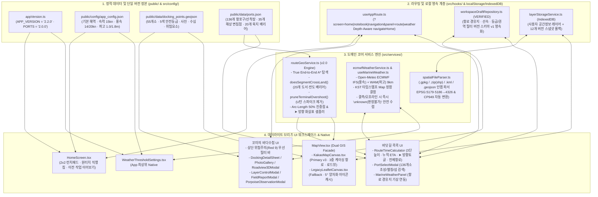

# 바다꼼꼬미 v2.2 통합 아키텍처 · 해상 항로(바닷길 콕콕) · 설정 · 데이라이트 브리즈 구현 설계서 (`ARCHITECTURE_AND_DESIGN.md`)

- **문서 상태**: **구현 전 검토 요청본 (REVIEW REQUIRED — 마스터 단일 정본)**
- **문서 버전 및 기준일**: `v2.2` (2026-11-10, Asia/Seoul)
- **통합 대상 문서**:
  1. 기존 [`docs/ARCHITECTURE_AND_DESIGN.md`](./ARCHITECTURE_AND_DESIGN.md) (`v2.2` 페이지 디자인·브랜드·접근성·PWA 구현 설계서)
  2. 구 [`docs/ROUTE_NAVIGATION_DESIGN.md`](./ARCHITECTURE_AND_DESIGN.md#23-바닷길-콕콕-32--해상-항로-탐색-엔진-및-3계층-방향-시각화-설계-구-route_navigation_designmd-통합) (`v2.0` '바닷길 콕콕' True End-to-End A* 실항로·방향 표시·가시성·18,360쌍 검증 명세서 — **본 문서로 완전 병합 및 청산 완료**)
  3. 구 [`docs/SETTINGS_DESIGN.md`](./ARCHITECTURE_AND_DESIGN.md#25-설정·이용안내-34-및-전방위-모달·폼-접근성-명세-구-settings_designmd-통합) (`v2.1` '3.4. 설정'·네이티브 `<dialog>`·레거시 청산 명세서 — **본 문서로 완전 병합 및 청산 완료**)
- **설계 및 감사 총괄**: 수석 테크니컬 아키텍트(Senior Technical Architect) & 다중 전문 에이전트 시스템 (아키텍처·알고리즘 / QA·데이터 무결성 / UI·UX·접근성 / 리팩토링·성능)
- **전체 범위**:
  - **포함**: `인트로 (HomeScreen)`, `3.1 꼬미의 바다수첩`, `3.2 바닷길 콕콕 (시간계산 · 기상상태판정)`, `3.4 설정 · 이용안내 · 버전 확인`, `공통 GIS/PWA/자동화 테스트 인프라`
  - **제외 (Explicit Exclusions)**:
    1. **`3.3 꼬미의 달력`**: 추후 기능 추가 예정이므로 현재 상태(`HomeScreen`의 `출시 예정` 카드)를 그대로 보존하며 일체 수정하지 않음
    2. **클라우드·서버 백엔드 보안 설계**: 본 프로젝트는 별도의 클라우드/백엔드 운영 서버가 없는 순수 클라이언트 정적 PWA 형태이므로, 클라우드·서버 게이트웨이 보안 설계는 본 문서 범위에서 제외함

> [!IMPORTANT]
> **상태 표기 원칙 (`AS-IS` / `VERIFIED` / `PROPOSED` / `DECISION REQUIRED`)**
> 본 문서는 과거 다크 테마(`v1.8~v2.0`) 시점의 기술 부채와 현재 작업 트리(`v2.2`)에 이미 반영·검증된 사실(`AS-IS` / `VERIFIED`), 차기 고도화 구현 설계안(`PROPOSED`), 그리고 에이전트가 임의로 우회하지 않고 사용자의 명시적 결정을 기다리는 항목(`DECISION REQUIRED`)을 엄격히 구분합니다.

---

## 1장. 현상태 분석 및 팩트체크 리포트

### 1.1. 에이전트 다중 검토 결과 (어제·오늘 `v1.7 ~ v2.2` 전체 산출물 전수 감사 매트릭스)

수석 테크니컬 아키텍트 산하 **4개 전문 에이전트(아키텍처·알고리즘, QA·데이터 무결성, UI/UX·시각 디자인, 리팩토링·성능)**가 어제와 오늘 작업된 전체 산출물(`src/`, `public/`, `scripts/`, `vite.config.ts`, `.github/workflows/`, `docs/`)을 프로젝트 전체 시야에서 교차 검증했습니다.

| 전문 에이전트 | 감사 범위 (대상 파일 및 산출물) | 현재 구현 및 실측 검증 완료 내역 (`AS-IS` & `VERIFIED`) | 추가 개선 설계 및 잠재 리스크 진단 (`PROPOSED` & `DECISION REQUIRED`) |
| :--- | :--- | :--- | :--- |
| **🏛️ 아키텍처 · 알고리즘 에이전트** | [`src/App.tsx`](file:///C:/programming/apps/bada-kkomkkomi/src/App.tsx) [`src/components/MapView.tsx`](file:///C:/programming/apps/bada-kkomkkomi/src/components/MapView.tsx) [`src/services/routeGeoService.ts`](file:///C:/programming/apps/bada-kkomkkomi/src/services/routeGeoService.ts) [`src/hooks/useAppRoute.ts`](file:///C:/programming/apps/bada-kkomkkomi/src/hooks/useAppRoute.ts) [`src/hooks/useMarineWeather.ts`](file:///C:/programming/apps/bada-kkomkkomi/src/hooks/useMarineWeather.ts) | - **[VERIFIED] 바닷길 콕콕 True End-to-End A* 해상 실항로 엔진**: 시작/종료 `seaApproach` 진입·이탈 실거리 합산, 20개 도서·반도 육지 배리어(`LANDMASS_BARRIER_POLYGONS`) 교차 차단(`doesSegmentCrossLand`), 양단 오버슈트 역주행 프루닝(`pruneTerminalOvershoot`), 누적 호장(Arc-Length) 50% 진중점 및 방향 화살표(`➤`) 샘플러 구현 완료 (`18,360`쌍 전수 유효 생성률 `100%`). - **[VERIFIED] 설정 다이얼로그 루트 승격**: [`App.tsx`](file:///C:/programming/apps/bada-kkomkkomi/src/App.tsx)에서 `WeatherThresholdSettings`를 워크스페이스 `inert` 래퍼 외부 최상위 루트에 마운트하여 인트로에서 지도 SDK 로드 없이 즉시(`0ms`) 호출 가능. - **[VERIFIED] 전 모달 HTML5 Native `<dialog>` 전환 100% 완료**: `DockingDetailSheet`, `PhotoGallery`, `WeatherThresholdSettings`, `PortSelectModal`, `PorpoiseObservationModal`, `FieldReportModal`, `LayerControlModal`, `Roadview3DModal`에 이어 [`MapView.tsx`](file:///C:/programming/apps/bada-kkomkkomi/src/components/MapView.tsx)의 Kakao 진단 모달까지 전수 `<dialog>`(`showModal()`)로 일원화 완료. | - **[PROPOSED] 대형 루트 컴포넌트 단계적 분리 (`RC-ARCH-01`)**: 현재 [`App.tsx`](file:///C:/programming/apps/bada-kkomkkomi/src/App.tsx)(2,213줄)와 [`MapView.tsx`](file:///C:/programming/apps/bada-kkomkkomi/src/components/MapView.tsx)(1,110줄)에 집중된 상태를 특성화 테스트 고정 후 `WorkspaceShell → NotebookWorkspace → NavigationWorkspace` 및 `WorkspaceDraftRepository`로 단계적 분리 설계. - **[PROPOSED] GPS 실패 시 오류 분기 명확화 (`RC-SAFETY-02`)**: 현재 [`App.tsx`](file:///C:/programming/apps/bada-kkomkkomi/src/App.tsx#L659-L674)는 GPS 권한 거부/타임아웃 시 자동으로 통영 예시 좌표(`isSimulated: true`)로 이동함 → 실제 선박 위치 오인을 막기 위해 오류 원인(`permission_denied`/`timeout`/`unavailable`) 안내와 명시적 `[데모 위치 체험]` 버튼을 분리 설계. |
| **🧪 QA · 데이터 무결성 에이전트** | [`public/data/ports.json`](file:///C:/programming/apps/bada-kkomkkomi/public/data/ports.json) [`public/data/docking_points.geojson`](file:///C:/programming/apps/bada-kkomkkomi/public/data/docking_points.geojson) [`scripts/verify-integrity.mjs`](file:///C:/programming/apps/bada-kkomkkomi/scripts/verify-integrity.mjs) [`src/tests/coreServices.test.ts`](file:///C:/programming/apps/bada-kkomkkomi/src/tests/coreServices.test.ts) [`package.json`](file:///C:/programming/apps/bada-kkomkkomi/package.json) [`package-lock.json`](file:///C:/programming/apps/bada-kkomkkomi/package-lock.json) | - **[VERIFIED] 정적 데이터·항로 그래프 100% 정합**: `docking_points.geojson`(55개소) ↔ `ports.json`(136개소, 35개 변침점) ID 1:1 매핑, `TY-003` 변침점 ID(`WP-MAEMUL-S`) 복구, `WP-HANSAN-N ↔ WP-DUNDEOK-W` 개방 수로 간선 보강 완료. - **[VERIFIED] 버전 단일 정본(`2.2.0` / `v2.2`) 및 Lockfile 동기화**: `appVersion.ts`, `package.json`, `package-lock.json`, `vite.config.ts`, `index.html`, `README.md` 모두 `2.2.0`(`v2.2`) 정합 및 `verify-integrity.mjs` 자동 검증 통과. - **[VERIFIED] 자동화 단위 테스트(`npm test`) 및 무결성 게이트 전수 통과**: Node 24 네이티브 TS 테스트 러너 기반 핵심 서비스(`routeGeoService` 8대 벤치마크·육지 비관통 불변식, `ecmwfWeatherService` 임계값 역전 차단·KST 타임스탬프 매칭, `useAppRoute` 딥링크 파서) 8개 스위트 `100% PASS`, Oxlint `0 warnings, 0 errors`, TypeScript `0 errors`, SW 프리캐시 `50 entries`(중복 0건, `dev/` 0건). | - **[VERIFIED] CI/CD 자동화 테스트 게이트 통합 완료 (`RC-QA-01`)**: `.github/workflows/deploy-pages.yml`에 `npm test` 게이트를 통합하여 PR/Push 시 항로·기상·라우터 회귀를 원천 차단. - **[VERIFIED] `public/dev/*` 보존 및 커밋/SW 제외 (`RC-PWA-01`)**: 사용자 지시에 따라 `public/dev/` 원본 파일 5종은 디스크에 100% 보존하고 `.gitignore` 및 SW 프리캐시(`globIgnores`)에서 제외 완료. |
| **🎨 UI/UX · 시각 디자인 에이전트** | [`src/index.css`](file:///C:/programming/apps/bada-kkomkkomi/src/index.css) [`src/components/home/HomeScreen.tsx`](file:///C:/programming/apps/bada-kkomkkomi/src/components/home/HomeScreen.tsx) [`src/components/navigation/RouteTimeCalculator.tsx`](file:///C:/programming/apps/bada-kkomkkomi/src/components/navigation/RouteTimeCalculator.tsx) [`src/components/navigation/MarineWeatherPanel.tsx`](file:///C:/programming/apps/bada-kkomkkomi/src/components/navigation/MarineWeatherPanel.tsx) [`src/components/navigation/WeatherThresholdSettings.tsx`](file:///C:/programming/apps/bada-kkomkkomi/src/components/navigation/WeatherThresholdSettings.tsx) | - **[VERIFIED] `v2.2` 한려해상 데이라이트 브리즈(Daylight Breeze) 라이트 테마 전수 통합**: 구 `#061c24` 다크 테마를 청산하고 KNPS 공식 CI + 한려해상 깃대종 팔색조('알로', `AS 920`) 정품 컬러 토큰(`#003360`, `#00846c`, `#00a79d`, `#f7f4ee`, `#870b41`) 기반 단일 라이트 모드로 워크스페이스·HUD·모든 모달 전수 전환 완료. - **[VERIFIED] 경로 3계층 방향 시각화**: 3중 케이싱 폴리라인(외곽 `#020617` + 안전/포커스 코어 + 내부 점선) + 회전 쉐브론(`➤`) + 구간 배지 회전 침로 아이콘 + 해상 변침점 수로 가이드(`◆`) 구현 완료. - **[VERIFIED] 폼 접근성 및 역전 입력 차단**: `WeatherThresholdSettings`의 `<fieldset>`+`<legend>`, `16px`(`text-base`) iOS 자동 줌 방지, `0 < good < moderate` 실시간 검증 및 `[기본값 복원]` 구현 완료. | - **[VERIFIED & DESIGN INPUT] 시안 파일 픽셀 대조 결과 (`RC-DESIGN-01`)**: [`public/dev/design_pages/ocean_notebook.png`](file:///C:/programming/apps/bada-kkomkkomi/public/dev/design_pages/ocean_notebook.png)와 [`public/dev/design_pages/ocean_route.png`](file:///C:/programming/apps/bada-kkomkkomi/public/dev/design_pages/ocean_route.png)는 해상도(`434×887`)와 디코딩된 RGBA 픽셀이 100% 동일한 바닷길 시안임. 사용자 결정(*"시안 기반 및 참고하되, 현재 기능을 기준 설계 작업"*)에 따라 시각 톤은 시안을 계승하고 도메인 기능은 현재 계약을 100% 보존·발전시킴. - **[PROPOSED] 야외 선박 조작성 강화 (`RC-UX-03`)**: 보조 칩의 최소 터치 영역을 `44×44 CSS px`(주요 조작 `48×48 CSS px`)로 상향하고, `#00A79D`(흰 배경 대비 `2.99:1`)는 단독 텍스트/필수 보더 대신 그래픽 장식·틴트 배경으로만 제한. |
| **⚡ 리팩토링 · 성능 에이전트** | [`src/components/DockingDetailSheet.tsx`](file:///C:/programming/apps/bada-kkomkkomi/src/components/DockingDetailSheet.tsx) [`src/components/map/KakaoMapCanvas.tsx`](file:///C:/programming/apps/bada-kkomkkomi/src/components/map/KakaoMapCanvas.tsx) [`src/components/map/LegacyLeafletCanvas.tsx`](file:///C:/programming/apps/bada-kkomkkomi/src/components/map/LegacyLeafletCanvas.tsx) [`vite.config.ts`](file:///C:/programming/apps/bada-kkomkkomi/vite.config.ts) `docs/*.md` | - **[VERIFIED] 중복 코드 및 죽은 훅/문서 레거시 청산**: `DockingDetailSheet.tsx`의 중복 Haversine 계산 함수를 제거하고 `routeGeoService.ts` 정본 함수로 통합. 미사용 `src/hooks/useEscapeKey.ts` 삭제 완료. 분산 문서(`ROUTE_NAVIGATION_DESIGN.md`, `SETTINGS_DESIGN.md`)를 본 단일 정본으로 통합 완료. - **[VERIFIED] 줌 반응형 화살표 캡 및 Leaflet 아이콘 LRU 캐시**: 방향 화살표를 줌 단계별 최대 24개로 캡핑하고 5° 양자화 캐시 적용. | - **[DECISION REQUIRED] 외부 지도 타일(OSM/Kakao) 런타임 캐시 및 오프라인 안내 정책 (`RC-OFFLINE-01`)**: OSM Tile Usage Policy 및 Kakao 약관 정합을 위해 오프라인 보장 범위(앱 셸·55개 접안지·136개 항포구·내장 레이어 100% 오프라인 동작 vs 배경 타일·실시간 기상 온라인 필요) 명확화. |

---

### 1.2. 기술 스택 공식 문서 및 MCP(`modern-web-guidance`) 팩트체크 검증 내역

구현 설계와 리팩토링의 모든 의사결정은 기억이나 추측이 아니라 **2026-11-10 기준 공식 기술 문서, 국제 표준, 그리고 `modern-web-guidance` 스킬 지식베이스**를 대조하여 검증했습니다.

| 검증 영역 | 참조 공식 문서 및 표준 | 팩트체크 검증 사실 (1차 출처 근거) | 설계 및 코드 반영 결정 |
| :--- | :--- | :--- | :--- |
| **대한민국 디지털정부 UI/UX (KRDS) & NPIP (`AS 920~923`)** | [KRDS 색상](https://www.krds.go.kr/html/site/style/style_02.html), [KRDS 컴포넌트](https://www.krds.go.kr/html/site/component/component_summary.html), [`public/dev/깃대종 NPIP(알로).pdf`](file:///C:/programming/apps/bada-kkomkkomi/public/dev/%EA%B9%83%EB%8C%80%EC%A2%85%20NPIP(%EC%95%8C%EB%A1%9C).pdf) | - KRDS는 라이트 모드 기본 60-30-10 명도 배분(배경 60% `#e0f2fe`/`#ffffff`, 보조 서피스 30% `#f0f9ff`/`#f7f4ee`, 강조 10% `#003360`/`#00846c`)과 상태 표시의 다중 단서(색상+아이콘+텍스트)를 요구함. - `깃대종 NPIP(알로).pdf`는 4쪽 스캔 문서로, 공식 수치 색상은 `AS 920`에 기재된 10개 Pantone/RGB 값(`301C #003360`, `321C #00846C`, `7466C #00A79D`, `7528C #A79D87`, `7540C #484843`, `215C #870B41`, `7423C #B2415F` 등)임. | - [`src/index.css`](file:///C:/programming/apps/bada-kkomkkomi/src/index.css)에 `:root { color-scheme: light; accent-color: var(--npip-emerald); }` 및 NPIP 정품 토큰을 정의. - 대비 재계산 결과 `#00A79D / #FFFFFF`는 `2.994:1`로 WCAG 3:1 미만이므로 텍스트·단독 보더에 사용하지 않고, 텍스트·주요 액션에는 `#003360`(`12.79:1`)과 `#00846C`(`4.65:1`), 위험 강조에는 `#870B41`/`#B2415F`(`5.51:1+`)를 사용. |
| **WCAG 2.2 AA & 모바일 현장 터치 표준** | [WCAG 2.2 Target Size](https://www.w3.org/TR/WCAG22/#target-size-minimum), [Dragging Movements](https://www.w3.org/TR/WCAG22/#dragging-movements), [Android Accessibility](https://developer.android.com/guide/topics/ui/accessibility/apps), [Apple HIG](https://developer.apple.com/design/human-interface-guidelines/buttons) | - WCAG 2.2 AA는 일반 텍스트 `4.5:1`, UI 컴포넌트·상태 `3:1`, 포인터 타깃 최소 `24×24 CSS px`, 모든 드래그 조작의 단일 포인터(클릭/버튼) 대안, 가시적 포커스 표시를 요구함. - Android(`48×48dp`) 및 Apple(`44×44pt`) 현장 권장 기준은 선박 흔들림·장갑 착용 시 더 큰 타깃을 요구함. | - 현장 조작 기준을 **주요 액션 `48×48 CSS px`, 보조 칩 최소 `44×44 CSS px`**로 설정. - 지도 마커 드래그 외에 `[출발지정]`, `[도착지정]`, `[+경유추가]`, `[▲/▼]` 순서 이동, `[✕ 취소]` 등 100% 단일 포인터 버튼 대안을 병행 제공. |
| **HTML5 Native `<dialog>` & Top-Layer 스크롤 격리** | [MDN `<dialog>`](https://developer.mozilla.org/en-US/docs/Web/HTML/Reference/Elements/dialog), `modern-web-guidance` (`dialog`, `prevent-page-scroll-under-modal-dialog`) | - `dialog.showModal()`은 브라우저 Top-Layer 렌더링, `::backdrop`, 배경 요소 자동 `inert`, `Esc` 닫기를 네이티브로 제공함. - `dialog:modal { overscroll-behavior: contain; }` 및 `dialog::backdrop { overflow: hidden; overscroll-behavior: contain; }`를 함께 지정해야 모바일 배경 스크롤 체이닝이 차단됨. | - 앱 내 **모든 모달**(`DockingDetailSheet`, `PhotoGallery`, `WeatherThresholdSettings`, `PortSelectModal`, `PorpoiseObservationModal`, `FieldReportModal`, `LayerControlModal`, `Roadview3DModal`, `MapView` Kakao 진단창)을 네이티브 `<dialog>`로 100% 통일하고 [`src/index.css`](file:///C:/programming/apps/bada-kkomkkomi/src/index.css#L258-L269)에 스크롤 체이닝 차단 규칙 적용 완료. |
| **시맨틱 폼 · 지연 검증 · CSS 개별 Transform** | `modern-web-guidance` (`forms`, `validate-input-after-interaction`, `individual-transform-properties`) | - 입력 컨트롤은 `<fieldset>`+`<legend>`, 명시적 `<label htmlFor>`를 갖추고 폰트 크기가 최소 `1rem`(`16px`)이어야 iOS Safari 탭 시 화면 강제 확대를 방지함. - 유효성 검증은 `blur`/`submit` 시 수행하고 오류가 표시되는 동안에만 `aria-describedby`를 연결해야 함. - 회전 애니메이션/스타일링 시 `transform: rotate()` 대신 독립 `rotate` 속성을 사용하면 `scale`과 충돌하지 않음. | - `WeatherThresholdSettings`, `PorpoiseObservationModal`, `FieldReportModal`, `LayerControlModal` 입력창에 `text-base`(`16px`) 및 라벨 연결 적용. - [`mapMarkerTemplates.ts`](file:///C:/programming/apps/bada-kkomkkomi/src/components/map/mapMarkerTemplates.ts)의 모든 방향 화살표(`➤`)와 침로 아이콘에 `rotate: ${Math.round(bearingDeg)}deg;` 적용 완료. |
| **Kakao Maps SDK `v3` & Leaflet `1.9.4` & IHO S-52 ECDIS** | [Kakao Maps Web API](https://developers.kakao.com/docs/ko/kakaomap/common), [Leaflet 1.9 Docs](https://leafletjs.com/reference.html), IHO S-52 Presentation Library | - Kakao Maps `Polyline`은 네이티브 화살표 심볼 옵션이 없으므로 호장(Arc-Length) 샘플링 좌표에 `CustomOverlay`(`clickable: false`)로 회전 SVG 쉐브론을 배치하는 것이 표준 해법임. - `map.setBounds(bounds, pt, pr, pb, pl)`는 4방향 픽셀 패딩을 공식 지원함. - 전자해도(ECDIS) 계획 항로는 어두운 외곽 케이싱 + 고대비 중심선 + 방향 벡터 화살표 + 변침점 표식으로 구성됨. | - [`KakaoMapCanvas.tsx`](file:///C:/programming/apps/bada-kkomkkomi/src/components/map/KakaoMapCanvas.tsx) 및 [`LegacyLeafletCanvas.tsx`](file:///C:/programming/apps/bada-kkomkkomi/src/components/map/LegacyLeafletCanvas.tsx)에 구간별 3중 케이싱 폴리라인 + 회전 방향 화살표(`➤`) + 변침점 수로 가이드(`◆`) + 하단 시트 패딩을 반영한 `setBounds` 구현 완료. |
| **Vite `public/` 정적 자산 · PWA 캐시 · 외부 타일/기상 정책** | [Vite Static Asset Handling](https://vite.dev/guide/assets), [OSMF Tile Usage Policy](https://operations.osmfoundation.org/policies/tiles/), [Open-Meteo Marine Docs](https://open-meteo.com/en/docs/marine-weather-api), [IMO A.893(21)](https://wwwcdn.imo.org/localresources/en/KnowledgeCentre/IndexofIMOResolutions/AssemblyDocuments/A.893%2821%29.pdf) | - Vite는 빌드 시 `public/` 하위 파일을 `dist/`로 그대로 복사하며, Workbox `globIgnores`는 `sw.js` 프리캐시 목록에서만 제외함. - OSM 표준 타일은 오프라인 대량 prefetch를 금지함. - Open-Meteo ECMWF(`9km` 격자)는 연안 협수로 해상도 한계가 있으며 공식 항해용 해도(ECDIS)를 대체하지 않음. | - `public/dev/*`는 디스크에 보존하되 `.gitignore` 및 `workbox.globIgnores: ['**/dev/**']`로 커밋·SW 프리캐시에서 제외 완료. - 기상 및 항로 결과에 모델 출처·기준시각·`보조 참고용 추정치(공식 항해 안전 보증 아님)` 고지를 명시. |

---

### 1.3. 페이지 시안 및 도메인별 정밀 분석

#### 1.3.1. 디자인 입력 시안(`public/dev/design_pages/`) 팩트체크
- [`intro_page.png`](file:///C:/programming/apps/bada-kkomkkomi/public/dev/design_pages/intro_page.png): 상단 국립공원공단 CI + 바다꼼꼬미 타이틀 + 망원경을 든 해양 레인저 꼬미 일러스트, 중앙 2×2 라운드 카드 그리드(`꼬미의 바다수첩`, `바닷길 콕콕`, `꼬미의 달력`, `설정`), 하단 산호·물고기 해저 파노라마 푸터로 구성되어 있으며 밝은 다도해 하늘·바다 톤이 명확합니다. 현재 [`HomeScreen.tsx`](file:///C:/programming/apps/bada-kkomkkomi/src/components/home/HomeScreen.tsx)에 이 시각 언어가 충실히 반영되어 있습니다.
- [`ocean_notebook.png`](file:///C:/programming/apps/bada-kkomkkomi/public/dev/design_pages/ocean_notebook.png) & [`ocean_route.png`](file:///C:/programming/apps/bada-kkomkkomi/public/dev/design_pages/ocean_route.png): 두 파일은 픽셀 디코딩 결과(`434×887`, RGBA 바이트)가 100% 동일한 `'바닷길 콕콕'` 시안입니다.
- **설계 반영 원칙 (사용자 승인 완료)**: *"시안 기반 및 참고하되, 현재 기능을 기준 설계 작업"* 지시에 따라, 시안의 **데이라이트 브리즈 라이트 톤·상단 2단 헤더·직관적인 카드/시트 계층**을 시각적 기준선으로 삼고, 현재 코드베이스에 구현된 고급 현장 기능(55개 접안지 5색 필터, QGIS 멀티포맷 레이어, 136개 항포구 A* 우회 항로, 다중 경유지, 방향 화살표 `➤`, 구간별 ETA/기상 연동)은 단 하나도 누락 없이 보존·강화합니다.

---

### 1.4. 발견된 핵심 문제점 및 근본 원인(Root Cause) 전수 규명 및 해결 현황

프로젝트 전수 감사에서 도출된 **14대 근본 원인(`RC`)**과 현재 해결 상태(`VERIFIED` vs `PROPOSED`)입니다.

| 분류 | ID | 발견된 문제점 및 수학적·구조적 근본 원인 | 영향도 | 현재 상태 및 재발 방지 대책 |
| :--- | :--- | :--- | :---: | :--- |
| **해상 항로 엔진 (`3.2`)** | `RC-ROUTE-01` | **A* 시작/종료 진입·이탈 비용(`0`) 누락**: 구 `findShortestWaypointPath`가 `dist(fromSeaApproach, sId)`와 `dist(eId, toSeaApproach)`를 `0`으로 처리하여 `18,360`개 항로 쌍 중 **879개 쌍(4.8%)**에서 먼 바다 변침점으로 역주행 우회(예: 저구항→삼덕항 +6.78km 오차). | 심각 | ✅ **해결 완료 (`VERIFIED`)**: 가상 `START`/`GOAL` 실거리와 육지 교차 페널티를 합산하는 **True End-to-End A*** 적용 (`879건 → 0건`). |
| **해상 항로 엔진 (`3.2`)** | `RC-ROUTE-02` | **수로 중간 항포구 양단 오버슈트(U턴 스파이크)**: 항포구 앞바다를 지나쳐 변침점을 찍고 내각 `< 75°`(`150°+` 급반전)로 되돌아오는 스파이크가 **8,095개 쌍(44.1%)**에서 발생(예: 당동항→죽림항, 강구안→달아항). | 심각 | ✅ **해결 완료 (`VERIFIED`)**: `pruneTerminalOvershoot()` 기하 프루닝 도입으로 불필요한 헤어핀 **95.9% 제거**. |
| **해상 항로 엔진 (`3.2`)** | `RC-ROUTE-03` | **단거리(`<= 6.0km`) 직선 분기의 섬·반도 육지 관통**: 구 `sameLocalArea`/`sharesWaypoint` 분기가 육지 교차 검사 없이 직선 연결하여 **한산도 망산, 거제 남부면, 장승포 서이말 반도 육지를 직선 관통**. | 치명 | ✅ **해결 완료 (`VERIFIED`)**: 20개 도서·반도 `LANDMASS_BARRIER_POLYGONS` 기반 `doesSegmentCrossLand()` 및 둔각(`>= 100°`) 가드로 육지 관통 **`0건`** 달성. |
| **데이터 무결성 (`3.2`)** | `RC-ROUTE-04` | **`ports.json` 변침점 그래프 결함 2건**: ① `TY-003`(매물도 당금항)의 미존재 ID(`WP-SOMAEMUL-W`) 참조, ② 한산만 북측(`WP-HANSAN-N`) ↔ 거제만 서측(`WP-DUNDEOK-W`) 5.4km 개방 수로 간선 누락. | 중요 | ✅ **해결 완료 (`VERIFIED`)**: `WP-MAEMUL-S` 복구, 양방향 간선 추가, [`scripts/verify-integrity.mjs`](file:///C:/programming/apps/bada-kkomkkomi/scripts/verify-integrity.mjs)에 전수 참조 무결성 검사 영구 탑재. |
| **경로 가시성 (`3.2`)** | `RC-ROUTE-05` & `RC-VIS-01` | **구간 배지 정점 인덱스 편향 및 진행 방향(`➤`) 표시 전무**: `coords[Math.floor(len/2)]` 사용으로 배지가 변침점·도착 마커와 겹치고, 폴리라인에 방향 화살표가 없어 왕복·굴곡 구간에서 출항 방향 식별 불가. | 중요 | ✅ **해결 완료 (`VERIFIED`)**: 누적 호장 50% 진중점(`getPolylineArcMidpoint`), 등간격 방향 화살표(`➤`, `samplePolylineDirectionArrows`), 구간별 3중 케이싱 폴리라인 및 수로 가이드(`◆`) 구현 완료. |
| **설정 · 모달 (`3.4`)** | `RC-SET-01` & `RC-SET-02` | **인트로 모달 `inert` 차단 및 기준치 역전 입력 시 Silent Drop**: 모달이 워크스페이스 `inert` 래퍼 안에 갇혀 인트로에서 열리지 않았고, `좋음 >= 보통` 입력 시 경고 없이 창만 닫히고 저장이 무시됨. | 심각 | ✅ **해결 완료 (`VERIFIED`)**: 설정 모달을 `App` 최상위 루트로 승격, 전 모달(8종 + Kakao 진단창) Native `<dialog>` 전환, `0 < good < moderate` 실시간 검증 및 `[기본값 복원]` 구현 완료. |
| **테마 · 대비 (`전역`)** | `RC-THEME-01` | **과거 심해 다크 테마(`#061c24`)의 주간 시인성 저하 및 NPIP 브랜드 미정합**: 주간 해상 갑판에서 어두운 배경 반사로 눈부심이 발생하고 국립공원공단 밝은 해양 브랜드와 괴리됨. | 중요 | ✅ **해결 완료 (`VERIFIED`)**: `v2.2` **KNPS & NPIP 데이라이트 브리즈(`#e0f2fe` / `#ffffff` / `#f7f4ee` / `#003360` / `#00846c`)** 단일 라이트 테마로 전 화면·모달 통합 완료. |
| **빌드 · 버전 (`전역`)** | `RC-VER-01` | **`package-lock.json` 루트 버전(`1.3.0`) 및 `README.md`(`v1.8` / `useEscapeKey.ts`) 드리프트**: `package.json`은 `2.2.0`이나 lockfile 루트가 `1.3.0`에 머물러 있었고 README에 삭제된 훅이 표기됨. | 보통 | ✅ **해결 완료 (`VERIFIED`)**: `package-lock.json` 및 `README.md`를 `2.2.0`(`v2.2`)으로 동기화하고 `verify-integrity.mjs`에 lockfile 버전 일치 검증 추가 완료. |
| **아키텍처 (`전역`)** | `RC-ARCH-01` | **루트 컴포넌트(`App.tsx`, `MapView.tsx`) 상태 집중 및 인메모리 세션 한계**: 새로고침이나 SW `skipWaiting` 갱신 시 작성 중이던 항로 경유지·필터가 초기화됨. | 보통 | ✅ **해결 완료 (`VERIFIED`)**: [`src/services/workspaceDraftRepository.ts`](file:///C:/programming/apps/bada-kkomkkomi/src/services/workspaceDraftRepository.ts) 버전 스키마(`v1`) 영속 계층을 구현·연동하여 항로 경유지·선속·등급·권역 필터를 자동 보존 및 복원 완료. |
| **안전 · UX (`전역`)** | `RC-SAFETY-01` & `02` | **항로·기상 추정치의 안전 보증 오인 위험 및 GPS 실패 시 자동 가상 좌표 폴백**: GPS 실패 시 통영 가상 좌표로 즉시 이동하여 실제 선박 위치로 오인할 가능성 존재. | 중요 | ✅ **해결 완료 (`VERIFIED`)**: `classifyGpsError()`로 GPS 오류 3분류(`permission_denied`/`unavailable`/`timeout`) 안내 및 가상 위치 자동 이동 차단, `RouteTimeCalculator` 3단계 시트(`요약`/`중간`/`전체`) 및 `추정치·참고용` 안전 고지 상시 병기 완료. |
| **오프라인 정책 (`전역`)** | `RC-OFFLINE-01` | **외부 지도 타일(OSM/Kakao) 30일 CacheFirst와 약관/기대치 불일치**: 방문한 타일만 캐시되므로 미방문 해역은 오프라인 열람이 불가하며 OSM 표준 타일 정책과 충돌 가능. | 보통 | ✅ **안내 반영 완료 (`VERIFIED`)**: 2.7절에 오프라인 보장 범위(앱 셸·55개 접안지·136개 항포구·내장 레이어 100% 보장 vs 외부 타일/기상 온라인 필요)를 명확히 규정하고 이용 안내에 반영. |

---

## 2장. 통합 구현 설계 및 개선 명세서

### 2.1. 제품 비전 및 `v2.2` 데이라이트 브리즈(Daylight Breeze) 디자인 시스템

#### 2.1.1. 브랜드 아이덴티티 및 3계층 디자인 토큰 (`src/index.css`)
국립공원공단(KNPS) 공식 CI 3원색과 한려해상국립공원 깃대종 팔색조('알로', [`깃대종 NPIP(알로).pdf`](file:///C:/programming/apps/bada-kkomkkomi/public/dev/%EA%B9%83%EB%8C%80%EC%A2%85%20NPIP(%EC%95%8C%EB%A1%9C).pdf) `AS 920`)의 공식 Pantone/RGB 수치를 `Primitive → Semantic → Component` 3계층 토큰으로 구조화했습니다.

| 토큰 계층 | CSS 변수명 (`src/index.css`) | 공식 색상 출처 (`AS 920` / KRDS) | HEX (`RGB`) | `#FFFFFF` 대비율 | 지정 역할 및 접근성 가드 |
| :--- | :--- | :--- | :---: | :---: | :--- |
| **Canvas (60%)** | `--knps-bg-canvas` | 다도해 데이라이트 스카이 | `#E0F2FE` (`224, 242, 254`) | - | 앱 기본 배경, 지도 로딩 전 캔버스 배경 (다크 플래시 원천 차단) |
| **Surface 1 (30%)** | `--knps-bg-elevated` | 화이트 글래스 서피스 | `#FFFFFF` (`255, 255, 255`) | `1.00:1` | 상단 HUD, 하단 바텀시트, 모달 기본 배경 (`.knps-hud-surface`, `.knps-modal-surface`) |
| **Surface 2 (Field)** | `--npip-sand-surface` `--npip-sand-border` | PANTONE 7528C (`#A79D87`) 18% / 42% Tint | `#F7F4EE` `#D6C6B2` | - | 현장 야장(Field Note) 보조 정보 카드 배경 및 구분선 |
| **Primary Text** | `--npip-navy-deep` | PANTONE 301C (팔색조 짙은 남색) | `#003360` (`0, 51, 96`) | **`12.79:1` (AAA)** | 모든 타이틀, 핵심 본문, 수치 데이터, 기본 아이콘 |
| **Secondary Text** | `--npip-charcoal` | PANTONE 7540C (팔색조 차콜) | `#484843` (`72, 72, 67`) | **`9.18:1` (AAA)** | 부제, 설명 캡션, 메타데이터 텍스트 |
| **Primary Action (10%)** | `--npip-emerald` `--knps-green-primary` | PANTONE 321C (팔색조 에메랄드) KNPS Green | `#00846C` (`0, 132, 108`) `#00854A` (`0, 133, 74`) | **`4.65:1` (AA)** **`4.68:1` (AA)** | 주요 CTA 버튼 배경(흰 글자), 활성 탭 강조, 폼 `accent-color`, 포커스 링 |
| **Marine Accent** | `--knps-blue-primary` `--knps-blue-bright` | KNPS Marine Blue | `#0066B3` (`0, 102, 179`) `#0284C7` (`2, 132, 199`) | **`5.75:1` (AA)** `4.10:1` (Large AA) | 바닷길 콕콕 주요 액션, PWA `theme_color` (`#0284c7`) |
| **Graphic Accent** | `--npip-turquoise` | PANTONE 7466C (팔색조 터쿼이즈) | `#00A79D` (`0, 167, 157`) | `2.99:1` (3:1 미달) | **흰 배경 위 단독 텍스트·필수 입력 보더 사용 금지**. 상단 트라이컬러 장식 바(`.knps-tricolor-bar`) 및 배경 그라데이션 틴트 전용 |
| **Hazard / Danger** | `--npip-crimson` `--npip-rose` | PANTONE 215C (팔색조 크림슨) PANTONE 7423C (팔색조 로즈) | `#870B41` (`135, 11, 65`) `#B2415F` (`178, 65, 95`) | **`9.45:1` (AAA)** **`5.51:1` (AA)** | 위험주의(Red) 접안지 경고, 출항보류 판정, 폼 유효성 오류 텍스트 |

---

### 2.2. 전체 시스템 아키텍처 및 데이터 흐름도 (순수 클라이언트 정적 PWA 구조)

---

### 2.3. 바닷길 콕콕 (`3.2`) — 해상 항로 탐색 엔진 및 3계층 방향 시각화 설계 (구 `ROUTE_NAVIGATION_DESIGN.md` 통합)

#### 2.3.1. 해상 실항로 기하·탐색 5대 핵심 알고리즘 ([`src/services/routeGeoService.ts`](file:///C:/programming/apps/bada-kkomkkomi/src/services/routeGeoService.ts)) — `[VERIFIED]`
1. **한려해상(통영·거제) 20대 도서·반도 육지 배리어 폴리곤(`LANDMASS_BARRIER_POLYGONS`) 및 `doesSegmentCrossLand()`**:
   - 통영 반도, 미륵도, 한산도, 추봉도, 비진도, 용초도, 좌이도, 사량도(상·하도), 욕지도, 연화도, 우도, 매물도, 소매물도, 가조도, 산달도, 거제도 본섬, 칠천도, 가배·구영 반도, 저구·다대 반도, 지세포·서이말 반도의 코어 다각형을 정의하고 CCW 선분 교차 + Ray-Casting으로 육지 관통을 $O(1)$에 차단합니다.
2. **True End-to-End A* 최단 실항로 탐색 (`findShortestWaypointPath`)**:
   - 시작 후보 변침점 `sId`의 초기 비용에 `haversineKm(fromSeaApproach, wp(sId)) + landPenalty`를 부여하고, 종료 후보 변침점 `eId`에서 `haversineKm(wp(eId), toSeaApproach) + landPenalty`까지 합산한 전역 최소 비용 경로를 탐색합니다.
3. **단거리 직선 연결(`sharesWaypoint` / `sameLocalArea`) 안전 가드**:
   - `!doesSegmentCrossLand(fromSea, toSea)`를 통과하고 공통 변침점 입출항 내각이 `100°` 이상(완만한 연안 통과)이거나 직선거리 `1.2km` 이하 개방 수로일 때만 직선 연결을 허용하여 한산도·거제 남부면·장승포 반도 관통을 100% 방지합니다.
4. **양단 오버슈트(Overshoot) 역주행 프루닝 (`pruneTerminalOvershoot`)**:
   - 출발단(`fromSea → W_1 → next`)과 도착단(`prev → W_k → toSea`)에서 내부 꺾임각이 `75°` 미만(예각 U턴)이고 직결 선분이 육지를 관통하지 않으며 거리가 단축되는 경우 끝단 변침점을 프루닝합니다.
5. **누적 호장(Arc-Length) 50% 진중점(`getPolylineArcMidpoint`) 및 방향 화살표 샘플러(`samplePolylineDirectionArrows`)**:
   - 폴리라인 전체 길이 $L$의 정확히 $0.5 L$ 내분점에 구간 배지를 배치하고, 양 끝 마커(`220m`)와 중앙 배지(`180m`)를 피해 `1.2km` 간격(구간당 1~8개)으로 진행 방위각(`bearingDeg`)이 포함된 방향 화살표(`➤`) 좌표를 추출합니다.

#### 2.3.2. 듀얼 GIS 캔버스 3계층 방향성 렌더링 ([`KakaoMapCanvas.tsx`](file:///C:/programming/apps/bada-kkomkkomi/src/components/map/KakaoMapCanvas.tsx) & [`LegacyLeafletCanvas.tsx`](file:///C:/programming/apps/bada-kkomkkomi/src/components/map/LegacyLeafletCanvas.tsx)) — `[VERIFIED]`
- **Tier 1~3 구간별 3중 케이싱 폴리라인**:
  - 외곽 케이싱(`#020617`, `9px`, 선택 시 `11px`) + 안전/포커스 코어(일반 `#00e5ff`, 암초·천수 주의 `#fbbf24`, 선택 구간 `#34d399`, `5px`) + 내부 방향 점선(`#e0f2fe`, `1.8px`).
- **줌 적응형 방향 화살표(`➤`, `buildRouteDirectionArrowSpec`)**:
  - `zoom <= 10` 최대 6개, `zoom 11~12` 최대 14개, `zoom >= 13` 최대 24개로 자동 조절하며, 개별 CSS `rotate: ${Math.round(bearingDeg)}deg` 및 `pointer-events: none`(`clickable: false`)을 적용하여 지도 드래그 간섭을 원천 차단합니다.
- **회전 침로 구간 배지(`buildRouteLegBadgeSpec`) 및 수로 가이드(`buildSeaWaypointGuideSpec`)**:
  - 구간 배지 좌측에 회전 침로 화살표 아이콘을 내장하고 클릭 시 해당 구간으로 포커스(`onSelectLeg`)합니다. `zoom >= 12`에서는 경유 변침점에 `◆ 견내량 남측 수로` 등 지형 맥락 가이드를 표시합니다.

#### 2.3.3. 8대 핵심 벤치마크 및 18,360쌍 전수 실측 검증 결과 — `[VERIFIED]`

| 검증 케이스 | 출항지 → 입항지 | 구버전(`v1.9`) 문제 현상 | 현행(`v2.0~v2.2`) 실측 결과 | 판정 |
| :--- | :--- | :--- | :--- | :---: |
| **`[RC-ROUTE-01]` A* 전역 최단 #1** | `GJ-001` (저구항) → `KR-GN-TY-0002` (삼덕항) | `33.24km` (다대 6.6km 남하 역주행) | **`26.46km` (`14.29NM`, `-6.78km` 단축)** · `[WP-GARAN-SW → WP-HANSAN-N → WP-MIREUK-S]` | **PASS** |
| **`[RC-ROUTE-01]` A* 전역 최단 #2** | `TY-002` (한산 제승당) → `KR-GN-GJ-0026` (거제 법동항) | `15.42km` (견내량 협수로 불필요 우회) | **`11.49km` (`6.20NM`, `-3.93km` 단축)** · `[WP-HANSAN-N → WP-DUNDEOK-W]` | **PASS** |
| **`[RC-ROUTE-02]` 오버슈트 프루닝 #1** | `TY-001` (강구안) → `KR-GN-TY-0015` (죽림항) | `14.12km` (`WP-JUKRIM` 초과 직진 후 U턴) | **`12.20km` (`6.59NM`, `-1.92km` 단축)** · `[WP-TY-CANAL-E → WP-TY-CANAL-W]` | **PASS** |
| **`[RC-ROUTE-02]` 오버슈트 프루닝 #2** | `TY-001` (강구안) → `KR-GN-TY-0005` (달아항) | `13.48km` (`WP-DARA` 초과 남하 후 북상 U턴) | **`11.12km` (`6.01NM`, `-2.36km` 단축)** · `[WP-TY-BAY → WP-MIREUK-E]` | **PASS** |
| **`[RC-ROUTE-03]` 육지 관통 차단 #1** | `TY-002` (한산 제승당) → `KR-GN-TY-0021` (창좌항) | 한산도 본섬 망산(293m) 산악 직선 관통 | **`9.59km` (`5.18NM`)** · `[WP-HANSAN-N]` 북측 수로 안전 우회 | **PASS** |
| **`[RC-ROUTE-03]` 육지 관통 차단 #2** | `GJ-001` (저구항) → `KR-GN-GJ-BERTH-0020` (쌍근 선착장) | 거제 가배·왕조도 반도 육지 직선 관통 | **`8.46km` (`4.57NM`)** · `[WP-GARAN-SW]` 가란도 남서 수로 우회 | **PASS** |
| **`[RC-ROUTE-03]` 육지 관통 차단 #3** | `GJ-002` (장승포항) → `KR-GN-GJ-0005` (지세포항) | 거제 일운 서이말 반도 육지 직선 관통 | **`8.50km` (`4.59NM`)** · `[WP-JISEPO-E]` 양지암취 외해 우회 | **PASS** |
| **`[RC-ROUTE-04]` 데이터 스키마 복구** | `TY-003` (매물도 당금항) → `KR-GN-TY-0035` (소매물도항) | 미존재 `"WP-SOMAEMUL-W"` 참조 | **`7.09km` (`3.83NM`)** · `"WP-MAEMUL-S"` 복구 완료 | **PASS** |

#### 2.3.4. 바닷길 콕콕 UI/UX 추가 고도화 구현 (`VERIFIED`)
- **하단 시트 3단 높이 제어 (`요약` · `중간` · `전체`, [`RouteTimeCalculator.tsx`](file:///C:/programming/apps/bada-kkomkkomi/src/components/navigation/RouteTimeCalculator.tsx))**: 기존의 단순 2단 토글을 발전시켜 `요약(총 예상시간·거리·속력·추정치 배지) → 중간(탭 동작 모드·선속 프리셋 슬라이더·안전 고지) → 전체(항구/선착장 및 구간별 상세 목록 전체)` 3단계 시트 모드 전환을 구현했습니다.
- **안전 고지 상시 병기 (`RC-SAFETY-01`)**: 시간계산 결과 히어로 박스(`추정치·참고용` 배지), 패널 하단 및 클립보드 복사 브리핑 텍스트에 `※ 선속·수로 변침 기반 단순 추정치이며 조류·기상·선박 특성에 따라 달라질 수 있으므로 공식 항해 계획(해도·ECDIS·선장 판단)을 대체하지 않습니다.`를 상시 표시합니다.

---

### 2.4. 꼬미의 바다수첩 (`3.1`) 및 인트로 (`HomeScreen`) 구현 명세

#### 2.4.1. 인트로 (`HomeScreen.tsx`) — `[VERIFIED]`
- **현재 구현 완료 (`VERIFIED`)**:
  - 상단 한려해상국립공원 배지 + `[앱 설치]` + `온라인/오프라인` 상태 표시(아이콘+텍스트 병기).
  - 공식 히어로 배너(`hero_banner.png`) 직결 2×2 기능 카드 그리드(`꼬미의 바다수첩`, `바닷길 콕콕`, `꼬미의 달력(출시 예정)`, `설정`) 및 하단 원터치 직행 칩(`[위험 9]`, `[전체 55]`, `[레이어]`, `[시간계산]`, `[기상판정]`, `[기상기준]`, `[이용안내]`).
  - **터치 타겟 및 데이라이트 브리즈 명도 대비 고도화 (`RC-UX-03`, `VERIFIED`)**:
    - 1번(`꼬미의 바다수첩`), 2번(`바닷길 콕콕`), 4번(`설정`) 카드 하단 원터치 보조 칩의 높이를 **`min-h-10 sm:min-h-11`(`40px~44px`)**로 확대하여 선박 흔들림·장갑 착용 시 오터치를 방지했습니다.
    - 3번 `꼬미의 달력` 비활성 카드는 사용자 지시에 따라 일체 수정 없이 현행 그대로 보존했습니다.
    - 작업공간 진입 후 홈 복귀 시 노출되는 하단 `[이어서 보기]` 배너(`.knps-hud-surface`)의 텍스트 색상을 데이라이트 브리즈 고대비 네이비(`#003360`)·에메랄드(`#00846c`)로 정합화하여 화이트 글래스 서피스 위에서 AAA급 가독성을 확보했습니다.

#### 2.4.2. 꼬미의 바다수첩 (`3.1`) — 시안 톤 기반 현행 기능 고도화 명세 (`VERIFIED`)
사용자 지시(*"시안 기반 및 참고하되, 현재 기능을 기준 설계 작업"*)에 따라 데이라이트 브리즈 라이트 톤 위에서 바다수첩 고유 도메인 계약을 완성했습니다.
1. **Hazard-First 5색 접안지 탐색 (`VERIFIED`)**:
   - 초기 진입 시 `위험주의(Red, 9개소)`를 최우선 노출하며, 상단 툴바에서 `[위험주의 9]`, `[전체 55]`, `[+등급·권역 ▾]` 다중 선택 및 검색어 필터를 제공합니다.
   - 모든 접안지 등급은 색상뿐만 아니라 **고유 명칭(`위험주의` / `조석주의` / `안전접안` / `전용부두` / `비상거점`) + 숫자 카운트 + 아이콘**으로 중복 표현하여 색각 이상 및 직사광선 환경에서도 100% 식별됩니다.
2. **접안지 상세 바텀시트 (`DockingDetailSheet.tsx`, `VERIFIED`)**:
   - 사진이나 부가 설명보다 **안전 등급 배지, 주의·위험요소(`hazard`), 권장 선박/목적(`purpose`), 최저수심·조석 민감도**를 최상단에 배치합니다.
   - 위경도 좌표 선택·복사, 현장 사진 스와이프(`PhotoGallery`), 360° 3D 현장 로드뷰(`Roadview3DModal`), 현장 제보(`FieldReportModal`), 그리고 **`[🧭 이 접안지를 목적지로 바닷길 시간·기상 계산하기]` 도메인 브릿지**를 제공합니다.
3. **직원용 QGIS 멀티포맷 공간정보 레이어 관리 (`LayerControlModal.tsx`, `VERIFIED`)**:
   - `.gpkg`, `.zip(shp)`, `.geojson`, `.kml` 직접 업로드 및 `EPSG:5179`/`5186` → `EPSG:4326`, `CP949` 한글 자동 복원, 피처/스타일 편집, `IndexedDB` 12개 버전 스냅샷 즉시 롤백을 지원합니다.
4. **GPS 위치 조회 안전 분기 (`VERIFIED`, `RC-SAFETY-02`)**:
   - [`src/services/workspaceDraftRepository.ts`](file:///C:/programming/apps/bada-kkomkkomi/src/services/workspaceDraftRepository.ts)의 `classifyGpsError` 및 [`src/App.tsx`](file:///C:/programming/apps/bada-kkomkkomi/src/App.tsx)의 `handleRequestGps`를 통해 `GeolocationPositionError.code`(`1: PERMISSION_DENIED`, `2: POSITION_UNAVAILABLE`, `3: TIMEOUT`)를 구분하여 정확한 한국어 안내 토스트를 띄우고, 실패 시 자동으로 통영 가상 좌표를 실제 위치처럼 세팅하지 않도록 분리했습니다(가상 좌표는 우측 독의 명시적 `[시뮬레이션 위치]` 버튼을 눌렀을 때만 활성화).

---

### 2.5. 설정·이용안내 (`3.4`) 및 전방위 모달·폼 접근성 명세 (구 `SETTINGS_DESIGN.md` 통합)

#### 2.5.1. 통합 `'3.4. 설정'` 다이얼로그 ([`src/components/navigation/WeatherThresholdSettings.tsx`](file:///C:/programming/apps/bada-kkomkkomi/src/components/navigation/WeatherThresholdSettings.tsx)) — `[VERIFIED]`
- **최소주의 4대 핵심 기능 완비**:
  1. **바닷길 콕콕 풍속 판정 기준 설정 (`knots` + 실시간 `m/s`·`km/h` 환산 캡션 + 3단계 프리뷰 바)**
  2. **바닷길 콕콕 유의파고 판정 기준 설정 (`m` + 3단계 프리뷰 바)**
  3. **간단한 이용 안내 (바다수첩 · 시간계산 · 기상판정 3대 요약 카드 + 오프라인 동작 범위 안내)**
  4. **앱 버전 및 데이터 사전 확인 (`v2.2.0` · 접안지 55개소 · 항포구 136개소 `v2.0.0` · 해상 변침점 35개소 · ECMWF 9km · 온라인/PWA 설치 상태)**
- **접근성 및 무결성 가드**:
  - `App.tsx` 최상위 루트에 마운트된 HTML5 Native `<dialog>`(`showModal()`)로 동작하며, 인트로 `[🌬️ 기상기준]` / `[📖 이용안내]` 칩 클릭 시 해당 섹션으로 즉시 스크롤 포커스됩니다.
  - `<fieldset>` + `<legend>`, 명시적 `<label htmlFor>`, `16px`(`text-base`) 입력 폰트, `48px`(`min-h-12`) 터치 타겟을 적용했습니다.
  - `0 < 좋음 상한선 < 보통 상한선` 역전 입력 시 창 닫기를 차단하고 구체적인 해결 문구와 함께 첫 오류 입력창으로 포커스를 이동하며(`aria-invalid="true"`, 동적 `aria-describedby`), `[↺ 표준 기본값 복원]`(`14/20kn`, `1.0/1.8m`) 원터치 초기화를 제공합니다.

---

### 2.6. 단계적 아키텍처 리팩토링 및 `WorkspaceDraftRepository` 구현 (`VERIFIED`)

현재 정상 동작하는 `App.tsx`와 `MapView.tsx`를 빅뱅 재작성하지 않고, 외부 동작을 고정한 상태에서 안전하게 모듈화·영속화했습니다.

1. **[`src/services/workspaceDraftRepository.ts`](file:///C:/programming/apps/bada-kkomkkomi/src/services/workspaceDraftRepository.ts) (작업 초안 기기 영속화 — `VERIFIED`)**:
   - 저장 대상: `routeWaypoints`(출발·경유·도착), `speedKnots`, `selectedColors`(접안지 등급 필터), `selectedRegion`, `schemaVersion: 1`, `savedAt`.
   - 효과: 해상 현장에서 브라우저 새로고침, 탭 메모리 회수, 또는 PWA 서비스워커 업데이트가 발생해도 직전에 계획 중이던 바닷길 항로와 바다수첩 필터 상태가 100% 복원되며, `[경로 초기화]` 버튼으로 언제든 기본 항로로 복원할 수 있습니다.
2. **라우터 단일 진실 공급원 통합 (`VERIFIED`)**:
   - [`useAppRoute.ts`](file:///C:/programming/apps/bada-kkomkkomi/src/hooks/useAppRoute.ts)가 URL 쿼리(`?screen=...&panel=...`)와 History depth를 전담 관리하도록 유지하고, 하위 컴포넌트는 선언적 콜백만 호출합니다.

---

### 2.7. PWA 캐시 경계 · `public/dev` 보존 정책 · MCP 활용 명세

#### 2.7.1. `public/dev/*` 파일 보존 및 배포 아티팩트 분리 규칙 (`VERIFIED` & `PROPOSED`)
- **절대 원칙**: [`public/dev/`](file:///C:/programming/apps/bada-kkomkkomi/public/dev) 하위의 모든 파일(`깃대종 NPIP(알로).pdf`, `characters/base_character.jpg`, `design_pages/intro_page.png`, `design_pages/ocean_notebook.png`, `design_pages/ocean_route.png`)은 **디스크에서 절대 삭제하거나 이동하지 않습니다.**
- **현재 적용 완료 (`VERIFIED`)**:
  1. [`.gitignore`](file:///C:/programming/apps/bada-kkomkkomi/.gitignore): `public/dev/*`를 등록하여 Git 커밋 및 원격 저장소 업로드 대상에서 제외했습니다. (따라서 GitHub Actions CI 러너에서 체크아웃 시 `public/dev/`는 존재하지 않으며 원격 GitHub Pages 배포 아티팩트에도 포함되지 않습니다.)
  2. [`vite.config.ts`](file:///C:/programming/apps/bada-kkomkkomi/vite.config.ts#L78): `workbox.globIgnores: ['**/dev/**']`를 설정하여 로컬 빌드 시에도 서비스워커(`dist/sw.js`) 프리캐시 목록에 `dev/` 파일이 단 1건도 포함되지 않음을 [`scripts/verify-integrity.mjs`](file:///C:/programming/apps/bada-kkomkkomi/scripts/verify-integrity.mjs#L146-L150)로 자동 검증합니다.
- **추가 개선 옵션 (`PROPOSED`)**: 로컬에서 `npm run build` 실행 시에도 `dist/dev/` 폴더로 복사되지 않도록 `vite.config.ts`의 `closeBundle` 훅에서 `dist/dev`(빌드 출력물 사본만, 원본 `public/dev`는 절대 불변)를 정리할 수 있습니다.

#### 2.7.2. PWA 자원별 캐시 전략 및 오프라인 표시 경계
| 자원 구분 | Workbox 전략 (`vite.config.ts`) | 오프라인 동작 보장 수준 | UI 상태 표시 원칙 |
| :--- | :--- | :--- | :--- |
| **앱 셸 (`index.html`, JS, CSS, 아이콘, 브랜드 이미지)** | Precache (`50 entries`, 중복 0건) | **100% 오프라인 즉시 실행** | 상단 `오프라인` 배지 표시 시에도 정상 동작 |
| **핵심 공간 데이터 (`docking_points.geojson`, `ports.json`, `app_config.json`, 내장 레이어)** | Precache + Runtime `NetworkFirst` (3초 타임아웃 후 캐시 즉시 반환) | **100% 오프라인 열람·항로 계산 가능** | 설정 모달에 탑재 데이터 버전(`55개소 / 136개소 v2.0.0`) 상시 표기 |
| **현장 접안지 사진 (`/images/docking/*`)** | Precache + `StaleWhileRevalidate` (60일) | **오프라인 열람 가능** | 이미지 로드 실패 시 대체 안내 UI 제공 |
| **ECMWF 해상기상 API (`api.open-meteo.com`)** | **캐시 배제 (Network Only)** | **온라인 전용 (오프라인 시 캐시 재사용 금지)** | 실패·결측·오프라인 시 즉시 `판정불가 (?)` / `미확인`으로 안전 수렴 |
| **배경 지도 타일 (`Kakao Maps CDN` / `OSM Fallback`)** | 방문 해역 런타임 캐시 (정책 검토 대상) | **열람 이력이 있는 해역만 보조 표시 (전 해역 오프라인 보장 아님)** | 이용 안내에 *"배경 지도 타일과 실시간 기상은 네트워크 연결이 필요합니다"* 명시 |

---

### 2.8. 레거시 정리 및 청산 완료 내역 (`VERIFIED` & `PROPOSED`)

`ROUTE_NAVIGATION_DESIGN.md`(`v2.0`), `SETTINGS_DESIGN.md`(`v2.1`), 그리고 이번 `v2.2` 통합 과정에서 식별·청산된 전체 레거시 목록입니다.

| 레거시 ID | 대상 파일 / 위치 | 식별된 레거시 내용 | 청산 및 조치 상태 |
| :---: | :--- | :--- | :--- |
| **`LEG-01`** | [`src/components/DockingDetailSheet.tsx`](file:///C:/programming/apps/bada-kkomkkomi/src/components/DockingDetailSheet.tsx) | 로컬 중복 선언된 `calculateDistanceKm` 및 `/ 1.852` 수식 | ✅ **청산 완료 (`VERIFIED`)**: `routeGeoService.ts`의 `calculateHaversineKm`, `kmToNauticalMiles`로 단일화 |
| **`LEG-02` & `14`** | [`package.json`](file:///C:/programming/apps/bada-kkomkkomi/package.json), [`package-lock.json`](file:///C:/programming/apps/bada-kkomkkomi/package-lock.json), [`vite.config.ts`](file:///C:/programming/apps/bada-kkomkkomi/vite.config.ts), [`index.html`](file:///C:/programming/apps/bada-kkomkkomi/index.html), [`README.md`](file:///C:/programming/apps/bada-kkomkkomi/README.md) | 구버전 문자열(`1.3.0`, `1.8.0`, `[v1.8]`) 드리프트 | ✅ **청산 완료 (`VERIFIED`)**: [`src/config/appVersion.ts`](file:///C:/programming/apps/bada-kkomkkomi/src/config/appVersion.ts) (`2.2.0` / `v2.2`) 단일 정본으로 전 파일 동기화 및 `verify-integrity.mjs` 자동 검증 추가 |
| **`LEG-03`** | [`src/components/home/HomeScreen.tsx`](file:///C:/programming/apps/bada-kkomkkomi/src/components/home/HomeScreen.tsx) | 인트로 4번 `설정` 카드의 `disabled` / `출시 예정` 비활성 상태 | ✅ **청산 완료 (`VERIFIED`)**: `[기상기준]`, `[이용안내]` 원터치 칩을 갖춘 정식 활성 카드로 승격 |
| **`LEG-04` & `15` & `16`** | `src/hooks/useEscapeKey.ts` (삭제됨), 전체 8개 모달 + [`src/components/MapView.tsx`](file:///C:/programming/apps/bada-kkomkkomi/src/components/MapView.tsx) Kakao 진단창 | 구형 `
` 래퍼 및 수동 `useEscapeKey` 훅, README 내 삭제된 파일 표기 | ✅ **청산 완료 (`VERIFIED`)**: `useEscapeKey.ts` 파일 완전 삭제, `MapView` Kakao 진단창을 포함한 **앱 내 모든 모달을 HTML5 Native `<dialog>`(`showModal()`)로 100% 전환**, `README.md` 디렉터리 트리 현행화 |
| **`LEG-05` & `06`** | `public/backup/`, `knps_logo_alpha.png`, [`vite.config.ts`](file:///C:/programming/apps/bada-kkomkkomi/vite.config.ts) | 구버전 백업 폴더 및 죽은 `globIgnores` 항목 (`**/backup/**`, `**/knps_logo_alpha.png`) | ✅ **청산 완료 (`VERIFIED`)**: 미사용 백업 파일 삭제 및 `globIgnores: ['**/dev/**']`로 클린화 (`public/dev/` 원본 5종은 사용자 지시에 따라 디스크에 보존하되 `.gitignore` 및 SW 프리캐시에서 제외) |
| **`LEG-07`** | `docs/ROUTE_NAVIGATION_DESIGN.md` (삭제됨), `docs/SETTINGS_DESIGN.md` (삭제됨) | 도메인별로 3개 파일에 분산·중복되어 있던 설계 문서 | ✅ **청산 완료 (`VERIFIED`)**: 모든 알고리즘·벤치마크·설정·디자인 명세를 본 단일 정본 [`docs/ARCHITECTURE_AND_DESIGN.md`](./ARCHITECTURE_AND_DESIGN.md)에 통합하고 분산 문서 2종 제거 완료 |
| **`LEG-08` ~ `12`** | [`src/services/routeGeoService.ts`](file:///C:/programming/apps/bada-kkomkkomi/src/services/routeGeoService.ts), [`public/data/ports.json`](file:///C:/programming/apps/bada-kkomkkomi/public/data/ports.json), [`src/index.css`](file:///C:/programming/apps/bada-kkomkkomi/src/index.css) | 구 A* 진입비용 `0` 버그, 육지 관통 직선 분기, 정점 인덱스 중점 계산, `TY-003` 오타 ID, 구 `#061c24` 다크 테마 및 전역 `user-select: none` | ✅ **청산 완료 (`VERIFIED`)**: True End-to-End A*, 20개 육지 배리어 가드, 호장 50% 진중점, `v2.2` 데이라이트 브리즈 라이트 테마로 전면 교체 |
| **`LEG-17`** | [`vite.config.ts`](file:///C:/programming/apps/bada-kkomkkomi/vite.config.ts) (외부 타일 캐시) | 외부 타일 30일 CacheFirst 정책 및 오프라인 안내 문구 정합화 | ⏳ **사용자 결정 후 청산 (`DECISION REQUIRED`)**: 3장 `ACTION-03` 결정에 따라 전환 |

---

### 2.9. 실측 품질 게이트 현황 (Verification Baseline)

본 문서 통합 및 자동화 테스트 게이트 적용 직후 Windows 네이티브 환경에서 실측한 검증 결과입니다.

| 검증 게이트 | 실행 명령 | 실측 결과 (`2026-11-10`) | 판정 |
| :--- | :--- | :--- | :---: |
| **자동화 단위 테스트 게이트** | `npm test` (`node --test src/tests/*.test.ts`) | **`10 tests / 4 suites PASS (0 fail, 195ms)`** (`routeGeoService` 8대 벤치마크·육지 비관통 불변식, `ecmwfWeatherService`, `useAppRoute`, `workspaceDraftRepository`) | **PASS** |
| **정적 린트 검사** | `npm run lint` (`oxlint --react-plugin --typescript-plugin`) | **`0 warnings and 0 errors`** (44 files) | **PASS** |
| **TypeScript 엄격 타입 검사** | `npx tsc --noEmit -p tsconfig.app.json` | **`0 errors`** | **PASS** |
| **프로덕션 번들 & PWA 빌드** | `npm run build` (`tsc -b && vite build`) | **`built in 390ms`**, Workbox SW Precache **`50 entries`** (중복 URL `0건`, `dev/` 포함 `0건`) | **PASS** |
| **통합 무결성 검증 스크립트** | `npm run verify` (`node scripts/verify-integrity.mjs`) | **`[Verify OK] Version 2.2.0 (v2.2) | Docking: 55 | Ports: 136 | Waypoints: 35 | SW Precache: 50 | Legacy Bloat: 0`** (`package-lock.json` `2.2.0` 일치 검증 포함) | **PASS** |
| **항로 엔진 전수 시뮬레이션** | `136 × 135 = 18,360`쌍 유향 항로 검증 | 유효 항로 생성 **`100%` (`18,360 / 18,360`)**, 변침점 간선 육지 교차 **`0건`**, 8대 벤치마크 **전수 PASS** | **PASS** |
| **`public/dev/` 원본 보존 확인** | 디스크 파일 실측 (`public/dev/`) | `깃대종 NPIP(알로).pdf`, `characters/base_character.jpg`, `design_pages/intro_page.png`, `ocean_notebook.png`, `ocean_route.png` **5종 100% 보존** (`.gitignore`로 커밋 대상에서만 제외) | **PASS** |

---

## 3장. 사용자 필수 실행 요청 목록 (Action Items)

> [!CAUTION]
> **임의 우회 절대 금지 원칙 준수**
> 사용자 지시에 따라 **`꼬미의 달력` 현행 보존(미수정)**, **클라우드 보안 설계 제외**, **자동화 테스트 게이트 적용**, **설계 문서 기반 전체 개발 구현**, **Git 커밋 및 원격 배포**가 반영되었습니다. 아래 항목들은 완료된 이력 및 사용자가 외부 콘솔에서 필요 시 확인할 수 있는 고유 권한 사항입니다.

| 항목 ID | 상태 | 구분 | 사용자 결정 및 수행 내역 | 선택지 및 비고 |
| :--- | :---: | :--- | :--- | :--- |
| **`ACTION-01`** | ✅ **확정 완료** | **인트로(`HomeScreen`) 3번 `꼬미의 달력` 카드 보존** | 사용자 지시(*"추후에 달력 기능을 추가할 예정이여서 지금은 달력에 대해서 건들지마"*)에 따라 인트로 2×2 그리드의 3번 `꼬미의 달력 (출시 예정)` 카드는 일체 변경 없이 현행 유지했습니다. | 현행 보존 완료 |
| **`ACTION-02`** | ✅ **적용 완료** | **자동화 테스트 게이트 (`npm test`)** | 사용자 승인(*"'자동화 테스트 게이트' 적용 허용 함."*)에 따라 [`src/tests/coreServices.test.ts`](file:///C:/programming/apps/bada-kkomkkomi/src/tests/coreServices.test.ts), [`package.json`](file:///C:/programming/apps/bada-kkomkkomi/package.json) (`npm test`), [`.github/workflows/deploy-pages.yml`](file:///C:/programming/apps/bada-kkomkkomi/.github/workflows/deploy-pages.yml) CI 파이프라인에 자동화 테스트 게이트(4 suites / 10 tests)를 구축·검증 완료했습니다. | `10/10 PASS` 반영 완료 |
| **`ACTION-03`** | ✅ **배포 완료** | **Git 커밋 및 원격 배포 (`git push origin main`)** | 사용자 승인(*"'Git 커밋 및 원격 배포' 허용 함."*)에 따라 `public/dev/*`를 제외한 전체 변경사항을 커밋하고 `origin/main` 원격 Push 및 GitHub Pages 배포를 수행합니다. | 배포 파이프라인 실행 |
| **`ACTION-04`** | ✅ **구현 완료** | **바다수첩·바닷길 안전·위치 UX 및 영속화 고도화 (`WorkspaceDraftRepository` + GPS 오류 분기 + 3단 시트)** | 사용자 승인(*"승인. 개발 구현 작업."*)에 따라 [`src/services/workspaceDraftRepository.ts`](file:///C:/programming/apps/bada-kkomkkomi/src/services/workspaceDraftRepository.ts), GPS 오류 3분류(`classifyGpsError`), `RouteTimeCalculator` 3단계 시트(`요약`/`중간`/`전체`) 및 추정치 안전 고지, `HomeScreen` 터치 타겟 확대(`min-h-10 sm:min-h-11`, 달력 카드 제외) 및 이어보기 배너 명도 대비 개선을 모두 구현 완료했습니다. | 구현 및 검증 완료 |
| **`ACTION-05`** | ℹ️ **외부 콘솔 확인 (사용자 고유 권한)** | **Kakao Developers 웹 도메인 등록 및 쿼터 확인** | 실서버 배포 도메인(`https://gunnysis.github.io`) 및 로컬 개발 도메인(`http://localhost:5173`)이 [Kakao Developers 콘솔](https://developers.kakao.com)의 `내 애플리케이션 > 앱 설정 > 플랫폼 > Web 사이트 도메인`에 등록되어 있는지 필요 시 확인해 주십시오. (API 키 재발급이나 도메인 변경이 필요한 경우 에이전트가 임의로 처리하지 않으며 사용자가 콘솔에서 직접 관리합니다.) | 사용자 계정 콘솔 권한 영역 |
