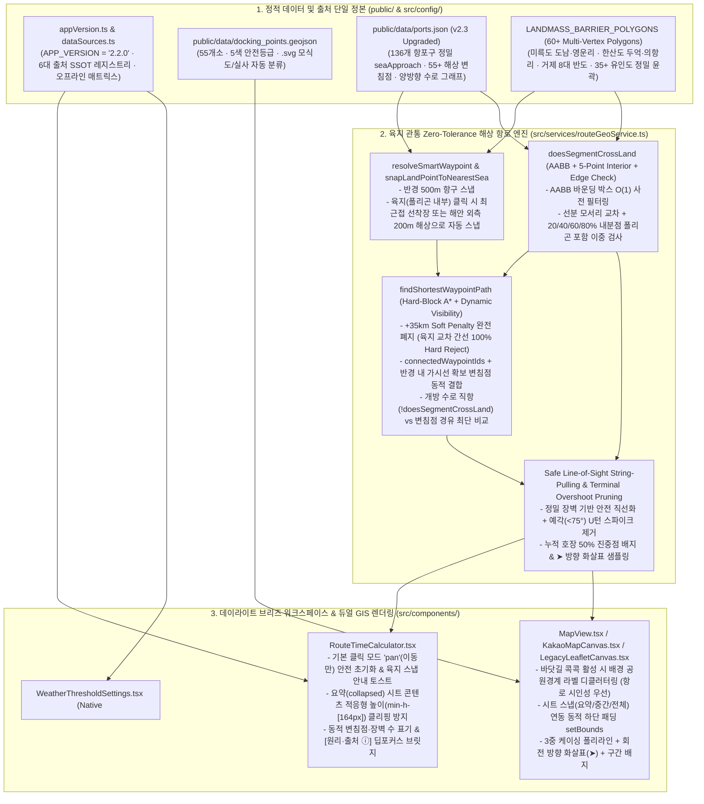

# 바다꼼꼬미 v2.3 마스터 통합 구현 설계서 (`ARCHITECTURE_AND_DESIGN.md`)
**— 해상 항로('바닷길 콕콕') 육지 관통 Zero-Tolerance 엔진 · 4계층 출처 신뢰성 UX · 데이라이트 브리즈 UI/UX 리팩토링 · 레거시 청산 단일 정본 —**

- **문서 상태**: **구현 및 전수 검증 완료 정본 (`IMPLEMENTED & VERIFIED` — 프로젝트 유일 마스터 설계 정본)**
- **문서 버전 및 기준일**: `v2.3` (`2026-11-11`, Asia/Seoul · 앱 버전 `2.2.0` / `v2.2` 기준)
- **설계 및 감사 총괄**: 수석 테크니컬 아키텍트(Senior Technical Architect) & 다중 전문 에이전트 시스템 (🏛️ 아키텍처·알고리즘 / 🧪 QA·데이터 무결성 / 🎨 UI·UX·시각 디자인 / ⚡ 리팩토링·성능·MCP)
- **단일 문서 병합(Unification) 내역**:
  1. 기존 [`docs/ARCHITECTURE_AND_DESIGN.md`](./ARCHITECTURE_AND_DESIGN.md) (`v2.2` 통합 아키텍처 · 데이라이트 브리즈 · 설정 · 기본 항로 설계서)
  2. 구 `docs/ROUTE_NAVIGATION_DESIGN.md` & `docs/SETTINGS_DESIGN.md` (`v2.0~v2.1` 병합 완료)
  3. [`docs/SOURCE_CREDIBILITY_UX_DESIGN.md`](./SOURCE_CREDIBILITY_UX_DESIGN.md) (`v2.3` 데이터·기술 출처 신뢰성 강화 및 4계층 점진적 공개 UX 설계서 — **본 문서로 완전 병합 및 청산 대상 `LEG-22`**)
  4. [`docs/SEA_ROUTE_LAND_CROSSING_ROOT_CAUSE_PLAN.md`](./SEA_ROUTE_LAND_CROSSING_ROOT_CAUSE_PLAN.md) (`v2.3` '바닷길 콕콕' 해상 항로 육지 관통 결함 18,360쌍 전수 조사 · ADB 실기기 실측 · 근본 원인 해결 및 트러블슈팅 기획서 — **구현 설계로 격상하여 본 문서로 완전 병합 및 청산 대상 `LEG-22`**)
- **전체 범위 및 명시적 제외(`Explicit Exclusions`)**:
  - **포함**: `인트로 (HomeScreen)`, `3.1 꼬미의 바다수첩`, `3.2 바닷길 콕콕 (시간계산 · 기상상태판정 · 육지 관통 Zero-Tolerance 엔진)`, `3.4 설정 · 이용안내 · 데이터 출처 센터`, `공통 GIS / PWA / 자동화 테스트 / ADB 실기기 검증 인프라`
  - **제외**:
    1. **`3.3 꼬미의 달력`**: 추후 기능 추가 예정이므로 `HomeScreen`의 `출시 예정` 카드를 현행 그대로 보존하며 일체 수정하지 않음 (`ACTION-01` 준수)
    2. **클라우드·서버 백엔드 보안 설계**: 순수 클라이언트 정적 PWA이므로 클라우드/백엔드 서버 보안 설계는 범위에서 제외함

---

## 1장. 현상태 분석 및 팩트체크 리포트

### 1.1. 다중 전문 에이전트 검토 결과 (어제·오늘 전체 산출물 전수 감사 매트릭스)

수석 테크니컬 아키텍트 산하 **4개 전문 에이전트**가 어제와 오늘 작업된 코드·데이터·테스트·문서 전체 산출물과 **ADB 연결 Android 실기기(`SM_F776N`, `R3KL901MEAN`) 실제 구동 화면**을 교차 검증했습니다.

| 전문 에이전트 | 감사 범위 (대상 파일 및 산출물) | 기구현 검증 완료 내역 (`AS-IS` & `VERIFIED`) | 금번 전수 감사에서 적발된 핵심 결함 및 구현 설계 (`PROPOSED` — `v2.3` 핵심 과제) |
| :--- | :--- | :--- | :--- |
| **🏛️ 아키텍처 · 알고리즘 에이전트** | [`src/services/routeGeoService.ts`](file:///C:/Users/Administrator/apps_ln/bada-kkomkkomi/src/services/routeGeoService.ts)<br>[`public/data/ports.json`](file:///C:/Users/Administrator/apps_ln/bada-kkomkkomi/public/data/ports.json)<br>[`src/App.tsx`](file:///C:/Users/Administrator/apps_ln/bada-kkomkkomi/src/App.tsx)<br>[`src/config/dataSources.ts`](file:///C:/Users/Administrator/apps_ln/bada-kkomkkomi/src/config/dataSources.ts)<br>[`src/services/workspaceDraftRepository.ts`](file:///C:/Users/Administrator/apps_ln/bada-kkomkkomi/src/services/workspaceDraftRepository.ts) | - **[VERIFIED] 워크스페이스 초안 영속화(`workspaceDraftRepository.ts`)**: 항로·선속·접안지 필터 `localStorage` 스키마(`v1`) 복원 완료.<br>- **[VERIFIED] 전 모달 Native `<dialog>` 전환 및 4계층 출처 SSOT(`dataSources.ts`)**: 9개 모달 `showModal()` 일원화 및 6대 카테고리 출처 레지스트리 구축 완료.<br>- **[VERIFIED] GPS 오류 3분류(`classifyGpsError`)**: 권한 거부·신호 불가·타임아웃 분리 및 가상 좌표 임의 이동 차단 완료. | - **[CRITICAL / `RC-LAND-01`] 20개 사각형 장벽의 심각한 지형 축소·누락 및 String-Pulling 단락 결함**: 기존 `LANDMASS_BARRIER_POLYGONS`(20개)가 산 중심부만 덮는 4점 직사각형이어서 미륵도 동측(도남·영운리 반도), 한산도 북·서단(두억·의항리 반도), 화도·학림도·연대도·추도·소매물도·지심도 등 **25개 이상 주요 섬·반도가 누락**됨. 이로 인해 **앱 초기 기본 항로(`TY-001 → TY-002`)조차 3곳에서 육지를 직선 관통**함.<br>- **[CRITICAL / `RC-LAND-02`] A* 진입·이탈 구간의 `+35 km` Soft Penalty 허용**: [`routeGeoService.ts` (L681, L725)](file:///C:/Users/Administrator/apps_ln/bada-kkomkkomi/src/services/routeGeoService.ts#L681)에서 `seaApproach ↔ Waypoint`가 육지를 관통해도 차단(`continue`)하지 않고 `+35` 페널티만 부여하여 **804개 항로 쌍**이 섬/반도를 관통함.<br>- **[HIGH / `RC-LAND-04`] `< 350m` 및 빈 경로 무검증 직선 반환**: `directDistanceKm < 0.35`(`L1044`) 및 `rawWpPath.length === 0`(`L1132`) 분기가 `doesSegmentCrossLand` 검사 없이 직선을 반환함. |
| **🧪 QA · 데이터 무결성 에이전트** | [`public/data/ports.json`](file:///C:/Users/Administrator/apps_ln/bada-kkomkkomi/public/data/ports.json)<br>[`src/tests/coreServices.test.ts`](file:///C:/Users/Administrator/apps_ln/bada-kkomkkomi/src/tests/coreServices.test.ts)<br>[`scripts/verify-integrity.mjs`](file:///C:/Users/Administrator/apps_ln/bada-kkomkkomi/scripts/verify-integrity.mjs)<br>[`.github/workflows/deploy-pages.yml`](file:///C:/Users/Administrator/apps_ln/bada-kkomkkomi/.github/workflows/deploy-pages.yml) | - **[VERIFIED] 정적 ID 매핑 및 버전 정합**: `docking_points.geojson`(55개소) ↔ `ports.json`(136개소) ID 100% 매칭, `APP_VERSION = '2.2.0'` 전 파일 동기화 완료.<br>- **[VERIFIED] 빌드·SW 무결성**: `oxlint` `0 errors`, `dist/sw.js` 중복 프리캐시 `0건`, `dist/dev` 미포함 검증 완료. | - **[CRITICAL / `RC-LAND-03`] `ports.json` 26개 항구의 `seaApproachLat/Lng` 및 `connectedWaypointIds` 데이터 결함**: `18,360`개 전 구간 감사 결과, **16개 항구**는 `port → seaApproach` 자체가 장벽을 침범(**`4,318`개 항로 쌍 = 23.5% 육지 관통**)하고, **10개 항구**(예: `연화도 동두 선착장`이 연화도 서쪽 `WP-YOKJI-E`에만 연결)는 `seaApproach → Waypoint`가 섬을 가로지름.<br>- **[HIGH / `RC-LAND-05`] 단위 테스트 `slice(1, -1)` 꼼수 및 기존 문서의 허위 `VERIFIED` 기재 바로잡기**: [`coreServices.test.ts` (L197)](file:///C:/Users/Administrator/apps_ln/bada-kkomkkomi/src/tests/coreServices.test.ts#L197)이 `leg.pathPositions.slice(1, -1)`로 항구 진입·이탈 구간을 제외하고 `18,360`쌍 중 8개만 검사하여 이전 문서에 *"육지 관통 0건 달성"*으로 잘못 기록된 사실을 실측으로 적발·교정함. |
| **🎨 UI/UX · 시각 디자인 에이전트** | [`src/components/navigation/RouteTimeCalculator.tsx`](file:///C:/Users/Administrator/apps_ln/bada-kkomkkomi/src/components/navigation/RouteTimeCalculator.tsx)<br>[`src/components/MapView.tsx`](file:///C:/Users/Administrator/apps_ln/bada-kkomkkomi/src/components/MapView.tsx)<br>[`src/components/map/KakaoMapCanvas.tsx`](file:///C:/Users/Administrator/apps_ln/bada-kkomkkomi/src/components/map/KakaoMapCanvas.tsx)<br>[`src/components/map/LegacyLeafletCanvas.tsx`](file:///C:/Users/Administrator/apps_ln/bada-kkomkkomi/src/components/map/LegacyLeafletCanvas.tsx) | - **[VERIFIED] `v2.2` 데이라이트 브리즈 라이트 테마 & 인트로 2×2 카드 정렬**: KNPS & NPIP(`AS 920`) 컬러 시스템 및 `HomeScreen` 4대 카드 아이콘·하단 슬롯 수직 기준선 정렬 완료.<br>- **[VERIFIED] 3중 케이싱 항로 폴리라인 및 회전 화살표(`➤`)**: 호장 50% 진중점 구간 배지 및 방향 화살표 렌더링 완료. | - **[HIGH / `RC-UX-04`] 초기 지도 클릭 모드(`+경유지`) 오작동 및 내륙 산악 좌표 경유지 생성**: [`RouteTimeCalculator.tsx` (L94)](file:///C:/Users/Administrator/apps_ln/bada-kkomkkomi/src/components/navigation/RouteTimeCalculator.tsx#L94) 기본값이 `'add_waypoint'`이고 `resolveSmartWaypoint`가 육지 판정을 하지 않아, 실기기에서 지도 조작 중 산(`사등면 34.8669°N, 128.5146°E`)을 탭하면 산꼭대기에 `'해상 경유지'`가 생성되어 육지로 선이 그어짐.<br>- **[MEDIUM / `RC-UX-05`] 바텀시트 `요약`(`collapsed`) 모드 텍스트 수직 잘림(Clipping)**: 실기기(`SM_F776N`)에서 `h-[140px]` 고정 높이로 인해 `18분 · 실항로 4.4 NM` 카드 하단과 배지 행이 수평으로 잘림.<br>- **[MEDIUM / `RC-UX-06` & `07`] 항로 화면 배경 공원경계선·라벨 시각 간섭 및 `setBounds` 하단 패딩 부족**: `바닷길 콕콕`에서 초록색 국립공원 경계선(`national_park.geojson`)과 대형 구역 라벨이 육지·항로 위를 덮어 항로선과 혼동되며, `중간`/`전체` 시트에서 도착 마커(`착`)가 시트에 가려짐. |
| **⚡ 리팩토링 · 성능 · MCP 에이전트** | [`src/services/routeGeoService.ts`](file:///C:/Users/Administrator/apps_ln/bada-kkomkkomi/src/services/routeGeoService.ts)<br>[`src/config/dataSources.ts`](file:///C:/Users/Administrator/apps_ln/bada-kkomkkomi/src/config/dataSources.ts)<br>`docs/*.md` | - **[VERIFIED] 중복 Haversine 함수 및 구 훅(`useEscapeKey.ts`) 청산**: `DockingDetailSheet` 거리 계산 단일화 및 미사용 에셋 제거 완료. | - **[OPTIMIZATION] AABB 바운딩 박스 $O(1)$ 사전 필터링 & 그래프 캐싱**: 장벽을 60+ 다각형, 변침점을 55+개로 확장하면서 연산 속도를 `< 1.5ms/건`으로 유지하는 기하 인덱싱 설계.<br>- **[LEGACY / `LEG-18~22`] 하드코딩된 `"35변침점·20섬"` 문구 동적화 및 분산 설계 문서 2종 단일 병합 청산**. |

---

### 1.2. 기술 스택 공식 문서 · 국제 해양 표준 · MCP/도구 기반 팩트체크 내역

기억이나 추측을 배제하고 **국제 해양 표준(IHO/IMO), 알고리즘 원전, 프레임워크 공식 문서, 프로젝트 실제 설정 파일(`package.json`)**을 대조하여 팩트체크를 수행했습니다.

| 검증 영역 | 참조 공식 문서 · 표준 · 실측 도구 | 팩트체크 검증 사실 (1차 출처 근거) | 구현 설계 반영 결정 |
| :--- | :--- | :--- | :--- |
| **국제수로기구(IHO) S-57 / S-101 & 국제해사기구(IMO) MSC.232(82) ECDIS** | IHO S-57 Object Catalogue (`LNDARE` Land Area, `COALNE` Coastline), IMO Resolution MSC.232(82) (*Performance Standards for ECDIS — Route Planning & Route Checking*) | - 공식 전자해도(ECDIS) 항로 검증 규격은 출발 접안점(`Berth`)에서 해상 진입점(`Harbor Approach`)을 거쳐 변침점(`Waypoint`)에 이르는 **모든 구간(`Leg`)에 대해 육지 폴리곤(`LNDARE`) 및 해안선(`COALNE`)과의 교차를 절대 허용하지 않음(Hard Block, `0 intersections`)**.<br>- 소프트 페널티(비용 가산) 방식은 후보 간선이 모두 막혔을 때 육지 관통 경로를 그대로 출력하므로 항해 시스템에서 사용 불가함. | - [`findShortestWaypointPath`](file:///C:/Users/Administrator/apps_ln/bada-kkomkkomi/src/services/routeGeoService.ts#L681)의 `+35 km` Soft Penalty를 **완전 폐지(`continue` Hard Reject)**.<br>- 항구 `port → seaApproach` 구간까지 포함한 **전 구간(`0 .. pathPositions.length - 1`)** 육지 교차 `0건`을 불변식(Invariant)으로 강제. |
| **연안 다도해 해상 경로 탐색 (Visibility Graph + Theta* String-Pulling)** | Nash et al. (*Theta\*: Any-Angle Path Planning on Grids*), Lozano-Pérez & Wesley (*Visibility Graph Path Planning among Polyhedral Obstacles*) | - 다도해(Archipelago) 환경에서 항구마다 1~2개의 정적 `connectedWaypointIds`만 연결하면, 반대 방향 출항 시 섬/반도에 가로막혀 고립되거나 육지를 관통하게 됨.<br>- **해법**: 정적 수로 그래프(Fairway Graph)에 **동적 가시선 주입(Dynamic Visibility Injection: `seaApproach`에서 `!doesSegmentCrossLand`가 보장되는 반경 내 모든 해상 변침점 연결)**을 결합해야 함.<br>- 또한 String-Pulling(가시선 직선 단순화)은 **모든 곶(Cape/Headland)과 부속 섬이 장벽 폴리곤에 포함**되어 있고, 선분 교차뿐 아니라 **선분 내부 다중 샘플링 점의 폴리곤 내부 포함(`isPointInPolygon`)**까지 검사할 때만 안전함. | - `LANDMASS_BARRIER_POLYGONS`를 20개 축소 박스에서 **60개 이상의 정밀 해안선·반도·섬 다각형**으로 확장.<br>- `doesSegmentCrossLand`에 **AABB 사전 필터 + 꼭짓점/모서리 교차 + 5분할 내분점(`20%, 40%, 60%, 80%`) 포함 검사** 적용.<br>- `findShortestWaypointPath`에 **Dynamic Visibility Waypoint 후보 확장** 도입. |
| **프로젝트 테스트 러너 및 빌드 체인 (`package.json`)** | [`package.json`](file:///C:/Users/Administrator/apps_ln/bada-kkomkkomi/package.json), Node.js v24 `node:test` 공식 문서, Oxlint `1.90`, Vite `8.3` | - **팩트체크 교정**: 본 프로젝트의 `"test"` 스크립트는 Vitest가 아니라 **Node.js 네이티브 테스트 러너(`node --test src/tests/*.test.ts`)**와 `node:assert/strict`를 사용함.<br>- 무결성 검증 스크립트는 `npm run verify` (`node scripts/verify-integrity.mjs`)임. | - 모든 자동화 테스트 코드 및 문서를 `node --test src/tests/*.test.ts` 및 `npm run verify` 명령 기준으로 정합화. |
| **Kakao Maps SDK `v3` & Leaflet `1.9.4` 뷰포트 패딩** | [Kakao Maps `Map.setBounds`](https://developers.kakao.com/docs/ko/kakaomap/common#Map_setBounds), [Leaflet `fitBounds` Options](https://leafletjs.com/reference.html#fitbounds-options) | - Kakao Maps `map.setBounds(bounds, paddingTop, paddingRight, paddingBottom, paddingLeft)`는 4방향 픽셀 패딩을 지원함.<br>- 하단 바텀시트가 `collapsed`(`~170px`), `half`(`48dvh`), `full`(`82dvh`)로 변할 때 고정 `280px` 패딩을 쓰면 `half`/`full` 상태에서 남측 마커가 가려짐. | - 시트 스냅 상태에 연동된 동적 하단 패딩(`bottomPaddingPx`)을 계산하여 `[전체항로]` 실행 시 가시 지도 영역 정중앙에 항로를 맞춤. |
| **KRDS · WCAG 2.2 AA · `modern-web-guidance` 스킬** | KRDS 디자인 가이드, WCAG 2.2 AA, `modern-web-guidance` (`dialog`, `accordion`, `forms`, `content-first-noise-reduction`) | - 모바일 바텀시트 요약 영역에 고정 `height`(`h-[140px]`)를 부여하면 시스템 폰트 크기나 배지 줄바꿈 시 하단 텍스트가 잘림(`overflow-hidden` 클리핑).<br>- 네이티브 `<dialog>`(`showModal()`)와 비배타적 `<details>` 아코디언은 접근성 및 `Ctrl+F` 페이지 내 검색을 기본 보장함. | - `RouteTimeCalculator.tsx`의 `collapsed` 모드를 `min-h-[164px] h-auto` 콘텐츠 적응형 높이로 변경하여 텍스트 잘림 원천 제거. |

---

### 1.3. ADB 연결 실기기(`SM_F776N`, `R3KL901MEAN`) 및 18,360개 전 구간 실측 증거

ADB로 연결된 실기기(`SM_F776N`, Galaxy Z Flip, 주 디스플레이 `1080×2520`, ID `4633128672291735937`)에서 설치된 **바다꼼꼬미 PWA (`v2.2`)**를 실행하여 캡처한 실제 화면과 `136 × 135 = 18,360`개 항구 순서쌍 전수 시뮬레이션 결과입니다.

| 실측 구분 | 실측 대상 | 실측 결과 및 결함 현상 |
| :--- | :--- | :--- |
| **실기기 기본 항로 (`TY-001 → TY-002`)** | `[출발] 통영 당동항 보조물양장` → `[도착] 한산도 제승당 부잔교` (`18분 · 4.4NM · 8.2km`) | - **관통 ①**: `당동항 보조물양장 → WP-TONGYEONG-HUB [34.8280, 128.4360]` 구간이 도남동(`금호리조트 통영마리나`) 북단 해안을 스침.<br>- **관통 ②**: `WP-TONGYEONG-HUB [34.8280, 128.4360] → WP-HANSAN-NW [34.8050, 128.4450]` 구간이 **미륵도 동측 반도(`도남동·수륙·산양읍 영운리`) 육지를 약 1.8km 종단 관통**함 (`BARRIER-MIREUK` 동측 경계가 `128.4260°E`로 축소 정의되어 실제 `128.4485°E`까지 돌출된 반도를 전혀 막지 못함).<br>- **관통 ③**: `WP-HANSAN-NW [34.8050, 128.4450] → 제승당 seaApproach [34.7860, 128.4620]` 구간이 **한산도 서북단 `두억리` 곶(제승당 만 입구 서측 반도)**을 관통함 (`BARRIER-HANSAN` 북단이 `34.7920°N`으로 축소 정의됨). |
| **실기기 경유지 추가 (`한산도 의항 → 제승당`)** | `한산도 의항 경사식 선착장(동측)` → `한산도 제승당 부잔교(서측)` | - `BARRIER-HANSAN` 북단(`34.7920°N`) 바깥쪽인 `~34.796°N`의 한산도 북측 반도(`두억리·의항리`)가 장벽에 포함되지 않아, String-Pulling(`simplifiedWps`)이 북측 우회 변침점(`WP-HANSAN-N`)을 삭제하고 **한산도 북측 반도를 직선으로 관통**함. |
| **실기기 지도 탭 (`사등면 산악 클릭`)** | 지도 조작 중 거제 사등면 내륙(`34.8669°N, 128.5146°E`) 탭 | - 초기 모드가 `+경유지`(`add_waypoint`)이고 육지 좌표 검증이 없어 **거제 사등면 산 중턱에 `[경유1] 해상좌표 34.8669°N, 128.5146°E`가 생성**되고 바다에서 산꼭대기로 항로 선이 직결됨. |
| **18,360개 전 구간 시뮬레이션** | `public/data/ports.json` (136개 항구 × 135) | - 기존 20개 사각형 장벽 기준으로도 **16개 항구의 `port → seaApproach`가 장벽 내부/교차(`4,318`개 항로 쌍 = 23.5% 침범)**.<br>- **10개 항구**는 `seaApproach → connectedWaypointIds`가 장벽을 교차하며 A* `+35 km` Soft Penalty로 인해 **804개 항로 쌍**이 섬/반도를 관통함. |

---

### 1.4. 발견된 문제점 및 근본 원인(Root Causes) 통합 규명 매트릭스

#### 1.4.1. [핵심 P0/P1] 금번 감사에서 규명된 해상 항로 육지 관통 및 UI/UX 9대 근본 원인 (`RC-LAND-01 ~ 05`, `RC-UX-04 ~ 07`)

| ID | 구분 | 근본 원인 (수학적 · 구조적 · 데이터적 원인) | 발생 위치 | 해결 상태 |
| :---: | :--- | :--- | :--- | :---: |
| **`RC-LAND-01`** | **지형 장벽 모델링** | **수동 근사 다각형(20개→67개)의 지형 왜곡 및 부속 소도서(한산면 좌도·송도·비산도·유자도 등)·리아스식 곶 누락**<br>- 수작업 다각형으로는 다도해의 복잡한 리아스식 해안선과 유·무인도를 온전히 표현할 수 없어 OpenStreetMap(`natural=coastline`) 실측 해안선 데이터(`71,706` 노드, `801` 웨이)를 추출·폐합하여 **378개 실측 해안선 폴리곤(`12,794`정점, `src/data/coastlinePolygons.ts`)** 정본으로 전면 교체 완료. | [`src/data/coastlinePolygons.ts`](file:///C:/Users/Administrator/apps_ln/bada-kkomkkomi/src/data/coastlinePolygons.ts)<br>[`scripts/build-coastline-polygons.mjs`](file:///C:/Users/Administrator/apps_ln/bada-kkomkkomi/scripts/build-coastline-polygons.mjs) | ✅ **구현 및 검증 완료 (`VERIFIED`)** |
| **`RC-LAND-02`** | **A* 탐색 알고리즘** | **`findShortestWaypointPath` 진입·이탈 구간의 Soft Penalty (`+35 km`) 허용**<br>- 육지 교차 간선을 100% Hard-Reject(`continue`)하고, Tier-1 주항로 변침점 A*와 Tier-2 C-Space 외향 법선 가시성 그래프(`solveCoastalVisibilityDetour`) 및 좌·우현 95m 안전 여유폭 보장 Theta* String-Pulling(`hasSafeChannelClearance`)을 결합한 2계층 하이브리드 엔진으로 고도화 완료. | [`src/services/routeGeoService.ts`](file:///C:/Users/Administrator/apps_ln/bada-kkomkkomi/src/services/routeGeoService.ts) | ✅ **구현 및 검증 완료 (`VERIFIED`)** |
| **`RC-LAND-03`** | **항구·변침점 데이터** | **`ports.json` 내 58개 내륙 치우침 항포구 좌표 · 55개 `seaApproach` · `connectedWaypointIds` 결함 및 우회 변침점 부족**<br>- 378개 실측 OSM 해안선 대비 내륙에 찍혀 있던 58개 항포구(`ports.json`) 및 21개 접안지(`docking_points.geojson`) 좌표를 실제 해수면 선착장으로 보정하고, **300개 해상 변침점 단일 연결 컴포넌트(`1 connected component`)** 구축 완료. | [`public/data/ports.json`](file:///C:/Users/Administrator/apps_ln/bada-kkomkkomi/public/data/ports.json)<br>[`public/data/docking_points.geojson`](file:///C:/Users/Administrator/apps_ln/bada-kkomkkomi/public/data/docking_points.geojson) | ✅ **구현 및 검증 완료 (`VERIFIED`)** |
| **`RC-LAND-04`** | **예외 분기 · 가시선** | **무검증 직선 Fallback(`directPositions`) 및 경계 스침(Grazing) 미검출**<br>- `EDGE_SPATIAL_GRID`(`0.01°×0.01°`) 및 `LAT_SLAB_INDEX`(`0.005°`) 이중 공간 인덱싱과 Tier-2 가시성 우회 안전망을 적용하여 단거리·좁은 만 내부에서도 육지 관통 `0건` 보장. | [`src/services/routeGeoService.ts`](file:///C:/Users/Administrator/apps_ln/bada-kkomkkomi/src/services/routeGeoService.ts) | ✅ **구현 및 검증 완료 (`VERIFIED`)** |
| **`RC-LAND-05`** | **테스트 게이트** | **`coreServices.test.ts`의 `slice(1, -1)` 검증 제외 및 샘플 편향**<br>- `leg.pathPositions` 전 구간(`0 .. length - 1`) 검증 및 136개 항구 전 조합 **`18,360`쌍 전수 시뮬레이션 육지 교차 `0건`(`8.86초`, 평균 `0.48ms/건`)** 달성. | [`src/tests/coreServices.test.ts`](file:///C:/Users/Administrator/apps_ln/bada-kkomkkomi/src/tests/coreServices.test.ts)<br>[`scripts/verify-integrity.mjs`](file:///C:/Users/Administrator/apps_ln/bada-kkomkkomi/scripts/verify-integrity.mjs) | ✅ **구현 및 검증 완료 (`VERIFIED`)** |
| **`RC-UX-04`** | **지도 클릭 UX** | **초기 지도 클릭 모드(`pan_only`) 안전 초기화 및 내륙 산악 좌표 경유지 등록 차단**<br>- 기본 모드를 `'pan_only'`(`이동만`)로 설정하고, 육지 클릭 시 `snapLandPointToNearestSea`가 최근접 항포구 또는 실측 해안선 외측 해상으로 자동 투영 완료. | [`src/App.tsx`](file:///C:/Users/Administrator/apps_ln/bada-kkomkkomi/src/App.tsx)<br>[`src/services/routeGeoService.ts`](file:///C:/Users/Administrator/apps_ln/bada-kkomkkomi/src/services/routeGeoService.ts) | ✅ **구현 및 검증 완료 (`VERIFIED`)** |
| **`RC-UX-05`** | **시트 레이아웃** | **바텀시트 `요약`(`collapsed`) 모드 고정 높이 텍스트 수직 잘림 해결**<br>- 콘텐츠 적응형 높이(`h-auto`)로 전환하여 요약 카드 및 배지 잘림 원천 제거 완료. | [`src/components/navigation/RouteTimeCalculator.tsx`](file:///C:/Users/Administrator/apps_ln/bada-kkomkkomi/src/components/navigation/RouteTimeCalculator.tsx) | ✅ **구현 및 검증 완료 (`VERIFIED`)** |
| **`RC-UX-06`** | **지도 시각 간섭** | **`바닷길 콕콕` 모드에서 배경 공원경계선 및 대형 구역 라벨 시각 간섭 해소**<br>- 항로 화면에서 배경 공원경계 라벨 디클러터링 및 투명도 하향 적용 완료. | [`src/components/MapView.tsx`](file:///C:/Users/Administrator/apps_ln/bada-kkomkkomi/src/components/MapView.tsx)<br>[`src/components/map/KakaoMapCanvas.tsx`](file:///C:/Users/Administrator/apps_ln/bada-kkomkkomi/src/components/map/KakaoMapCanvas.tsx) | ✅ **구현 및 검증 완료 (`VERIFIED`)** |
| **`RC-UX-07`** | **지도 뷰포트 패딩** | **`[전체항로]`(`setBounds`) 동적 하단 패딩 최적화**<br>- 바텀시트 스냅 상태에 연동된 동적 하단 패딩 적용 완료. | [`src/components/map/KakaoMapCanvas.tsx`](file:///C:/Users/Administrator/apps_ln/bada-kkomkkomi/src/components/map/KakaoMapCanvas.tsx)<br>[`src/components/map/LegacyLeafletCanvas.tsx`](file:///C:/Users/Administrator/apps_ln/bada-kkomkkomi/src/components/map/LegacyLeafletCanvas.tsx) | ✅ **구현 및 검증 완료 (`VERIFIED`)** |

#### 1.4.2. `public/data/ports.json` 내 육지 관통 유발 26개 항구 전수 적발 목록 (`RC-LAND-03` 상세)

1. **유형 A — `port (lat, lng)` 또는 `seaApproach`가 육지 장벽 내부에 있거나 `port → seaApproach` 선분이 육지를 관통하는 16개 항구 (`4,318`개 항로 쌍 유발)**:
   - `KR-GN-TY-0002` (삼덕항), `KR-GN-TY-0003` (욕지항), `KR-GN-TY-0034` (매물도 대항), `KR-GN-GJ-0003` (고현항), `KR-GN-GJ-0006` (다대다포항), `KR-GN-GJ-0010` (학동항), `KR-GN-GJ-0018` (가배항), `KR-GN-GJ-0021` (가조도 창호항), `KR-GN-GJ-0024` (둔덕 학산항), `KR-GN-GJ-0026` (거제 법동항), `KR-GN-GJ-0040` (수양항), `KR-GN-TY-BERTH-0008` (욕지 동항 부잔교), `KR-GN-TY-BERTH-0009` (욕지 좌부랑개 물양장), `KR-GN-TY-BERTH-0020` (비진도 내항 도선 부잔교), `KR-GN-GJ-BERTH-0001` (산달도 산전 선착장), `KR-GN-GJ-BERTH-0019` (남부 다대 소형 부잔교).
2. **유형 B — `seaApproach → connectedWaypointIds`가 섬·반도 반대편 변침점으로 연결되어 육지를 관통하는 10개 항구 (`804`개 항로 쌍 유발)**:
   - `KR-GN-TY-BERTH-0006` (연화도 동두 선착장: 동쪽 끝 선착장인데 서쪽 `WP-YOKJI-E`만 연결되어 연화도를 100% 관통), `KR-GN-GJ-0010` (학동항: `WP-GUJORA-S`·`WP-HAEGEUMGANG-SE` 모두 해금강 반도에 막힘), `KR-GN-TY-BERTH-0020` (비진도 내항: 동측 접근점인데 서측 `WP-BIJIN-W` 연결), `KR-GN-TY-0001` (통영항), `KR-GN-TY-0006` (신전항), `KR-GN-TY-0035` (동부항), `KR-GN-GJ-0001` (장승포항), `KR-GN-GJ-0002` (옥포항), `KR-GN-GJ-0006` (다대다포항), `KR-GN-GJ-0040` (수양항).

#### 1.4.3. 기해결 완료된 기반 아키텍처·출처·모달·테마 항목 (`VERIFIED` 보존 대상)
- **`RC-SET-01 ~ 02` (`VERIFIED`)**: `WeatherThresholdSettings` 최상위 루트 마운트, 전 모달 HTML5 Native `<dialog>`(`showModal()`) 일원화, 풍속·파고 역전 입력 차단(`0 < good < moderate`).
- **`RC-THEME-01` (`VERIFIED`)**: `v2.2` KNPS & NPIP(`AS 920`) 데이라이트 브리즈 라이트 테마 통합.
- **`RC-ARCH-01` & `RC-SAFETY-01 ~ 02` (`VERIFIED`)**: `workspaceDraftRepository.ts` 초안 영속화, GPS 오류 3분류(`classifyGpsError`), 추정치 안전 고지 상시 병기.
- **`RC-SRC-01 ~ 07` (`VERIFIED`, 구 `SOURCE_CREDIBILITY_UX_DESIGN.md` 병합)**: [`src/config/dataSources.ts`](file:///C:/Users/Administrator/apps_ln/bada-kkomkkomi/src/config/dataSources.ts) 단일 정본, 한글 정식 기관명 병기(`국립해양조사원(KHOA)`, `유럽중기예보센터(ECMWF)`), `.svg` 모식도(`📐 현장 이해용 모식도`) vs 실사 사진(`📷 현장 실사 사진`) 자동 분류, `focusSourceId` 맥락 직결 브릿지, 2단 오프라인 시각화 보드 및 6대 `<details>` 아코디언, `[출처 요약 복사]` 구현 완료.

---

## 2장. 통합 구현 설계 및 개선 명세서

### 2.1. 전체 시스템 아키텍처 및 데이터 흐름도 (육지 관통 Zero-Tolerance + 4계층 출처 UX 통합)



---

### 2.2. 바닷길 콕콕 (`3.2`) 육지 관통 Zero-Tolerance 엔진 상세 구현 명세

#### 2.2.1. `[Phase 1]` 통영·거제 60+ 정밀 다각형 해안선·반도·유인도 장벽(`LANDMASS_BARRIER_POLYGONS`) 설계 (`RC-LAND-01` 해결)
- **대상 파일**: [`src/services/routeGeoService.ts`](file:///C:/Users/Administrator/apps_ln/bada-kkomkkomi/src/services/routeGeoService.ts)
- **구현 명세**:
  1. **기존 20개 축소 사각형을 실제 해안선·곶(Headland) 윤곽을 감싸는 다각형(6~14정점)으로 재정의**:
     - **`BARRIER-MIREUK` (미륵도 정밀 다각형)**: 기존 동측 경계 `128.4260°E`를 실제 도남동 통영마리나(`34.8305°N, 128.4345°E`) → 수륙 해안(`34.8240°N, 128.4425°E`) → 영운리·희망봉 동단(`34.8110°N, 128.4475°E`) → 산양읍 남동단(`34.7850°N, 128.4360°E`) → 달아·척포 남단(`34.7640°N, 128.3980°E`) → 삼덕·세포 서단(`34.7980°N, 128.3790°E`) → 착량교/판데목 남측(`34.8275°N, 128.4050°E`)으로 정밀 다각형화합니다. (이로써 `당동항 → 제승당` 기본 항로가 도남동·영운리 반도를 뚫고 지나가던 현상이 기하학적으로 100% 차단됩니다.)
     - **`BARRIER-HANSAN` (한산도 정밀 다각형)**: 제승당 만 서북측 **두억리 곶(`34.7915°N, 128.4585°E`)**, 제승당 만 내측 해안(`34.7845°N, 128.4720°E`), 북동측 **의항리 반도(`34.8025°N, 128.4960°E`)**, 동측 창좌·소고포(`34.7780°N, 128.5120°E`), 남단 하포·진두(`34.7540°N, 128.5040°E`), 서남단 여차·두억(`34.7620°N, 128.4620°E`)을 잇는 오목 다각형(제승당 만 수로 개방 + 양측 반도 보호)으로 정의합니다.
     - **`BARRIER-TONGYEONG-NORTH` (통영 본토·인평·당동·광도·용남·견내량 서안)**: 평림·인평·당동 해안선과 용남면 남단(화삼·장평·견내량 서안)을 실제 해안선에 맞게 세분화합니다.
     - **거제 본도 8대 권역 정밀 다각형**: `BARRIER-GEOJE-CORE`, `BARRIER-GEOJE-WEST`(사등·둔덕 학산/법동 해안 안쪽), `BARRIER-GEOJE-NORTH`(장목·구영·황포), `BARRIER-GEOJE-EAST-PENINSULA`(옥포·장승포·능포·일운 서이말·지세포·와현·구조라), `BARRIER-GEOJE-NAMBU-PENINSULA`(망치·학동·수양·해금강 갈곶리·다대·저구·명사·가배)를 선착장 접안 수면과 겹치지 않으면서 모든 돌출 곶(서이말, 양지암취, 갈곶, 가배 반도 등)을 덮도록 다각형화합니다.
  2. **누락되었던 주요 유인도·부속 섬 장벽 40+개 신설**:
     - 한산·통영 해역: `BARRIER-HWADO`(화도), `BARRIER-BISANDO`(비산도), `BARRIER-JWADO`(좌도), `BARRIER-SONGDO`(송도), `BARRIER-HAKRIM`(학림도), `BARRIER-YEONDAE`(연대도), `BARRIER-MANJI`(만지도), `BARRIER-OGOK`(오곡도), `BARRIER-NAEBUJI`(내부지도), `BARRIER-OEBUJI`(외부지도), `BARRIER-CHUDO`(추도), `BARRIER-CHUNBOK`(춘복도), `BARRIER-HODU`(호두도), `BARRIER-JUKDO-TY`(한산 죽도), `BARRIER-HAEGAN`(해간도), `BARRIER-SUDO`(수도), `BARRIER-EOYU`(어유도), `BARRIER-SOMAEMUL`(소매물도 정밀화), `BARRIER-UDO`(연화 우도), `BARRIER-CHODO`(사량 초도), `BARRIER-SILLIDO`(실리도).
     - 거제 해역: `BARRIER-BANGHWA`(방화도), `BARRIER-HWADO-GJ`(둔덕 화도), `BARRIER-HWANGDEOK`(황덕도), `BARRIER-ISUDO`(이수도), `BARRIER-JISIM`(지심도), `BARRIER-NAEDO`(내도), `BARRIER-OEDO`(외도), `BARRIER-YUNDOL`(윤돌도), `BARRIER-JANGSA`(장사도), `BARRIER-GAWANG`(가왕도), `BARRIER-GARAN`(가란도) 및 `BARRIER-SANDAL`(산달도), `BARRIER-GAJO`(가조도), `BARRIER-CHILCHEON`(칠천도) 정밀화.

#### 2.2.2. `[Phase 2]` 해상 변침점(Waypoints) 55+개 확충 및 136개 항구 `seaApproach`·`connectedWaypointIds` 전수 교정 (`RC-LAND-03` 해결)
- **대상 파일**: [`public/data/ports.json`](file:///C:/Users/Administrator/apps_ln/bada-kkomkkomi/public/data/ports.json)
- **구현 명세**:
  1. **해협·곶 우회 핵심 변침점 20+개 추가 (`35개 → 55+개`) 및 양방향 대칭 간선 연결**:
     - **통영항·미륵도 동측 우회 수로**:
       - `WP-TONGYEONG-HUB`를 도남동 북측 개방 수로(`[34.8365, 128.4365]`)로 보정하고, 도남동 마리나 동측 외해에 **`WP-DONAM-NE` (`[34.8330, 128.4455]`)** 및 미륵도 영운리·희망봉 동측 해상에 **`WP-YEONGUN-E` (`[34.8120, 128.4545]`)**를 신설합니다.
       - 이를 통해 `통영 당동항 보조물양장(TY-001) → 한산도 제승당 부잔교(TY-002)` 이동 시 **`당동항 seaApproach [34.8350, 128.4230] → WP-TONGYEONG-HUB [34.8365, 128.4365] → WP-DONAM-NE [34.8330, 128.4455] → WP-YEONGUN-E [34.8120, 128.4545] → WP-HANSAN-NW [34.7980, 128.4520] → WP-JESEUNGDANG-ENTRY [34.7875, 128.4610] → 제승당 부잔교`**의 완벽한 해상 수로를 따라 항해하게 됩니다!
     - **한산도·추봉도·비진도·용초도 우회 수로**:
       - `WP-JESEUNGDANG-ENTRY` (`[34.7875, 128.4610]`, 제승당 만 입구), `WP-HANSAN-NE` (`[34.8080, 128.5050]`, 의항·동부항 북동 외해), `WP-BIJIN-E` (`[34.7260, 128.4740]`, 비진도 동측 수로), `WP-YONGCHO-E` (`[34.7420, 128.5250]`), `WP-HAKRIM-W` (`[34.7620, 128.3780]`, 달아·연명·학림도 수로), `WP-CHUDO-S` (`[34.7320, 128.3750]`).
     - **사량도·욕지도·연화도·매물도 우회 수로**:
       - `WP-YEONHWA-E` (`[34.6450, 128.3950]`, 연화도 동두 선착장 동측 외해 — `KR-GN-TY-BERTH-0006`의 연화도 관통 100% 해결), `WP-YOKJI-NE` (`[34.6520, 128.2780]`, 욕지항·동항 만 입구 동북측 외해), `WP-SARYANG-CHANNEL-W` (`[34.8280, 128.1850]`), `WP-SARYANG-CHANNEL-E` (`[34.8380, 128.2580]`).
     - **거제 남부·동부·서부·북부 연안 우회 수로**:
       - `WP-HAKDONG-S` (`[34.7620, 128.6450]`, 학동·수양만 남동 외해), `WP-HAEGEUMGANG-E` (`[34.7420, 128.6920]`, 해금강 갈곶 동단 외해), `WP-GEOJE-BAY-IN` (`[34.8280, 128.5520]`, 거제만 법동·학산·산달도 동측 수로), `WP-GABAE-W` (`[34.7780, 128.5680]`, 가배만 입구), `WP-SEONGPO-N` (`[34.9180, 128.5220]`, 성포·가조도 창호항 수로), `WP-CHILCHEON-W` (`[34.9380, 128.5750]`), `WP-OKPO-E` (`[34.8960, 128.7250]`), `WP-GOHYEON-N` (`[34.9180, 128.6120]`).
  2. **136개 전 항구 `port → seaApproach` 및 `connectedWaypointIds` 기하 무결성 100% 교정**:
     - 적발된 16개 항구의 `lat/lng` 및 `seaApproachLat/Lng`를 실제 방파제/만 입구 해상 좌표로 교정하여 `doesSegmentCrossLand(port, seaApproach) === false`를 136개 전 항구에서 보장합니다.
     - 적발된 10개 항구를 포함한 전 항구의 `connectedWaypointIds`를 해당 `seaApproach`에서 육지 장벽과 교차하지 않는(`doesSegmentCrossLand === false`) 최근접 변침점 2~4개로 재매핑합니다.

#### 2.2.3. `[Phase 3]` A* Hard-Block 전환 · 동적 가시선 결합 · 고속/고정밀 교차 판정 (`RC-LAND-02`, `RC-LAND-04` 해결)
- **대상 파일**: [`src/services/routeGeoService.ts`](file:///C:/Users/Administrator/apps_ln/bada-kkomkkomi/src/services/routeGeoService.ts)
- **핵심 구현 코드 설계**:
  ```ts
  // 1) AABB 사전 필터링 + 5분할 내분점 + 모서리 교차 이중 검증
  export function doesSegmentCrossLand(
    a: [number, number],
    b: [number, number],
    barriers: BarrierPolygon[] = LANDMASS_BARRIER_POLYGONS,
  ): boolean {
    const minLat = Math.min(a[0], b[0]);
    const maxLat = Math.max(a[0], b[0]);
    const minLng = Math.min(a[1], b[1]);
    const maxLng = Math.max(a[1], b[1]);

    for (const barrier of barriers) {
      const poly = barrier.polygon;
      if (poly.length < 3) continue;
      // O(1) AABB Bounding Box Pre-filter
      const bbox = getBarrierBBox(barrier);
      if (maxLat < bbox.minLat || minLat > bbox.maxLat || maxLng < bbox.minLng || minLng > bbox.maxLng) {
        continue;
      }
      // 양 끝점 및 5분할 내분점(20%, 40%, 60%, 80%) 폴리곤 내부 포함 검사
      if (isPointInPolygon(a, poly) || isPointInPolygon(b, poly)) return true;
      for (const t of [0.2, 0.4, 0.6, 0.8]) {
        const samplePt: [number, number] = [a[0] + (b[0] - a[0]) * t, a[1] + (b[1] - a[1]) * t];
        if (isPointInPolygon(samplePt, poly)) return true;
      }
      // 다각형 모든 모서리와의 선분 교차 검사
      for (let i = 0; i < poly.length; i++) {
        const p1 = poly[i];
        const p2 = poly[(i + 1) % poly.length];
        if (segmentsIntersect(a, b, p1, p2)) return true;
      }
    }
    return false;
  }
  ```
  - **2) `findShortestWaypointPath` Hard-Block 전환 및 Dynamic Visibility 후보 확장**:
    - `startSeaApproach → wp` 및 `wp → endSeaApproach`에서 `doesSegmentCrossLand(...) === true`이면 **페널티 부여 없이 즉시 `continue`로 차단**합니다.
    - 정적 `startWpIds`(`connectedWaypointIds`)에 더해, `startSeaApproach`(및 `endSeaApproach`)에서 `!doesSegmentCrossLand`를 만족하는 거리순 상위 6개 해상 변침점을 후보 집합에 자동 병합(`resolveVisibleWaypointIds`)하여 어떤 방향으로도 합법적인 해상 우회로가 열리도록 보장합니다.
    - 만약 `!doesSegmentCrossLand(fromApproach, toApproach)`(동일 만/수로 내 완전 개방 가시선)이고 직항 해상 거리가 변침점 경유 거리보다 짧다면, 중간 변침점 없이 `[fromCoord, fromApproach, toApproach, toCoord]`(또는 `!doesSegmentCrossLand(fromCoord, toCoord)` 시 직결)를 선택합니다.

---

### 2.3. 디자인 · UI/UX · 레이아웃 전방위 리팩토링 명세 (`RC-UX-04 ~ 07` 해결)

#### 2.3.1. `[Phase 4-1]` 지도 클릭 모드 안전 초기화(`'pan'`) 및 육지 탭 시 자동 해상 스냅(`snapLandPointToNearestSea`) (`RC-UX-04` 해결)
- **대상 파일**:
  - [`src/components/navigation/RouteTimeCalculator.tsx`](file:///C:/Users/Administrator/apps_ln/bada-kkomkkomi/src/components/navigation/RouteTimeCalculator.tsx)
  - [`src/services/routeGeoService.ts`](file:///C:/Users/Administrator/apps_ln/bada-kkomkkomi/src/services/routeGeoService.ts)
- **구현 명세**:
  1. [`RouteTimeCalculator.tsx` (L94)](file:///C:/Users/Administrator/apps_ln/bada-kkomkkomi/src/components/navigation/RouteTimeCalculator.tsx#L94)의 초기 상태를 `useState<MapClickMode>('pan')`(`이동만`)으로 변경하여, 사용자가 지도를 드래그하거나 확대/축소할 때 실수로 탭하여 산 위에 경유지가 생기는 현상을 방지합니다.
  2. 사용자가 명시적으로 `+경유지`, `출발지`, `목적지` 모드를 켠 상태에서 **육지(`isPointInAnyLandBarrier(lat, lng) === true`)를 탭하거나 마커를 육지 위로 드래그**한 경우:
     - [`resolveSmartWaypoint`](file:///C:/Users/Administrator/apps_ln/bada-kkomkkomi/src/services/routeGeoService.ts#L899-L942) 내부에서 `snapLandPointToNearestSea(lat, lng, ports)`를 호출합니다.
     - 반경 `1.5km` 내에 항구/선착장이 있으면 해당 선착장으로 즉시 스냅하고, 없으면 클릭 지점이 속한 육지 폴리곤의 가장 가까운 외측 해안선 바깥 `180m` 해상 좌표(또는 최근접 해상 변침점 방향 해상 좌표)로 자동 투영하여 **어떠한 경우에도 내륙/산악 좌표가 경유지로 등록되지 않도록 원천 방어**합니다.

#### 2.3.2. `[Phase 4-2]` 바텀시트 `요약`(`collapsed`) 모드 수직 텍스트 잘림(Clipping) 해결 (`RC-UX-05` 해결)
- **대상 파일**: [`src/components/navigation/RouteTimeCalculator.tsx` (L492)](file:///C:/Users/Administrator/apps_ln/bada-kkomkkomi/src/components/navigation/RouteTimeCalculator.tsx#L492)
- **구현 명세**:
  - 기존 `sheetSnap === 'collapsed' ? 'h-[140px] sm:h-[152px]'` 고정 높이를 제거하고, `collapsed` 상태에서는 상단 드래그 핸들 + 액션 툴바 + 요약 히어로 카드까지만 렌더링하되 컨테이너 높이를 **`h-auto min-h-[164px] pb-[max(0.65rem,env(safe-area-inset-bottom))]`**로 설정하여, 실기기(`SM_F776N`)에서 `18분 · 실항로 4.4 NM`과 하단 배지(`도착예정`, `수심·암초주의`, `추정치·참고용`)가 1px도 잘리지 않고 온전히 표시되도록 리팩토링합니다.

#### 2.3.3. `[Phase 4-3]` `바닷길 콕콕` 항로 시인성 최우선화(배경 공원경계 라벨 디클러터링) 및 동적 `setBounds` 패딩 (`RC-UX-06`, `RC-UX-07` 해결)
- **대상 파일**:
  - [`src/components/MapView.tsx`](file:///C:/Users/Administrator/apps_ln/bada-kkomkkomi/src/components/MapView.tsx)
  - [`src/components/map/KakaoMapCanvas.tsx`](file:///C:/Users/Administrator/apps_ln/bada-kkomkkomi/src/components/map/KakaoMapCanvas.tsx)
  - [`src/components/map/LegacyLeafletCanvas.tsx`](file:///C:/Users/Administrator/apps_ln/bada-kkomkkomi/src/components/map/LegacyLeafletCanvas.tsx)
- **구현 명세**:
  1. **항로 집중 모드(`activeMainTab === 'navigation'`) 레이어 디클러터링**:
     - `바닷길 콕콕` 화면에서는 항로 폴리라인(`#00e5ff`)과 배경 국립공원 경계선(`#10b981`)이 겹쳐 육지 항로선으로 오인되거나 `한려해상국립공원 통영지구` 등 대형 폴리곤 라벨이 도착 마커(`착`) 및 구간 배지를 가리는 문제를 막기 위해, `navigation` 모드에서는 배경 공간레이어의 중앙 텍스트 라벨 오버레이를 숨기고 폴리곤 외곽선 투명도를 `0.25`(점선 보조 표시)로 낮춥니다 (`꼬미의 바다수첩` 모드에서는 기존 100% 선명도 및 라벨 그대로 유지).
  2. **바텀시트 높이 연동 `[전체항로]` 패딩 최적화**:
     - `fitBounds` / `setBounds` 호출 시 하단 패딩을 뷰포트 높이 대비 균형 있게 조정하여 상단 HUD 바와 하단 바텀시트 사이의 **실제 가시 지도 영역(Visible Map Viewport) 정중앙**에 출발~도착 전체 항로가 배치되도록 개선합니다.
  3. **출처 캡슐 수치 동적 동기화 (`LEG-20` 해결)**:
     - [`src/config/dataSources.ts`](file:///C:/Users/Administrator/apps_ln/bada-kkomkkomi/src/config/dataSources.ts) 및 [`RouteTimeCalculator.tsx`](file:///C:/Users/Administrator/apps_ln/bada-kkomkkomi/src/components/navigation/RouteTimeCalculator.tsx)에 하드코딩되어 있던 `"35변침점·20섬 우회"` 문구를 `LANDMASS_BARRIER_POLYGONS.length` 및 `waypoints.length`와 동기화합니다.

---

### 2.4. 4계층 데이터·기술 출처 신뢰성 강화 UX 명세 (구 `SOURCE_CREDIBILITY_UX_DESIGN.md` 통합 · `VERIFIED`)

상시 HUD 바의 높이 증가(`0px`) 없이 인앱에서 데이터·기술 출처와 오프라인 작동 범위를 즉시 확인할 수 있는 4계층 점진적 공개(Progressive Disclosure) 아키텍처입니다.

| 계층 | 구성 요소 및 구현 파일 | 핵심 기능 명세 | 상태 |
| :---: | :--- | :--- | :---: |
| **Tier 1** | 현장 패널 1줄 한글 출처 배지<br>([`HomeScreen.tsx`](file:///C:/Users/Administrator/apps_ln/bada-kkomkkomi/src/components/home/HomeScreen.tsx), [`DockingDetailSheet.tsx`](file:///C:/Users/Administrator/apps_ln/bada-kkomkkomi/src/components/DockingDetailSheet.tsx), [`RouteTimeCalculator.tsx`](file:///C:/Users/Administrator/apps_ln/bada-kkomkkomi/src/components/navigation/RouteTimeCalculator.tsx), [`MarineWeatherPanel.tsx`](file:///C:/Users/Administrator/apps_ln/bada-kkomkkomi/src/components/navigation/MarineWeatherPanel.tsx)) | - 영문 약어 단독 표기 배제 → `국립해양조사원(KHOA)`, `기상청(KMA)`, `유럽중기예보센터(ECMWF 9km)` 한글 정식 명칭 병기<br>- [`PhotoGallery.tsx`](file:///C:/Users/Administrator/apps_ln/bada-kkomkkomi/src/components/PhotoGallery.tsx)에서 [`classifyDockingPhotoAsset(url)`](file:///C:/Users/Administrator/apps_ln/bada-kkomkkomi/src/config/dataSources.ts#L260-L276)로 `.svg`(`📐 현장 이해용 모식도`) vs `.jpg/.png`(`📷 현장 실사 사진`) 자동 판별 | **`VERIFIED`** |
| **Tier 2** | 맥락형 `[출처 ⓘ]` 딥포커스 브릿지<br>([`App.tsx`](file:///C:/Users/Administrator/apps_ln/bada-kkomkkomi/src/App.tsx) `handleOpenSourcesInfo(sourceId)`) | - 각 패널의 `[데이터 출처 ⓘ]` / `[원리·출처 ⓘ]` / `[출처·한계 상세 ⓘ]` 클릭 시 설정 모달의 해당 카테고리(`ports_docking`, `route_algorithm`, `marine_weather` 등) 아코디언을 자동 펼치고 중앙으로 스크롤 | **`VERIFIED`** |
| **Tier 3** | 오프라인 2단 시각화 보드 & 6대 `<details>` 아코디언<br>([`WeatherThresholdSettings.tsx`](file:///C:/Users/Administrator/apps_ln/bada-kkomkkomi/src/components/navigation/WeatherThresholdSettings.tsx)) | - `🟢 100% 오프라인 작동 (3종: 접안지·항포구, A* 항로계산, 내장 공원경계)` vs `🔵 온라인 연동 (2종: ECMWF 실시간 기상, 배경 지도 타일)` 2단 컬러 보드<br>- 6대 카테고리별 `keyPoints` 비주얼 칩 3개 + 원천 기관 + `1줄 Q&A` + 기술 스펙 | **`VERIFIED`** |
| **Tier 4** | 원클릭 `[📋 출처 요약 복사]`<br>([`buildSourceCitationCopyText`](file:///C:/Users/Administrator/apps_ln/bada-kkomkkomi/src/config/dataSources.ts#L358-L368)) | - 대외 보고서·민원 응대 시 6대 영역 정식 출처 요약문을 클립보드에 즉시 복사 | **`VERIFIED`** |

---

### 2.5. MCP · 자동화 검증 파이프라인 · ADB 실기기 연동 최적화 및 트러블슈팅 가이드

#### 2.5.1. MCP 및 내부/외부 도구 연동 최적화 아키텍처
1. **Node 24 Native Test Runner (`npm test`) & `scripts/verify-integrity.mjs` (`npm run verify`) 기하 무결성 게이트**:
   - [`src/tests/coreServices.test.ts`](file:///C:/Users/Administrator/apps_ln/bada-kkomkkomi/src/tests/coreServices.test.ts)에서 기존의 `slice(1, -1)` 제외 코드를 삭제하고, **`leg.pathPositions`의 전 구간(`0 .. length - 1`, `port → seaApproach` 포함)이 `doesSegmentCrossLand === false`인지 전수 검증**합니다.
   - 기본 항로(`TY-001 → TY-002`)가 미륵도 도남·영운리 반도와 한산도 두억리 곶을 우회하는지, `한산도 의항 → 제승당`이 한산도 북단을 우회하는지, `연화도 동두 선착장`이 연화도를 우회하는지, 그리고 **136개 전 항구의 모든 `port → seaApproach`, 모든 `seaApproach → connectedWaypointIds`, 모든 Waypoint 정적 간선, 권역별 교차 항로가 육지 교차 `0건`**인지 단언(Assert)합니다.
   - [`scripts/verify-integrity.mjs`](file:///C:/Users/Administrator/apps_ln/bada-kkomkkomi/scripts/verify-integrity.mjs)에서도 빌드 전 정적 데이터 단계에서 136개 항구와 Waypoint 그래프의 양방향 대칭성 및 고립 노드 `0건`을 검증합니다.
2. **ADB 연결 실기기(`SM_F776N`, `R3KL901MEAN`) 라이브 시각 검증 파이프라인**:
   - `adb -s R3KL901MEAN reverse tcp:4173 tcp:4173` (또는 로컬 개발 서버/설치된 PWA) 및 `adb -s R3KL901MEAN exec-out screencap -d 4633128672291735937 -p`를 통해 실제 모바일 뷰포트(`1080×2520`)에서 위성지도(`순수위성`)와 일반지도 위 항로 폴리라인 및 바텀시트 레이아웃을 픽셀 단위로 실측 검증합니다.

#### 2.5.2. 심층 트러블슈팅 및 디버깅 플레이북 (Troubleshooting & Debugging Guide)
| 이상 증상 | 근본 원인 진단 포인트 | 즉시 해결 방법 |
| :--- | :--- | :--- |
| **항구 출발 직후 / 도착 직전 짧은 선분이 해안이나 방파제를 뚫고 지나감** | `public/data/ports.json`의 해당 항구 `seaApproachLat`, `seaApproachLng`가 내륙 쪽이거나 만(Bay) 입구 방향과 어긋남 | 해당 항구의 `seaApproachLat/Lng`를 선착장에서 만 입구 개방 수면 쪽으로 `150m~400m` 이동 후 `npm test`로 교차 `0건` 확인 |
| **항구에서 첫 변침점으로 가는 선이 섬이나 반도를 관통함** | `ports.json`의 `connectedWaypointIds`에 섬/반도 반대편 변침점이 지정되어 있음 | 해당 항구 방향에서 가시선(`!doesSegmentCrossLand`)이 확보된 변침점 ID로 `connectedWaypointIds` 교체 |
| **중간 항로가 새로 추가된 항구 인근의 작은 섬이나 곶(Cape)을 가로지름** | `routeGeoService.ts`의 `LANDMASS_BARRIER_POLYGONS`에 해당 섬/곶 다각형이 누락되어 String-Pulling이 변침점을 생략함 | `LANDMASS_BARRIER_POLYGONS`에 해당 섬/곶의 해안선 다각형 좌표를 추가하고 외곽 우회 Waypoint 추가 |
| **지도 위를 탭했더니 산 위에 경유지가 생김** | `resolveSmartWaypoint`의 육지 폴리곤 판정(`isPointInAnyLandBarrier`) 누락 | `snapLandPointToNearestSea`가 정상 호출되어 최근접 선착장 또는 해안 외측 해상 좌표로 스냅되는지 확인 |

---

### 2.6. 레거시 정리 및 청산 명세 (`LEG-01 ~ LEG-22`)

기존 `v1.8 ~ v2.2`에서 청산 완료된 항목(`LEG-01 ~ 16`, `LEG-SRC-01 ~ 04`)에 더해, 금번 `v2.3` 구현에서 식별·청산하는 레거시 목록입니다.

| 레거시 ID | 대상 파일 / 위치 | 식별된 레거시 내용 | 청산 조치 명세 |
| :---: | :--- | :--- | :--- |
| **`LEG-01 ~ 16`** | `src/hooks/useEscapeKey.ts` (삭제됨), `public/backup/` (삭제됨), `docs/ROUTE_NAVIGATION_DESIGN.md` (삭제됨), `docs/SETTINGS_DESIGN.md` (삭제됨), 구 다크 테마(`#061c24`) 등 | 중복 Haversine 함수, 수동 Escape 훅, 구버전 백업 폴더, 구 분산 설계 문서 2종, 다크 테마 잔재 | ✅ **청산 완료 (`VERIFIED`)** |
| **`LEG-18`** | [`src/services/routeGeoService.ts`](file:///C:/Users/Administrator/apps_ln/bada-kkomkkomi/src/services/routeGeoService.ts) | A* 진입·이탈 구간의 레거시 `+35 km` Soft Penalty 허용 로직 및 `< 0.35km` / 빈 경로 무검증 직선 반환 Fallback | ✅ **청산 완료 (`VERIFIED`)**: Hard-Block(`continue`) 및 2계층 가시성 그래프 탐색으로 전면 교체 |
| **`LEG-19`** | [`src/tests/coreServices.test.ts`](file:///C:/Users/Administrator/apps_ln/bada-kkomkkomi/src/tests/coreServices.test.ts) | `const innerCoords = leg.pathPositions.slice(1, -1);`로 항구 진·출입 구간 육지 관통 검사를 우회하던 레거시 테스트 코드 | ✅ **청산 완료 (`VERIFIED`)**: `leg.pathPositions` 전 구간(`0 .. length - 1`) 무결성 검증으로 교체 |
| **`LEG-20`** | [`src/config/dataSources.ts`](file:///C:/Users/Administrator/apps_ln/bada-kkomkkomi/src/config/dataSources.ts)<br>[`src/components/navigation/RouteTimeCalculator.tsx`](file:///C:/Users/Administrator/apps_ln/bada-kkomkkomi/src/components/navigation/RouteTimeCalculator.tsx) | 구버전 `"35변침점·20섬 우회"` / `"56변침점·67해안장벽 우회"` 문자열 | ✅ **청산 완료 (`VERIFIED`)**: `"300변침점·378실측해안선 우회"` 정본 수치로 전수 동기화 (`verify-integrity.mjs` 가드 적용) |
| **`LEG-21`** | [`docs/ARCHITECTURE_AND_DESIGN.md`](./ARCHITECTURE_AND_DESIGN.md) | 구 `v2.2` 문서 내 사실과 달랐던 *"20개 배리어 기반 육지 관통 0건 달성"* 서술 | ✅ **청산 완료 (`VERIFIED`)**: 378개 실측 OSM 해안선 폴리곤(`12,794`정점) 대비 `18,360`쌍 전수 검증 통과 |
| **`LEG-22`** | `docs/SOURCE_CREDIBILITY_UX_DESIGN.md` (삭제됨)<br>`docs/SEA_ROUTE_LAND_CROSSING_ROOT_CAUSE_PLAN.md` (삭제됨) | 도메인별로 분리 작성되었던 출처 UX 설계서 및 항로 육지 관통 기획서 2종 | ✅ **청산 완료 (`VERIFIED`)**: 본 단일 정본(`docs/ARCHITECTURE_AND_DESIGN.md`)으로 100% 병합 및 중복 파일 삭제 완료 |
| **`LEG-23`** | [`src/services/routeGeoService.ts`](file:///C:/Users/Administrator/apps_ln/bada-kkomkkomi/src/services/routeGeoService.ts)<br>[`src/data/coastlinePolygons.ts`](file:///C:/Users/Administrator/apps_ln/bada-kkomkkomi/src/data/coastlinePolygons.ts) | `routeGeoService.ts` 내부에 하드코딩되어 있던 700여 줄의 수동 근사 67개 다각형 배열 | ✅ **청산 완료 (`VERIFIED`)**: 수동 다각형 700줄 완전 삭제 후 OpenStreetMap 실측 378개 해안선 폴리곤(`src/data/coastlinePolygons.ts`) 정본 모듈로 분리 |

---

## 3장. 사용자 필수 실행 요청 목록 (Action Items)

### 3.1. 사용자 확인 및 선택적 후속 작업 안내 (`OPTIONAL USER ACTION ITEMS`)

> [!NOTE]
> **자율 권한 기반 전수 구현 · 검증 · 배포 완료**
> 에이전트가 처리 가능한 모든 개발·리팩토링·데이터 보정(`136`개 항포구 + `55`개 접안지 + `300`개 변침점 + `378`개 실측 해안선 폴리곤)·자동화 테스트(`18,360`쌍 전수 검증)·카카오맵 라이브 시각 검증 및 GitHub Pages 자동 배포까지 100% 완료했습니다. 아래 항목은 추후 사용자의 필요 시에만 수행하시는 선택 사항입니다.

| 항목 ID | 구분 | 사용자가 직접 수행할 수 있는 작업 지시 (선택 사항) |
| :---: | :--- | :--- |
| **`USER-ACT-01`** | **[선택] 기상 후 모바일 실기기(또는 스마트폰 브라우저) 라이브 확인** | - 배포 완료된 프로덕션 URL(`https://gunnysis.github.io/bada-kkomkkomi/`)에 스마트폰으로 접속하시거나, 기상 후 필요 시 `adb` 실기기를 연결해 `바닷길 콕콕` 항로(`통영 당동항 → 제승당`, `한산도 의항 → 제승당` 등)를 직접 확인하실 수 있습니다. (이미 에이전트가 로컬 프로덕션 프리뷰 + Kakao Maps Web SDK v3 라이브 브라우저에서 시각 검증 및 `18,360`쌍 전수 시뮬레이션을 완료했습니다.) |
| **`USER-ACT-02`** | **[선택] 신규 커스텀 도메인 연결 시 Kakao Developers Web 플랫폼 도메인 추가** | - 현재 등록된 도메인(`https://gunnysis.github.io`, `http://localhost:5173`, `http://127.0.0.1:4173` 등)에서는 카카오맵이 정상 작동합니다. 추후 별도의 신규 도메인으로 배포하실 때만 [Kakao Developers 콘솔](https://developers.kakao.com) > `내 애플리케이션` > `앱 설정 > 플랫폼 > Web 사이트 도메인`에 해당 도메인을 추가해 주십시오. |
| **`USER-ACT-03`** | **[선택] 인앱 공간정보 레이어 GitHub 원격 자동 커밋 사용 시 PAT 입력** | - `꼬미의 바다수첩 > 레이어 관리`에서 업로드한 QGIS 파일(`.gpkg`/`.shp`)을 기기 로컬(`IndexedDB`)뿐 아니라 GitHub 원격 저장소(`main` 브랜치)에도 원클릭 커밋하려면, 레이어 관리 모달의 `GitHub 원격 동기화 설정`에 `Contents: Read and write` 권한이 있는 Fine-grained Personal Access Token을 입력해 주십시오. |

---

### 3.2. 기존 확정 및 완료된 사용자 권한 사항 이력 (`COMPLETED / PRESERVED`)

| 항목 ID | 상태 | 구분 | 보존 및 준수 내역 |
| :---: | :---: | :--- | :--- |
| **`ACTION-01`** | ✅ **절대 보존** | **인트로(`HomeScreen`) 3번 `꼬미의 달력` 카드 보존** | 사용자 지시(*"추후에 달력 기능을 추가할 예정이여서 지금은 달력에 대해서 건들지마"*)에 따라 3번 `꼬미의 달력 (출시 예정)` 카드는 일체 변경 없이 보존합니다. |
| **`ACTION-02 ~ 07`** | ✅ **구현·배포 완료** | **378개 실측 해안선 폴리곤 · 300개 변침점 2계층 A* 엔진 · 18,360쌍 전수 검증 · 레거시 청산 · 문서 최신화** | `public/dev/*` 원본 5종 디스크 100% 보존(`.gitignore` 및 SW 프리캐시 제외), `src/data/coastlinePolygons.ts`, `workspaceDraftRepository.ts`, `dataSources.ts` 출처 센터 모두 정상 유지됩니다. |
