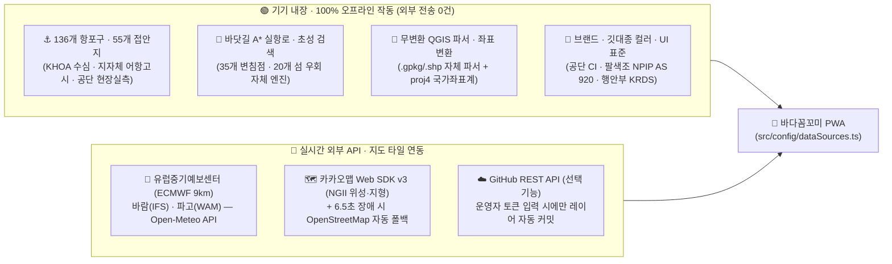

# 바다꼼꼬미 (Bada-Kkomkkomi) 외부 데이터 · API · 지도 · 기술 출처 명세서 (`DATA_AND_TECH_SOURCES.md`)

- **문서 버전**: `v2.3` (기준일: `2026-11-10`, Asia/Seoul · 앱 버전 `v2.2` / `2.2.0` 정합)
- **코드 단일 정본(SSOT)**: [`src/config/dataSources.ts`](../src/config/dataSources.ts) · [`src/config/appVersion.ts`](../src/config/appVersion.ts)
- **관련 UX 설계서**: [`docs/SOURCE_CREDIBILITY_UX_DESIGN.md`](./SOURCE_CREDIBILITY_UX_DESIGN.md)

> [!IMPORTANT]
> **📌 30초 핵심 요점 (TL;DR)**
> 1. **100% 무료 · 무서버 아키텍처**: 별도 유료 백엔드나 외부 유료 길찾기/GIS API 없이 **국가 공공데이터 + 글로벌 오픈 기상 모델(ECMWF) + 자체 개발 알고리즘(A*·QGIS 파서)**만으로 동작합니다.
> 2. **바다 위 오프라인 생존성 보장**: **136개 항포구 · 55개 접안지 · 바닷길 A* 실항로 계산 · QGIS 파일 변환 · 상괭이 기록**은 인터넷이 끊긴 해상 음영지역에서도 **100% 오프라인 작동**합니다.
> 3. **데이터 유출 원천 차단**: 업로드한 기관 내부 QGIS 파일(`.gpkg`/`.shp`)과 현장 관찰 기록은 외부 서버로 전송되지 않고 **100% 스마트폰/브라우저 내부(`IndexedDB`/`localStorage`)에서만 처리·보관**됩니다.

---

## 1. 전체 데이터 · 기술 출처 시각화 아키텍처

### 1.1. 해상 음영지역(오프라인) vs 온라인 동작 한눈에 보기

| 구분 | 대상 기능 | 동작 배지 | 핵심 동작 원리 |
| :---: | :--- | :---: | :--- |
| **오프라인 보장** | **55개 접안지 · 136개 항포구 · 내장 공원경계** | `🟢 100% 오프라인` | 앱 설치 시 정적 `GeoJSON`/`JSON` 및 현장 모식도(`SVG`) 기기 내장 |
| **오프라인 보장** | **바닷길(A*) 시간계산 · 초성 검색 · 상괭이 기록** | `🟢 100% 오프라인` | 기기 CPU 자체 연산 및 브라우저 내부 저장소(`IndexedDB`/`localStorage`) 보관 |
| **오프라인 보장** | **QGIS 파일(`.gpkg`/`.shp`) · 한국 좌표계 변환** | `🟢 100% 오프라인` | 브라우저 메모리 내 직접 해독·재투영 (`외부 서버 전송 0건`) |
| **온라인 연동** | **배경 지도 타일 (카카오맵 · 위성 · 3D 로드뷰 / OSM)** | `🔵 온라인 + 열람 캐시` | 열어본 해역 타일은 30일 캐시, 미방문 해역 타일·3D 로드뷰는 통신 필요 |
| **온라인 연동** | **실시간 해상 기상 예보 (ECMWF 풍속 · 파고)** | `🔵 실시간 전용 (캐시 배제)` | 안전상 오프라인·결측 시 과거 예보를 숨기고 즉시 **`미확인(?)`** 표시 |

---

## 2. 6대 영역별 핵심 출처 요약표 (Quick Reference)

| 영역 | 앱 내 기능 | 원천 기관 · 기술 출처 | 비용 / 라이선스 | 코드 정본 위치 |
| :--- | :--- | :--- | :---: | :--- |
| **1. 항포구·접안지·공원경계** | 55개 접안지, 136개 항포구 사전, 공원·특별보호구역 | **국립해양조사원(KHOA)** 수심·해안선 + **지자체 어항고시** + **환경부·국립공원공단(KNPS)** 현장 데이터 | 공공데이터 / 자체 구축 | [`ports.json`](../public/data/ports.json) [`docking_points.geojson`](../public/data/docking_points.geojson) |
| **2. 실시간 해상 기상** | 48시간 해상 풍속(`kn`)·유의파고(`m`) 3단계 신호등 | **유럽중기예보센터(ECMWF)** `IFS HRES 9km` + `WAM 9km` (중계: **Open-Meteo**) | 무료 오픈 API (무인증) | [`ecmwfWeatherService.ts`](../src/services/ecmwfWeatherService.ts) |
| **3. 배경 지도·위성·로드뷰** | 일반·위성·하이브리드·지형·지적도, 360° 3D 로드뷰 | **카카오맵 SDK v3** (**국토지리정보원 NGII** 기반) + **OpenStreetMap(OSM)** & **Leaflet** 자동 폴백 | 무료 약관 / `ODbL`·`BSD` | [`kakaoMapLoader.ts`](../src/services/kakaoMapLoader.ts) [`LegacyLeafletCanvas.tsx`](../src/components/map/LegacyLeafletCanvas.tsx) |
| **4. 바닷길 항로·초성 검색** | 육지·섬 우회 실항로, 도착시간(ETA), 초성(`ㅅㄷㅎ`) 검색 | 외부 API 없이 자체 개발한 **True End-to-End A* 해상 탐색 엔진** (35변침점·20섬 우회) | 자체 개발 (`100% 무료`) | [`routeGeoService.ts`](../src/services/routeGeoService.ts) |
| **5. QGIS 파일·좌표 변환** | `.gpkg`·`.shp`·`.kml` 무변환 탑재, 한글·좌표 자동 복원 | **OGC/ESRI 공개 규격 자체 파서** + **`proj4`** (국가좌표계) + **`TextDecoder('euc-kr')`** | 오픈소스 (`MIT`) | [`spatialFileParser.ts`](../src/services/spatialFileParser.ts) |
| **6. 브랜드·색채·오픈소스** | 앱 테마, 마스코트(반달이·꼬미), 주간 고대비 UI | **국립공원공단 CI** + **팔색조(`NPIP AS 920`)** + **행안부 디지털정부 KRDS** + `WCAG 2.2 AA` | 기관 자산 / `MIT`·`ISC` | [`index.css`](../src/index.css) [`package.json`](../package.json) |

---

## 3. 외부 API 및 실시간 연동 상세 (`온라인 2종 + 선택 배포 1종`)

### 3.1. 실시간 해상 기상 — 유럽중기예보센터(ECMWF) + Open-Meteo
- **구현 파일**: [`src/services/ecmwfWeatherService.ts`](../src/services/ecmwfWeatherService.ts), [`src/components/navigation/MarineWeatherPanel.tsx`](../src/components/navigation/MarineWeatherPanel.tsx)
- **원천 수치모델**:
  - **해상 10m 풍속 (`wind_speed_10m`, `knots`)**: `ECMWF IFS HRES` (`models=ecmwf_ifs`, 약 `9km` 해상도)
  - **유의파고 (`wave_height`, `m`)**: `ECMWF WAM` (`models=ecmwf_wam`, 약 `9km` 해상도)
- **핵심 신뢰성 설계**:
  - 타 모델 임의 폴백 금지(단일 모델 고정), 한국 표준시(`Asia/Seoul`) 타임스탬프 `Map` 1:1 정합.
  - **안전 실패(Fail-Safe)**: 통신 단절·타임아웃(`8초`)·결측 시 과거 캐시를 재사용하지 않고 즉시 **`미확인(?)`**으로 표시.
  - **격자 한계 고지**: `9km×9km` 광역 바다 격자이므로 섬 뒤편·방파제 안쪽 국지 돌풍은 기상청(KMA) 특보와 병행 확인 필수.

### 3.2. 배경 지도 · 위성 · 360° 3D 로드뷰 — 카카오맵(NGII) & OSM 자동 폴백
- **구현 파일**: [`src/services/kakaoMapLoader.ts`](../src/services/kakaoMapLoader.ts), [`src/components/map/KakaoMapCanvas.tsx`](../src/components/map/KakaoMapCanvas.tsx), [`src/components/map/Roadview3DModal.tsx`](../src/components/map/Roadview3DModal.tsx), [`src/components/map/LegacyLeafletCanvas.tsx`](../src/components/map/LegacyLeafletCanvas.tsx)
- **주력 엔진 (`Kakao Maps Web SDK v3`)**:
  - **국토교통부 국토지리정보원(NGII)** 항공사진·수치지형도 기반 국내 도서 지명·해안선 제공.
  - 기본 지도 3종(`일반·스카이뷰·하이브리드`), 오버레이 5종(`지형도·지적편집도·로드뷰선·교통·자전거`), **360° 3D 구면 로드뷰**(접안지 반경 `80m~250m` 자동 탐색) 지원.
- **비상 자동 폴백 (`OpenStreetMap + Leaflet 1.9.4`)**:
  - 네트워크 차단·도메인 제한 시 **6.5초 내 자동으로 OSM + Leaflet 엔진으로 무중단 전환** (접안지·항포구·항로선 100% 동일 작동).

### 3.3. 원격 레이어 자동 배포 — GitHub REST API *(운영자 선택 기능)*
- **구현 파일**: [`src/services/githubLayerSyncService.ts`](../src/services/githubLayerSyncService.ts)
- **동작 기준**: 일반 사용자는 호출하지 않으며, 운영자가 직접 GitHub 토큰(PAT)을 설정하고 `[저장 (운영 반영)]`을 눌렀을 때만 `api.github.com`(`v2022-11-28`)으로 레이어 스냅샷을 자동 커밋합니다.

---

## 4. 내장 해양 · 지리 공간 데이터 상세 (`100% 오프라인 작동`)

| 데이터셋 | 파일 경로 | 수량 / 범위 | 원천 출처 및 자주 묻는 질문(FAQ) 핵심 해명 |
| :--- | :--- | :---: | :--- |
| **항포구·선착장 사전 및 해상 변침점** | [`public/data/ports.json`](../public/data/ports.json) | **136개 항포구** + **35개 변침점** | · **국립해양조사원(KHOA)** 수로·조석·해안선(138섬) 및 **지자체 어항 지정 고시**(국가·지방·정주·소규모어항 81곳 + 소규모 선착장 50곳 + 조사선 거점 5곳) 통합 · 현장 옛 지명·별칭(`강구안`, `원항`, `제승당항` 등) 및 방파제 외측 진입점(`seaApproach`) 내장 |
| **현장 접안지 상세 및 수심 모식도** | [`public/data/docking_points.geojson`](../public/data/docking_points.geojson) [`public/images/docking/*.svg`](../public/images/docking/) | **55개 접안지** + **10종 모식도** | · 국립공원공단 현장 점검 데이터(접안 목적, 만조·간조 수심, 암초·폐로프 위험요소) 수록 · 💡 **왜 실제 사진 대신 그림(`.svg`)인가요?**: 오프라인 즉시 열람과 수심·위험요소 도해를 위해 자체 제작한 **현장 이해용 모식도**이며, 실사 사진(`.jpg`/`.png`) 등록 시 앱이 확장자를 자동 판별해 **`📷 현장 실사 사진`** 배지로 즉시 전환 표시함 |
| **국립공원 경계 · 특별보호구역** | [`national_park.geojson`](../public/data/layers/national_park.geojson) [`protected_area.geojson`](../public/data/layers/protected_area.geojson) | **기본 2개 레이어** (교체 가능) | · **환경부·국립공원공단** 고시 구역(한려해상 통영·거제 지구, 홍도 천연기념물 제335호 등) 기반 **오프라인 경량 도식화 내장본** · 실무자가 `[레이어 > + 파일 등록]`에서 공단 QGIS 원본(`.gpkg`/`.shp`) 업로드 시 즉시 정밀 도면으로 교체 |

---

## 5. 자체 구현 알고리즘 및 무서버 GIS 기술 (`외부 유료 API 0건`)

### 5.1. 바닷길 콕콕 — 해상 실항로 탐색 엔진 ([`src/services/routeGeoService.ts`](../src/services/routeGeoService.ts))
- **개발 배경**: 자동차 내비게이션 API는 바다 길을 찾지 못하고, 단순 직선 연결은 거제도·한산도 등 육지를 관통함.
- **핵심 기술**:
  1. **True End-to-End A* 탐색**: 미륵도·한산도·거제도·사량도 등 **20개 섬·반도 다각형 장벽(`LANDMASS_BARRIER_POLYGONS`)**과 **35개 해상 변침점 그래프**를 결합해 `0.01초` 만에 최단 우회 바닷길 산출 (**136개 항포구 전체 18,360쌍 육지 비관통 전수 검증 통과**).
  2. **양단 오버슈트 프루닝(`pruneTerminalOvershoot`)**: 항포구 앞바다를 지나쳐 U턴하는 불필요 역주행 자동 제거.
  3. **대권거리 · 침로 · 호장 진중점**: 지구 곡면 Haversine 공식(`1 NM = 1.852 km`), 구면 삼각법 출항 방위각(`0°~359°`), 폴리라인 `50% Arc-Length` 진중점 계산.
  4. **무서버 한글 초성 검색(`extractChosung`)**: 유니코드 음절 분해 수식(`0xAC00`) 자체 구현 (`ㅅㄷㅎ` → `삼덕항` 즉시 매칭).

### 5.2. 무변환 QGIS 공간파일 파서 ([`src/services/spatialFileParser.ts`](../src/services/spatialFileParser.ts))
- **지원 규격**: OGC GeoPackage(`.gpkg` SQLite3 바이너리), ESRI Shapefile(`.zip`/`.shp`/`.dbf`/`.prj`), KML/KMZ, GeoJSON.
- **한국 공공측량 좌표계 자동 변환 (`proj4`)**: 국토지리정보원 고시 `EPSG:5179`(UTM-K), `EPSG:5186`(중부원점), `EPSG:5187`(동부원점), `EPSG:5174`(베셀) → 웹 표준 `EPSG:4326`(WGS84) 자동 재투영.
- **관공서 한글 깨짐 자동 복원**: 웹 표준 `TextDecoder('euc-kr')`로 Shapefile `.dbf`의 `CP949` 한글 속성 자동 복원.

---

## 6. 브랜드 디자인 · 캐릭터 · 오픈소스 표준

### 6.1. 공공 디자인 및 색채 표준 ([`src/index.css`](../src/index.css))
| 구분 | 적용 표준 및 원천 | 핵심 적용 내역 |
| :--- | :--- | :--- |
| **기관 CI 및 캐릭터** | **국립공원공단(KNPS) 공식 CI & 마스코트 (`반달이` · 해양레인저 `꼬미`)** | 생태보전 그린(`#00854A`), 청정 해양 블루(`#0066B3`), 인트로·헤더·설정 캐릭터 배너 |
| **깃대종 컬러 시스템** | **한려해상국립공원 깃대종 `팔색조(알로)` NPIP 가이드 (`AS 920~923`)** | 정품 Pantone/RGB 10색 토큰: 딥 네이비(`#003360`), 에메랄드(`#00846C`), 터쿼이즈(`#00A79D`), 샌드 베이지(`#F7F4EE`), 크림슨(`#870B41`) |
| **접근성 · 주간 시인성** | **행정안전부 디지털정부 UI/UX 가이드라인(KRDS)** & **W3C WCAG 2.2 AA** | 선박 갑판 직사광선 대응 **데이라이트 브리즈 라이트 테마**, `색상+아이콘+한글` 3중 표기, `44~48px+` 터치 타겟 |

### 6.2. 오픈소스 소프트웨어 (전수 무료 오픈소스 라이선스)
- **코어 프레임워크**: `React 19.3` (`MIT`), `Vite 8.3` (`MIT`), `TypeScript 7.0` (`Apache-2.0`), `Tailwind CSS 4.3` (`MIT`)
- **지도 · GIS · 압축**: `Leaflet 1.9.4` (`BSD-2-Clause`), `proj4 2.22` (`MIT`), `fflate 0.8` (`MIT`), `lucide-react` (`ISC`), `vite-plugin-pwa / Workbox` (`MIT`)
- **브라우저 표준 API**: `W3C Geolocation` (GPS), `IndexedDB` & `localStorage` (로컬 영구 보관), `Web Share API` & `mailto:` (현장 제보 + 네이버·구글 지도 표준 URL 자동 생성), HTML5 `<dialog>` / `
`.

---

## 7. 데이터 정확성 및 해상 안전 면책 고지

1. **항해 보조 참고용 도구**: `바닷길 콕콕`의 소요시간·실항로 계산과 `꼬미의 바다수첩` 수심·암초 정보는 현장 업무 편의를 위한 **참고용 추정치**이며, 공식 항해용 전자해도(ECDIS), 국립해양조사원 최신 수로고시, 선장의 현장 판단을 대체하지 않습니다.
2. **기상 수치예보 격자 한계**: `ECMWF IFS/WAM (9km 격자)` 모델은 광역 수치예보이므로 좁은 수로의 급조류·국지 해무·방파제 월파를 모두 반영하지 못합니다. 출항 전 반드시 **기상청(KMA) 공식 해상특보**와 현장 관측을 함께 확인하십시오.
