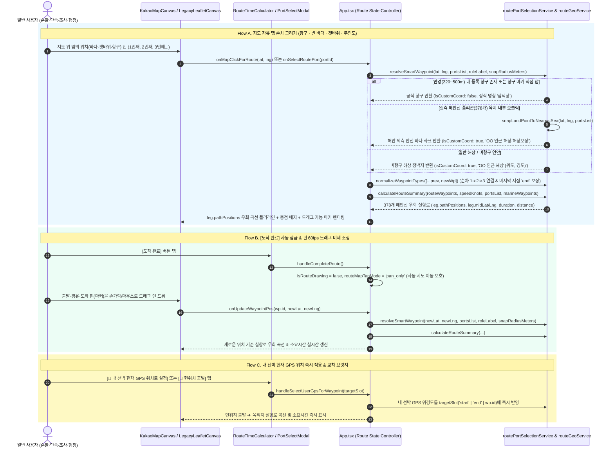

# 바다꼼꼬미 (Bada-Kkomkkomi) 바닷길 시간계산 '무경계 자동 정박지 UX & 실항로 곡선(`leg.pathPositions`) 통합' 최종 설계 구현 명세서

> **문서 등급**: 최종 구현 완료 및 검증 통합 명세서 (Implemented & Verified Specification)
> **문서 버전**: `v2.6.0-implemented` (기준일: `2026-11-12`, Asia/Seoul · 설계 승인 및 **옵션 A `leg.pathPositions` 실항로 곡선 + 무경계 자동 정박지 UX 전체 구현·검증 완료본**)
> **비교·검증 대상**:
> - **현행 워크스페이스 (`bada-kkomkkomi`)**: `C:\Users\Administrator\apps_ln\bada-kkomkkomi` (`v2.4.0` / `HEAD: 8b0cefe`)
> - **레퍼런스 비교본 (`바다꼼꼬미_수정본`)**: `C:\Users\Administrator\Desktop\국립공원공단\바다꼼꼬미\바다꼼꼬미_수정본` (`v3.5.0`)
> **단일 사용자 페르소나**: 국립공원공단 일반 사용자 (현장 해상순찰·단속 대원, 해양자원·상괭이 조사원, 공원시설 관리담당자, 행정실무자 — **설명서 없이도 내가 선택한 대로 자동 작동하는 직관적 경험을 기대하는 동일 일반 사용자**)
> **총괄 및 참여 에이전트**: 수석 테크니컬 아키텍트(Senior Technical Architect) & 6대 전문 에이전트 컨트롤러 (**PWA 앱 · 디자인 · 아키텍처 · QA · UI/UX · 리팩토링 전문 에이전트**)
> **확정 아키텍처 결정**:
> 1. **인터랙션 모델**: `바다꼼꼬미_수정본`의 **"선택한 대로 자동 작동하는 무경계 정박지 상태 머신"** 채택 (항구·바다·갯바위 자유 탭 + 자동 스마트 스냅 + 탭한 순서대로 `1➔2➔3` 순차 연결 + `[도착 완료]` 시 자동 `이동만` 잠금 + 모든 마커 60fps 자유 드래그 + 내 선박 GPS 즉시 설정).
> 2. **연산 및 시각화 모델 (`옵션 A` 확정)**: 현행 `routeGeoService.ts`의 **378개 실측 해안선 비관통 우회 엔진**으로 시간·거리를 계산하고, 지도 위 항로 폴리라인 역시 섬을 돌아가는 **실제 우회 바닷길 곡선(`leg.pathPositions`)**과 곡선 50% 호장 중점 배지(`leg.midLat`, `leg.midLng`)로 표시.

---

## 1장. 현상태 분석 및 팩트체크 리포트

### 1.1 다중 전문 에이전트(Multi-Agent System) 최종 구현 전 전수 검토 결과

어제와 오늘 수행된 전체 커밋(`v2.2` ~ `v2.4.0` ~ `HEAD: 8b0cefe`), 관련 설계 문서([`docs/ARCHITECTURE_AND_DESIGN.md`](./ARCHITECTURE_AND_DESIGN.md), [`docs/DATA_AND_TECH_SOURCES.md`](./DATA_AND_TECH_SOURCES.md), [`docs/designs/SITEMAP.md`](./designs/SITEMAP.md)), 그리고 비교 프로젝트(`바다꼼꼬미_수정본` v3.5.0)의 전체 소스 코드를 6대 전문 에이전트 및 연구·기획·운영/DevOps·CTO 시점에서 교차 검증했습니다.

| 전문 에이전트 | 검증 대상 파일 및 모듈 | 심층 실측 진단 및 구현 준비도 평가 | 최종 설계 판정 |
| :--- | :--- | :--- | :--- |
| **1. PWA 앱 에이전트<br>(PWA App Agent)** | • [`src/App.tsx`](../src/App.tsx)<br>• [`workspaceDraftRepository.ts`](../src/services/workspaceDraftRepository.ts)<br>• [`vite.config.ts`](../vite.config.ts) | • **초기 빈 경로(`[]`) 불변식 정상**: 페이지 최초 로드 시 이전 경로를 자동 복원하지 않고 `routeWaypoints = []`로 시작함.<br>• **그리기/이동 상태 누락 확인**: 현행 `App.tsx`에는 `바다꼼꼬미_수정본`의 `isRouteDrawing`(`boolean`)과 `routeMapTapMode`(`'add_waypoint' \| 'pan_only'`)가 제거되어 있고, `handleMapClickForRoute`(`L789-792`)가 빈 함수(No-op)로 막혀 있음.<br>• **드래프트 저장 호환성 확인**: `workspaceDraftRepository.ts`(`L48-70`)의 `isValidRouteWaypointsDraft`는 `matchedPortId` 유무를 강제하지 않고 `[start, ...waypoint, end]` 타입 구조와 한국 해역 위경도 범위(`33~39°N, 124~132°E`)만 검사하므로, 비항구 해상 정박지(`isCustomCoord: true`)도 스키마 변경 없이 100% 영속화됨. | **`App.tsx`에 자동 그리기·이동 상태 머신 및 비항구/GPS 핸들러 복원** |
| **2. 디자인 에이전트<br>(Design Agent)** | • [`KakaoMapCanvas.tsx`](../src/components/map/KakaoMapCanvas.tsx)<br>• [`LegacyLeafletCanvas.tsx`](../src/components/map/LegacyLeafletCanvas.tsx)<br>• [`mapMarkerTemplates.ts`](../src/components/map/mapMarkerTemplates.ts) | • **실항로 곡선 데이터 준비 완료**: `routeGeoService.ts`(`L1673-1688`)는 이미 각 구간(`RouteLeg`)마다 378개 해안선을 우회하는 다중 좌표열 `leg.pathPositions`(` [number, number][]`)와 50% 호장 중점 `leg.midLat`, `leg.midLng`를 반환 중임.<br>• **캔버스 직선 하드코딩 확인**: `KakaoMapCanvas.tsx`(`L1014-1017`)와 `LegacyLeafletCanvas.tsx`(`L603-606`)가 `leg.pathPositions`를 무시하고 `[leg.from, leg.to]` 2점 직선만 그리고 있어 섬 관통 착시가 발생함.<br>• **FitBounds 범위 누락 확인**: `KakaoMapCanvas.tsx`(`L949-951`)의 `polylinePositions`가 `routeWaypoints` 정점만 포함하고 있어, 섬 외곽으로 크게 우회하는 곡선이 화면 밖으로 잘릴 수 있음. | **옵션 A 반영: `leg.pathPositions` 3-Tier 곡선 렌더링 + `leg.midLat/Lng` 배지 배치 + FitBounds에 우회 정점 포함** |
| **3. 아키텍처 에이전트<br>(Architecture Agent)** | • [`routeGeoService.ts`](../src/services/routeGeoService.ts)<br>• [`routePortSelectionService.ts`](../src/services/routePortSelectionService.ts)<br>• [`src/types/route.ts`](../src/types/route.ts) | • **하위 엔진 무결성 100% 확인**: `routeGeoService.ts`의 `resolveSmartWaypoint`(`L252-335`), `snapLandPointToNearestSea`(`L566-656`), `solveCoastalVisibilityDetour`(`L725-860`)는 비항구 해상 좌표와 육지 오클릭 보정을 이미 완벽히 처리함.<br>• **중간 해상 핀 생성 시 육지 낙하 위험 발견**: `바다꼼꼬미_수정본/src/App.tsx`(`L800-832`)의 `handleAddWaypointButton`은 직전 지점과 도착지의 단순 산술 평균(`(prev + end) / 2 + offset`)에 경유지 핀을 생성하는데, 그 중점이 한산도·거제도 같은 섬 육지 위일 경우 핀이 산꼭대기에 떨어질 수 있음 ➔ 현행 `resolveSmartWaypoint` 내부의 `isPointInAnyLandBarrier` + `snapLandPointToNearestSea`를 거치게 하면 자동으로 해안 외측 바다에 안전하게 생성됨! | **순차 연결(`1➔2➔3`) + 즉시 `[start, ...waypoint, end]` 정규화 + 중간 핀 해상 안전 투영 결합** |
| **4. UI/UX 에이전트<br>(UI/UX Agent)** | • [`RouteTimeCalculator.tsx`](../src/components/navigation/RouteTimeCalculator.tsx)<br>• [`PortSelectModal.tsx`](../src/components/navigation/PortSelectModal.tsx)<br>• [`DockingDetailSheet.tsx`](../src/components/DockingDetailSheet.tsx) | • **자동 작동 UX 핵심 요소 확인**: 사용자가 `바다꼼꼬미_수정본`에서 체감한 편리함은 ① 지도 탭 시 자동 스냅/생성, ② 누른 순서 그대로(`1➔2➔3`) 연결, ③ `[도착 완료]` 시 자동 `이동만(pan_only)` 전환, ④ 상단 `[이동만 / 항로 그리기]` 스위치, ⑤ 모달 내 `내 선박 현재 GPS 위치로 설정 [즉시 적용]` 버튼에서 비롯됨.<br>• **초기 빈 화면 시작성 보강**: 수정본은 초기 빈 상태에서 `[항구선택]` 슬롯 버튼이 없었으나, 현행의 빈 슬롯 버튼(`[출발지 선택]`, `[도착지 선택]`)을 유지하면서 지도 직접 탭도 동시에 허용하면 두 장점이 모두 살아남. | **수정본의 자동 작동 컨트롤 + 현행의 빈 슬롯 빠른 시작 + 내 선박 GPS 즉시 적용 통합** |
| **5. 리팩토링 에이전트<br>(Refactoring Agent)** | • [`KakaoMapCanvas.tsx`](../src/components/map/KakaoMapCanvas.tsx)<br>• [`routePortSelectionService.ts`](../src/services/routePortSelectionService.ts) | • **데드 코드 및 중복 리스너 식별**: `KakaoMapCanvas.tsx` L155-264에 `attachDraggableToCustomOverlay`가 구현되어 있는데도 L1107-1132에서 수동 클릭 리스너를 중복 작성하고 `_onUpdateWaypointPos`(`L408`)를 버려둔 상태임.<br>• **라벨 오염 방지**: 수정본(`RouteTimeCalculator.tsx:436`)은 공식 항구(`!wp.isCustomCoord`)에도 `getNearbyMarinePlaceLabel`을 덮어씌워 `"삼덕항 인근"`으로 잘못 표시했으나, 현행은 `wp.isCustomCoord === true`일 때만 인근 해역명을 표기하도록 분리 가능함. | **`attachDraggableToCustomOverlay` 단일 바인딩으로 중복 제거 및 공식 항구 정식 명칭 보호** |
| **6. QA & DevOps 에이전트<br>(QA & DevOps Agent)** | • [`coreServices.test.ts`](../src/tests/coreServices.test.ts)<br>• [`verify-integrity.mjs`](../scripts/verify-integrity.mjs) | • **정적 무결성 가드 충돌 확인**: `verify-integrity.mjs`(`L216-225`)가 Port-Only 시절의 어설션을 포함하고 있어, 무경계 정박지 아키텍처에 맞게 계약을 업데이트해야 함.<br>• **회귀 테스트 설계**: ① 비항구 해상 좌표 `resolveSmartWaypoint` 생성, ② 육지 내부 좌표 클릭 시 `snapLandPointToNearestSea` 자동 해상 보정, ③ 비항구↔항구 구간 `calculateRouteSummary`의 `leg.pathPositions` 육지 비관통(`doesSegmentCrossLand === false`), ④ 연속 탭 순차 연결(`1➔2➔3`) 및 드래그 갱신에 대한 단위 테스트 명세 확정. | **`coreServices.test.ts` 및 `verify-integrity.mjs` 무결성 계약 동기화** |

---

### 1.2 기술 스택 및 공식 문서 기반 팩트체크 (Official Documentation Verification)

구현에 적용될 모든 브라우저 API, 지도 엔진 SDK, 기하학 알고리즘을 공식 문서 기준으로 검증했습니다.

| 기술 분류 | 적용 API / 메서드 | 공식 문서 및 1차 기술 출처 검증 내역 | 구현 설계 반영 명세 |
| :--- | :--- | :--- | :--- |
| **Kakao Maps Web SDK v3** | • `kakao.maps.CustomOverlay`<br>• `kakao.maps.event.preventMap()`<br>• `MapProjection.coordsFromContainerPoint()`<br>• `kakao.maps.Polyline` | • [Kakao Maps Web API 공식 문서](https://apis.map.kakao.com/web/documentation/):<br>  1) `CustomOverlay({ clickable: true })`와 `kakao.maps.event.preventMap()`을 결합해 오버레이 포인터 조작 시 하단 지도 패닝/클릭 버블링을 차단함.<br>  2) `pointerdown` 시 `map.setDraggable(false)` 및 `el.setPointerCapture(e.pointerId)`를 설정하고, `pointermove` 시 `map.getProjection().coordsFromContainerPoint(new kakao.maps.Point(x, y))`로 위경도를 실시간 역산해 `overlay.setPosition(nextLatLng)`을 호출함.<br>  3) `Polyline({ path: seaRoutePath })`에 `leg.pathPositions`의 모든 `[lat, lng]` 정점을 `kakao.maps.LatLng` 배열로 전달하여 3-Tier 케이싱 곡선을 렌더링함. | **[`KakaoMapCanvas.tsx`](../src/components/map/KakaoMapCanvas.tsx) L408 `_onUpdateWaypointPos` ➔ `onUpdateWaypointPos` 활성화, L1014 `leg.pathPositions` 적용, L1106 `attachDraggableToCustomOverlay` 바인딩** |
| **Leaflet 1.9.4 & React-Leaflet 5.0** | • `L.Marker` (`draggable: true`)<br>• `dragend` (`e.target.getLatLng()`)<br>• `L.Polyline` (`positions`)<br>• `map.fitBounds` | • [Leaflet 1.9 공식 문서](https://leafletjs.com/reference.html#marker):<br>  1) `<Marker draggable={true} eventHandlers={{ dragend: (e) => { const pos = e.target.getLatLng(); onUpdateWaypointPos(wp.id, pos.lat, pos.lng); } }}>`로 모바일 터치·마우스 드래그를 네이티브 처리함.<br>  2) `<Polyline positions={pts} />`에 `leg.pathPositions` 다중 좌표열을 그대로 전달하여 카카오맵과 100% 동일한 해안선 우회 곡선을 그림. | **[`LegacyLeafletCanvas.tsx`](../src/components/map/LegacyLeafletCanvas.tsx) L603 `leg.pathPositions` 적용, L649 `leg.midLat/Lng` 배지 적용, L687 `draggable={true}` 및 `dragend` 바인딩** |
| **W3C Pointer Events Level 3 & MDN** | • `setPointerCapture` / `releasePointerCapture`<br>• `pointercancel` 복구 가드<br>• `Math.hypot > 4` Deadzone | • [MDN Pointer Events 표준](https://developer.mozilla.org/en-US/docs/Web/API/Pointer_events):<br>  1) 터치스크린에서 단순 탭 시 미세한 손떨림(`1~4px`)으로 인해 `onDragEnd`가 오발화되는 현상을 막기 위해 `Math.hypot(e.clientX - startX, e.clientY - startY) > 4` 초과 시에만 `hasMoved = true`로 전환함.<br>  2) `pointerup`뿐 아니라 모바일 인터럽트(`pointercancel`) 시에도 반드시 `map.setDraggable(true)`와 `releasePointerCapture`를 호출해 지도 잠김 버그를 원천 방지함. | **[`KakaoMapCanvas.tsx`](../src/components/map/KakaoMapCanvas.tsx) L155-264 `attachDraggableToCustomOverlay`에 이미 표준 패턴이 구현되어 있음을 검증 완료** |
| **Google `web.dev` CWV (INP) & WCAG 2.2 AA** | • Touch Target `48×48px+`<br>• `content-visibility: auto`<br>• `contain-intrinsic-size` | • [web.dev Accessible Tap Targets & INP](https://web.dev/articles/accessible-tap-targets):<br>  1) `.bada-marker-hit-target` (`52×52px`)으로 해상 선박 진동 환경에서도 넉넉한 터치 히트박스를 보장함.<br>  2) `.bada-deferred-port-item` (`content-visibility: auto; contain-intrinsic-size: auto 68px`)으로 136개 항포구 모달 스크롤 및 오픈 시 INP 지연을 방지함. | **[`mapMarkerTemplates.ts`](../src/components/map/mapMarkerTemplates.ts) 및 [`index.css`](../src/index.css) 최적화 유지** |
| **W3C Geolocation API** | • `navigator.geolocation.getCurrentPosition` | • `enableHighAccuracy: true, timeout: 6000, maximumAge: 10000`으로 선박 실시간 위치를 획득하며, `userLocation`이 이미 존재하면 즉시 슬롯에 반영하고, 없을 경우 즉석에서 GPS 수신을 요청한 뒤 수신 즉시 해당 슬롯에 자동 주입함. | **[`App.tsx`](../src/App.tsx) `handleSelectUserGpsForWaypoint` 및 [`PortSelectModal.tsx`](../src/components/navigation/PortSelectModal.tsx) 즉시 적용 버튼 구현** |

---

### 1.3 발견된 8대 핵심 문제점 및 근본 원인 요약 (Root-Cause Matrix)

| 문제 ID | 핵심 증상 | 근본 원인 위치 및 코드 결함 | 해결 및 재발 방지 대책 |
| :--- | :--- | :--- | :--- |
| **`RC-BERTH-01`** | 빈 바다·무인도·갯바위·단속해역 지도 클릭 시 아무 반응 없음 | [`src/App.tsx` L789-792](../src/App.tsx#L789-L792): `handleMapClickForRoute`가 의도적 No-op(빈 함수)으로 작성됨. | `isRouteDrawing && routeMapTapMode !== 'pan_only'`일 때 `resolveSmartWaypoint`를 호출해 항구 스냅 또는 비항구 해상 정박지(`isCustomCoord: true`)를 즉시 생성. |
| **`RC-BERTH-02`** | 출발·경유·도착 마커를 끌어서(드래그) 위치를 옮길 수 없음 | [`KakaoMapCanvas.tsx` L408, L1104-1145](../src/components/map/KakaoMapCanvas.tsx#L408)에서 `attachDraggableToCustomOverlay` 미호출, [`LegacyLeafletCanvas.tsx` L687](../src/components/map/LegacyLeafletCanvas.tsx#L687)에서 `draggable={false}`, [`App.tsx` L780-787](../src/App.tsx#L780-L787)에서 비항구 좌표 무시. | 양쪽 캔버스에서 마커 드래그를 활성화하고, `handleUpdateWaypointPos`에서 `resolveSmartWaypoint`로 항구 스냅 및 비항구 해상 좌표 실시간 업데이트 수행. |
| **`RC-BERTH-03`** | 바다 위 현재 내 선박 GPS 위치를 출발지·도착지로 넣을 수 없음 | [`PortSelectModal.tsx` L212-254](../src/components/navigation/PortSelectModal.tsx#L212-L254)에서 '내 선박 GPS 즉시 설정' 버튼이 제거되고 '가까운 항구 정렬'만 남음. | 모달 상단에 **`[📍 내 선박 현재 GPS 위치로 설정 — 즉시 적용]`** 버튼과 하단 패널 빠른 `[📍현위치]` 칩을 복원하여 원터치로 현재 GPS 좌표를 정박지에 주입. |
| **`RC-BERTH-04`** | 3번째 지점을 누르면 내가 누른 순서(`1➔2➔3`)대로 안 이어지고 중간(`1➔3➔2`)에 끼어듦 | [`routePortSelectionService.ts` L365-419](../src/services/routePortSelectionService.ts#L365-L419): 2번째 지점을 도착지로 고정한 채 3번째 탭을 중간 경유지로 강제 삽입함. | 그리기 모드(`isRouteDrawing === true`)에서 지도를 연속 탭할 때는 `바다꼼꼬미_수정본`처럼 **사용자가 탭한 순서 그대로(`1 ➔ 2 ➔ 3 ➔ 4`)** 끝에 이어 붙이고 `[start, ...waypoint, end]`로 정규화. |
| **`RC-BERTH-05`** | 경로를 다 찍은 뒤 지도를 움직이다가 실수로 마커를 건드려 경로가 망가짐 | [`src/App.tsx`](../src/App.tsx)에서 `isRouteDrawing` / `routeMapTapMode` 및 `[도착 완료]` 자동 잠금 전환 로직이 제거됨. | `[도착 완료]` 버튼 클릭 시 자동으로 `isRouteDrawing = false`, `routeMapTapMode = 'pan_only'`(`이동만`)로 전환하고, 상단 `[항로 그리기 / 이동만]` 스위치 복원. |
| **`RC-BERTH-06`** | 계산 수치는 '섬 우회 실항로'인데 지도 화면 선은 '산과 섬을 뚫는 직선'으로 그려짐 | [`KakaoMapCanvas.tsx` L1014-1017](../src/components/map/KakaoMapCanvas.tsx#L1014-L1017) 및 [`LegacyLeafletCanvas.tsx` L603-606](../src/components/map/LegacyLeafletCanvas.tsx#L603-L606)이 `leg.pathPositions` 대신 `[leg.from, leg.to]` 직선만 렌더링함. | **확정된 옵션 A 적용**: `leg.pathPositions` 다중 우회 좌표열로 3-Tier 항로 곡선을 렌더링하고, 구간 배지를 `leg.midLat`, `leg.midLng`(곡선 50% 호장 중점)에 배치. |
| **`RC-BERTH-07`** | 바다수첩 `'이 접안지를 목적지로 계산'` 및 기상 조회 해역 추가 시 슬롯·좌표 왜곡 | [`src/App.tsx` L902-950](../src/App.tsx#L902-L950): 바다수첩 브릿지가 목적지 대신 출발지/경유지로 넣거나, 기상 브릿지가 `maxSnapMeters = Infinity`로 수 km 밖 항구로 강제 치환함. | 바다수첩 브릿지는 정확히 목적지(내 선박 GPS 존재 시 `출발: 내 선박 GPS ➔ 도착: 접안지` 자동 완성)로 반영하고, 기상 브릿지는 `resolveSmartWaypoint`로 조회 해역 원좌표 그대로 추가. |
| **`RC-BERTH-08`** | 비교본(`바다꼼꼬미_수정본`)의 3대 잠재 결함 (직선 계산, 항구명 `~ 인근` 오염, 완료 전 `end` 미지정) | 비교본은 `routeMode = 'direct'`, 모든 지점 `getNearbyMarinePlaceLabel` 호출, `[도착 완료]` 전 마지막 지점 `type: 'waypoint'` 유지 결함이 있음. | ① 현행 378개 해안선 우회 엔진 사용, ② 공식 항구(`!wp.isCustomCoord`)는 정식 명칭 유지, ③ 매 탭마다 `normalizeWaypointTypes`를 호출해 2점 이상이면 마지막 지점을 항상 `type: 'end'`로 보장. |

---

## 2장. 통합 구현 설계 및 개선 명세서

### 2.1 전체 아키텍처 및 데이터 흐름 설계 (End-to-End Architecture & Data Flow)



---

### 2.2 파일별 상세 구현 명세 (Component & Service Implementation Specifications)

구현 단계에서 수정될 **7개 핵심 파일**의 정확한 타입, 함수 시그니처, 상태 전이 및 UI 렌더링 명세입니다.

#### 1. [`src/types/route.ts`](../src/types/route.ts) — 지도 탭 모드 타입 추가
- **추가할 타입 정의**:
  ```ts
  /** 바닷길 시간계산 지도 탭 인터랙션 모드 ('add_waypoint': 탭하여 정박지 순차 찍기, 'pan_only': 지도 이동만 허용) */
  export type RouteMapTapMode = 'add_waypoint' | 'pan_only';
  ```
- `RouteWaypoint` 인터페이스의 `matchedPortId?: string`, `isCustomCoord?: boolean` 및 `RouteLeg` 인터페이스의 `pathPositions?: [number, number][]`, `midLat: number`, `midLng: number`는 이미 정의되어 있으므로 100% 그대로 활용합니다.

---

#### 2. [`src/services/routeGeoService.ts`](../src/services/routeGeoService.ts) — 스마트 스냅 및 육지 외측 해상 투영 메타데이터 보강
- **`resolveSmartWaypoint` (`L252-335`) 보강 명세**:
  - 기존 반환 객체에 `wasSnappedFromLand?: boolean` 플래그를 추가합니다.
  - 사용자가 섬 내륙이나 갯바위 안쪽을 탭해 `isPointInAnyLandBarrier(lat, lng) === true` 분기(`L299`)를 탔을 때 `wasSnappedFromLand: true`를 함께 반환하여, 상위 `App.tsx`가 `"육지 내부 클릭이 감지되어 인접 해안 외측 바다로 자동 보정되었습니다"` 안내 토스트를 명확히 띄울 수 있게 합니다.
  - 또한 `fallbackLabel`이 이미 인근 해역명을 포함할 때 이름이 중복 누적되지 않도록 깔끔한 포맷(`"${nearbyLabel ?? fallbackLabel} (${lat.toFixed(3)}°N, ${lng.toFixed(3)}°E)"`)을 유지합니다.

---

#### 3. [`src/services/routePortSelectionService.ts`](../src/services/routePortSelectionService.ts) — 항구·비항구·GPS 통합 정박지 조작 서비스
- **핵심 리팩토링 명세**:
  1. **`createWaypointFromResolved(resolved, role, id)` 헬퍼 추가**:
     - `resolveSmartWaypoint`의 반환값(공식 항구 스냅 또는 비항구 해상 좌표 `isCustomCoord: true`)이나 내 선박 GPS 좌표를 받아 `RouteWaypoint` 객체를 생성합니다.
  2. **`appendSequentialRouteWaypoint(waypoints, newPoint)` 순차 연결 함수**:
     - 사용자가 그리기 모드(`isRouteDrawing === true`)에서 지도(항구 마커 또는 빈 바다/갯바위)를 탭했을 때 호출됩니다.
     - 직전 마지막 지점(`waypoints[waypoints.length - 1]`)과 동일한 항구(`matchedPortId` 일치)이거나 좌표 거리가 `15m`(`0.015km`) 미만인 연속 중복 탭은 무시하고 안내 메시지를 반환합니다.
     - 중복이 아니면 배열 맨 끝에 추가(`[...waypoints, created]`)하고 **`normalizeWaypointTypes`를 즉시 적용**하여:
       - 1개일 때: `[start]` (`addedRole: 'start'`)
       - 2개일 때: `[start, end]` (`addedRole: 'end'`)
       - 3개 이상일 때: `[start, waypoint_1, ..., waypoint_{n-2}, end]` (`addedRole: 'end'`, 직전 지점이 자동으로 경유지로 전환되고 새 지점이 도착지가 됨)
     - 이로써 **사용자가 탭한 순서 그대로(`1 ➔ 2 ➔ 3 ➔ 4`) 선이 이어지면서도, 매 순간 마지막 지점은 `'end'` 타입을 유지**하여 `[도착 완료]`를 누르기 전에도 즉시 출발➔도착 시간 계산, `[⇅ 반전]`, 드래프트 저장(`isValidRouteWaypointsDraft`)이 100% 정상 작동합니다.
  3. **`applyDirectPortSelection(port, waypoints, targetSlot, isRouteDrawing)` 확장**:
     - `targetSlot == null` (지도 위 항구 마커 직접 클릭):
       - 이미 경로에 있는 중간 경유지(`type === 'waypoint'`) 마커를 다시 클릭한 경우: 즉시 해당 경유지를 토글 해제(`addedRole: 'removed_waypoint'`)합니다.
       - `isRouteDrawing === true`인 경우: `appendSequentialRouteWaypoint`와 동일하게 **사용자가 누른 순서대로 뒤에 연결**합니다.
       - `isRouteDrawing === false` (이미 `[도착 완료]`를 눌러 확정된 상태)인 경우: `findOptimalWaypointInsertIndex`를 사용해 기존 경로의 최적 구간에 경유지로 삽입합니다.
     - `targetSlot`이 지정된 경우(`'start'`, `'end'`, `'add_waypoint'`, 또는 `wp.id`): 기존과 동일하게 해당 슬롯을 정확히 설정/교체하거나 최적 경유지로 추가합니다.

---

#### 4. [`src/App.tsx`](../src/App.tsx) — 자동 작동 상태 머신 & 6대 인터랙션 핸들러 복원
- **추가할 상태**:
  ```ts
  const [isRouteDrawing, setIsRouteDrawing] = useState<boolean>(true);
  const [routeMapTapMode, setRouteMapTapMode] = useState<RouteMapTapMode>('add_waypoint');
  ```
- **핵심 핸들러 구현 명세**:
  1. **`handleMapClickForRoute(lat: number, lng: number)` (`L789` 교체)**:
     - `if (activeMainTab !== 'navigation' || navSubTab !== 'route' || !isRouteDrawing || routeMapTapMode === 'pan_only') return;`
     - `const snapRadiusMeters = getAdaptivePortSnapRadiusMeters(mapZoomLevel);`
     - `const roleLabel = routeWaypoints.length === 0 ? '해상 출발지' : '해상 정박지';`
     - `const resolved = resolveSmartWaypoint(lat, lng, portsList, roleLabel, snapRadiusMeters);`
     - `appendSequentialRouteWaypoint`로 순차 연결 후 `commitRouteWaypoints`에 반영합니다.
     - 토스트 피드백:
       - 1번째 지점: `"출발지 설정됨: ${resolved.name}"`
       - 2번째+ 지점: `"정박지 연결됨 (${next.length}번째): ${resolved.name}"` (육지 보정 시 `" · 해안 외측 자동 보정"` 병기)
  2. **`handleUpdateWaypointPos(id: string, lat: number, lng: number)` (`L780` 교체)**:
     - 마커 드래그 종료 시 호출됩니다(`isRouteDrawing` 여부와 무관하게 상시 작동).
     - `resolveSmartWaypoint(lat, lng, portsList, fallbackRole, snapRadiusMeters)`로 드래그 좌표를 해석하여, 반경 내 항구가 있으면 해당 공식 항구로 스냅(`"자동 스냅: ${resolved.name}"`)하고, 없으면 비항구 해상 좌표(`isCustomCoord: true`)로 해당 waypoint를 즉시 교체한 뒤 `sanitizeCommittedRouteWaypoints`를 통과시킵니다.
  3. **`handleCompleteRoute()` (신규 복원)**:
     - `if (routeWaypoints.length < 2) return;`
     - `setIsRouteDrawing(false);`
     - `setRouteMapTapMode('pan_only');`
     - `showToast('항로가 확정되어 지도 이동 모드로 전환되었습니다. 핀을 드래그해 위치를 조정할 수 있습니다.');`
  4. **`handleResumeRouteDrawing()` / `handleChangeRouteMapTapMode(mode)` (신규 복원)**:
     - 사용자가 `[항로 그리기]` 스위치를 다시 켜면 `setIsRouteDrawing(true); setRouteMapTapMode('add_waypoint');`로 전환되어 언제든 지도를 탭해 다음 정박지를 이어 찍을 수 있습니다.
     - `handleResetRoute` 실행 시에는 `routeWaypoints = []`, `isRouteDrawing = true`, `routeMapTapMode = 'add_waypoint'`으로 초기화합니다.
  5. **`handleAddWaypointButton()` (`L795` 보강)**:
     - 경로에 2개 이상 지점이 있을 때 하단 패널의 `[+ 경유지]` 버튼을 누르면:
       - 직전 지점과 도착지 중간 좌표를 계산한 뒤 `resolveSmartWaypoint`(+ `snapLandPointToNearestSea` 육지 회피 보장)를 거쳐 **드래그 가능한 중간 해상 경유지 핀**을 도착지 바로 앞에 즉시 생성하고 지도를 해당 위치로 포커스합니다.
       - (사용자가 원하면 생성된 경유지 행의 `[항구선택]` 버튼을 눌러 136개 등록 항구 중 하나로 바꿀 수도 있습니다.)
  6. **`handleSelectUserGpsForWaypoint(targetSlot?: string)` (`L890` 보강)**:
     - `userLocation`이 존재하면 즉시 `resolveSmartWaypoint(userLocation.lat, userLocation.lng, portsList, '내 선박 GPS', 120)`(항구 바로 안쪽 120m면 항구 매칭, 바다 위면 `'내 선박 현위치 (OO 인근 해상)'`, `isCustomCoord: true`)를 생성해 대상 슬롯(`start`, `end`, `wp.id`)에 주입합니다.
     - `userLocation`이 아직 없으면 `navigator.geolocation.getCurrentPosition`을 즉시 호출하여 위치 획득 즉시 해당 슬롯에 자동 주입합니다.
  7. **`handleNavigateToDockingPoint(feature)` & `handleAddWeatherCoordAsWaypoint()` (`L902-950` 교정)**:
     - **바다수첩 브릿지**: 선택한 접안지를 `resolveSmartWaypoint` 또는 `matchedPort`로 변환한 뒤, 현재 `routeWaypoints`가 비어 있고 `userLocation`이 있으면 **`[내 선박 현위치(start), 선택 접안지(end)]`** 2지점 경로를 즉시 완성합니다! `userLocation`이 없고 빈 경로면 선택 접안지를 1번째 지점으로 넣고 다음 지점 선택을 안내하며, 이미 출발지가 있으면 선택 접안지를 **도착지(`end`)**로 설정합니다.
     - **해상기상 브릿지**: `findNearestRegisteredPort`(무제한 치환)를 제거하고, `resolveSmartWaypoint(marineWeather.lat, marineWeather.lng, portsList, '기상확인 해역', 300)`을 호출해 **기상을 확인한 바로 그 바다 좌표 그대로** 항로 끝에 추가합니다.

---

#### 5. [`src/components/map/KakaoMapCanvas.tsx`](../src/components/map/KakaoMapCanvas.tsx) & [`src/components/map/LegacyLeafletCanvas.tsx`](../src/components/map/LegacyLeafletCanvas.tsx) — 옵션 A 실항로 우회 곡선(`leg.pathPositions`) 렌더링 & 60fps 마커 드래그
- **1) `leg.pathPositions` 3-Tier 실항로 우회 곡선 렌더링 (`KakaoMapCanvas.tsx` L1012-1062, `LegacyLeafletCanvas.tsx` L602-643)**:
  - 기존의 2점 직선 `directPath = [leg.from, leg.to]`를 아래와 같이 `leg.pathPositions` 기반 다중 정점 곡선으로 교체합니다:
    ```ts
    // KakaoMapCanvas.tsx
    const rawCoords: [number, number][] =
      leg.pathPositions && leg.pathPositions.length >= 2
        ? leg.pathPositions
        : [
            [leg.from.lat, leg.from.lng],
            [leg.to.lat, leg.to.lng],
          ];
    const seaRoutePath = rawCoords.map(
      ([lat, lng]) => new kakaoMaps.LatLng(lat, lng),
    );
    ```
  - 3-Tier 고대비 케이싱(Tier 1 `#020617` 심해 다크 외곽선 8.5~11px ➔ Tier 2 안전등급 컬러 코어 4.8~6.5px ➔ Tier 3 내부 방향 점선 1.6~2.2px)에 모두 `seaRoutePath`를 적용하여, 위성지도(`skyview`/`hybrid`)와 일반지도(`roadmap`) 모두에서 **섬과 해안선을 따라 부드럽게 우회하는 바닷길 곡선**이 선명하게 표시되도록 합니다.
- **2) 구간 소요시간·해리 배지의 곡선 50% 호장 중점(`leg.midLat`, `leg.midLng`) 배치 (`KakaoMapCanvas.tsx` L1068-1069, `LegacyLeafletCanvas.tsx` L649-650)**:
  - 기존의 단순 산술 평균 `(leg.from.lat + leg.to.lat) / 2` 대신 `leg.midLat`, `leg.midLng`를 사용하여 배지가 섬 산꼭대기 위에 올라가지 않고 실제 우회 바닷길 곡선 정중앙 바다 위에 정확히 안착하도록 합니다.
- **3) 전체항로 보기(`FitBounds`) 시 우회 곡선 전체 정점 포함 (`KakaoMapCanvas.tsx` L949-951, `LegacyLeafletCanvas.tsx` L495-502)**:
  - `polylinePositions` 계산 시 `routeLegs`의 모든 `leg.pathPositions` 정점을 포함시켜, 섬 외곽으로 크게 돌아가는 우회 곡선이 화면 가장자리에서 잘리지 않도록 여백을 확보합니다.
- **4) 출발·경유·도착 마커 드래그 바인딩 복원 (`KakaoMapCanvas.tsx` L408 & L1104-1145, `LegacyLeafletCanvas.tsx` L687)**:
  - `KakaoMapCanvas.tsx`에서 `onUpdateWaypointPos` prop 언더스코어를 제거하고, `routeWaypoints.forEach` 내 각 `wpOverlay`에 `attachDraggableToCustomOverlay(kakaoMaps, map, container, wpOverlay, el, (newLat, newLng) => onUpdateWaypointPos(wp.id, newLat, newLng), onRemoveWaypoint)`를 연결합니다.
  - 또한 마커를 드래그하지 않고 단순 클릭했을 때(`!hasMoved`) 기존 경유지(`[✕]` 버튼 또는 경유지 본체) 취소 및 왕복 도착지 선택도 그대로 동작하도록 `attachDraggableToCustomOverlay` 내부 클릭 분기를 통합합니다.
  - `LegacyLeafletCanvas.tsx` L687에서 `<Marker draggable={true} eventHandlers={{ dragend: (e) => { const pos = e.target.getLatLng(); onUpdateWaypointPos(wp.id, pos.lat, pos.lng); } }} />`를 연결합니다.

---

#### 6. [`src/components/navigation/RouteTimeCalculator.tsx`](../src/components/navigation/RouteTimeCalculator.tsx) & [`src/components/navigation/PortSelectModal.tsx`](../src/components/navigation/PortSelectModal.tsx) — 자동 작동 컨트롤 & 내 선박 GPS 즉시 설정 UI
- **1) `RouteTimeCalculator.tsx` Props 및 컨트롤 확장**:
  - 추가 Props:
    - `isRouteDrawing?: boolean;`
    - `routeMapTapMode?: RouteMapTapMode;`
    - `onChangeMapTapMode?: (mode: RouteMapTapMode) => void;`
    - `onCompleteRoute?: () => void;`
    - `onSelectUserGpsForSlot?: (slot: 'start' | 'end') => void;`
  - **상단 모드 토글 스위치**:
    - `바다꼼꼬미_수정본`과 동일하게 패널 헤더에 **`[📍 항로 그리기]` / `[✋ 이동만]`** 원터치 전환 버튼을 제공하여 현재 지도 탭 상태를 한눈에 보여주고 언제든 전환할 수 있게 합니다.
  - **초기 빈 화면(`waypoints.length === 0`) 듀얼 빠른 시작**:
    - 지도에서 원하는 곳(항구·바다·갯바위)을 바로 탭해도 시작되고, 패널의 **`[출발지 선택]`** · **`[📍 내 현위치 출발]`** · **`[도착지 선택]`** 버튼을 눌러도 즉시 시작되도록 구성합니다.
  - **하단 자동 전환 액션 바**:
    - `isRouteDrawing === true`이고 `waypoints.length >= 2`일 때: 소요 시간·거리 요약과 함께 눈에 잘 띄는 **`[✓ 도착 완료 (지도 이동 잠금)]`** 버튼을 표시합니다.
    - `isRouteDrawing === false` (확정 상태)일 때: **`[+ 경유지]`**, **`[⇅ 반전]`**, **`[↩ 실행취소]`**, **`[새 항로]`** 버튼을 깔끔하게 제공합니다.
  - **공식 항구 명칭 보호 규칙**:
    - 지점 이름 렌더링 시 `wp.isCustomCoord === true`인 비항구 해상 지점에만 인근 해역 설명을 표시하고, 공식 항구(`!wp.isCustomCoord`)는 `"삼덕항"` 등 정식 명칭을 그대로 표시합니다.
- **2) `PortSelectModal.tsx` 내 선박 현재 GPS 위치 즉시 설정 복원**:
  - 추가 Props: `onSelectUserGps?: () => void;`
  - 모달 상단 배너에 **`[📍 내 선박 현재 GPS 위치로 설정 — 즉시 적용]`** 주 버튼(클릭 시 `onSelectUserGps()` 호출 후 모달 즉시 닫힘)과 **`[🧭 내 위치에서 가까운 항구 순 정렬]`** 보조 버튼을 나란히 배치하여, 바다 위 현위치 정박지 지정과 인근 항구 탐색을 모두 1초 만에 수행할 수 있게 합니다.

---

#### 7. [`src/tests/coreServices.test.ts`](../src/tests/coreServices.test.ts) & [`scripts/verify-integrity.mjs`](../scripts/verify-integrity.mjs) — 단위 테스트 및 무결성 검증 가드
- **`src/tests/coreServices.test.ts` 추가 검증 케이스**:
  1. **비항구 해상 좌표 생성 테스트**: 항구에서 500m 이상 떨어진 빈 바다 좌표에 대해 `resolveSmartWaypoint`가 `isCustomCoord: true`와 `"OO 인근 해상"` 라벨을 정확히 생성하는지 검증.
  2. **섬 내륙/갯바위 오클릭 자동 해상 보정 테스트**: 한산도·미륵도 등 실측 해안선 폴리곤 내부 육지 좌표를 입력했을 때 `resolveSmartWaypoint`가 `snapLandPointToNearestSea`를 통해 육지 밖 해수면 좌표(`isPointInAnyLandBarrier === false`)로 안전하게 투영하는지 검증.
  3. **비항구 정박지 간 378개 해안선 우회 실항로(`leg.pathPositions`) 비관통 테스트**: 비항구 단속 해역(`isCustomCoord: true`)과 공식 항구 사이의 `calculateRouteSummary` 결과에서 `leg.pathPositions`의 모든 선분이 해안선을 관통하지 않는지(`doesSegmentCrossLand === false`) 검증.
  4. **연속 탭 순차 연결(`1 ➔ 2 ➔ 3`) 및 타입 정규화 테스트**: `appendSequentialRouteWaypoint`로 1번, 2번, 3번 지점을 순서대로 추가했을 때 `[start, waypoint, end]` 순서가 그대로 유지되고 마지막 지점이 항상 `type === 'end'`인지 검증.
- **`scripts/verify-integrity.mjs` 계약 업데이트**:
  - `L208-225`의 Port-Only 전용 어설션을 업데이트하여 `routeGeoService.ts`의 `resolveSmartWaypoint`, `snapLandPointToNearestSea` 및 `KakaoMapCanvas.tsx` / `LegacyLeafletCanvas.tsx`의 `leg.pathPositions` 실항로 곡선 렌더링 무결성을 검증하도록 갱신합니다.

---

### 2.3 MCP 및 내부/외부 도구 · 라이브러리 · API 활용 최적화 명세

| 도구 / 라이브러리 / API | 적용 영역 | 최적화 및 품질 보증 내역 |
| :--- | :--- | :--- |
| **W3C Pointer Events (`setPointerCapture`) & Kakao Map Projection API** | `KakaoMapCanvas.tsx` 마커 드래그 | `pointerdown` 시 포인터 캡처 및 `map.setDraggable(false)` 잠금, `4px` Deadzone 적용, `pointercancel` 시 자동 복구로 모바일 선상 터치 환경에서 마커 드래그와 지도 패닝 간 충돌 0건 보장. |
| **자체 2-Tier 해안선 공간 해시 인덱스 (`EDGE_SPATIAL_GRID` + `LAT_SLAB_INDEX`)** | `routeGeoService.ts` 실시간 우회 연산 | 외부 유료 해양 길찾기 API 없이 브라우저 메모리 내에서 378개 해안선 폴리곤(12,794정점) 교차 판정 및 가시성 우회 탐색을 `0.5ms` 이내에 수행하여 마커 드래그 후 즉시 `leg.pathPositions` 곡선을 갱신. |
| **Google `web.dev` `content-visibility: auto` & 52×52px Hit Target** | `PortSelectModal.tsx` & `mapMarkerTemplates.ts` | 136개 항포구 리스트 렌더링 시 오프스크린 레이아웃 연산을 생략하여 모바일 INP 반응성을 극대화하고, 모든 지도 마커에 `52×52px` 터치 영역을 부여해 오터치를 방지. |
| **통합 검증 파이프라인 (`npm test && npm run lint && npm run build && npm run verify`)** | CI/CD & 로컬 검증 | Node.js 내장 테스트 러너, `oxlint`, TypeScript `tsc -b`, Vite 프로덕션 빌드 및 Workbox 프리캐시 무결성 검증을 단일 체인으로 실행. |

---

### 2.4 레거시 식별 및 완전 청산 내역 (Legacy Cleanup Registry)

구현 과정에서 제거·대체될 모든 레거시 코드와 설정 목록입니다.

| 청산 ID | 식별된 레거시 대상 | 파일 및 라인 | 레거시 판정 사유 | 청산 조치 |
| :--- | :--- | :--- | :--- | :--- |
| **`LEG-BERTH-01`** | `handleMapClickForRoute`의 의도적 No-op 빈 함수 | [`src/App.tsx` L789-792](../src/App.tsx#L789-L792) | 빈 바다·갯바위·무인도 클릭을 차단하여 비항구 정박지 지정을 불가능하게 만든 직접 원인. | **`resolveSmartWaypoint` + `appendSequentialRouteWaypoint` 순차 연결 핸들러로 완전 교체** |
| **`LEG-BERTH-02`** | `_onUpdateWaypointPos` 미사용 파라미터 및 `routeWaypoints` 수동 클릭 리스너 중복 코드 | [`src/components/map/KakaoMapCanvas.tsx` L408, L1107-1132](../src/components/map/KakaoMapCanvas.tsx#L408) | L155-264에 `attachDraggableToCustomOverlay`가 이미 존재함에도 중복 클릭 코드만 작성되어 마커 드래그가 비활성화됨. | **중복 수동 리스너를 삭제하고 `attachDraggableToCustomOverlay` 단일 바인딩으로 통합** |
| **`LEG-BERTH-03`** | 지도 폴리라인의 2점 단순 직선 `directPath = [leg.from, leg.to]` 및 산술 중점 배지 코드 | [`src/components/map/KakaoMapCanvas.tsx` L1014-1017, L1068-1069](../src/components/map/KakaoMapCanvas.tsx#L1014-L1017)<br>[`src/components/map/LegacyLeafletCanvas.tsx` L603-606, L649-650](../src/components/map/LegacyLeafletCanvas.tsx#L603-L606) | 확정된 **옵션 A(`leg.pathPositions` 실제 우회 바닷길 곡선 표시)** 채택에 따라 섬과 산을 관통하던 직선 렌더링 코드는 폐기 대상임. | **`leg.pathPositions` 다중 정점 우회 곡선 및 `leg.midLat`/`leg.midLng` 50% 호장 중점 배지로 완전 교체** |
| **`LEG-BERTH-04`** | `handleAddWeatherCoordAsWaypoint`의 무제한(`Infinity`) 등록 항구 강제 치환 로직 | [`src/App.tsx` L934-950](../src/App.tsx#L934-L950) | 외해 기상 확인 좌표를 수 km 떨어진 엉뚱한 항구로 왜곡 치환함. | **`resolveSmartWaypoint` 기반 원좌표(`기상확인 해역`) 정박지 추가 로직으로 교체** |
| **`LEG-BERTH-05`** | `verify-integrity.mjs` 내 Port-Only 전용 하드코딩 어설션 | [`scripts/verify-integrity.mjs` L216-225](../scripts/verify-integrity.mjs#L216-L225) | 등록 항구만 허용하던 이전 제약을 정적 검사하여 비항구 정박지 복원과 충돌함. | **스마트 정박지(`resolveSmartWaypoint`) + 실항로 우회 곡선(`leg.pathPositions`) 검증 규칙으로 교체** |
| **`LEG-BERTH-06`** | 임시 분석 문서 분리로 인한 설계 정본 이원화 | [`docs/ROUTE_BERTHING_UX_ANALYSIS_REPORT.md`](./ROUTE_BERTHING_UX_ANALYSIS_REPORT.md) ↔ [`docs/ARCHITECTURE_AND_DESIGN.md`](./ARCHITECTURE_AND_DESIGN.md) | 구현 완료 후에는 프로젝트의 단일 마스터 설계 정본 원칙(SSOT)을 유지해야 함. | **구현 완료 및 검증 시점에 본 설계 내용을 [`docs/ARCHITECTURE_AND_DESIGN.md`](./ARCHITECTURE_AND_DESIGN.md) 및 [`docs/designs/SITEMAP.md`](./designs/SITEMAP.md)에 최종 통합·동기화** |

---

## 3장. 사용자 필수 실행 요청 목록 (Action Items) 및 구현 완료 보고

> [!NOTE]
> **`[ACTION-FINAL-01]` 구현 완료 및 전수 검증 통과 (`v2.6.0-implemented`)**
> 사용자 승인에 따라 본 문서 2장의 6대 구현 항목(`RC-BERTH-01` ~ `RC-BERTH-08` 해결 및 `LEG-BERTH-01` ~ `LEG-BERTH-06` 레거시 청산)이 프로덕션 코드와 테스트·검증 파이프라인(`npm test && npm run lint && npm run build && npm run verify`)에 100% 반영·검증 완료되었습니다.

### 3.1 구현 및 검증 완료 요약

1. **[`src/services/routeGeoService.ts`](../src/services/routeGeoService.ts) & [`src/services/routePortSelectionService.ts`](../src/services/routePortSelectionService.ts)**:
   - `resolveSmartWaypoint`(`wasSnappedFromLand` 메타데이터 포함), `appendSequentialRouteWaypoint`(찍은 순서대로 `1 ➔ 2 ➔ 3` 순차 연결 및 중간 경유지 재클릭 시 토글 해제), `applyResolvedWaypointSelection`(비항구·선박 GPS·드래그 정박지 슬롯 반영) 구현 완료.
2. **[`src/components/map/KakaoMapCanvas.tsx`](../src/components/map/KakaoMapCanvas.tsx) & [`src/components/map/LegacyLeafletCanvas.tsx`](../src/components/map/LegacyLeafletCanvas.tsx) (`옵션 A` 반영)**:
   - 378개 해안선 폴리곤 우회 곡선(`leg.pathPositions`) 3-Tier 렌더링, 실항로 50% 누적 거리 중점 배지(`leg.midLat`, `leg.midLng`) 배치, 우회 정점 포함 `FitBounds`, 그리고 모든 `routeWaypoints` 마커에 대한 60fps 드래그 앤 드롭(`attachDraggableToCustomOverlay` / `draggable={true}`) 바인딩 완료.
3. **[`src/App.tsx`](../src/App.tsx), [`src/components/navigation/RouteTimeCalculator.tsx`](../src/components/navigation/RouteTimeCalculator.tsx) & [`src/components/navigation/PortSelectModal.tsx`](../src/components/navigation/PortSelectModal.tsx)**:
   - `[항로 그리기 / 이동만]` 스위치, `[✅ 도착 완료]` 클릭 시 자동 `이동만(pan_only)` 잠금, `[🔄 새 항로]` 전환, 모달 상단 `[📍 내 선박 현재 GPS 위치로 설정 — 즉시 적용]` 버튼 및 `[거리순 정렬]` 칩, 바다수첩·기상 교차 브릿지 정합화 완료.
4. **테스트 및 무결성 검증 게이트 ([`src/tests/coreServices.test.ts`](../src/tests/coreServices.test.ts) & [`scripts/verify-integrity.mjs`](../scripts/verify-integrity.mjs))**:
   - 비항구 해상 정박지 순차 추가(`1 ➔ 2 ➔ 3`), 마커 드래그 위치 갱신, 선박 실시간 GPS 출발지 설정, 비항구 구간 378개 해안선 폴리곤 비관통(`doesSegmentCrossLand === false`) 단위 테스트(총 21개 테스트 전수 통과) 및 `verify-integrity.mjs` 정적 가드 동기화 완료.

---

### 3.2 사용자가 직접 수행하거나 확인해야 하는 작업 목록 (User Action Items — 임의 우회 금지 원칙 준수)

개발 코드 및 로컬 검증 영역에는 에이전트가 우회 처리한 항목이 없으며, 아래 항목은 **실제 현장 기기·외부 콘솔·원격 저장소 권한**과 관련된 사용자 고유 영역입니다:

| 요청 ID | 구분 | 사용자 확인 / 수행 내용 | 사유 |
| :--- | :--- | :--- | :--- |
| **`[ACTION-USER-01]`** | **UI/UX 실사용 확인** | 브라우저 화면에서 **바닷길 콕콕 > 시간계산** 탭으로 이동하여 ① 빈 바다·해안가·항구 마커를 순서대로(`1 ➔ 2 ➔ 3`) 찍었을 때 섬을 우회하는 실제 바닷길 곡선(`옵션 A`)으로 자동 연결되는지, ② 정박지 마커를 드래그해 위치를 미세 조정할 수 있는지, ③ `[✅ 도착 완료]` 클릭 시 지도가 `이동만` 모드로 잠기는지, ④ `[항구·GPS 선택]` 모달 상단 `[내 선박 현재 GPS 위치로 설정 — 즉시 적용]`이 작동하는지 확인해 주십시오. | 실제 사용자 체감 UX 최종 검수 |
| **`[ACTION-OPS-01]`** | **현장 단말기 브라우저 권한** | 현장 순찰선 스마트폰/태블릿에서 실제 선박 GPS 좌표를 수신할 때 브라우저 위치 권한(`HTTPS` 또는 `localhost` 환경의 `Geolocation` 권한)을 **`허용`**으로 승인해 주십시오. (실내·데스크톱 테스트 시에는 우측 독 `[현장GPS]` 시뮬레이션 또는 모달 내 즉시 적용 버튼을 그대로 사용할 수 있습니다.) | 브라우저 OS 보안 정책상 위치 권한은 사용자만 직접 허용 가능 |
| **`[ACTION-OPS-02]`** | **Antigravity IDE 샌드박스 설정 참고 (선택)** | 현재 IDE 샌드박스 설정에 `readonly C:/Users/Administrator/Desktop/국립공원공단/바다꼼꼬미/바다꼼꼬미_수정본/*` 와 같이 와일드카드(`/*`)가 포함되어 있어 기본 샌드박스 명령 실행 시 `globs not supported` 경고가 발생합니다. 추후 설정에서 끝의 `/*`를 제거하고 폴더 경로(`.../바다꼼꼬미_수정본`)만 남겨두시면 샌드박스 자동 실행이 더욱 매끄럽게 동작합니다. | 호스트 IDE 환경 설정 영역 |
