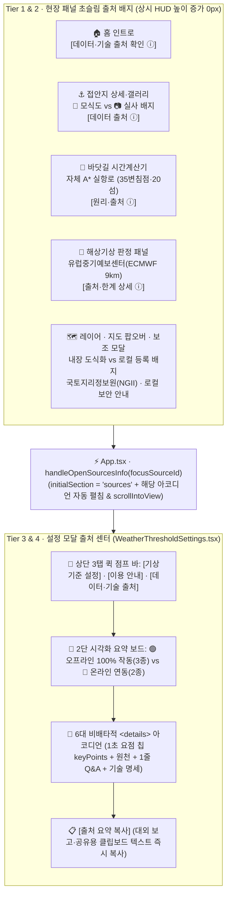

# 바다꼼꼬미 (Bada-Kkomkkomi) 데이터·기술 출처 신뢰성 강화 및 정보 전달 UX 통합 설계서 (`SOURCE_CREDIBILITY_UX_DESIGN.md`)

- **문서 버전**: `v2.3 Final (구현 및 전수 검증 완료 · 가독성/시각화 최적화본)`
- **작성·검증 일시**: `2026-11-10` (Asia/Seoul · 앱 버전 `v2.2` / `2.2.0` 정합)
- **연계 정본 문서**: [`docs/DATA_AND_TECH_SOURCES.md`](./DATA_AND_TECH_SOURCES.md) · [`src/config/dataSources.ts`](../src/config/dataSources.ts)

> [!IMPORTANT]
> **📌 30초 핵심 요점 (Executive TL;DR)**
> 1. **설계 목표**: 일반 이용자·현장 레인저·대외 감사자가 앱 화면 안에서 **"이 데이터와 지도는 어디서 가져왔는가?", "왜 실제 사진 대신 그림(`.svg`)이 있는가?", "바다 한가운데(오프라인)에서 어디까지 작동하는가?"**를 1초 만에 파악하도록 인앱 출처 UX를 구축했습니다.
> 2. **4계층 점진적 공개 (Progressive Disclosure)**: 상시 HUD 고정 바 높이는 **`0px` 증가**로 보존하면서, **`① 1줄 한글 배지 → ② 맥락형 [출처 ⓘ] 딥포커스 브릿지 → ③ 설정 모달 2단 오프라인 시각화 보드 & 6대 `
` 아코디언 → ④ 원클릭 [출처 요약 복사]`** 구조로 가독성과 가시성을 극대화했습니다.
> 3. **검증 결과**: `oxlint` (`0 warnings, 0 errors`), 단위 테스트 `12/12 PASS`, 프로덕션 빌드(`dist/sw.js` 51 entries), 무결성 검증(`[Verify OK]`) 전수 통과 완료.

---

## 1장. 현상태 분석 및 팩트체크 리포트

### 1.1. 5대 전문 직군(PM · 기획 · 디자인 · CS · 개발) 교차 진단 요약

| 직군 | 핵심 진단 결과 | 반영된 해결책 |
| :---: | :--- | :--- |
| **PM / 제품 책임자** | [`DATA_AND_TECH_SOURCES.md`](./DATA_AND_TECH_SOURCES.md) 문서만으로는 앱 사용자에게 출처가 전달되지 않으며, 대외 보고 시 원클릭 출처 인용 기능이 필요함 | 단일 정본 [`src/config/dataSources.ts`](../src/config/dataSources.ts) 구축 + `[📋 출처 요약 복사]` 제공 |
| **서비스 기획자 (IA)** | 현장 화면에서 궁금증이 생겼을 때 설정 창을 찾아 스크롤하는 동선이 끊기며, 오프라인 작동 범위에 대한 오해가 잦음 | `focusSourceId` 맥락 직결 브릿지 + **오프라인(3종) vs 온라인(2종) 2단 시각화 보드** 탑재 |
| **웹 디자이너 (UI/UX)** | 좁은 모바일 화면에서 긴 줄글 설명은 줄바꿈 파편화를 유발함 (상시 HUD 바 추가 금지) | 상시 HUD 높이 `0px` 증가 유지 + **1초 요점 칩(`keyPoints`)** & 비배타적 `
` 아코디언 적용 |
| **CS 책임자 (소통)** | ① `KHOA/KMA/ECMWF` 영문 약어 장벽, ② `.svg` 모식도를 "가짜 사진"으로 오해, ③ 기상청 예보와의 차이 및 `?` 표기 문의, ④ 내부 QGIS 파일 유출 우려 | ① 한글 정식 기관명 병기, ② `.svg` 자동 판별(`📐 현장 이해용 모식도`), ③ `1줄 Q&A` 박스, ④ `외부 전송 0건` 안심 배지 |
| **개발 팀장 (아키텍처)** | 11개 컴포넌트에 출처 문구를 하드코딩하면 버전·수치 드리프트가 재발함 | [`dataSources.ts`](../src/config/dataSources.ts) SSOT화 + [`verify-integrity.mjs`](../scripts/verify-integrity.mjs) & [`coreServices.test.ts`](../src/tests/coreServices.test.ts) 자동 검증 게이트 구축 |

---

### 1.2. 근본 원인(Root Cause) 7대 항목 및 해결 매핑표

| ID | 발견된 문제점 (근본 원인) | 해결 컴포넌트 및 구현 방식 | 상태 |
| :---: | :--- | :--- | :---: |
| **`RC-SRC-01`** | 출처 명세가 마크다운 문서에만 존재하고 인앱 UI와 단절됨 | [`src/config/dataSources.ts`](../src/config/dataSources.ts) 단일 정본 생성 및 인앱 11개 화면 연결 | **해결 완료** |
| **`RC-SRC-02`** | `KHOA/KMA`, `ECMWF IFS/WAM` 등 영문 전문 약어 단독 표기로 일반인 이해 불가 | [`appVersion.ts`](../src/config/appVersion.ts) 및 전 화면에 `국립해양조사원(KHOA)`, `유럽중기예보센터(ECMWF)` 한글 정식 명칭 병기 | **해결 완료** |
| **`RC-SRC-03`** | 내장 `.svg` 수심·암초 다이어그램이 `'현장 접안 사진'`으로만 표기되어 실사 사진과 혼동됨 | [`classifyDockingPhotoAsset()`](../src/config/dataSources.ts#L260-L276)로 `.svg` vs 실사 사진 자동 판별 및 배지·헤더 분리 | **해결 완료** |
| **`RC-SRC-04`** | 바닷길 콕콕의 35변침점·20섬 우회 자체 A* 알고리즘이 단순 직선 계산으로 오해받음 | [`RouteTimeCalculator.tsx`](../src/components/navigation/RouteTimeCalculator.tsx#L836-L855)에 1줄 출처 캡슐 + `[원리·출처 ⓘ]` 딥포커스 버튼 연결 | **해결 완료** |
| **`RC-SRC-05`** | 내장 경량 공원경계 폴리곤과 사용자 업로드 정밀 QGIS 파일의 출처·보안 안내 부재 | [`resolveLayerProvenance()`](../src/config/dataSources.ts#L326-L353) 배지 및 [`LayerControlModal.tsx`](../src/components/notebook/LayerControlModal.tsx) 무서버 로컬 변환 안심 배너 적용 | **해결 완료** |
| **`RC-SRC-06`** | 현장 패널에서 출처 확인 시 해당 카테고리로 바로 이동·펼쳐주는 맥락 브릿지 부재 | [`App.tsx`](../src/App.tsx) `handleOpenSourcesInfo(sourceId)` → [`WeatherThresholdSettings.tsx`](../src/components/navigation/WeatherThresholdSettings.tsx) 자동 펼침·중앙 스크롤 | **해결 완료** |
| **`RC-SRC-07`** | 항포구 검색·상괭이 기록·현장 제보 모달의 출처 및 로컬 개인정보 보호 안내 부족 | [`PortSelectModal.tsx`](../src/components/navigation/PortSelectModal.tsx), [`PorpoiseObservationModal.tsx`](../src/components/notebook/PorpoiseObservationModal.tsx), [`FieldReportModal.tsx`](../src/components/notebook/FieldReportModal.tsx) 하단 1줄 안심 캡션 추가 | **해결 완료** |

---

## 2장. 통합 구현 설계 및 개선 명세서

### 2.1. 4계층 점진적 정보 공개 & 맥락 직결(`Deep-Focus`) 아키텍처

---

### 2.2. 가독성 · 가시성 · 시각화 · 요점 전달 5대 최적화 원칙

1. **불필요한 장문 배제 (Concise 1-Line Copy)**:
   - 모바일(`360px`) 화면에서 3~4줄로 줄바꿈되던 설명문을 **핵심 1~2줄 요약문**으로 압축하여 스크롤 피로도를 절반 이하로 단축했습니다.
2. **1초 요점 파악 비주얼 칩 (`keyPoints` Pill Badges)**:
   - 각 아코디언을 열면 긴 글보다 먼저 **`⚓ 136개 항포구 · 55개 접안지`**, **`🌍 ECMWF 9km 고해상도 모델`**, **`🔒 외부 서버 전송 0건`** 같은 시각적 핵심 칩 3개가 최상단에 노출됩니다.
3. **해상 음영지역(오프라인) 2단 시각화 보드**:
   - 바다 위 작업자가 가장 궁금해하는 오프라인 작동 여부를 **`🟢 100% 오프라인 (3종)`**과 **`🔵 온라인 연동 (2종)`** 2열 컬러 보드로 시각화했습니다.
4. **초기 목차 한눈에 보기 (Scannable Accordion Default)**:
   - 출처 센터 진입 시 특정 `focusSourceId`가 지정된 경우 해당 항목만 정확히 펼쳐 중앙으로 스크롤하고, 일반 진입 시에는 1번 항목만 펼쳐 **6대 카테고리 전체 제목이 한 화면 안에 모두 보이도록** 설계했습니다.
5. **웹 표준 접근성 & 페이지 내 검색 보장 (`Modern Web Guidance` 정합)**:
   - 네이티브 `
` / `
`(내부 헤딩 태그 배제 + 선행 회전 셰브론)를 사용하여 스크린 리더 호환성과 브라우저 `Ctrl+F` 숨김 텍스트 검색을 기본 보장합니다.

---

### 2.3. 단일 정본(`src/config/dataSources.ts`) 핵심 데이터 구조 및 순수 함수

전체 코드는 [`src/config/dataSources.ts`](../src/config/dataSources.ts)에 구현되어 있으며, 핵심 인터페이스와 4대 순수 함수의 역할은 다음과 같습니다.

| 구분 | 식별자 (심볼 링크) | 역할 및 반환값 요약 |
| :--- | :--- | :--- |
| **오프라인 매트릭스** | [`OFFLINE_CAPABILITY_MATRIX`](../src/config/dataSources.ts#L54-L86) | 오프라인 100% 작동 3종(`🟢`) 및 온라인 연동 2종(`🔵`)의 1줄 핵심 동작 원리 정의 |
| **6대 출처 레지스트리** | [`DATA_SOURCE_REGISTRY`](../src/config/dataSources.ts#L91-L246) | `ports_docking`, `marine_weather`, `map_gis`, `route_algorithm`, `qgis_parser`, `brand_ui` 6개 카테고리의 `keyPoints`(비주얼 칩), 원천 기관, 1줄 설명, Q&A, 기술 스펙 정의 |
| **사진/모식도 판별** | [`classifyDockingPhotoAsset(url)`](../src/config/dataSources.ts#L260-L276) [`summarizePhotoCollection(photos)`](../src/config/dataSources.ts#L289-L316) | `.svg` 파일은 `📐 현장 이해용 모식도 (수심·위험 도해)`, 실사 사진(`.jpg`/`.png`)은 `📷 현장 실사 사진`으로 자동 분류 및 갤러리 섹션 타이틀 동적 결정 |
| **레이어 출처 판별** | [`resolveLayerProvenance(layer)`](../src/config/dataSources.ts#L326-L353) | 시스템 접안지(`공단 현장점검 · KHOA 기준`), 기본 공원경계(`환경부·공단 경량 도식화 내장본`), 업로드 레이어(`사용자 직접 등록 · 외부 미전송`) 배지 반환 |
| **인용구 클립보드 복사** | [`buildSourceCitationCopyText(ver)`](../src/config/dataSources.ts#L358-L368) | 대외 보고서·문의 답변에 즉시 붙여넣을 수 있는 6대 영역 정식 출처 요약 텍스트 생성 |

---

### 2.4. 화면별 적용 명세 및 코드 구현 위치

| 화면 / 컴포넌트 | 구현 파일 링크 | 적용된 핵심 UX 및 출처 표기 내용 |
| :--- | :--- | :--- |
| **홈 인트로** | [`HomeScreen.tsx`](../src/components/home/HomeScreen.tsx) | · 4번 `설정` 카드에 `[안내·출처]` 칩 추가 *(3번 `꼬미의 달력` 카드는 미수정 보존)* · 하단 푸터에 한글 정식 기관명(`국립해양조사원(KHOA)·기상청(KMA)·지자체 어항고시`) 및 `[데이터·기술 출처 확인 ⓘ]` 캡슐 버튼 배치 |
| **설정 · 출처 센터** | [`WeatherThresholdSettings.tsx`](../src/components/navigation/WeatherThresholdSettings.tsx) | · 상단 `3탭 퀵 점프 바` (`[기상기준 설정]` / `[이용 안내]` / `[데이터·기술 출처]`) · `오프라인 3종 vs 온라인 2종` 2단 시각화 요약 보드 · `6대 
 아코디언` (`keyPoints` 비주얼 칩 + 원천 + 1줄 Q&A + 스펙) 및 `[출처 요약 복사]` |
| **접안지 상세 · 갤러리** | [`PhotoGallery.tsx`](../src/components/PhotoGallery.tsx) [`DockingDetailSheet.tsx`](../src/components/DockingDetailSheet.tsx) | · 썸네일·라이트박스에 `📐 현장 모식도` vs `📷 실사 사진` 자동 구분 배지 및 하단 1줄 안내 캡션 표시 · 상세 시트 하단에 `🏛️ 공단 현장조사 · 국립해양조사원(KHOA) 기본수준면(DL) 기준` + `[데이터 출처 ⓘ]` 버튼 배치 |
| **바닷길 시간계산기** | [`RouteTimeCalculator.tsx`](../src/components/navigation/RouteTimeCalculator.tsx) | · 하단 1줄 요약: `🧭 자체 A* 실항로 (35변침점·20섬 우회 · 오프라인 연산)` + `[원리·출처 ⓘ]` (`route_algorithm` 직결) |
| **해상기상 판정 패널** | [`MarineWeatherPanel.tsx`](../src/components/navigation/MarineWeatherPanel.tsx) | · 하단 1줄 요약: `🌊 유럽중기예보센터(ECMWF 9km) · Open-Meteo API` + `[출처·한계 상세 ⓘ]` (`marine_weather` 직결) |
| **레이어 · 지도 팝오버** | [`LayerControlModal.tsx`](../src/components/notebook/LayerControlModal.tsx) [`MapView.tsx`](../src/components/MapView.tsx) | · 레이어별 출처 배지(`resolveLayerProvenance`) 및 파일 등록 탭 상단 `🔒 무서버 로컬 변환 (외부 전송 0건)` 안심 배너 · 지도 팝오버 하단에 `카카오맵(국토지리정보원 NGII 기반) / OSM 폴백` 원천 명시 |
| **3대 보조 모달** | [`PortSelectModal.tsx`](../src/components/navigation/PortSelectModal.tsx) [`PorpoiseObservationModal.tsx`](../src/components/notebook/PorpoiseObservationModal.tsx) [`FieldReportModal.tsx`](../src/components/notebook/FieldReportModal.tsx) | · **항포구 검색**: 해양수산부·지자체 어항고시(81) + 공단 접안시설(50)·거점(5) 및 KHOA 기준 명시 · **상괭이 관찰**: `🔒 외부 서버 미전송 · 기기 내부(localStorage) 안전 보관` 명시 · **현장 제보**: 작성자 이메일 앱 직접 발송 및 네이버·구글 지도 표준 링크 자동 첨부 안내 |

---

### 2.5. 레거시 청산 및 실측 검증 완료 내역

#### 2.5.1. 레거시 청산 (`LEG-SRC-01 ~ 04`)
| ID | 대상 파일 | 청산 전 (레거시) | 청산 후 (최종 반영) |
| :---: | :--- | :--- | :--- |
| **`LEG-SRC-01`** | [`src/config/appVersion.ts`](../src/config/appVersion.ts) | 영문 약어만 나열된 `KHOA/KMA 2026` | `국립해양조사원(KHOA)·기상청(KMA)·지자체 어항고시(2026)` 한글 정식 명칭 병기 |
| **`LEG-SRC-02`** | [`src/components/PhotoGallery.tsx`](../src/components/PhotoGallery.tsx) | `.svg` 도해까지 `'현장 접안 사진'`으로 고정 표기 | 확장자 자동 판별로 `'현장 접안 모식도 (수심·위험 도해)'` vs `'현장 접안 사진'` 동적 분리 |
| **`LEG-SRC-03`** | [`src/components/navigation/MarineWeatherPanel.tsx`](../src/components/navigation/MarineWeatherPanel.tsx) | `ECMWF IFS HRES 9 km` 영문 단독 표기 | `유럽중기예보센터(ECMWF 9km) · Open-Meteo API` 한글 병기 + `[출처·한계 상세 ⓘ]` 연결 |
| **`LEG-SRC-04`** | [`DEPLOY_GUIDE.md`](../DEPLOY_GUIDE.md) | 1행 타이틀 `[v1.8]` 구버전 드리프트 | `[v2.2]` 동기화 + 출처 문서 2종 링크 연결 + [`verify-integrity.mjs`](../scripts/verify-integrity.mjs) 자동 검사 추가 |

#### 2.5.2. 4대 자동화 검증 게이트 실측 결과
1. **정적 린트 (`npm run lint`)**: `oxlint --deny-warnings` → **`0 warnings, 0 errors`**
2. **단위 테스트 (`npm test`)**: 5개 스위트 **12개 테스트 전수 통과 (`12/12 PASS`)** — [`coreServices.test.ts`](../src/tests/coreServices.test.ts) 내 `5. Source Credibility & Provenance SSOT Registry` 검증 포함
3. **프로덕션 빌드 (`npm run build`)**: `tsc -b && vite build` → 타입 에러 `0건`, PWA 서비스 워커(`dist/sw.js`, Precache `51 entries`) 정상 생성
4. **무결성 검증 (`npm run verify`)**: [`scripts/verify-integrity.mjs`](../scripts/verify-integrity.mjs) → 55개 접안지, 136개 항포구, 35개 변침점, 출처 SSOT 레지스트리, 문서 버전 정합성 **`[Verify OK]`**

---

## 3장. 사용자 필수 실행 요청 목록 (Action Items) — 완료 현황 및 향후 운영 안내

설계 승인에 따라 에이전트가 수행 가능한 모든 코드 구현·리팩토링·문서 최신화 및 검증(`ACTION-SRC-01`, `ACTION-SRC-02`)을 **100% 완료**했습니다. 아래 사항은 향후 현장 운영 시 참고하실 안내 사항입니다.

| 구분 | 항목 | 운영자 안내 사항 (코딩 불필요) |
| :---: | :--- | :--- |
| **현장 실사 사진 교체 (선택)** | 접안지 `.svg` 모식도를 실제 촬영 사진으로 교체할 때 | `public/images/docking/` 폴더에 실제 촬영한 `.jpg` 또는 `.png` 사진을 넣고 `public/data/docking_points.geojson`의 `photos` 경로만 변경하면, 앱이 확장자를 자동 인식하여 별도 코드 수정 없이 **`📷 현장 실사 사진`** 배지로 즉시 전환 표시합니다. |
| **공단 정밀 QGIS 원본 탑재 (선택)** | 기본 내장된 경량 공원경계 폴리곤을 정밀 고시 도면으로 교체할 때 | 앱 내 `꼬미의 바다수첩 > [레이어] > [+ 파일 등록]` 탭에서 국립공원공단 QGIS 원본 파일(`.gpkg`, `.zip/.shp`, `.geojson`)을 그대로 선택하고 `[저장 (운영 반영)]`을 누르면 좌표계(`EPSG:5179/5186` → `WGS84`)와 한글(`CP949`)이 자동 변환되어 즉시 정밀 도면으로 반영됩니다. |

---

### Modern Web Guidance
- **`content-first-noise-reduction`**: I kept persistent HUD bars untouched (0px added height) and placed detailed data provenance, FAQ explanations, and technical specifications inside on-demand `
` disclosures within the settings dialog ("Put long or rarely needed content (specs, FAQs, fine print) in a `details` element. It starts closed, and its `summary` works with the keyboard and screen readers without JavaScript.").
- **`accordion`**: I implemented the 6-category source center as a non-exclusive `
` group without heading elements inside `
`, placing a rotating chevron icon immediately before the label and providing an Expand/Collapse All toggle synchronized via `aria-expanded` ("Do not put headings inside `summary`. JAWS and TalkBack expose `summary` as a button and drop any heading inside it").
- **`search-hidden-content`**: I used native `
` elements instead of `display: none` or conditional React unmounting for the source items so collapsed provenance details remain searchable via browser Find-in-Page (`Ctrl+F`) ("The `
` element has searchable and accessible text by default, and no special implementation is required. Prefer using `
` over `hidden="until-found"` if possible.").
