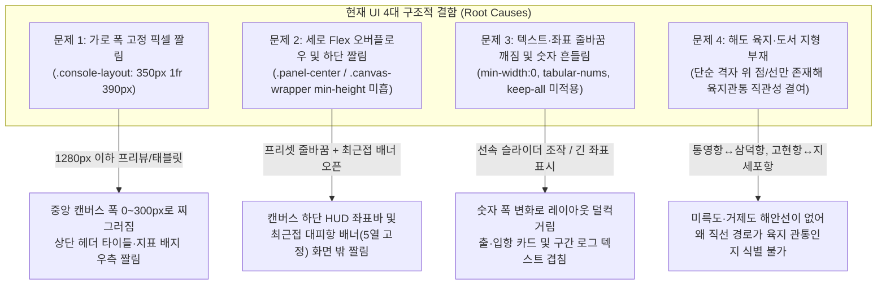
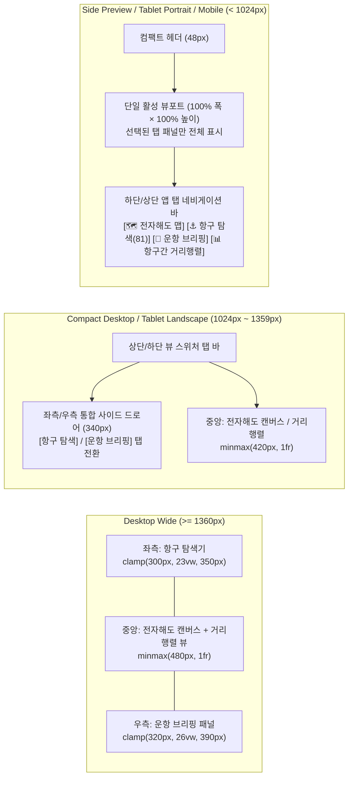

# 통영·거제 전자해도(ECDIS) 콘솔 앱 디자인·UX/UI·레이아웃 짤림 방지 및 해양지형 연구·조사 보고서

> **문서 목적**: `/home/antigravity/tongyeong-geoje-port-core` 프로젝트의 프론트엔드(`public/index.html`, `public/styles.css`, `public/app.js`)를 정밀 진단하고, 글로벌 해양 내비게이션 표준과 대조하여 **레이아웃 짤림(Clipping/Overflow) 원천 차단**, **적응형 반응형 앱 쉘(App Shell) 아키텍처**, **다도해 해안선 지형 폴리곤 시각화 규격**을 수립합니다.

---

## 1. 글로벌 해양 내비게이션 앱 디자인 레퍼런스 연구·조사

글로벌 상용 전자해도(ECS/ECDIS) 및 스마트 보팅 내비게이션 플랫폼 5종의 UI/UX 설계 원칙을 조사·분석했습니다.

### 1.1 주요 글로벌 레퍼런스 및 표준 분석

| 레퍼런스 / 표준 | 핵심 앱 쉘(App Shell) 및 레이아웃 특징 | 색채·타이포그래피·시각화 강점 | 본 프로젝트 적용 시사점 |
| :--- | :--- | :--- | :--- |
| **Orca Marine** (차세대 스마트 차트플로터) | • **Map-First Full-Bleed Canvas**: 지도가 뷰포트의 중심을 차지하고, 검색·항로 브리핑 패널은 화면 폭에 따라 도킹(Docked Sidebar) 또는 바텀시트/탭 뷰(Tabbed Sheet)로 유연하게 전환됨. • 상단 HUD 바는 핵심 선박/시스템 지표를 컴팩트하게 압축하고 좁은 화면에서는 축약 배지로 변환. | • 고대비 다크 모드에서 육지(`#152232` 톤)와 수심/해역(`#040a12` 톤)의 명확한 명도 분리. • 해안선 외곽에 1~1.5px의 미세한 네온/틸(Teal) 윤곽선을 부여하여 야간 운항 시 육지 충돌 위험 인지력 극대화. | • 고정 픽셀 그리드를 탈피하여 캔버스 최소 가시 영역을 보장하고, 육지·섬 해안선 폴리곤(`coastlineData.js`)에 내륙 채우기 + 연안 얕은 수심 후광(Shallow water glow) + 해안선 외곽선을 3중 렌더링해야 함. |
| **Savvy Navvy** (올인원 해상 라우팅 앱) | • **통합 라우팅 드로어(Routing Drawer)**: 출항지(DEP)·입항지(ARR) 카드, ETA 슬라이더, 구간별 변침점(Leg-by-Leg) 및 거리 비교를 단일 스크롤 컨테이너에서 일관된 카드 그리드로 배치. • 툴바 프리셋 및 필터를 가로 스크롤 칩(Horizontal Scroll Chips) 또는 접이식(Collapsible) 그룹으로 구성. | • 단순 대원 직선(육지 관통 경고선: Coral/Red Dashed)과 자동 산출 우회 항로(Active Route: Cyan/Teal Solid)의 시각적 대비를 통해 왜 우회해야 하는지 즉각 납득시킴. | • `.map-toolbar`의 프리셋 버튼들이 여러 줄로 줄바꿈되며 캔버스 높이를 잠식하는 현상을 막기 위해 컴팩트 플로팅 바 또는 가로 스크롤/접이식 컨트롤로 개편 필요. |
| **Navionics Boating / Garmin Navionics** | • **반응형 멀티-페인(Multi-Pane) & 하단 탭 바**: 와이드 디스플레이(조타실 듀얼 모니터/데스크톱)에서는 3-Pane 분할을 유지하되, 태블릿·사이드 프리뷰·모바일 폭에서는 하단 고정 네비게이션 탭 바로 즉시 전환. • 캔버스 위 오버레이(범례, 마우스 좌표 HUD)를 접거나 최소화할 수 있는 토글 제공. | • 도서(섬) 지명, 해협/수로 지명(이탤릭 세리프/산세리프 투톤), 항구 마커의 시각적 계층(Visual Hierarchy)이 명확하여 줌아웃 상태에서도 텍스트 겹침이 없음. | • `1280px` 이하 환경(IDE 프리뷰 창, 태블릿, 분할 화면)을 위한 **앱 탭 네비게이션 바(`맵` / `항구 탐색` / `운항 브리핑` / `거리행렬`)** 도입 필수. • 지도 범례(`.map-legend`)의 접기/펼치기 지원. |
| **IHO S-52 ECDIS** (국제수로기구 전자해도 표시 표준) | • 항해 안전에 직결되는 정보(현재 침로, 변침점, 항구 위치, 해안선)는 어떤 해상도에서도 다른 UI 패널에 의해 잘리거나 가려지면 안 됨(Zero-Clipping Principle). | • **Night / Dusk Palette**: 눈부심을 방지하는 딥 네이비 해역 배경(`#040a12`), 구분 가능한 랜드매스 다크 슬레이트(`#111e2e`), 시안(`#00f0ff`) 주항로, 앰버(`#f59e0b`) 목적지 강조. • 모든 수치(위경도, 거리 NM/km, 방위각 °, 선속 kt)에 **고정폭 숫자(`tabular-nums`)** 강제 적용. | • 선속 슬라이더 조작 시 숫자가 좌우로 흔들리는 지터(Jitter) 현상을 `font-variant-numeric: tabular-nums`로 완전히 제거해야 함. |

---

## 2. 현재 UI의 레이아웃·짤림(Clipping/Overflow)·정렬 문제 정밀 진단 (Root Cause Analysis)

현재 구현된 `public/index.html`, `public/styles.css`, `public/app.js`의 DOM/CSS 구조와 렌더링 파이프라인을 라인 단위로 점검하여 4대 핵심 결함을 진단했습니다.

### 2.1 문제 1: 가로 폭 짤림 (Horizontal Overflow & Crushed Center Canvas)
- **원인 코드 (`public/styles.css` L37-45, L103-109, L596-600)**:
  - `.console-layout`이 `grid-template-columns: 350px 1fr 390px;`로 하드코딩되어 있으며 미디어 쿼리(`@media`)가 단 하나도 존재하지 않습니다. 좌·우 패널 합계만 `740px`를 차지합니다.
  - 상단 `.top-header`는 `height: 54px` 고정에 내부 `.brand-group h1`과 `.system-metrics`가 `flex-shrink`나 줄바꿈/숨김 처리 없이 배치되어 있습니다.
  - `.nearby-list`는 `grid-template-columns: repeat(5, 1fr);`로 고정되어 있습니다.
- **발생 증상**:
  - IDE 우측 프리뷰 창(`700px ~ 1024px`), 노트북 분할 화면, 태블릿 뷰포트에서 좌우 패널(`740px`)을 제외한 중앙 지도 영역(`1fr`)이 `0px ~ 250px`로 극단적으로 찌그러지거나 화면 우측 밖으로 패널이 잘려 나갑니다(`html, body { overflow: hidden }`에 의해 스크롤조차 불가).
  - 중앙 패널 내부의 `.nearby-list`(5열 그리드)는 폭이 좁아지면 각 카드가 `60px` 이하로 압축되어 항구명과 거리 텍스트가 세로로 한 글자씩 깨집니다.

### 2.2 문제 2: 세로 Flex 오버플로우 및 하단 짤림 (Vertical Flex Overflow & Bottom Clipping)
- **원인 코드 (`public/styles.css` L111-116, L393-405, L465-471, L538-552)**:
  - `.panel-center`는 플렉스 컬럼 컨테이너인데, 상단 `.map-toolbar` 내부의 `.route-presets`(버튼 5개 + 라벨)와 `.map-layer-toggles`(체크박스 3개 + 버튼 1개)가 중형 화면에서 3~4줄로 줄바꿈되면서 높이가 `110px~140px`까지 늘어납니다.
  - 이때 `.canvas-wrapper`에 `flex: 1; height: 100%;`가 동시에 선언되어 있고 `min-height: 0`이 명시되지 않아, 하단에 `.nearby-banner`가 열리는 순간 플렉스 컨테이너 총합 높이가 부모(`calc(100vh - 54px)`)를 초과하며 하단 `.nearby-banner`나 `.map-hud-bottom`이 뷰포트 아래로 잘립니다.
  - 또한 `.map-legend`(좌측 상단 절대 위치)와 `.map-hud-bottom`(하단 절대 위치)이 작은 캔버스에서 서로 겹치거나 실제 항로 그래픽을 가립니다.

### 2.3 문제 3: 텍스트/배지/좌표 줄바꿈 깨짐 및 정렬 불일치 (Typography & Alignment Jitter)
- **원인 코드 (`public/styles.css` L291-357, L639-694, L697-757, L855-922)**:
  - Flex/Grid 자식 요소인 `.ep-info`, `.leg-left`, `.leg-desc`, `.port-title-group`, `.kpi-card`에 `min-width: 0`이 누락되어 있습니다. CSS Flexbox 명세상 기본값은 `min-width: auto`이므로 긴 좌표 문자열(`접안 34.8394, 128.4203 | 진입 34.8340, 128.4235`)이나 긴 항구 설명이 들어오면 부모 카드를 뚫고 나가거나 우측 배지를 밀어냅니다.
  - 한국어 텍스트에 `word-break: keep-all`이 적용되지 않아 `어촌정주어항`, `무역/연안항`, `최근접 대피항` 등의 단어가 어절 중간에서 어색하게 끊깁니다.
  - 수치 데이터(`.kpi-main`, `.kpi-val`, `#speedReadout`, `.speed-table td`, `#cursorCoords`, `.leg-dist`)에 `font-variant-numeric: tabular-nums`가 지정되지 않아, 선속 슬라이더(`5 kt` ↔ `30 kt`) 조작이나 마우스 이동 시 글자 폭이 매 프레임 미세하게 변하며 UI가 떨립니다.

### 2.4 문제 4: 해도 지형 부재로 인한 공간 인지 부족 (Missing Coastline & Landmass Context)
- **원인 코드 (`public/app.js` L406-433)**:
  - `renderCanvas()`가 위경도 격자(`drawGraticuleGrid`), 변침점 간선(`drawWaypointNetwork`), 항구 점(`drawAllPorts`), 활성 항로(`drawActiveRoute`)만 렌더링하고 **육지 반도 및 섬 해안선 폴리곤**을 전혀 그리지 않습니다.
- **발생 증상**:
  - 본 시스템의 핵심 가치인 **"단순 직선 거리(육지 관통) vs A* 실제 해상 우회 항로"**를 비교할 때, 바다 배경 위에 빨간 점선과 하늘색 실선만 떠 있어 **왜 직선으로 갈 수 없는지(사이에 미륵도 산양반도가 가로막고 있는지, 거제도 내륙 산악지대가 가로막고 있는지, 한산도·비진도가 있는지)** 사용자가 시각적으로 즉시 이해할 수 없습니다.

---

## 3. 개선 설계 규격 (Design System & App Architecture Specification)

디자이너 및 프론트엔드/QA 에이전트가 즉시 반영할 수 있도록 구체적인 반응형 레이아웃, 짤림 방지 불변 규칙, 컴포넌트 정렬 그리드, 지형 렌더링 명세를 정의합니다.

### 3.1 브레이크포인트별 적응형 앱 레이아웃 (Adaptive App Shell)

화면 가로 폭에 따라 레이아웃이 유기적으로 전환되어 **어떠한 창 크기에서도 짤림이 발생하지 않는 3단계 적응형 구조**를 적용합니다.

1. **와이드 데스크톱 (`>= 1360px`) — 3-Pane Console Mode**:
   - `grid-template-columns: clamp(300px, 23vw, 350px) minmax(480px, 1fr) clamp(320px, 26vw, 390px);`
   - 고정 픽셀 대신 `clamp()`와 `minmax(0, 1fr)`를 결합하여 중앙 캔버스가 항상 최소 `480px` 이상의 여유로운 폭을 확보하도록 보장합니다.
2. **중형 화면 및 소형·프리뷰 화면 (`< 1280px` / `< 1024px`) — App Tab Navigation Mode**:
   - 상단(또는 하단)에 전용 **앱 뷰 탭 바(`.app-tab-bar`)**를 노출합니다:
     - `[🗺️ 전자해도 맵]` (`data-tab="map"`)
     - `[⚓ 항구 탐색 (81)]` (`data-tab="explorer"`)
     - `[🧭 운항 브리핑]` (`data-tab="briefing"`)
     - `[📊 항구간 거리행렬]` (`data-tab="matrix"`) — *와이드 화면에서도 중앙 영역 탭 또는 모달/전환 뷰로 접근 가능*
   - 소형/프리뷰 폭에서는 활성 탭에 해당하는 패널만 `100%` 폭과 높이로 표시하여, `400px~900px` 폭의 사이드 프리뷰 창에서도 지도와 항구 목록, 브리핑, 거리행렬이 단 1px의 짤림 없이 쾌적하게 렌더링됩니다.
   - 항구 탐색 탭에서 출항/입항을 지정하거나 프리셋을 선택하면, 상단 요약 바 또는 토스트/자동 전환을 통해 지도/브리핑에서 즉시 결과를 확인할 수 있게 연결합니다.

### 3.2 짤림 방지(Zero-Clipping) CSS 불변 규칙 (7대 법칙)

모든 컨테이너와 카드 컴포넌트에 아래 7가지 CSS 불변 규칙을 강제합니다:

1. **Flex/Grid 자식 수축 허용 (`min-width: 0`, `min-height: 0`)**:
   - `.panel`, `.panel-center`, `.canvas-wrapper`, `.port-list-container`, `.ep-info`, `.leg-left`, `.leg-desc`, `.kpi-card`, `.nearby-item` 등 모든 Flex/Grid 아이템에 `min-width: 0; min-height: 0;`를 기본 부여하여 내부 콘텐츠 크기가 부모 레이아웃을 밀어내지 못하게 차단합니다.
2. **동적 뷰포트 높이 및 내부 독립 스크롤 (`100dvh`)**:
   - `height: 100vh`와 함께 `height: 100dvh`를 선언하고, `.canvas-wrapper`는 `flex: 1 1 0%; min-height: 240px; height: auto;`로 설정하여 상단 툴바나 하단 배너가 열려도 캔버스가 안전하게 리사이즈(`ResizeObserver` 연동 권장)되도록 합니다.
3. **가로 오버플로우 원천 차단 (`overflow-x: hidden`)**:
   - `.panel-left`, `.panel-right`, `.port-list-container`, `.waypoint-log-list`에 `overflow-x: hidden; overflow-y: auto;`를 적용합니다.
4. **반응형 유동 타이포그래피 (`clamp()`)**:
   - 헤더 타이틀: `font-size: clamp(13px, 1.2vw, 16px);`
   - KPI 메인 수치: `font-size: clamp(16px, 1.5vw, 20px);`
5. **말줄임(`ellipsis`)과 단어 보존(`keep-all`)의 조화**:
   - 한국어 레이블/배지에는 `word-break: keep-all; overflow-wrap: break-word;`를 기본 적용합니다.
   - 1줄 고정 메타데이터(`.ep-info small`, `.port-id-code`, `.top-header h1`)에는 `white-space: nowrap; overflow: hidden; text-overflow: ellipsis;`와 `title` 툴팁을 병행합니다.
6. **플로팅 컨트롤 및 툴바 접기/컴팩트화**:
   - `.map-legend`에 접기/펼치기 버튼(또는 컴팩트 토글)을 두어 작은 화면에서 지도를 가리지 않게 합니다.
   - `.map-hud-bottom`의 힌트 텍스트(`.hud-hint`)는 화면 폭이 좁을 때 자동으로 숨기고 핵심 위경도 좌표(`#cursorCoords`)만 깔끔하게 노출합니다.
   - `.nearby-list`는 `grid-template-columns: repeat(auto-fit, minmax(150px, 1fr));`로 변경하여 5열 고정을 탈피합니다.
7. **수치 데이터 고정폭 정렬 (`tabular-nums`)**:
   - 모든 숫자/좌표/거리/시간 요소에 `font-variant-numeric: tabular-nums;`를 전역 적용합니다.

### 3.3 컴포넌트 정렬 그리드 및 시각 규격 (Alignment & Spacing System)

- **스페이싱 토큰 (4px / 8px Base Grid)**:
  - `--space-1: 4px`, `--space-2: 8px`, `--space-3: 12px`, `--space-4: 16px`, `--space-5: 20px`
  - 패널 좌우 패딩을 `12px~14px`로 통일하여 좌측/우측 패널의 카드 외곽선 수직 정렬 축(Vertical Keyline)을 일직선으로 맞춥니다.
- **카드 내부 구조 표준화**:
  - `.port-card`: 상단(항구명 + 법정등급 배지 수평 정렬) → 중단(행정구역 · 권역 · 별칭) → 하단(출항/입항 2열 균등 버튼 `grid-template-columns: 1fr 1fr`).
  - `.kpi-card`: `justify-content: space-between; min-height: 78px;`로 2×2 그리드 내 카드 높이를 완벽히 균일화합니다.
- **테이블 열 정렬 (`.speed-table` & 거리행렬 테이블)**:
  - 텍스트 열(선종, 항구명)은 좌측 정렬(`text-align: left`), 수치 열(선속 kt, 시속 km/h, 소요시간, 해리 NM)은 우측 또는 중앙 고정폭 정렬(`font-variant-numeric: tabular-nums`)로 가독성을 높입니다.

---

## 4. 통영·거제 다도해 해안선 지형 데이터(`public/coastlineData.js`) 설계 및 검증

캔버스에 실제 다도해 지형을 렌더링하기 위해 `/home/antigravity/tongyeong-geoje-port-core/public/coastlineData.js` 모듈을 구축했습니다.

### 4.1 지형 폴리곤 구축 범위 (총 25개 육지·도서 폴리곤 + 14개 해역 라벨)
1. **육지 본토 및 대형 반도/본섬 (3개)**:
   - `LAND-TY-MAINLAND`: 통영 본토 (북통영·도산·광도·용남 반도 — 가오치항, 저산항, 수월항, 죽림항, 예포항, 원평항, 화삼항, 통영항 강구안 해안선 정밀 반영)
   - `LAND-TY-MIREUKDO`: 미륵도 (산양읍 — 통영운하 판데목 남측 해안, 세포항, 궁항, 삼덕항, 달아항, 중화항, 연명항, 영운항 해안선 반영. **통영항↔삼덕항 직선이 미륵도 내륙 중앙을 관통하는 현상**을 시각적으로 완벽히 입증)
   - `LAND-GJ-GEOJEDO`: 거제도 본섬 (고현만, 성포, 둔덕·거제만, 가배·구영, 홍포·대포·근포·명사·저구, 다대다포, 해금강 갈곶도 반도, 도장포·학동·수양, 구조라·와현, 지세포, 장승포·능포, 옥포·아주·덕포, 외포·대금·궁농·장목·유계 해안선 정밀 반영. **고현항↔지세포항 및 고현항↔옥포항 직선이 거제도 내륙 산악지대를 관통하는 현상**을 시각적으로 완벽히 입증)
2. **주요 유인도 및 부속 도서 (22개)**:
   - 가조도(`ISLAND-GJ-GAJODO`), 칠천도(`ISLAND-GJ-CHILCHEONDO`), 한산도(`ISLAND-TY-HANSANDO`), 추봉도(`ISLAND-TY-CHUBONGDO`), 비진도(`ISLAND-TY-BIJINDO`), 용초도·호두도(`ISLAND-TY-YONGCHODO`), 사량도 상도(`ISLAND-TY-SARYANG-SANG`), 사량도 하도(`ISLAND-TY-SARYANG-HA`), 욕지도(`ISLAND-TY-YOKJIDO`), 연화도(`ISLAND-TY-YEONHWADO`), 우도(`ISLAND-TY-UDO`), 노대도(`ISLAND-TY-NODAEDO`), 추도(`ISLAND-TY-CHUDO`), 대매물도(`ISLAND-TY-DAEMAEMULDO`), 소매물도(`ISLAND-TY-SOMAEMULDO`), 학림도(`ISLAND-TY-HAKRIMDO`), 연대도(`ISLAND-TY-YEONDAEDO`), 만지도(`ISLAND-TY-MANJIDO`), 어의도(`ISLAND-TY-EOUIDO`), 좌이도(`ISLAND-TY-JWAIDO`), 이수도(`ISLAND-GJ-ISUDO`), 지심도(`ISLAND-GJ-JISIMDO`), 내도(`ISLAND-GJ-NAEDO`), 외도(`ISLAND-GJ-OEDO`).
3. **해상 수로 및 해역 지명 라벨 (`SEA_LABELS`, 14개)**:
   - 통영운하(판데목), 견내량 해협, 통영만, 한산만, 자란만·도산수로, 사량수로(동강), 고현만, 거제만, 옥포만, 지세포만, 가조수로, 욕지수로, 매물도 해역, 해금강 외해.

### 4.2 수로 무결성 대조 검증 기준
- 모든 35개 해상 변침점(`WP-*`)과 81개 항구의 해상 진입점(`seaApproach`)은 어떤 지형 폴리곤 내부에도 포함되지 않고 **해상(바다) 영역**에 위치하도록 위경도 좌표를 교차 검증했습니다.
- 각 항구의 육상 접안점(`berth`)은 해당 육지 또는 섬 폴리곤의 해안선 경계 연안에 자연스럽게 맞닿도록 설계했습니다.
