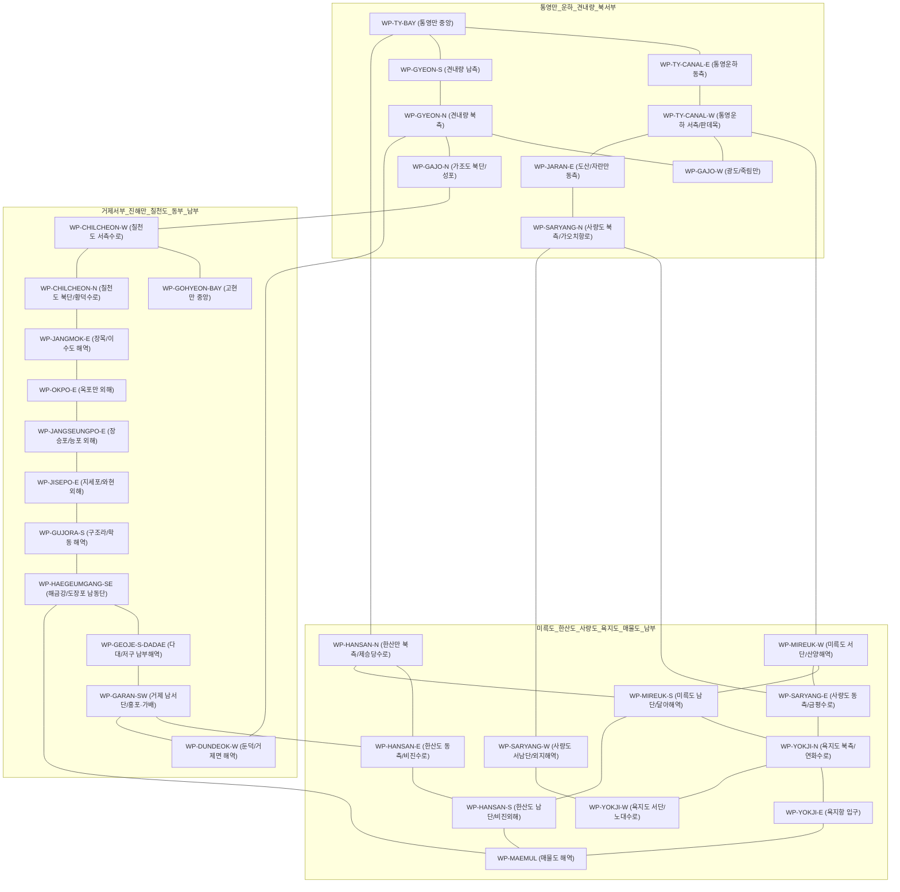

# 통영시·거제시 항구 및 다도해 해상 변침점(Waypoint) 데이터 팩트체크 및 기술 분석 보고서

**문서 버전**: v1.0.0  
**작성 주체**: 기획·실무·해양데이터 팩트체크/검증 에이전트  
**기준 데이터**: 해양수산부 어촌어항관리시스템(NARAPORT), 한국어촌어항공단(FIPA) 어항일람, 경상남도·통영시·거제시 어항현황 공공데이터, 국립해양조사원 해도/해상수로 기준

---

## 1. 공공데이터 기반 통영·거제 어항/항만 현황 팩트체크

### 1.1 관련 법령 및 관리 체계 검증
대한민국의 항만 및 어항은 크게 **「항만법」**에 따른 항만(무역항, 연안항)과 **「어촌·어항법」**에 따른 어항(국가어항, 지방어항, 어촌정주어항, 소규모항포구)으로 이원화되어 관리됩니다. 통영시와 거제시는 한려해상국립공원과 다도해 지형을 끼고 있어 전국에서 항만·어항 밀집도가 가장 높은 해역입니다.

| 분류 코드 (`portClass`) | 법정 등급 명칭 (`portClassLabel`) | 근거 법령 | 지정 및 관리권자 (`managementAgency`) | 통영·거제 대표 항구 |
| :--- | :--- | :--- | :--- | :--- |
| `TRADE_COASTAL_PORT` | 무역/연안항 | 항만법 | 해양수산부 / 경상남도 (통영시·거제시 위임) | **통영**: 통영항(무역항), 중화항(연안항) **거제**: 장승포항(무역항), 옥포항(무역항), 고현항(무역항) |
| `NATIONAL_FISHING_PORT` | 국가어항 | 어촌·어항법 | 해양수산부 (마산지방해양수산청 / 통영시·거제시 관리) | **통영**: 삼덕항, 욕지항, 학림항, 달아항, 연명항, 영운항, 능양항, 호두항 **거제**: 능포항, 지세포항, 다대다포항, 외포항, 구조라항, 덕포항(광역) |
| `LOCAL_FISHING_PORT` | 지방어항 | 어촌·어항법 | 경상남도지사 (통영시·거제시 집행) | **통영**: 궁항, 세포항, 저산항, 수월항, 예포항, 화삼항, 원평항, 어의항, 진두항, 창좌항, 비진항, 진촌항, 내지항, 대항(사량), 유동항, 노대항, 연화항, 우도항, 당금항, 소매물도항 등 **거제**: 와현항, 학동항, 도장포항, 해금강항, 저구항, 명사항, 대포항, 가배항, 구영항, 성포항, 창호항, 계도항, 법동항, 유계항, 어온항, 연구항, 장목항, 궁농항, 대금항, 이수도항 등 |
| `SETTLEMENT_FISHING_PORT` | 어촌정주어항 | 어촌·어항법 | 통영시장 / 거제시장 | **통영**: 가오치항, 죽림항, 도동항, 외지항, 백학항, 대항(매물), 대항(추도), 미조항(추도), 연대항, 만지항 등 **거제**: 근포항, 홍포항, 유교항, 학산항, 시목항, 외간항, 송포항, 덕포항, 수양항, 아주항 등 |
| `SMALL_HARBOR` | 소규모항포구 | 어촌·어항법 외 | 통영시장 / 거제시장 (도서 선착장 포함) | **통영**: 제승당항(한산도 여객선선착장), 좌이도선착장 등 **거제**: 지심도항, 내도항, 외도선착장 등 |

---

## 2. 현장 지명(Alias) 및 행정구역·도서 대조 검증

해양수산부·지자체의 **고시 명칭(`officialName`)**과 어민·여객선사·낚시객이 사용하는 **현장 명칭(`name`, `aliases`)** 사이에 괴리가 발생하는 사례가 많아, 검색 및 라우팅 정확도를 위해 전수 대조 검증을 수행했습니다.

### 2.1 주요 이명(Alias) 및 행정구역 팩트체크 결과

1. **삼덕항 vs 원항 (통영시 산양읍 삼덕리)**
   - **공식 고시명**: `삼덕항` (국가어항)
   - **현장 별칭**: `원항`, `삼덕여객선터미널`, `산양삼덕항`
   - **검증 내용**: 산양읍 삼덕리 원항마을에 위치하여 현지에서는 '원항'과 '삼덕항'이 혼용됨. 욕지도·연화도행 카페리 기점.

2. **영운항 vs 이운항 (통영시 산양읍 영운리)**
   - **공식 고시명**: `영운항` (국가어항)
   - **현장 별칭**: `이운항`, `영운리항`, `이운마을선착장`
   - **검증 내용**: 산양읍 영운리 이운마을에 위치. 과거 이운항으로 불렸으나 국가어항 지정명은 영운항임.

3. **다대다포항 vs 다대항 / 다포항 (거제시 남부면 다대리·다포리)**
   - **공식 고시명**: `다대다포항` (국가어항)
   - **현장 별칭**: `다대항`, `다포항`, `다대포항`
   - **검증 내용**: 거제시 남부면 다대리와 다포리가 하나의 만을 공유하며 통합 국가어항인 '다대다포항'으로 지정됨. 내만 깊숙한 곳은 다대항, 입구 남동측은 다포항으로 세분하여 부름.

4. **가오치항 vs 사량도여객선터미널 (통영시 도산면 오륜리)**
   - **공식 고시명**: `가오치항` (어촌정주어항)
   - **현장 별칭**: `사량도여객선터미널`, `오륜리가오치항`
   - **검증 내용**: 사량도(진촌항·내지항)로 가는 주력 차도선 기점으로, 이용객 대다수가 '사량도여객선터미널'로 검색함.

5. **통영항 vs 강구안 / 서호항 (통영시 항남동·서호동·정량동)**
   - **공식 고시명**: `통영항` (무역항)
   - **현장 별칭**: `강구안`, `서호항`, `통영여객선터미널`, `동호항`
   - **검증 내용**: 통영항은 강구안(문화마당/어선부두), 서호만(통영항여객선터미널), 동호만(어업전진기지)을 포괄하는 무역항임.

6. **사량도 내 항구 구분 (통영시 사량면)**
   - 사량도는 **상도**(진촌항=금평항, 내지항, 대항)와 **하도**(외지항, 백학항, 덕동항, 먹방항)가 사량대교로 연결되어 있음.
   - 특히 사량면 사무소 소재지인 **진촌항**은 행정리 명칭에 따라 `금평항`, `사량도여객선터미널(상도)`로도 불림.

7. **매물도 및 추도 내 ‘대항’ 동음이의어 검증**
   - `대항`이라는 지명이 **사량도(상도 대항)**, **대매물도(대항)**, **추도(대항)** 3곳에 모두 존재함.
   - 따라서 명칭 충돌을 방지하기 위해 `name`은 권역 식별자를 포함한 `사량 대항`, `매물도 대항`, `추도 대항`으로 구분하고, `officialName`과 `aliases`에 `대항` 및 마을 별칭을 매핑하여 검색성과 유일성을 동시에 확보함.

8. **한산도 제승당항 vs 진두항 / 창좌항 (통영시 한산면)**
   - **제승당항**: 한산면 소고포리에 위치한 한산도 대표 여객선 선착장(`한산도여객선터미널`, `소고포선착장`).
   - **진두항**: 한산면 진두리에 위치하며 추봉도(봉암·예곡)와 한산대교(추봉교)로 인접한 내만 지방어항.

---

## 3. 선박 운항 좌표 이원화 (`berth` vs `seaApproach`) 및 다도해 변침점(Waypoint) 설계 분석

### 3.1 왜 내륙 도로명주소 좌표 대신 `berth`와 `seaApproach`를 분리해야 하는가?

일반 지도 API(카카오맵, 네이버지도 등)에서 항구명이나 도로명주소(예: `경상남도 통영시 통영해안로 234`)를 지오코딩하면 **여객선터미널 건물 지붕이나 주차장(육지 내륙)** 좌표가 반환됩니다. 해상 경로 탐색 엔진에서 이 좌표를 그대로 사용하면 다음과 같은 치명적 오류가 발생합니다.

1. **방파제 및 부두 매립지 관통 오류**: 항구 내측 접안점(`berth`)은 대개 ‘ㄱ’자 또는 ‘ㄷ’자 형태의 방파제(Breakwater) 안쪽 깊숙한 곳에 위치합니다. 외해 변침점에서 `berth`로 직접 직선을 그으면 방파제 콘크리트 구조물이나 만 입구 곶(Cape)을 관통하게 됩니다.
2. **접안(Berthing)과 입항 접근(Sea Approach)의 항해학적 분리**:
   - **`berth` (항내 접안 좌표)**: 실제 선박이 부두 선석, 물양장, 슬립웨이(경사식 선착장)에 계류하는 항내 수면/안벽 경계 좌표입니다.
   - **`seaApproach` (방파제 외곽 해상 진입점 좌표)**: 방파제 등대(홍등대·백등대) 외곽의 안전 수심이 확보된 해역 좌표입니다.
3. **3단계 해상 라우팅 파이프라인 보장**:
   $$\text{출발항 } berth \longrightarrow \text{출발항 } seaApproach \longrightarrow \text{다도해 Waypoint 그래프 경로} \longrightarrow \text{도착항 } seaApproach \longrightarrow \text{도착항 } berth$$
   이 구조를 통해 항내 진·출입 구간과 다도해 본선 항로 구간을 완벽히 분리하여 육지/방파제 침범 없는 실제 해상 항적을 생성합니다.

### 3.2 통영·거제 다도해 지형 특성 및 해상 변침점(Waypoint) 네트워크 설계

통영·거제 해역은 미륵도, 거제도 본섬, 한산도, 사량도, 욕지도, 가조도, 칠천도 등 크고 작은 섬과 반도가 복잡하게 얽혀 있어 단순 직선(Haversine) 연결 시 100% 육지를 관통합니다. 이를 해결하기 위해 국립해양조사원 연안항로 기준을 반영한 **32개 핵심 해상 변침점(Waypoint) 무방향 연결 그래프(Connected Graph)**를 설계했습니다.

### 3.3 핵심 병목 수로(Chokepoint) 우회 설계 검증
1. **통영운하(판데목) 우회 vs 미륵도 남단 우회**:
   - 통영항(강구안·서호항)에서 삼덕항·사량도·욕지도로 갈 때 소형 선박 및 여객선은 통영운하(`WP-TY-CANAL-E` ↔ `WP-TY-CANAL-W`)를 통과하거나, 미륵도 동측 한산만(`WP-HANSAN-N`)을 거쳐 미륵도 남단 달아해역(`WP-MIREUK-S`)으로 우회합니다.
2. **견내량(신거제대교·거제대교 수로) 통과**:
   - 통영만(`WP-TY-BAY`)에서 거제 서부(둔덕·성포·가조도) 및 진해만(고현·칠천도·장목)으로 이동할 때 반드시 견내량 협수로(`WP-GYEON-S` ↔ `WP-GYEON-N`)를 통과하도록 강제하여 거제도 본섬 육지 관통을 원천 차단합니다.
3. **해금강(갈곶도) 및 거제 남단 우회**:
   - 장승포·지세포·구조라(거제 동부)에서 저구·다대·가배(거제 남서부) 또는 매물도·한산도로 이동할 때 해금강 남동단 외해 변침점(`WP-HAEGEUMGANG-SE`)을 경유하도록 설계하여 해금강 반도 관통을 방지합니다.
