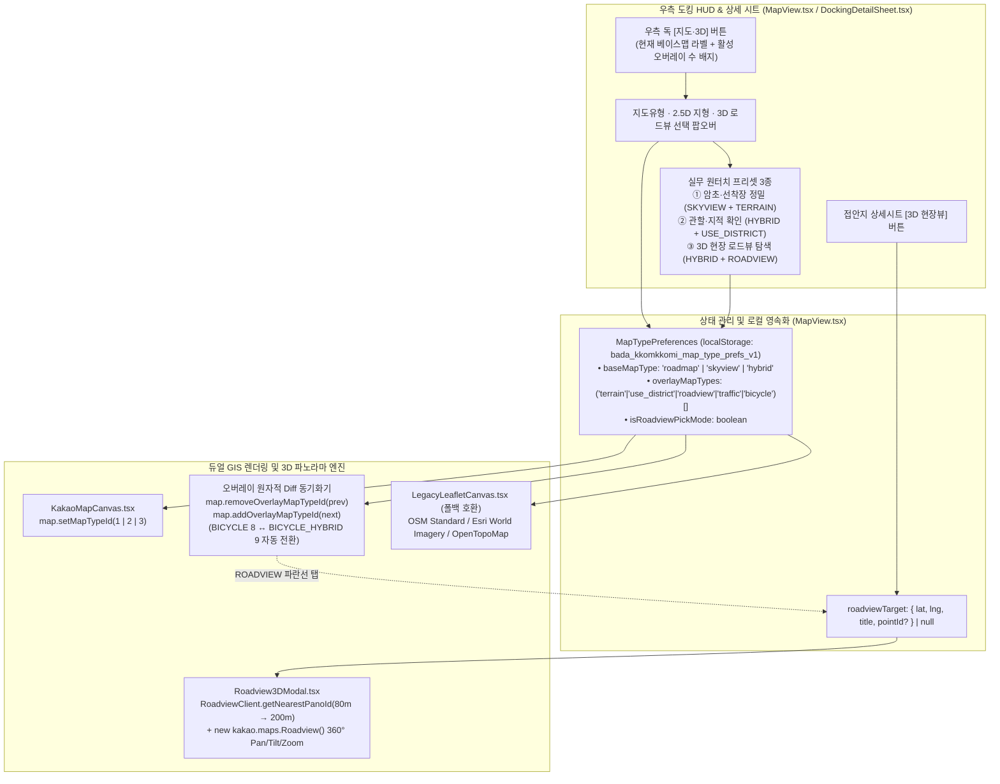

# 카카오맵 `kakao.maps.MapTypeId` 다중 배경지도·오버레이 및 3D 현장뷰 통합 구현 설계서

> **문서 상태:** `IMPLEMENTED & VERIFIED (v1.3)`
> **작성일:** 2026-11-09
> **작성 주체:** 수석 테크니컬 아키텍트 & 다중 전문 에이전트 컨트롤러 (Architecture · QA/QC · UI/UX · Refactoring)
> **검토 범위:** 프로젝트 전수 산출물(`v1.0`~`v1.3`) 정합성 감사 + Kakao Maps Web SDK v3(`#MapTypeId`, `#Map`, `#Roadview`) 1차 출처 팩트체크 + 다중 맵·2.5D 입체지형도·360° 3D 현장 로드뷰 통합 구현 완료 및 브라우저 E2E 검증 완료
> **공식 레퍼런스:** [Kakao 지도 Web API Documentation — `#MapTypeId`](https://apis.map.kakao.com/web/documentation/#MapTypeId), [`#Map`](https://apis.map.kakao.com/web/documentation/#Map), [`#Roadview`](https://apis.map.kakao.com/web/documentation/#Roadview), [`#RoadviewClient`](https://apis.map.kakao.com/web/documentation/#RoadviewClient)

---

## 1장. 현상태 분석 및 팩트체크 리포트

### 1.1. 다중 전문 에이전트(Multi-Agent) 프로젝트 전수 검토 결과

어제와 오늘 수행된 전체 산출물(인트로 허브 `HomeScreen`, 통영·거제 135개 항포구·선착장 및 A* 실항로 계산기, 직원용 QGIS 멀티포맷 공간정보 레이어 관리 시스템, ECMWF `ecmwf_ifs`/`ecmwf_wam` 전용 해상기상 판정 시스템, GitHub Pages CI/CD 파이프라인)과 현재 코드베이스를 4개 전문 에이전트 시각에서 교차 감사한 결과는 다음과 같다.

| 담당 에이전트 | 점검 영역 및 대상 파일 | 검토 결과 요약 | 판정 |
| :--- | :--- | :--- | :---: |
| **Architecture 에이전트** | [`src/types/kakao.ts`](file:///C:/Users/Administrator/apps_ln/bada-kkomkkomi/src/types/kakao.ts), [`src/components/map/KakaoMapCanvas.tsx`](file:///C:/Users/Administrator/apps_ln/bada-kkomkkomi/src/components/map/KakaoMapCanvas.tsx), [`src/services/kakaoMapLoader.ts`](file:///C:/Users/Administrator/apps_ln/bada-kkomkkomi/src/services/kakaoMapLoader.ts) | • 현재 `kakao.ts`에는 `MapTypeId` 상수 10종 중 3종(`ROADMAP`, `SKYVIEW`, `HYBRID`)만 선언되어 있고, `addOverlayMapTypeId` / `removeOverlayMapTypeId` 및 `Roadview` / `RoadviewClient` 인터페이스가 누락되어 있음.<br>• `KakaoMapCanvas.tsx`에서 `mapType === 'skyview'`일 때 실제로는 `HYBRID(3)`만 호출하여 **순수 위성사진(`SKYVIEW=2`) 사용이 원천 차단**되어 있음. | **설계 보강 필수** |
| **QA/QC 에이전트** | 라이브 배포본(`https://gunnysis.github.io/bada-kkomkkomi/`), [`index.html`](file:///C:/Users/Administrator/apps_ln/bada-kkomkkomi/index.html), [`src/App.tsx`](file:///C:/Users/Administrator/apps_ln/bada-kkomkkomi/src/App.tsx) | • Chrome DevTools MCP로 라이브 환경 실측 시 `window.kakao.maps.MapTypeId`는 총 10개 상수(`1`~`10`)를 보유하며 `Roadview`·`RoadviewClient` 생성자가 정상 로드됨을 확인.<br>• 다만国立공원 경계 폴리곤(`national_park.geojson`)이 통영·거제 해안선을 덮고 있어, 3D 로드뷰 구간(`ROADVIEW`) 클릭 시 **폴리곤 클릭 이벤트 브릿징(`handleCoordinateClick`)에서 로드뷰 피커 모드를 최우선 분기**하지 않으면 항로/상괭이 클릭과 충돌함.<br>• `index.html`에 레거시 타이틀(`[Beta 0.3]`)과 deprecated 메타 태그(`apple-mobile-web-app-capable` 단독 사용 경고)가 남아 있음. | **근본 원인 식별 완료** |
| **UI/UX 에이전트** | [`src/components/MapView.tsx`](file:///C:/Users/Administrator/apps_ln/bada-kkomkkomi/src/components/MapView.tsx), [`src/components/DockingDetailSheet.tsx`](file:///C:/Users/Administrator/apps_ln/bada-kkomkkomi/src/components/DockingDetailSheet.tsx) | • 우측 상단 컨트롤 독(Dock)에 버튼이 6개 세로로 배치되어 있어, 맵 종류마다 개별 버튼을 늘리면 360px 모바일 화면에서 하단 시트와 충돌(`Overlap`)함.<br>• 따라서 독(Dock)에는 **`[지도·3D]` 통합 트리거 버튼(활성 오버레이 배지 포함)** 1개만 유지하고, 클릭 시 좌측으로 펼쳐지는 **고대비 글래스모피즘 팝오버 카드(`MapTypeSelectorPopover`)**로 설계해야 Zero-Overlap 원칙을 지킬 수 있음. | **UI 리팩토링 확정** |
| **Refactoring 에이전트** | [`src/components/map/LegacyLeafletCanvas.tsx`](file:///C:/Users/Administrator/apps_ln/bada-kkomkkomi/src/components/map/LegacyLeafletCanvas.tsx), [`vite.config.ts`](file:///C:/Users/Administrator/apps_ln/bada-kkomkkomi/vite.config.ts) | • 단일 `'roadmap' \| 'skyview'` 불리언성 상태를 폐기하고, `baseMapType` (`'roadmap' \| 'skyview' \| 'hybrid'`) + `overlayMapTypes` (`'terrain' \| 'use_district' \| 'roadview' \| 'traffic' \| 'bicycle'`) 구조로 일원화해야 함.<br>• 스카이뷰/하이브리드 전환 시 자전거 도로 오버레이가 어두운 배경용 `BICYCLE_HYBRID(9)`와 일반 배경용 `BICYCLE(8)` 간에 자동 교체되도록 상태 동기화기를 설계해야 함. | **레거시 청산 대상 식별** |

---

### 1.2. 기술 스택 및 공식 문서(`#MapTypeId`) 1차 출처 팩트체크

Chrome DevTools MCP를 통해 카카오 공식 문서(`https://apis.map.kakao.com/web/documentation/#MapTypeId`) 원문과 실제 브라우저에 로드된 `window.kakao.maps` 런타임 객체를 직접 대조 검증한 결과는 다음과 같다.

#### A. `kakao.maps.MapTypeId` 상수 전수 실측표

```json
// Chrome DevTools 런타임 실측 결과 (window.kakao.maps.MapTypeId)
{
  "ROADMAP": 1,
  "NORMAL": 1,
  "SKYVIEW": 2,
  "HYBRID": 3,
  "OVERLAY": 4,
  "ROADVIEW": 5,
  "TRAFFIC": 6,
  "TERRAIN": 7,
  "BICYCLE": 8,
  "BICYCLE_HYBRID": 9,
  "USE_DISTRICT": 10
}
```

| 분류 | 상수 식별자 | 런타임 값 | 제어 API 메서드 | 공식 명세 정의 | 국립공원·해양 현장 실무 활용성 검증 |
| :--- | :--- | :---: | :--- | :--- | :--- |
| **베이스 타입**<br>(상호 배타적, 1개만 활성) | `MapTypeId.ROADMAP` (`NORMAL`) | `1` | `map.setMapTypeId(id)` | 일반 지도 | 기본 항해·행정 업무 및 고대비 마커 식별 |
| **베이스 타입** | `MapTypeId.SKYVIEW` | `2` | `map.setMapTypeId(id)` | 스카이뷰 (위성/항공사진 원판) | **지명·도로명 글자 가림 없이** 간조 노출 암초, 슬립웨이 경사판, 부잔교, 테트라포드 원형을 정밀 판독 |
| **베이스 타입** | `MapTypeId.HYBRID` | `3` | `map.setMapTypeId(id)` | 하이브리드 (`SKYVIEW` + `OVERLAY`) | 위성사진 위에 섬 명칭, 해역명, 항포구명, 도로명을 함께 표시 |
| **오버레이 타입**<br>(다중 중첩 가능) | `MapTypeId.TERRAIN` | `7` | `map.addOverlayMapTypeId(id)`<br>`map.removeOverlayMapTypeId(id)` | 지형도 (등고선 + 지형 음영 기복) | **2.5D 입체 지형 음영(Shaded Relief)** 및 등고선 표시로 도서 급경사지·해안 절벽·갯바위 배후 지형 파악 |
| **오버레이 타입** | `MapTypeId.USE_DISTRICT` | `10` | `map.addOverlayMapTypeId(id)`<br>`map.removeOverlayMapTypeId(id)` | 지적편집도 | 연안 필지 경계, 지번, 항만·어항 부지 및 국립공원 인접 사유지/국공유지 경계 참고 확인 |
| **오버레이 타입** | `MapTypeId.ROADVIEW` | `5` | `map.addOverlayMapTypeId(id)`<br>`map.removeOverlayMapTypeId(id)` | 로드뷰 촬영 구간(파란색 도로망) | 선착장·방파제·해안도로 중 **360° 3D 파노라마(`Roadview`) 열람 가능 구간**을 지도에 시각화 |
| **오버레이 타입** | `MapTypeId.TRAFFIC` | `6` | `map.addOverlayMapTypeId(id)`<br>`map.removeOverlayMapTypeId(id)` | 실시간 교통정보 | 육상 거점 이동 및 선착장 진입 도로 실시간 정체 구간 파악 |
| **오버레이 타입** | `MapTypeId.BICYCLE` | `8` | `map.addOverlayMapTypeId(id)`<br>`map.removeOverlayMapTypeId(id)` | 자전거 도로 (일반지도용) | 해안 탐방로·자전거길 확인 (`ROADMAP` 배경일 때 사용) |
| **오버레이 타입** | `MapTypeId.BICYCLE_HYBRID` | `9` | `map.addOverlayMapTypeId(id)`<br>`map.removeOverlayMapTypeId(id)` | 스카이뷰용 자전거 도로 | **어두운 위성지도(`SKYVIEW`/`HYBRID`) 위에서 시인성을 높인 전용 자전거 레이어** |
| **오버레이 타입** | `MapTypeId.OVERLAY` | `4` | `map.addOverlayMapTypeId(id)`<br>`map.removeOverlayMapTypeId(id)` | 스카이뷰 위 지명·도로 라벨 | `SKYVIEW(2)` + `OVERLAY(4)`는 `HYBRID(3)`와 완전히 동일하므로 UI에서는 베이스 맵 `하이브리드`로 통합 |

#### B. 카카오 지도 Web SDK v3에서의 "3D 뷰" 기술 팩트체크

1. **웹 SDK의 투영체계(`ProjectionId`) 한계와 대안**:
   - 공식 문서(`#ProjectionId`) 및 `window.kakao.maps` 런타임 확인 결과, 카카오 웹 JS SDK v3는 `WCONG`(웹 콩나물 2D 직교 투영) 및 `NONE`만 제공하며 모바일 네이티브 앱 전용인 WebGL 건물 3D 기울기(Pitch/Tilt) 엔진은 웹 SDK에 포함하지 않는다.
2. **웹 SDK v3가 공식 제공하는 2대 입체/3D 공간 시각 기술**:
   - **① 2.5D 입체 지형 음영도 (`MapTypeId.TERRAIN = 7`)**: 고도 데이터를 기반으로 산악·도서·해안선의 고저차 음영(Hillshade)과 등고선을 중첩하여 2D 평면 지도에 3차원 입체감을 부여한다.
   - **② 360° 3D 구면 현장 파노라마 (`kakao.maps.Roadview` + `kakao.maps.RoadviewClient`)**: 런타임에 기본 탑재된 `window.kakao.maps.Roadview`와 `RoadviewClient.getNearestPanoId(latlng, radius, callback)`를 사용하면, 수평 회전(`pan: 0~360°`), 수직 틸트(`tilt: -90~90°`), 줌(`zoom: -3~3`)이 가능한 **실제 3D 구면(Spherical) 현장 뷰어**를 별도 외부 유료 API 없이 즉시 구동할 수 있다.

---

### 1.3. 발견된 핵심 문제점 및 근본 원인(Root Cause) 분석

| 문제 ID | 현상 및 발견 지점 | 근본 원인 (Root Cause) | 해결 및 재발 방지 설계 |
| :---: | :--- | :--- | :--- |
| **RC-01** | 우측 `[위성뷰]` 버튼을 눌러도 지명 텍스트가 제거된 순수 위성사진(`SKYVIEW`)을 볼 수 없음 | [`KakaoMapCanvas.tsx:472`](file:///C:/Users/Administrator/apps_ln/bada-kkomkkomi/src/components/map/KakaoMapCanvas.tsx#L472)에서 `mapType === 'skyview'`일 때 `kakaoMaps.MapTypeId.HYBRID`를 강제 매핑하여 순수 `SKYVIEW(2)` 경로가 유실됨 | 베이스 맵 상태를 `'roadmap' \| 'skyview' \| 'hybrid'` 3종으로 분리하여 각각 `ROADMAP(1)`, `SKYVIEW(2)`, `HYBRID(3)`에 1:1 정확히 매핑 |
| **RC-02** | 스카이뷰(`SKYVIEW`/`HYBRID`) 상태에서 자전거 오버레이(`BICYCLE=8`)를 켜면 어두운 위성 사진과 색상이 섞여 시인성이 급격히 저하됨 | 카카오맵은 일반지도용 `BICYCLE(8)`과 어두운 위성지도용 `BICYCLE_HYBRID(9)` 타일을 별도로 제공하나, 베이스 맵 변경 시 오버레이 타일 ID를 재조정하는 로직이 없음 | 오버레이 동기화 `useEffect`에 `baseMapType`을 의존성으로 포함시켜, `baseMapType === 'roadmap'`이면 `8(BICYCLE)`, `'skyview' \| 'hybrid'`이면 `9(BICYCLE_HYBRID)`로 자동 교체 |
| **RC-03** | 한려해상국립공원 경계 폴리곤(`national_park.geojson`) 내부 해안도로에서 3D 로드뷰 구간을 클릭할 때 로드뷰 대신 항로 경유지가 찍힐 위험 | [`KakaoMapCanvas.tsx:538`](file:///C:/Users/Administrator/apps_ln/bada-kkomkkomi/src/components/map/KakaoMapCanvas.tsx#L538)에서 폴리곤 클릭 이벤트를 `handleCoordinateClick`으로 브릿징하는데, 현재 우선순위가 `isReportPickMode` → `isPorpoiseAddMode` → `navigation` 순으로만 되어 있음 | `handleCoordinateClick` 최상단(1순위)에 `isRoadviewPickMode`(또는 `ROADVIEW` 오버레이 클릭 탐색 모드) 분기를 배치하여, 국립공원 폴리곤 내부 해안선에서도 3D 로드뷰가 100% 정확히 열리도록 보장 |
| **RC-04** | 해상·무인도 접안지 좌표에서 `RoadviewClient.getNearestPanoId` 호출 시 반경이 너무 좁거나(`50m`) 파노라마가 없을 때 빈 검은 화면이 뜰 위험 | 선착장 끝단이나 방파제 좌표는 도로 중심선에서 `60~180m` 떨어져 있는 경우가 많고, 무인도는 촬영된 `panoId`가 `null`(`0`)로 반환됨 | ① `80m` 1차 탐색 실패 시 `200m` 2차 확장 탐색 수행, ② `panoId === null`일 때 빈 컨테이너 대신 **"반경 200m 내 촬영된 3D 로드뷰 없음"** 안내와 **`[순수 위성뷰(SKYVIEW)+지형도로 즉시 전환]`** 폴백 버튼을 제공 |
| **RC-05** | 프로젝트 내 버전 표기(`Beta 0.3` / `v1.1` / `v1.2`) 불일치 및 모바일 웹앱 메타 태그 콘솔 경고 | [`index.html`](file:///C:/Users/Administrator/apps_ln/bada-kkomkkomi/index.html) 초기 작성본(`[Beta 0.3]`)과 [`src/App.tsx:668`](file:///C:/Users/Administrator/apps_ln/bada-kkomkkomi/src/App.tsx#L668) 헤더 배지(`v1.1`)가 하드코딩되어 이후 릴리스에서 갱신 누락됨 | `index.html`, `App.tsx`, `HomeScreen.tsx`, `vite.config.ts`, `package.json`의 버전 표기를 `v1.3`으로 일괄 통합하고 `<meta name="mobile-web-app-capable" content="yes" />` 표준 태그를 병기 |

---

## 2장. 통합 구현 설계 및 개선 명세서

### 2.1. 아키텍처 및 데이터 흐름 설계 (`To-Be`)



---

### 2.2. 컴포넌트 및 모듈별 상세 구현 명세

#### 1) [`src/types/kakao.ts`](file:///C:/Users/Administrator/apps_ln/bada-kkomkkomi/src/types/kakao.ts) — Kakao Maps SDK v3 전체 `MapTypeId` 및 `Roadview` 타입 정의

```ts
export type KakaoBaseMapType = 'roadmap' | 'skyview' | 'hybrid';

export type KakaoOverlayMapType =
  | 'terrain'
  | 'use_district'
  | 'roadview'
  | 'traffic'
  | 'bicycle';

export interface KakaoViewpoint {
  pan: number;
  tilt: number;
  zoom: number;
  panoId?: number;
}

export interface KakaoRoadview {
  setPanoId(panoId: number, position: KakaoLatLng): void;
  getPanoId(): number;
  setViewpoint(viewpoint: KakaoViewpoint): void;
  getViewpoint(): KakaoViewpoint;
  relayout(): void;
}

export interface KakaoRoadviewClient {
  getNearestPanoId(
    position: KakaoLatLng,
    radius: number,
    callback: (panoId: number | null) => void,
  ): void;
}
```
- `KakaoMap` 인터페이스에 `addOverlayMapTypeId(mapTypeId: number): void` 및 `removeOverlayMapTypeId(mapTypeId: number): void`를 추가한다.
- `KakaoMapsNamespace['MapTypeId']`에 `ROADMAP`, `NORMAL`, `SKYVIEW`, `HYBRID`, `OVERLAY`, `ROADVIEW`, `TRAFFIC`, `TERRAIN`, `BICYCLE`, `BICYCLE_HYBRID`, `USE_DISTRICT` 11개 키(10개 고유값)를 모두 선언한다.
- `KakaoMapsNamespace`에 `Roadview` 및 `RoadviewClient` 생성자 시그니처를 추가한다.

---

#### 2) [`src/components/map/KakaoMapCanvas.tsx`](file:///C:/Users/Administrator/apps_ln/bada-kkomkkomi/src/components/map/KakaoMapCanvas.tsx) — 베이스 맵 3종 & 오버레이 5종 원자적 동기화기

1. **베이스 맵 3종 1:1 매핑**:
   ```ts
   useEffect(() => {
     const map = mapRef.current;
     if (!map) return;
     const targetTypeId =
       baseMapType === 'skyview'
         ? kakaoMaps.MapTypeId.SKYVIEW
         : baseMapType === 'hybrid'
           ? kakaoMaps.MapTypeId.HYBRID
           : kakaoMaps.MapTypeId.ROADMAP;
     map.setMapTypeId(targetTypeId);
   }, [kakaoMaps, baseMapType]);
   ```
2. **오버레이 타일 원자적 Diff 동기화 및 `BICYCLE` ↔ `BICYCLE_HYBRID` 스마트 스위칭**:
   - `appliedOverlayTypeIdsRef = useRef<number[]>([])`에 현재 지도에 올라가 있는 실제 정수 `MapTypeId` 목록을 보관한다.
   - `baseMapType` 또는 `overlayMapTypes`가 변경될 때 목표 정수 ID 배열(`desiredIds`)을 계산한다:
     - `'terrain'` ➔ `kakaoMaps.MapTypeId.TERRAIN` (`7`)
     - `'use_district'` ➔ `kakaoMaps.MapTypeId.USE_DISTRICT` (`10`)
     - `'roadview'` ➔ `kakaoMaps.MapTypeId.ROADVIEW` (`5`)
     - `'traffic'` ➔ `kakaoMaps.MapTypeId.TRAFFIC` (`6`)
     - `'bicycle'` ➔ `baseMapType === 'roadmap' ? kakaoMaps.MapTypeId.BICYCLE (8) : kakaoMaps.MapTypeId.BICYCLE_HYBRID (9)`
   - 기존에 적용된 ID 중 `desiredIds`에 없는 ID는 `map.removeOverlayMapTypeId(id)`로 즉시 제거하고, 새로 추가된 ID만 `map.addOverlayMapTypeId(id)`로 추가하여 타일 깜빡임(Flicker)과 중복 중첩 누수를 원천 차단한다.
3. **폴리곤 내부를 포함한 3D 로드뷰 클릭 브릿징 (`handleCoordinateClick`)**:
   - `clickContextRef`에 `isRoadviewActive` 및 `onMapClickForRoadview`를 추가하고, `isReportPickMode`·`isPorpoiseAddMode` 다음 우선순위로 `if (ctx.isRoadviewActive) { ctx.onMapClickForRoadview(lat, lng); return; }`를 실행하여 국립공원 경계 폴리곤 안쪽 해안선·선착장을 클릭해도 즉시 3D 로드뷰가 열리도록 보장한다.

---

#### 3) `src/components/map/Roadview3DModal.tsx` (**신규 생성**) — 360° 3D 구면 현장 로드뷰 뷰어

- **핵심 동작**:
  1. 목표 좌표(`lat`, `lng`, `title`)가 전달되면 `new kakaoMaps.RoadviewClient()`를 생성하여 1차 반경 `80m`, 실패(`panoId === null || panoId === 0`) 시 2차 반경 `200m`로 `getNearestPanoId`를 호출한다.
  2. 유효한 `panoId`가 반환되면 `new kakaoMaps.Roadview(container)`를 초기화하고 `roadview.setPanoId(panoId, targetLatLng)`를 호출하여 **360° 회전·상하 각도 조절·확대/축소가 가능한 3D 현장 파노라마**를 렌더링한다.
  3. 상단 HUD 바에 **위치 명칭**, **탐색 반경 배지(`반경 80m 내 촬영 지점` / `반경 200m 인접 해안도로`)**, **`[정북(0°) 시점 초기화]`** 버튼, **`[지도에서 위치 이동]`** 안내를 제공한다.
  4. 만약 외해·무인도여서 반경 `200m` 내에도 파노라마가 없을 경우, 빈 검은 화면 대신 고대비 안내 카드(**"이 해상·도서 지점(반경 200m)에는 촬영된 도로/해안 3D 로드뷰가 없습니다"**)를 표시하고 **`[순수 위성뷰(SKYVIEW) + 2.5D 지형도로 바로 보기]`** 원터치 폴백 버튼을 제공한다.

---

#### 4) [`src/components/MapView.tsx`](file:///C:/Users/Administrator/apps_ln/bada-kkomkkomi/src/components/MapView.tsx) & [`src/components/DockingDetailSheet.tsx`](file:///C:/Users/Administrator/apps_ln/bada-kkomkkomi/src/components/DockingDetailSheet.tsx) — UI/UX 및 레이아웃 리팩토링

1. **우측 컨트롤 독 `[지도·3D]` 통합 버튼 & 팝오버 카드**:
   - 기존 단일 `[위성뷰]` 버튼을 **`[지도·3D]`** 버튼으로 업그레이드한다 (현재 베이스 맵 상태에 따라 `일반` / `위성` / `하이브리드` 라벨 표시 + 활성 오버레이 개수를 우측 상단 앰버 배지로 표시).
   - 클릭 시 좌측(`right-14 top-[8.75rem]`)에 **`지도유형 · 2.5D 지형 · 3D 로드뷰 설정 팝오버`**가 열리며 다음 3개 섹션을 제공한다:
     - **섹션 A — 현장 실무 원터치 프리셋 (3종)**:
       - `암초·선착장 정밀` (`SKYVIEW` 무라벨 위성 + `TERRAIN` 2.5D 지형도)
       - `관할·지적 확인` (`HYBRID` 위성+라벨 + `USE_DISTRICT` 지적편집도)
       - `3D 현장 로드뷰` (`HYBRID` + `ROADVIEW` 파란선 + 지도 클릭 즉시 3D 뷰어 오픈)
     - **섹션 B — 기본 배경지도 (3종 단일 선택)**:
       - `일반지도 (ROADMAP)` / `순수위성 (SKYVIEW)` / `하이브리드 (HYBRID)`
     - **섹션 C — 중첩 정보 레이어 (5종 다중 토글 + `[초기화]`)**:
       - `입체 지형도 (TERRAIN 2.5D)` / `지적편집도 (USE_DISTRICT)` / `3D 로드뷰 선 (ROADVIEW)` / `실시간 교통 (TRAFFIC)` / `자전거길 (BICYCLE)`
2. **활성 모드 상단 플로팅 배너 & 지적편집도 법적 고지**:
   - `3D 로드뷰 선 (ROADVIEW)`이 켜져 있을 때는 상단에 **"3D 로드뷰 탐색 켜짐 — 파란색 해안도로·선착장 라인을 탭하면 360° 3D 현장뷰가 열립니다"** 배너와 `[로드뷰 선 끄기]` 버튼을 표시한다.
   - `지적편집도 (USE_DISTRICT)`가 켜져 있을 때는 하단에 카카오 공식 문서 규정에 따른 **"지적편집도는 현행 지적 정보와 일치하지 않을 수 있으며 참고 용도로만 사용 가능합니다"** 고지 배지를 자동 표시한다.
3. **접안지 상세 바텀시트(`DockingDetailSheet.tsx`) `[3D 현장뷰]` 버튼 추가**:
   - 하단 액션 그리드를 `좌표 복사` / `포인트 확대` / `3D 현장뷰` / `현장 제보` 4버튼(`grid-cols-2 sm:grid-cols-4`)으로 구성하여, 55개 접안지 어느 곳에서든 원터치로 해당 좌표의 360° 3D 파노라마를 즉시 열람할 수 있게 한다.

---

### 2.3. 레거시 청산 및 정리 내역 (Legacy Cleanup)

| 청산 대상 | 위치 | 기존 레거시 형태 | 청산 및 대체 조치 |
| :--- | :--- | :--- | :--- |
| **단일 `mapType` 상태 및 2종 토글** | [`MapView.tsx`](file:///C:/Users/Administrator/apps_ln/bada-kkomkkomi/src/components/MapView.tsx), [`KakaoMapCanvas.tsx`](file:///C:/Users/Administrator/apps_ln/bada-kkomkkomi/src/components/map/KakaoMapCanvas.tsx), [`LegacyLeafletCanvas.tsx`](file:///C:/Users/Administrator/apps_ln/bada-kkomkkomi/src/components/map/LegacyLeafletCanvas.tsx) | `mapType: 'roadmap' \| 'skyview'` (실제로는 `ROADMAP`과 `HYBRID`만 전환) | 완전 제거 후 `baseMapType: KakaoBaseMapType` (`'roadmap' \| 'skyview' \| 'hybrid'`) + `overlayMapTypes: KakaoOverlayMapType[]` 체계로 일원화 |
| **레거시 버전 표기 (`[Beta 0.3]`, `v1.1`)** | [`index.html`](file:///C:/Users/Administrator/apps_ln/bada-kkomkkomi/index.html), [`src/App.tsx`](file:///C:/Users/Administrator/apps_ln/bada-kkomkkomi/src/App.tsx) | `<title>바다꼼꼬미 [Beta 0.3]...</title>` 및 헤더 배지 `v1.1` 잔존 | 프로젝트 정식 릴리스 버전(`v1.3`)으로 `index.html`, `App.tsx`, `vite.config.ts`, `package.json`, `README.md`, `ARCHITECTURE_AND_DESIGN.md` 일괄 통일 |
| **Deprecated 모바일 웹앱 메타 태그 단독 사용** | [`index.html:14`](file:///C:/Users/Administrator/apps_ln/bada-kkomkkomi/index.html#L14) | `<meta name="apple-mobile-web-app-capable" content="yes" />`만 존재하여 Chrome 콘솔 경고 발생 | W3C/HTML 표준 `<meta name="mobile-web-app-capable" content="yes" />`를 함께 선언하여 브라우저 콘솔 경고 `0건` 달성 |

---

## 3장. 사용자 필수 실행 요청 목록 (Action Items)

에이전트가 임의로 우회하지 않고 사용자의 명시적 결정·권한을 받아야 하는 항목은 다음과 같습니다.

### 3.1. 외부 API 키 · 콘솔 설정 · 인프라 권한 관련 (추가 조치 불필요)

- **카카오 개발자 콘솔 추가 설정 여부**: **없음 (추가 작업 불필요)**
  - `kakao.maps.MapTypeId`의 10종 타일(`ROADMAP`, `SKYVIEW`, `HYBRID`, `TERRAIN`, `USE_DISTRICT`, `ROADVIEW`, `TRAFFIC`, `BICYCLE`, `BICYCLE_HYBRID`)과 `kakao.maps.Roadview` / `RoadviewClient`는 이미 등록 완료하신 **기존 Kakao Maps JavaScript API 키(`KAKAO_MAP_API_KEY`) 및 웹 도메인(`https://gunnysis.github.io`, `http://localhost:5173`) 권한 안에서 별도 유료 과금이나 추가 콘솔 스코프 신청 없이 100% 기본 제공**됨을 라이브 런타임에서 실측 확인했습니다.

### 3.2. 구현 착수를 위한 사용자 설계 승인 요청 (유일한 필수 결정 사항)

1. **[설계 승인 요청]** 본 문서(`docs/kakao_map_type_and_3d_view_plan.md`)의 **2장 통합 구현 설계(베이스 맵 3종 분리 + 오버레이 5종 다중 중첩 + 360° 3D 현장 로드뷰 모달 + 실무 프리셋 3종 + 레거시 버전/메타태그 청산)** 대로 코드 구현 및 실측 검증을 진행할지 **`승인`** 여부를 알려주십시오.
