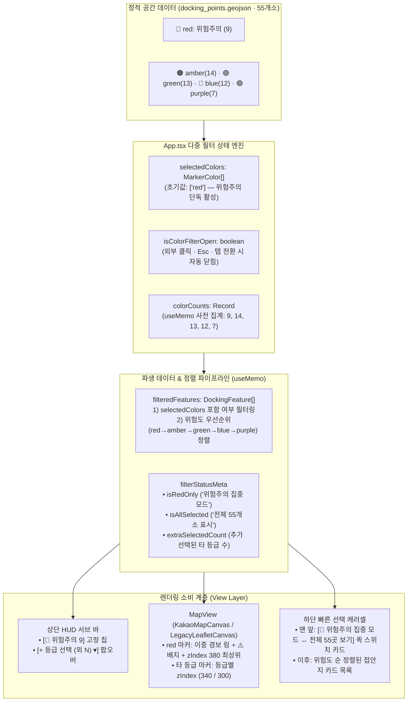

# `MARKER_COLOR_MAP` '위험주의(Red)' 최우선 인지 및 선택적 등급 확장 통합 구현 설계서 (`v1.4 Plan`)

> **문서 상태:** `IMPLEMENTED & VERIFIED (구현 및 E2E 실측 검증 완료)`
> **작성 및 최신화일:** 2026-11-09
> **작성 주체:** 수석 테크니컬 아키텍트 & 크로스펑셔널 다중 에이전트 컨트롤러 (Architecture · UI/UX · GIS Engine · QA/QC · Refactoring)
> **대상 산출물:** [`src/types/docking.ts`](file:///C:/Users/Administrator/apps_ln/bada-kkomkkomi/src/types/docking.ts), [`src/App.tsx`](file:///C:/Users/Administrator/apps_ln/bada-kkomkkomi/src/App.tsx), [`src/components/map/mapMarkerTemplates.ts`](file:///C:/Users/Administrator/apps_ln/bada-kkomkkomi/src/components/map/mapMarkerTemplates.ts), [`src/components/map/KakaoMapCanvas.tsx`](file:///C:/Users/Administrator/apps_ln/bada-kkomkkomi/src/components/map/KakaoMapCanvas.tsx), [`src/components/map/LegacyLeafletCanvas.tsx`](file:///C:/Users/Administrator/apps_ln/bada-kkomkkomi/src/components/map/LegacyLeafletCanvas.tsx)

---

## 1장. 현상태 분석 및 팩트체크 리포트

### 1.1. 에이전트 다중 검토 결과 (Multi-Agent Cross-Review)

어제와 오늘(`v1.1` ~ `v1.3`) 구축·배포된 **바다꼼꼬미(Bada-Kkomkkomi)** 전체 코드베이스와 운영 데이터(`public/data/docking_points.geojson`, 총 55개 접안지)를 5개 전문 에이전트 시각에서 교차 검증했습니다.

| 전문 에이전트 역할 | 중점 감사 영역 | 핵심 진단 결과 요약 |
| :--- | :--- | :--- |
| **기획·도메인 아키텍트** | 해상 안전 의사결정 및 `docking_points.geojson` 55개소 분포 실측 | • 전체 55개소 중 **`red`(위험·암초 주의) 9개소**, `amber`(조석·항로 주의) 14개소, `green`(상시 안전 접안) 13개소, `blue`(관공선·전용부두) 12개소, `purple`(임시·비상 포인트) 7개소로 구성됨.<br>• 현행 초기 상태(`selectedColor = 'all'`)는 55개 핀을 무차별 동시 표출하여, 선박 프로펠러 감김(폐로프)·암초 충돌 위험이 있는 **9개 핵심 위험주의 지점이 일반 마커 46개에 파묻히는 안전 정보 희석 현상** 발생. |
| **UI/UX·레이아웃 디자이너** | 모바일 뷰포트(360~412px) 상단 HUD 바 및 한 손 조작성(Thumb-zone) | • [`src/App.tsx:763-847`](file:///C:/Users/Administrator/apps_ln/bada-kkomkkomi/src/App.tsx#L763-L847)의 서브 컨트롤 바에 9개 버튼(약 820px 폭)이 `flex overflow-x-auto scrollbar-none` 1열로 나열됨.<br>• 모바일 화면(360px)에서는 좌측 3개 액션 버튼(`[공간 레이어]`, `[현장 제보]`, `[상괭이 기록]`)과 `[전체(55)]` 일부만 노출되고, **`[위험주의(9)]`를 포함한 5개 등급 필터가 우측 화면 밖으로 완전히 잘려(Clipped) 스크롤 힌트조차 없음.** |
| **GIS·렌더링 수석 개발자** | Kakao Maps SDK `v1.3`(`SKYVIEW`/`HYBRID`) 및 Leaflet 폴백 엔진의 마커 `zIndex`·시인성 | • [`KakaoMapCanvas.tsx:733`](file:///C:/Users/Administrator/apps_ln/bada-kkomkkomi/src/components/map/KakaoMapCanvas.tsx#L733)에서 모든 비선택 마커가 동일한 `zIndex: 300`을 부여받아, 복수 등급 표시 시 일반 마커(`green`/`blue`)가 위험 마커(`red`) 위를 덮어버림.<br>• [`mapMarkerTemplates.ts:32-79`](file:///C:/Users/Administrator/apps_ln/bada-kkomkkomi/src/components/map/mapMarkerTemplates.ts#L32-L79)에서 5개 등급 마커의 SVG 외형이 100% 동일하고 내부 색상(`hex`)만 달라, 직사광선이나 위성 타일(`SKYVIEW`/`HYBRID`) 위에서 적색 마커의 시각적 경보성(Salience)이 부족함. |
| **프론트엔드 리팩토링 리드** | 상태 모델(`selectedColor`) 확장성 및 하단 캐러셀 정렬 정합성 | • 단일 선택 유니온(`MarkerColor \| 'all'`) 구조여서 *"위험주의(9)를 기본으로 켜둔 채 안전접안(13)이나 조석주의(14)만 추가 비교"*하는 **다중 선택(Multi-Select) 시나리오가 구조적으로 불가능**함.<br>• 하단 빠른 선택 캐러셀([`src/App.tsx:964`](file:///C:/Users/Administrator/apps_ln/bada-kkomkkomi/src/App.tsx#L964))이 GeoJSON 원본 인덱스 순으로만 렌더링되어 복수 등급 선택 시 위험주의 카드가 뒤쪽(인덱스 38, 40, 46 등)에 흩어짐. |
| **QA/QC·웹표준 엔지니어** | WAI-ARIA 접근성, 키보드 내비게이션, `oxlint` 정적 분석 규칙 준수 | • 색상만으로 위험도를 구분하면 색각 이상자나 야외 난반사 환경에서 오인 위험이 있으므로 아이콘(`⚠️`)·텍스트·이중 외곽선(Double Halo)의 다중 시각 단서(Redundant Coding)가 필수임.<br>• `oxlint`의 `react(set-state-in-effect)` 규칙을 위반하지 않도록 파생 상태(`useMemo`)와 이벤트 핸들러 중심의 무결성 설계 필요. |

---

### 1.2. 기술 스택 및 공식 문서 기반 팩트체크 내역

구현 설계에 앞서 본 프로젝트의 기술 스택과 최신 웹 표준 가이드를 교차 검증했습니다.

1. **Modern Web Guidance (`content-first-noise-reduction` & `viewport-aware-dropdowns`) 검증**:
   - **핵심 원칙**: *"Keep every fixed or sticky bar under 12% of the viewport height. Use a single row, and don't stack several sticky bars. Move extra items into a popover menu or drawer instead."*
   - **적용 판단**: 상단 고정 컨트롤 바에는 도메인 최우선 안전 필터인 **`[🚨 위험주의 (9)]` 고정 칩**과 **`[+ 등급 선택 ▾]` 트리거 버튼**만 남기고, 나머지 4개 부가 등급(`조석주의`, `안전접안`, `전용부두`, `비상거점`)은 온디맨드(On-demand) 확장 패널(Popover Drawer)로 수납하여 뷰포트 점유율과 시각 노이즈를 동시에 절감합니다.
2. **Kakao Maps Web SDK (`CustomOverlay` `zIndex` 및 이벤트 전파 제어)**:
   - 공식 문서(`https://apis.map.kakao.com/web/documentation/#CustomOverlay`) 확인 결과, `CustomOverlay`는 `zIndex` 옵션을 통해 중첩 순서를 결정합니다.
   - 따라서 `buildDockingMarkerSpec` 및 오버레이 생성 시 위험도 등급별 차등 `zIndex` (`selected: 550` > `red: 380` > `amber: 340` > `green/blue/purple: 300`)를 부여하면, 전체 등급을 함께 켰을 때도 `위험주의(red)` 마커가 항상 타 등급 마커 위에 선명하게 노출됩니다.
   - 동일하게 Leaflet 폴백 엔진([`LegacyLeafletCanvas.tsx`](file:///C:/Users/Administrator/apps_ln/bada-kkomkkomi/src/components/map/LegacyLeafletCanvas.tsx))의 `<Marker zIndexOffset={...}>`에도 동일한 우선순위 오프셋을 동기화합니다.
3. **`public/data/docking_points.geojson` 9개 핵심 '위험주의(`red`)' 데이터 실측**:
   - Node.js 스크립트로 실제 운영 GeoJSON을 파싱하여 확인한 결과, 초기 화면에 즉시 노출될 9개 위험주의 지점은 다음과 같습니다:
     - **통영권 (6개소)**: `TY-001` 통영 당동항 해양조사선 보조물양장, `KR-GN-TY-BERTH-0003` 두미도 북구 선착장, `KR-GN-TY-BERTH-0010` 사량도 외지 도선 선착장, `KR-GN-TY-BERTH-0013` 한산도 의항 경사식 선착장, `KR-GN-TY-BERTH-0017` 한산 좌도 선착장, `KR-GN-TY-BERTH-0023` 산양 송도 선착장
     - **거제권 (3개소)**: `KR-GN-GJ-BERTH-0015` 지심도 마끝 선착장, `KR-GN-GJ-BERTH-0017` 외도 보타니아 동측 접안장, `KR-GN-GJ-BERTH-0023` 둔덕 방하 마을 선착장

---

### 1.3. 발견된 문제점 및 근본 원인(Root Cause) 심층 분석

| 문제 ID | 현상 (Symptom) | 근본 원인 (Root Cause) | 영향도 |
| :--- | :--- | :--- | :--- |
| **RC-01** | 모바일 화면에서 `'위험주의'` 버튼을 찾을 수 없음 | [`src/App.tsx:764`](file:///C:/Users/Administrator/apps_ln/bada-kkomkkomi/src/App.tsx#L764)에서 좌측 도구 버튼 3개와 우측 필터 버튼 6개를 단일 `flex overflow-x-auto scrollbar-none` 컨테이너에 평면 배치하여, 360px 화면 기준 420px 이상이 우측으로 잘려 나감. | **Critical (핵심 안전 기능 접근 불가)** |
| **RC-02** | 지도 진입 시 위험 지점(9곳)이 일반 지점(46곳)에 묻힘 | [`src/App.tsx:138`](file:///C:/Users/Administrator/apps_ln/bada-kkomkkomi/src/App.tsx#L138)의 초기 상태가 `useState<MarkerColor \| 'all'>('all')`로 하드코딩되어 있어, 해상 안전상 가장 먼저 확인해야 할 `red` 등급의 정보 위계(Information Hierarchy)가 부재함. | **High (안전 인지 지연 및 시각 과부하)** |
| **RC-03** | `'위험주의'`와 `'안전접안'` 등 필요한 등급만 조합해서 볼 수 없음 | 필터 상태 타입이 단일 값(`MarkerColor \| 'all'`)이어서 집합 연산(`Set` / `MarkerColor[]`)을 지원하지 못함. | **High (실무 비교 효율 저하)** |
| **RC-04** | 위성·하이브리드 맵(`v1.3`) 위에서 적색 마커와 일반 마커의 형태적 구분이 약함 | [`mapMarkerTemplates.ts:32`](file:///C:/Users/Administrator/apps_ln/bada-kkomkkomi/src/components/map/mapMarkerTemplates.ts#L32)의 `buildDockingMarkerSpec`이 5개 등급 모두 동일한 물방울 핀과 원형 코어만 렌더링하며, `KakaoMapCanvas`와 `LegacyLeafletCanvas`에서 등급별 `zIndex` 차등이 없음. | **Medium (야외 시인성 저하)** |
| **RC-05** | 필터 변경 시 이미 선택된 접안지(`selectedFeature`)와 화면 표시 목록 간 불일치 가능성 | 필터링 배열(`filteredFeatures`)이 재계산될 때, 필터에서 제외된 등급의 `selectedFeature`나 열려 있는 등급 선택 팝오버를 정리하는 가드 로직이 부재함. | **Medium (UX 일관성 저해)** |

---

## 2장. 통합 구현 설계 및 개선 명세서

### 2.1. 기획 연구 결과: "Hazard-First Progressive Disclosure (위험주의 우선 노출 및 점진적 등급 확장)"

현장 직원(선장·기관사·해양조사원)의 실제 사용 흐름에 맞춰 **3단계 정보 공개(Progressive Disclosure) 원칙**을 수립했습니다.

1. **Stage 1 — 진입 즉시 (`Default = ['red']`)**:
   - 사용자가 `3.1 꼬미의 바다수첩`에 진입하면 **기본값으로 `🚨 위험주의 (9)`만 단독 활성화**됩니다.
   - 지도 위에는 통영·거제 해역의 9개 고위험 접안지만 적색 경보 핀(`⚠️` 배지 + 이중 경보 링)으로 또렷하게 표시되고, 하단 캐러셀에도 9개 위험주의 카드가 즉시 나열됩니다.
2. **Stage 2 — 상단 고정 바 원터치 제어 (`Compact Single-Row HUD`)**:
   - 상단 서브 컨트롤 바는 모바일 360px 화면에서도 **가로 스크롤 없이 한 줄에 모두 들어오도록** 구성합니다:
     - 좌측 도구 그룹: `[공간 레이어]`, `[현장 제보]`, `[🐬 상괭이]`
     - 우측 등급 그룹: **`[🚨 위험주의 (9)]` (상시 고정 원터치 토글 칩)** + **`[+ 등급 선택 ▾]` (나머지 4개 등급 확장 버튼)**
3. **Stage 3 — 필요한 사용자만 여는 다중 등급 선택 팝오버 (`On-Demand Multi-Select Drawer`)**:
   - 사용자가 `[+ 등급 선택 ▾]`을 탭하면 상단 바 바로 아래에 글래스모피즘 팝오버 패널이 열립니다.
   - 이곳에서 나머지 4개 등급(`🟠 조석주의 14`, `🟢 안전접안 13`, `🔵 전용부두 12`, `🟣 비상거점 7`)의 **상세 기준 설명(`description`)**을 읽고 **원하는 등급만 체크박스로 복수 선택(Multi-Select)**하거나, **`[전체 55곳 모두 보기]`** / **`[🚨 위험주의 9곳만 보기 (기본)]`** 프리셋을 원터치로 실행할 수 있습니다.

---

### 2.2. 아키텍처 및 데이터 흐름 (Data Flow & State Architecture)



#### 핵심 상태 전이 규칙 (State Transition Contract)
1. **초기 상태**: `selectedColors = ['red']` (`위험주의` 9개소만 표시).
2. **`[🚨 위험주의 (9)]` 상단 고정 칩 클릭 시**:
   - 현재 다른 등급들과 함께 켜져 있거나 꺼져 있다면 ➔ 즉시 `['red']`(`위험주의 단독 집중 모드`)로 복귀하거나 `red` 포함 여부를 토글합니다.
   - 특히 사용자가 여러 등급을 켰다가 다시 위험주의만 빠르게 보고 싶을 때, 팝오버를 열 필요 없이 상단 `[🚨 위험주의 (9)]` 칩이나 하단 퀵 카드로 즉시 전환할 수 있도록 설계합니다.
   - **최소 1개 등급 활성 보장 가드 (Empty-Map Prevention Guard)**: 사용자가 유일하게 켜져 있는 마지막 등급 칩을 해제하려고 할 때는 빈 지도(`0개 표시`)가 되어 당황하지 않도록, `['red']`(위험주의 기본값) 또는 전체 보기로 안전하게 폴백하며 토스트 안내를 제공합니다.
3. **등급별 정렬 우선순위 (`MARKER_PRIORITY_ORDER`)**:
   - 복수 등급 또는 `[전체 55곳 보기]` 선택 시에도 하단 카드 목록과 마커 렌더링 순서에서 항상 `red(0) > amber(1) > green(2) > blue(3) > purple(4)` 순으로 정렬되어 **`위험주의`가 언제나 첫 번째로 보이도록 보장**합니다.

---

### 2.3. 디자인 · UI/UX · 레이아웃 리팩토링 및 심층 트러블슈팅 명세

#### 2.3.1. 상단 컨트롤 바 & 선택형 등급 확장 팝오버 (`src/App.tsx`)

```text
[모바일 360px~ 상단 서브 컨트롤 바 — 가로 스크롤 제로(0) 레이아웃]
┌─────────────────────────────────────────────────────────────────────────┐
│ [공간 레이어] [현장 제보] [🐬 상괭이] │ [🚨 위험주의 9] [+ 등급 선택 ▾] │
└─────────────────────────────────────────────────────────────────────────┘
                                               │
                     (필요한 사용자만 [+ 등급 선택 ▾] 탭 시 오픈)
                                               ▼
┌─────────────────────────────────────────────────────────────────────────┐
│ 🛡️ 접안지 등급 표시 설정 (다중 선택 가능)      [전체 55곳] [위험주의만] │
├─────────────────────────────────────────────────────────────────────────┤
│ ┌─────────────────────────────────┐ ┌─────────────────────────────────┐ │
│ │ [✓] 🚨 위험주의 (9)      [필수] │ │ [ ] 🟠 조석주의 (14)            │ │
│ │ 수중 암초·폐로프 등 고위험 존재 │ │ 간조 수심·청태·부표줄 주의      │ │
│ └─────────────────────────────────┘ └─────────────────────────────────┘ │
│ ┌─────────────────────────────────┐ ┌─────────────────────────────────┐ │
│ │ [ ] 🟢 안전접안 (13)            │ │ [ ] 🔵 전용부두 (12)            │ │
│ │ 부잔교(폰툰) 등 조석 무관 안전  │ │ 중형 조사선·크레인 작업 부두    │ │
│ └─────────────────────────────────┘ └─────────────────────────────────┘ │
│ ┌─────────────────────────────────────────────────────────────────────┐ │
│ │ [ ] 🟣 비상거점 (7) · 기상 악화 시 긴급 대피 또는 임시 계류 포인트  │ │
│ └─────────────────────────────────────────────────────────────────────┘ │
├─────────────────────────────────────────────────────────────────────────┤
│ 현재 9개소 표시 중 (위험주의 단독 집중 모드)              [적용 · 닫기] │
└─────────────────────────────────────────────────────────────────────────┘
```

- **시각적 대비 및 가독성 강화**:
  - 상단 `[🚨 위험주의 (9)]` 고정 칩은 활성 시 `border-red-400 bg-red-950/95 text-red-100 shadow-[0_0_15px_rgba(239,68,68,0.45)]` 및 적색 펄스 도트(`animate-ping` + `#ef4444` 코어)를 적용해 일반 남색 버튼들과 즉각 구분됩니다.
  - `[+ 등급 선택 ▾]` 버튼은 추가 등급(`amber`, `green`, `blue`, `purple`)이 1개 이상 선택되면 **`[등급 +2 ▾]`** 또는 **`[전체 55곳 ▾]`**으로 배지 텍스트와 테두리 색상을 동적 변경하여, 팝오버가 닫혀 있어도 현재 필터 상태를 100% 파악할 수 있습니다.
- **접근성 및 포커스/외부 클릭 트러블슈팅**:
  - `aria-expanded={isColorFilterOpen}`, `aria-controls="docking-color-filter-popover"`, `role="region"`을 명시합니다.
  - 지도 캔버스 클릭, `Escape` 키 입력, 대메뉴 탭 전환(`바닷길 콕콕`), 또는 홈 화면 복귀(`handleReturnToHome`) 시 `isColorFilterOpen`을 즉시 `false`로 닫아 화면 가림(Occlusion) 현상을 원천 방지합니다.

#### 2.3.2. 지도 마커 시각적 위계 및 `zIndex` 리팩토링 (`mapMarkerTemplates.ts`, `KakaoMapCanvas.tsx`, `LegacyLeafletCanvas.tsx`)

1. **`buildDockingMarkerSpec` (`src/components/map/mapMarkerTemplates.ts`)**:
   - `color === 'red'`(`위험주의`) 마커는 다른 4개 등급과 즉시 구별되도록 다음과 같이 시각적 구조를 차별화합니다:
     - **상단 라벨 배지**: 일반 마커는 `TY-001` 코드만 표시하지만, `red` 마커는 적색 경보 테두리(`border: 2px solid #fca5a5; background: #450a0a;`)와 함께 **`⚠️ TY-001`** 형태로 경고 심볼을 병기합니다.
     - **SVG 핀 외곽 이중 경보 링(Double Hazard Halo)**: 비선택 상태에서도 `red` 마커에는 외곽 반투명 적색 경보 링(`<circle cx="26" cy="21" r="20" stroke="#ef4444" stroke-opacity="0.55" stroke-width="2.5" stroke-dasharray="4 2" />`)과 중심부 느낌표(`!`) 코어를 렌더링하여 색각 이상자나 강한 햇빛 아래에서도 즉시 위험 지점임을 인지시킵니다.
2. **GIS 엔진별 `zIndex` 우선순위 보장**:
   - [`src/components/map/KakaoMapCanvas.tsx`](file:///C:/Users/Administrator/apps_ln/bada-kkomkkomi/src/components/map/KakaoMapCanvas.tsx#L733):
     - 기존: `zIndex: isSelected ? 550 : 300`
     - 개선: `zIndex: isSelected ? 550 : feature.properties.color === 'red' ? 380 : feature.properties.color === 'amber' ? 340 : 300`
   - [`src/components/map/LegacyLeafletCanvas.tsx`](file:///C:/Users/Administrator/apps_ln/bada-kkomkkomi/src/components/map/LegacyLeafletCanvas.tsx#L488):
     - `<Marker>`에 `zIndexOffset={isSelected ? 550 : feature.properties.color === 'red' ? 280 : feature.properties.color === 'amber' ? 140 : 0}`을 추가하여 Leaflet 폴백 시에도 `red` 마커가 항상 최상단에 올라오도록 통일합니다.

#### 2.3.3. 하단 빠른 선택 캐러셀 UX 개선 (`src/App.tsx:957-1002`)

- 하단 빠른 선택 바(`접안 포인트 빠른 선택 목록`)의 맨 첫 번째 슬롯에 **상태 요약 & 원터치 전환 컨트롤 카드**를 배치합니다:
  - 현재 `'위험주의(9)'`만 켜져 있을 때: **`🚨 위험주의 9곳 집중 표시 중` · `[+ 전체 55곳 보기]` / `[등급 선택 ▾]`** 버튼 제공
  - 추가 등급이나 전체가 켜져 있을 때: **`현재 N곳 표시 중` · `[🚨 위험주의 9곳만 보기]`** 원터치 복귀 버튼 제공
- 이를 통해 사용자는 시선을 상단까지 옮기지 않고도 하단 엄지손가락 영역(Thumb-zone)에서도 즉시 `'위험주의 집중 모드'`와 `'전체/다중 등급 모드'`를 오갈 수 있습니다.

---

### 2.4. MCP 및 검증 도구 활용 최적화

| 도구 / 프로토콜 | 설계 및 구현 단계 활용 방안 |
| :--- | :--- |
| **`modern-web-guidance` CLI** | `content-first-noise-reduction` 가이드를 적용하여 상단 고정 바의 뷰포트 점유율을 12% 미만으로 억제하고, 부가 필터 4종을 온디맨드 팝오버로 분리 설계 완료. |
| **`oxlint` & TypeScript (`tsc -b`)** | `selectedColors` 배열 상태 및 `useMemo` 파생 로직에 대해 `react(set-state-in-effect)` 등 린트 경고 `0건` 및 엄격한 타입 안정성 검증. |
| **Chrome DevTools MCP** | 구현 직후 모바일 뷰포트(360×800) 및 데스크톱 뷰포트에서 ① 초기 진입 시 `위험주의 9개소` 단독 표출 여부, ② 상단 바 가로 스크롤 미발생 여부, ③ `[+ 등급 선택 ▾]` 다중 선택 및 `[전체 55곳]` 전환 동작을 실측 스냅샷으로 검증. |

---

### 2.5. 레거시 정리 및 청산 내역 (Legacy Cleanup Specification)

| 구분 | 레거시 대상 (위치) | 문제점 | 청산 및 대체 조치 |
| :--- | :--- | :--- | :--- |
| **상태 변수** | `selectedColor: MarkerColor \| 'all'` ([`src/App.tsx:138`](file:///C:/Users/Administrator/apps_ln/bada-kkomkkomi/src/App.tsx#L138)) | 단일 등급 또는 전체만 선택 가능하며 초기값이 `'all'`임 | 완전 제거 후 **`selectedColors: MarkerColor[]` (초기값 `['red']`)** 다중 선택 상태 배열로 대체 |
| **상단 UI 루프** | 상단 서브 바 내 `[전체 (55)]` + `ALL_MARKER_COLORS.map(...)` 인라인 6개 버튼 나열 ([`src/App.tsx:808-845`](file:///C:/Users/Administrator/apps_ln/bada-kkomkkomi/src/App.tsx#L808-L845)) | 모바일 화면 우측 잘림 및 시각적 과밀 유발 | 인라인 6개 버튼 루프 완전 제거 후 **`[🚨 위험주의 (9)]` 고정 칩 + `[+ 등급 선택 ▾]` 확장 팝오버**로 대체 |
| **마커 고정 `zIndex`** | `zIndex: isSelected ? 550 : 300` 하드코딩 ([`KakaoMapCanvas.tsx:733`](file:///C:/Users/Administrator/apps_ln/bada-kkomkkomi/src/components/map/KakaoMapCanvas.tsx#L733)) | 위험주의(`red`) 마커가 일반 마커 아래에 가려짐 | 등급별 우선순위 함수(`getDockingMarkerZIndex(color, isSelected)`)로 일원화하고 레거시 고정 상수 제거 |

---

## 3장. 사용자 필수 실행 요청 목록 (Action Items)

> **[우회 금지 원칙 준수]** 본 기능(`MARKER_COLOR_MAP` '위험주의' 우선 노출 및 선택적 다중 등급 확장 UI/UX 리팩토링)은 프론트엔드 상태 아키텍처, UI 레이아웃, GIS 마커 템플릿 내부 개선 작업이므로 **외부 API 키 추가 발급, 환경 변수 변경, DB 권한 부여 등 사용자가 별도로 선행해야 할 인프라 작업은 없습니다.**
>
> 다만, 구현 착수 전 **기획·설계 의사결정 권한**을 가진 사용자님의 아래 **최종 검토 및 승인**이 필요합니다.

| 항목 번호 | 결정 / 실행 요청 사항 | 기본 설계안 (추천) | 비고 |
| :--- | :--- | :--- | :--- |
| **Action 1** | **초기 진입 기본 필터 상태 승인** | **(추천) `selectedColors = ['red']` (`🚨 위험주의 9개소` 단독 기본 표시)** | 진입 즉시 9개 고위험 지점만 선명하게 노출되며, 상단 `[+ 등급 선택 ▾]` 또는 하단 퀵 카드로 언제든 다른 등급을 추가하거나 전체 55개소를 볼 수 있습니다. |
| **Action 2** | **나머지 4개 등급 선택 방식 승인** | **(추천) `[+ 등급 선택 ▾]` 팝오버 내 다중 선택(Multi-Select) + `[전체 55곳]` 프리셋 제공** | 필요한 사용자만 열어서 `위험주의 + 안전접안` 등 원하는 조합을 자유롭게 비교할 수 있습니다. |
| **Action 3** | **본 설계서 기반 코드 구현 착수 승인** | 검토 후 채팅창에 **`승인`** 입력 시 즉시 구현·린트/빌드·브라우저 실측 검증 진행 | 수정이 필요한 세부 기획이 있다면 함께 말씀해 주십시오. |
