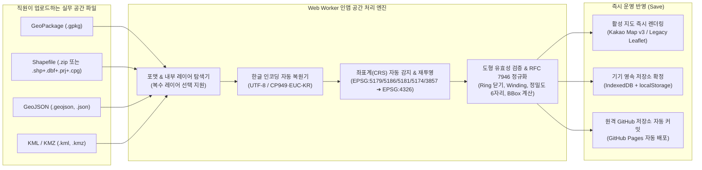
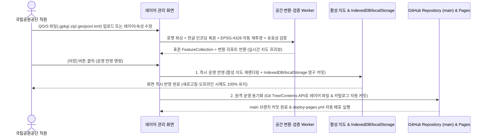

# QGIS 공간정보 레이어 운영 관리 연구·점검·기획·설계 (직원용 정식 서비스 아키텍처)

> 문서 상태: `IMPLEMENTED & VERIFIED (v1.2)`
> 작성일: 2026-11-09
> 대상: 바다꼼꼬미 PWA (국립공원공단 해양국립공원 직원용 실무 앱) / GitHub Pages
> 설계 관점: **MVP(최소 기능 제한) 배제 · 직원 실무 중심 풀서비스(Full-Service) 설계 및 구현 완료**
> 핵심 원칙: **① QGIS 실무 멀티 포맷(`.gpkg`, `.zip/.shp`, `.geojson`, `.kml`) 및 한국 좌표계 인앱 자동 변환 수용 · ② 관리 화면의 `[저장]` 버튼 클릭 = 즉시 운영 반영**

---

## 1. 결론 및 핵심 서비스 설계 방향

현재 `바다꼼꼬미`의 **공간정보 레이어 관리**(`LayerControlModal`)는 하드코딩된 3개 레이어의 메모리상 표시/숨김만 토글하며, 새로고침 시 초기화되고 파일 업로드·편집·영속 저장 기능이 없다.

본 앱은 일반 대중용 홍보 앱이 아니라 **국립공원공단 직원이 해상·도서 현장과 사무실에서 직접 사용하는 직원용 실무 앱**이다. 따라서 *"`.geojson`만 받고 나머지는 직원이 직접 QGIS에서 변환해 오라"*거나 *"관리 화면에서 저장해도 운영에는 바로 반영되지 않는다"*는 식의 MVP(최소 기능) 타협 설계를 전면 배제하고, **직원 실무 서비스 관점의 정식 공간정보 레이어 관리 시스템**으로 설계한다.

### 핵심 서비스 원칙 4가지

1. **QGIS 실무 포맷 원스톱 직접 수용 (Multi-Format Native Ingestion)**:
   - 직원이 QGIS나 유관 기관(해양수산부, 해경, 지자체 등)에서 사용하는 **GeoPackage(`.gpkg`)**, **Shapefile(`.zip` 압축 또는 `.shp`+`.dbf`+`.prj`+`.cpg` 다중 파일)**, **GeoJSON(`.geojson`, `.json`)**, **KML/KMZ(`.kml`, `.kmz`)** 파일을 별도의 외부 변환 작업 없이 그대로 업로드할 수 있다.
   - 단일 `.gpkg` 또는 `.zip` 안에 복수의 공간 레이어가 포함된 경우, 앱이 내부 레이어 목록을 즉시 분석해 직원이 원하는 레이어를 선택·일괄 등록할 수 있도록 지원한다.
2. **한국 공공측량 좌표계(CRS) 및 한글 인코딩(`CP949`/`EUC-KR`) 인앱 자동 변환**:
   - 직원이 `EPSG:5179`, `EPSG:5186`, `EPSG:5181`, `EPSG:5174`, `EPSG:3857` 등 국내 실무 좌표계 파일을 올렸을 때 오류로 차단하지 않고, 내장된 **`proj4` 좌표 변환 엔진이 자동으로 `EPSG:4326`(WGS 84 경도/위도)으로 즉시 재투영**한다.
   - 관공서 Shapefile(`.dbf`)의 고질적인 한글 깨짐(`CP949` / `EUC-KR`)을 자동 감지·변환하여 한글 속성명(`공원명`, `보호구역명`, `규제사항` 등)을 완벽히 보존한다.
3. **전 도형 타입(`Polygon`, `LineString`, `Point`) 및 실무 스타일링 완벽 지원**:
   - 공원구역·특별보호구역(`Polygon`/`MultiPolygon`), 해상 순찰 항로·탐방로·관할 경계선(`LineString`/`MultiLineString`), 선착장·부표·암초·관측지점(`Point`/`MultiPoint`)을 **Kakao Map v3**와 **Legacy Leaflet** 양쪽 엔진에서 모두 동일하게 렌더링하고, 화면에서 색상·선 두께·선 종류·투명도·표시 라벨 필드를 즉시 설정한다.
4. **관리 화면의 `[저장]` 버튼 = 즉시 운영 반영 (Direct Operational Apply)**:
   - 관리 화면에서 레이어 추가·수정·삭제·순서/스타일/표시 변경 후 **`[저장]` 버튼을 누르면 곧바로 운영에 반영**된다.
     - **[즉시 반영 1 — 앱 런타임 & 기기 영속 스토리지(`IndexedDB` / `localStorage`)]**: `[저장]` 클릭 즉시 현재 활성 지도(`KakaoMapCanvas` / `LegacyLeafletCanvas`)와 기기 영속 저장소에 운영 상태로 커밋되어 새로고침·오프라인 해상 현장에서도 즉시 유지된다.
     - **[즉시 반영 2 — 원격 GitHub 저장소(`main`) 자동 커밋 및 GitHub Pages 배포]**: 별도의 ZIP 다운로드나 수작업 PR 없이, `[저장]` 클릭과 동시에 GitHub API를 통해 `public/data/layers/` 및 레이어 카탈로그를 원격 `main` 브랜치에 자동 커밋하여 전체 직원 단말기에 운영 배포를 트리거한다. (해상 음영지역 등 오프라인 상태에서는 기기 내 즉시 운영 반영을 완료한 뒤 온라인 복귀 시 자동 동기화한다.)

---

## 2. 서비스 범위 및 실무 시나리오

### 2.1 직원 실무 핵심 기능 (Full-Service Scope)

| 영역 | 제공 기능 | 서비스 동작 기준 |
|---|---|---|
| **파일 가져오기 (Ingest)** | `.gpkg`, `.zip`(Shapefile), `.shp/.dbf/.prj/.cpg`(다중 선택), `.geojson`/`.json`, `.kml`/`.kmz` 드래그앤드롭 및 파일 선택 | 브라우저 Web Worker에서 포맷 자동 판별 후 표준 GeoJSON(`EPSG:4326`)으로 인앱 자동 변환 |
| **좌표계·인코딩 자동 처리** | 한국 표준 좌표계(`EPSG:5179`, `5186`, `5187`, `5185`, `5181`, `5174`, `3857`, `4326`) 자동 감지·재투영 및 `UTF-8`/`EUC-KR`(`CP949`) 한글 디코딩 | 직원이 QGIS에서 재투영/인코딩 변환을 다시 할 필요 없이 앱이 자동 처리 (수동 좌표계/인코딩 변경 드롭다운 병행 제공) |
| **레이어 CRUD** | 레이어 신규 등록, 메타데이터(이름, 분류, 설명, 출처, 기준일) 수정, 표시/숨김, 렌더링 순서(Z-index), 삭제 | 조작 즉시 지도 미리보기 제공 및 **`[저장]` 클릭 시 즉시 운영 반영** |
| **스타일 & 라벨 설정** | 선 색상, 선 굵기, 선 스타일(실선/점선), 면 채우기 색상·투명도, 포인트 마커 아이콘/색상, 지도 라벨 표시 속성(`properties` 컬럼 선택) | 하드코딩 스타일을 제거하고 레이어별 동적 스타일 설정 후 **`[저장]` 시 즉시 운영 반영** |
| **피처·속성·도형 관리** | 레이어 내 피처 목록 검색·필터, 속성값 수정/추가/삭제, 지도상 도형(Point/Line/Polygon) 선택·수정·삭제 | 현장에서 발견된 구역 명칭 오류·부표 위치 변경·경계 미세 수정 후 **`[저장]` 시 즉시 운영 반영** |
| **데이터 내보내기 (Export)** | 운영 중인 레이어를 표준 GeoJSON(`.geojson`)으로 원클릭 다운로드 | 현장/사무실 간 QGIS 재반입(Round-trip) 및 백업 지원 |
| **버전 이력 & 즉시 복원** | 최근 저장 이력(`releaseId`, 저장 시각, 변경 요약) 조회 및 `[이전 버전으로 복원]` | 오입력 발생 시 관리 화면에서 이전 버전 선택 후 **`[저장]` 한 번으로 즉시 원상 복구** |

### 2.2 명시적 비범위 (Zero-Cost 정적 아키텍처 유지 기준)

- 별도 유료 클라우드 서버(Azure, AWS 등) 및 유료 공간 DB(PostGIS 관리형 서버) 구축 (무상 운영 원칙 유지)
- 수백 MB~수 GB급 항공사진/위성 정사영상(GeoTIFF Raster) 원본 호스팅 (배경 위성지도는 이미 연동된 **Kakao 스카이뷰/하이브리드**로 제공)
- QGIS 데스크톱 전용 프로젝트 파일(`.qgz`, `.qgs` — 실제 공간 데이터 없이 로컬 PC 경로와 심볼 XML만 담긴 파일) 단독 업로드 (공간 데이터가 담긴 `.gpkg`, `.zip/.shp`, `.geojson`, `.kml`은 모두 직접 지원)

---

## 3. 현재 구현 팩트체크 (As-Is 진단)

### 3.1 현재 데이터 흐름 및 한계

```text
public/config/app_config.json
          │ 앱 시작 시 1회 fetch
          ▼
useAppConfig ── layers 메모리 상태 ── LayerControlModal 단순 체크박스 토글
          │
          ▼
MapView ── 각 layer.url JSON fetch ── Kakao(Polygon만) 또는 Leaflet 렌더
```

| 항목 | 현재 상태 (As-Is) | 소스 근거 | 직원용 서비스 관점의 문제점 및 개선 방향 |
|---|---|---|---|
| **레이어 등록 구조** | `app_config.json`에 3개 정적 하드코딩 | [`public/config/app_config.json`](file:///C:/Users/Administrator/apps_ln/bada-kkomkkomi/public/config/app_config.json#L25) | 직원이 앱에서 새 레이어를 추가·삭제할 수 없음 → **동적 레이어 카탈로그 + 영속 저장소 + 원격 자동 동기화로 전환** |
| **레이어 관리 UI** | 단순 체크박스 가시성 토글만 존재 | [`src/components/notebook/LayerControlModal.tsx`](file:///C:/Users/Administrator/apps_ln/bada-kkomkkomi/src/components/notebook/LayerControlModal.tsx#L59) | 파일 업로드, 스타일 변경, 속성 편집, `[저장]` 버튼 모두 없음 → **통합 공간정보 레이어 관리 워크스페이스로 전면 개편** |
| **저장 및 영속화** | 메모리(`useState`)만 변경, 새로고침 시 초기화 | [`src/hooks/useAppConfig.ts`](file:///C:/Users/Administrator/apps_ln/bada-kkomkkomi/src/hooks/useAppConfig.ts#L101) | 직원이 설정한 레이어 상태가 유지되지 않음 → **`[저장]` 클릭 시 `IndexedDB`/`localStorage` + 원격 GitHub 저장소 즉시 반영** |
| **지원 파일 포맷** | 사전 변환된 정적 `.geojson` URL만 fetch | [`src/components/MapView.tsx`](file:///C:/Users/Administrator/apps_ln/bada-kkomkkomi/src/components/MapView.tsx#L132) | 실무에서 쓰는 `.gpkg`, `.zip(shp)`, `EPSG:5179` 파일 직접 등록 불가 → **인앱 멀티 포맷 파서 & 자동 좌표 변환기 탑재** |
| **Kakao 도형 렌더링** | `Polygon`/`MultiPolygon`만 처리 (`LineString`, `Point` 누락) | [`src/components/map/KakaoMapCanvas.tsx`](file:///C:/Users/Administrator/apps_ln/bada-kkomkkomi/src/components/map/KakaoMapCanvas.tsx#L198) | 항로/탐방로(`LineString`)나 부표/암초(`Point`) 레이어를 카카오맵에 그릴 수 없음 → **Kakao `Polyline`, `CustomOverlay`/`Marker` 렌더러 추가** |
| **스타일 적용 방식** | `protected_area` 등 특정 ID에 점선/투명도 하드코딩 | [`src/components/map/KakaoMapCanvas.tsx`](file:///C:/Users/Administrator/apps_ln/bada-kkomkkomi/src/components/map/KakaoMapCanvas.tsx#L440) | 신규 레이어별 스타일 커스터마이징 불가 → **레이어 스타일 스키마(`strokeColor`, `strokeWidth`, `strokeDash`, `fillColor`, `fillOpacity`, `labelField`) 도입** |

### 3.2 현재 수록된 공간 데이터 표본 점검

| 파일 | 크기 | 피처 수 | 도형 타입 | 현재 상태 진단 |
|---|---:|---:|---|---|
| [`national_park.geojson`](file:///C:/Users/Administrator/apps_ln/bada-kkomkkomi/public/data/layers/national_park.geojson) | 1,302 B | 2 | `Polygon` | 레거시 `crs` 속성 포함, 외곽 링 시계방향(CW) → 인앱 정규화 엔진으로 자동 정리 대상 |
| [`protected_area.geojson`](file:///C:/Users/Administrator/apps_ln/bada-kkomkkomi/public/data/layers/protected_area.geojson) | 1,328 B | 2 | `Polygon` | 레거시 `crs` 속성 포함 → 인앱 정규화 엔진으로 자동 정리 대상 |
| [`docking_points.geojson`](file:///C:/Users/Administrator/apps_ln/bada-kkomkkomi/public/data/layers/docking_points.geojson) | 46,683 B | 55 | `Point` | 접안시설 전용 도메인 레이어로 정상 동작 중 |

---

## 4. 직원 실무 중심 QGIS 멀티 포맷 & 좌표계 자동 변환 아키텍처

직원용 앱에서는 직원이 QGIS의 복잡한 내보내기 옵션(`RFC7946=YES`, 수동 재투영, 인코딩 변환 등)을 일일이 맞추지 않아도 **실무 파일을 그대로 올리면 앱이 알아서 표준화**해야 한다.

### 4.1 지원 포맷 및 인앱 파싱 파이프라인



| 실무 입력 포맷 | 확장자 | 인앱 처리 방식 및 기술 구성 | 직원 UX 경험 |
|---|---|---|---|
| **GeoPackage** | `.gpkg` | SQLite/GeoPackage 바이너리 리더를 통해 `gpkg_contents`, `gpkg_geometry_columns`, `gpkg_spatial_ref_sys` 및 Standard GeoPackage Binary(GPB/WKB) 도형을 직접 파싱 | `.gpkg` 파일 1개에 여러 레이어(예: 공원경계, 특별보호구역, 해상항로)가 들어 있으면 **체크박스로 원하는 레이어를 골라 한 번에 가져오기** 가능 |
| **Shapefile** | `.zip` 또는 `.shp`, `.dbf`, `.shx`, `.prj`, `.cpg` | `fflate`(초경량 ZIP 해제) + Shapefile/DBF 바이너리 파서 결합. ZIP 압축본은 물론 압축하지 않은 다중 파일 드래그앤드롭도 자동 매칭 | 관공서 표준 배포 형태인 `.zip` 또는 폴더 내 `.shp+.dbf+.prj` 파일을 그대로 드래그하면 즉시 로드 |
| **GeoJSON** | `.geojson`, `.json` | 표준 RFC 7946 및 QGIS 구버전(`crs` 헤더 포함, 투영 좌표계 포함) 모두 수용 | 파일 선택 즉시 파싱 및 좌표계 자동 보정 |
| **KML / KMZ** | `.kml`, `.kmz` | KMZ 압축 해제 후 KML XML 파싱(`@tmcw/togeojson` 계열)으로 Point/LineString/Polygon 및 설명 속성 추출 | 구글 어스나 해경·순찰 장비에서 내보낸 트랙/구역 파일 즉시 로드 |

### 4.2 한국 공공측량 좌표계(CRS) 인앱 자동 감지 및 재투영

국내 해양·국립공원 공간데이터는 대부분 아래 좌표계 중 하나로 작성된다. 앱 내부에 아래 **한국 측량 표준 EPSG 정의(`proj4` 문자열)를 기본 내장**하여 파일 업로드 시 자동으로 `EPSG:4326`(WGS 84 경도/위도)으로 변환한다.

| EPSG 코드 | 좌표계 명칭 (실무 사용처) | 자동 감지 기준 (`.prj` / `srs_id` / 좌표 범위 휴리스틱) |
|---|---|---|
| **EPSG:4326** | WGS 84 경도/위도 (GPS·웹 표준) | `X: 124 ~ 132`, `Y: 32 ~ 39` 범위 (별도 변환 없이 정밀도·축 순서 정규화) |
| **EPSG:5179** | Korea 2000 / Unified CS (UTM-K, 국가공간정보포털·국립공원 표준) | `.prj`의 `Korea_2000_Korea_Unified_Coordinate_System` 또는 `X: 700,000 ~ 1,300,000`, `Y: 1,400,000 ~ 2,200,000` |
| **EPSG:5186** | Korea 2000 / Central Belt 2010 (중부원점, 지자체·수치지도 표준) | `.prj`의 `Central_Belt_2010` 또는 `X: 100,000 ~ 400,000`, `Y: 150,000 ~ 700,000` |
| **EPSG:5187** | Korea 2000 / East Belt 2010 (동부원점, 경상·동해 권역) | `.prj`의 `East_Belt_2010` |
| **EPSG:5185** | Korea 2000 / West Belt 2010 (서부원점, 서해 권역) | `.prj`의 `West_Belt_2010` |
| **EPSG:5181** | Korea 2000 / Central Belt (구 중부원점, 가산수치 500,000) | `.prj`의 `Central_Belt` (`false_northing 500000`) |
| **EPSG:5174** | Korean 1985 / Modified Central Belt (구 베셀 보정 중부원점, 구 지적도) | `.prj`의 `Bessel_1841` + Towgs84 7-parameter 변환 내장 |
| **EPSG:3857** | Web Mercator (구글·웹 배경지도 투영) | `X: 13,800,000 ~ 14,700,000`, `Y: 3,700,000 ~ 4,700,000` |

- **위도/경도 축 반전(`[lat, lng]`) 자동 교정**: 만약 파일 좌표가 `[34.78, 128.45]`처럼 위도·경도가 뒤집혀 들어온 경우 대한민국 영역(`경도 124~132, 위도 32~39`) 휴리스틱으로 즉시 감지하여 `[128.45, 34.78]`로 자동 교정하고 화면에 교정 사실을 안내한다.
- **수동 좌표계 오버라이드 드롭다운**: `.prj` 파일이 누락된 구형 Shapefile이라 하더라도 좌표값 범위를 통해 최적 좌표계를 자동 추천하며, 직원이 미리보기 지도를 보면서 드롭다운(`EPSG:5179`, `EPSG:5186`, `EPSG:5174` 등)을 바꾸면 즉시 재투영된 위치를 지도 위에서 확인할 수 있다.

### 4.3 한글 인코딩(`CP949` / `EUC-KR` / `UTF-8`) 자동 복원

1. `.cpg` 파일 또는 DBF 헤더의 Language Driver ID(LDID)가 존재하면 해당 인코딩을 우선 확인한다.
2. 선언이 없거나 잘못된 경우, 속성 바이트 배열에 대해 `new TextDecoder('utf-8', { fatal: true })`를 시도하고, 디코딩 오류가 발생하거나 깨진 문자(`U+FFFD`)가 검출되면 즉시 **`new TextDecoder('euc-kr')`(`CP949` 호환)**로 자동 전환한다.
3. 가져오기 미리보기 화면 상단에 `[인코딩: 자동 감지(EUC-KR/CP949) ▾]` 선택기를 함께 배치해 직원이 언제든 `UTF-8` ↔ `EUC-KR(CP949)`을 원클릭 전환할 수 있게 한다.

---

## 5. 직원용 공간정보 레이어 관리 UI/UX 및 `[저장 = 즉시 운영 반영]` 설계

### 5.1 통합 관리 화면 구조 (`LayerControlModal` 고도화)

기존의 단순 체크박스 모달을 **직원용 통합 공간정보 레이어 관리 워크스페이스**로 확장한다.

```text
[공간정보 레이어 관리] (직원용 통합 워크스페이스)
├─ 1. 상단 상태 바
│    ├─ 현재 운영 릴리스 버전(releaseId) · 최근 저장 시각 · 동기화 상태(온라인/로컬 영속)
│    └─ [+ 새 공간 레이어 파일 등록 (.gpkg / .zip / .shp / .geojson / .kml)] 버튼 (드래그앤드롭 지원)
├─ 2. 등록된 레이어 목록 & 빠른 제어 탭
│    ├─ 각 레이어 카드: [표시 스위치] [색상/스타일 뱃지] [레이어명·도형타입·피처수]
│    ├─ 레이어별 액션: [지도 이동(줌)] [스타일·라벨 설정] [속성/피처 편집] [파일 교체] [GeoJSON 내보내기] [삭제]
│    └─ 레이어 표시 순서(위/아래) 조정
├─ 3. 파일 등록 / 레이어·피처 상세 편집 패널 (선택 시 확장)
│    ├─ 멀티 레이어 선택 (예: .gpkg 내 원하는 테이블 체크)
│    ├─ 좌표계(CRS) 및 한글 인코딩 자동 변환 결과 배지 + 실시간 지도 미리보기
│    ├─ 스타일 편집기 (선 색상/두께/점선, 면 색상/투명도, 마커 색상, 지도 표시 라벨 컬럼 지정)
│    └─ 피처 목록 테이블 (검색, 속성값 인라인 수정, 개별 피처 삭제, 지도상 도형 하이라이트)
└─ 4. 하단 고정 액션 바
     ├─ [변경 취소] · [이전 버전 복원 ▾]
     └─ [저장 (운영 반영)] ── 클릭 즉시 활성 지도 + 기기 영속 저장소 + 원격 GitHub 저장소 동시 반영
```

### 5.2 CRUD 및 `[저장 = 즉시 운영 반영]` 동작 명세

| 직원 작업 | 화면 조작 (실시간 미리보기) | **`[저장]` 버튼 클릭 시 동작 (즉시 운영 반영)** |
|---|---|---|
| **레이어 신규 등록 (Create)** | `.gpkg`/`.zip`/`.geojson`/`.kml` 파일 드래그앤드롭 → 자동 좌표변환·정규화 → 지도 위 실시간 프리뷰 확인 | **`[저장]` 즉시 운영 반영**: 기기 `IndexedDB`/`localStorage`에 영구 저장 + 활성 지도 즉시 렌더링 + 원격 GitHub 저장소(`public/data/layers/`) 자동 커밋·배포 |
| **레이어 조회 및 검색 (Read)** | 등록된 전체 레이어, 도형 유형, 피처 개수, 속성 테이블, 기준일, 좌표 범위 조회 | 선택한 레이어 또는 특정 피처 위치로 지도 카메라 즉시 이동(`fitBounds`) |
| **레이어/스타일/속성 수정 (Update)** | 표시 여부(ON/OFF), 레이어명, 설명, 색상·투명도·선종류, 라벨 컬럼, 개별 피처 속성/도형 수정 | **`[저장]` 즉시 운영 반영**: 수정된 스타일·속성·가시성이 현재 앱과 원격 저장소에 즉시 운영 상태로 확정 |
| **레이어 파일 교체 (Replace)** | 최신 기준일 QGIS 파일 업로드 → 기존 레이어 대비 추가/수정/삭제된 피처 수 자동 비교 표시 | **`[저장]` 즉시 운영 반영**: 기존 레이어 ID와 스타일 설정을 유지한 채 공간 데이터만 최신본으로 무중단 교체 |
| **레이어/피처 삭제 (Delete)** | 불필요한 레이어 또는 특정 피처 삭제 선택 (실수 방지용 삭제 건수 배지 표시) | **`[저장]` 즉시 운영 반영**: 운영 레이어 카탈로그 및 지도에서 즉시 제거 및 원격 저장소 동기화 |
| **이전 버전 복원 (Rollback)** | 저장 이력 드롭다운에서 이전 정상 스냅샷 선택 후 미리보기 | **`[저장]` 즉시 운영 반영**: 선택한 정상 스냅샷으로 로컬 및 원격 운영 상태를 즉시 되돌림 |

### 5.3 `[저장]` 원클릭 운영 반영 시퀀스



---

## 6. 데이터 및 렌더링 계약 (Dual-Engine 완전 호환)

### 6.1 확장된 레이어 카탈로그 스키마 (`LayerCatalog`)

기존 `src/types/config.ts`의 단순 `SpatialLayer`(`id`, `name`, `visible`, `color`, `url`, `description`)를 확장하여 모든 실무 도형과 스타일을 표현한다(기존 필드와 100% 하위 호환 유지).

```json
{
  "schemaVersion": 1,
  "releaseId": "layers-2026-11-09.1",
  "updatedAt": "2026-11-09T16:50:00+09:00",
  "layers": [
    {
      "id": "national_park",
      "name": "한려해상국립공원 경계",
      "category": "boundary",
      "description": "국립공원 관할 공원구역 경계선",
      "visible": true,
      "url": "data/layers/national_park.geojson",
      "dataSha256": "<64-hex>",
      "geometryTypes": ["Polygon", "MultiPolygon"],
      "featureCount": 2,
      "bbox": [128.35, 34.68, 128.75, 34.92],
      "color": "#10b981",
      "style": {
        "strokeColor": "#10b981",
        "strokeWidth": 2.5,
        "strokeOpacity": 0.9,
        "strokeDash": "solid",
        "fillColor": "#10b981",
        "fillOpacity": 0.12,
        "pointRadius": 7,
        "labelField": "name",
        "zIndex": 20
      },
      "sourceMeta": {
        "originalFileName": "한려해상_공원경계_2026.gpkg",
        "originalCrs": "EPSG:5179",
        "updatedBy": "해양자원과",
        "updatedAt": "2026-11-09"
      }
    }
  ]
}
```

### 6.2 Kakao Map v3 & Legacy Leaflet 전 도형 렌더링 동등성 보장

현재 `KakaoMapCanvas.tsx`는 `Polygon`/`MultiPolygon`만 렌더링하고 있어, 직원이 항로(`LineString`)나 부표/관측점(`Point`) 레이어를 등록할 때 표시되지 않는 문제를 다음과 같이 해결한다.

| GeoJSON 도형 타입 | Kakao Map v3 (`KakaoMapCanvas.tsx`) 렌더링 구현 | Legacy Leaflet (`LegacyLeafletCanvas.tsx`) 렌더링 구현 | 공통 인터랙션 |
|---|---|---|---|
| `Polygon` / `MultiPolygon` | `new kakao.maps.Polygon({ path, strokeWeight, strokeColor, strokeOpacity, strokeStyle, fillColor, fillOpacity, zIndex })` (도넛 홀 내부 링 배열 완벽 지원) | `<GeoJSON style={...} />` (`L.Polygon`) | 도형 클릭 시 속성 팝업/요약 배너 표시, `labelField` 지정 시 중심점 라벨 표시 |
| `LineString` / `MultiLineString` | `new kakao.maps.Polyline({ path, strokeWeight, strokeColor, strokeOpacity, strokeStyle, zIndex })` | `<GeoJSON style={...} />` (`L.Polyline`) | 항로·경계선 클릭 시 노선명 및 속성 표시 |
| `Point` / `MultiPoint` | `new kakao.maps.CustomOverlay` (레이어 `style.fillColor`·`labelField`가 반영된 배지/핀 마커) | `pointToLayer` 기반 `L.circleMarker` / `L.divIcon` | 포인트 클릭 시 상세 속성 표시 |

---

## 7. `[저장]` 영속화 및 원격 자동 동기화 상세 설계

### 7.1 2계층 하이브리드 운영 저장소 구조

GitHub Pages는 정적 호스팅이므로 브라우저 메모리에만 두면 새로고침 시 사라지고, 원격 커밋만 기다리면 빌드 시간(약 1~2분) 동안 화면 반영이 지연된다. 이를 해결하기 위해 **로컬 즉시 영속화(`IndexedDB` + `localStorage`)와 원격 GitHub 자동 커밋을 결합**한다.

1. **1계층 — 기기 내 즉시 운영 반영 (`IndexedDB` + `localStorage` + `Runtime State`)**:
   - 직원이 `[저장]`을 누르는 즉시(0.1초 이내) 메타데이터 카탈로그와 정규화된 GeoJSON `FeatureCollection` 본문을 브라우저 `IndexedDB`(`bada_kkomkkomi_layers_db`)에 저장하고, 활성 지도(`MapView`)의 `layerGeoJsonMap` 상태를 즉시 갱신한다.
   - 동시에 최근 10개 운영 스냅샷(`snapshots` 스토어)을 자동 보관하여 네트워크 없이도 언제든 직전 버전으로 `[복원 후 저장]`할 수 있게 한다.
2. **2계층 — 원격 GitHub 저장소(`main`) 자동 커밋 및 전 단말 동기화**:
   - 운영 설정에 등록된 GitHub Fine-grained PAT(대상 저장소의 `contents: write` 단일 권한만 부여)를 사용해 GitHub Git Data API(`POST /repos/{owner}/{repo}/git/trees` → `commits` → `PATCH refs/heads/main`)로 변경된 `.geojson` 파일과 `public/config/app_config.json`(또는 `public/data/layers/index.json`)을 **단일 원자적 커밋(Single Atomic Commit)**으로 푸시한다.
   - 커밋 즉시 `.github/workflows/deploy-pages.yml`이 실행되어 다른 직원들의 단말기에도 동일한 운영 레이어가 배포된다.
   - **오프라인(해상 출항 중) 대응**: 출항 중이라 인터넷이 연결되지 않은 상태에서 직원이 `[저장]`을 누르면 **1계층(기기 내 운영 반영)이 즉시 완료되어 현장에서 바로 사용**할 수 있으며, `pendingSyncQueue`에 기록되었다가 육지 복귀(온라인 전환) 시 원클릭 또는 자동으로 원격 저장소에 동기화된다.

### 7.2 앱 시작 시 레이어 로드 우선순위 (최신성 보장)

앱 부팅 시 `useAppConfig` 및 레이어 로더는 다음 순서로 최신 운영 데이터를 결정한다:
1. 원격 서버(`public/data/layers/index.json` 및 `app_config.json`)와 기기 `IndexedDB`의 `updatedAt` / `releaseId`를 비교한다.
2. 기기에서 방금 `[저장]`한 최신 운영 데이터가(아직 GitHub Pages CDN `max-age=600` 캐시 전파 전이거나 오프라인 미동기화 상태일 때) 더 최신이면 **기기 `IndexedDB`의 운영본을 우선 표시**하여, 직원이 `[저장]` 후 새로고침하더라도 옛날 캐시로 되돌아가는 현상(Stale Read)을 원천 차단한다.
3. 다른 직원이 원격 저장소에 더 새로운 레이어 버전을 배포한 경우에는 원격 최신본을 가져와 `IndexedDB` 캐시를 자동 갱신한다.

---

## 8. 보안·데이터 무결성·안전장치 설계

직원용 앱에서 편의성을 극대화하더라도 잘못된 공간 데이터나 스크립트 주입으로 지도 전체가 멈추는 일은 없어야 한다.

1. **`[저장]` 전 자동 무결성 게이트 (Auto-Healing & Validation Gate)**:
   - **자동 복구(Auto-Heal) 우선**: 닫히지 않은 Polygon Ring(첫 점과 끝점 불일치), 반시계/시계 방향 Winding 오류, 레거시 `crs` 객체 잔존, `EPSG:5179`/`5186` 좌표계, `CP949` 인코딩, 중복 꼭짓점은 직원을 귀찮게 막지 않고 **인앱 엔진이 자동으로 표준 규격으로 교정**한다.
   - **치명적 손상 파일만 차단**: 도형 좌표가 숫자가 아닌 파일(`NaN`/`Infinity`), 공간 좌표가 전혀 없는 빈 파일, 압축 폭탄(Zip Bomb) 파일은 명확한 한국어 원인과 함께 `[저장]` 전에 차단한다.
2. **XSS 및 프로토타입 오염 방지**:
   - QGIS 파일 내부의 모든 속성(`properties`) 문자열은 지도 팝업·라벨·테이블에 렌더링할 때 React 텍스트 바인딩 또는 `escapeHtml`을 거치도록 강제하며, `__proto__`/`constructor` 키는 파싱 단계에서 제거한다.
3. **고용량 파일 Web Worker 비동기 처리 및 단순화 옵션**:
   - 정밀 해안선 등 꼭짓점(Vertex)이 수십만 개인 대용량 파일 업로드 시 메인 UI 스레드가 멈추지 않도록 파싱·좌표변환·BBox 계산을 Web Worker에서 수행한다.
   - 모바일 렌더링 부하가 큰 초고밀도 폴리곤/라인의 경우, 관리 화면에서 **[모바일 최적화 단순화(Douglas-Peucker, 허용오차 1m / 5m)]** 옵션을 선택해 형상 왜곡 없이 파일 크기를 70~90% 경량화하여 `[저장]`할 수 있도록 지원한다.
4. **원격 동기화 토큰 격리**:
   - 원격 GitHub 자동 커밋용 토큰은 소스코드나 공개 빌드 번들에 절대 포함하지 않으며, 직원 단말기의 로컬 보안 저장소에만 보관하거나 사내 경량 프록시 엔드포인트를 통해 연동한다.

---

## 9. CI/CD 및 PWA 캐시 최적화

### 9.1 GitHub Actions (`deploy-pages.yml`) 연동 검증

- 관리 화면에서 `[저장]`을 눌러 원격 `main` 브랜치에 레이어 커밋이 푸시되면 `.github/workflows/deploy-pages.yml`이 자동 실행된다.
- 워크플로 내에 `npm run validate:layers`(레이어 JSON/GeoJSON 무결성 검사), `npm run lint`, `npm run build`가 포함되어 있어, 만에 하나 손상된 데이터가 푸시되더라도 기존 정상 GitHub Pages 배포본이 덮어써지지 않고 보호된다.
- 빌드 산출물(`dist/`) 최적화: `public/dev/` 등 개발 참고용 대용량 디자인 원본이 운영 배포 아티팩트에 불필요하게 포함되지 않도록 정리하여 배포 속도를 단축한다.

### 9.2 PWA 서비스 워커 캐시 정책

- `public/data/layers/**` 및 `public/config/**`는 `NetworkFirst` 전략과 로컬 `IndexedDB` 최신 스냅샷 비교를 병행하여, 직원이 `[저장]`한 즉시 현재 기기에서 0초 만에 반영되고 타 단말기에서도 온라인 접속 시 최신 레이어를 즉시 수신하도록 구성한다.

---

## 10. 검증 규칙 및 서비스 품질 보증 (QA)

### 10.1 자동 및 실무 시나리오 검증 항목

| 검증 구분 | 실무 테스트 시나리오 | 기대 결과 (Pass 기준) |
|---|---|---|
| **포맷 호환성** | 1. QGIS에서 내보낸 `.gpkg` 파일 업로드 (복수 레이어 포함) | 내부 레이어 목록이 표시되고 선택한 레이어가 정상 파싱됨 |
| **포맷 호환성** | 2. 공공데이터포털/공단 표준 `.zip` (Shapefile: `.shp+.dbf+.prj`) 업로드 | 압축 해제 후 도형과 한글 속성이 깨짐 없이 로드됨 |
| **포맷 호환성** | 3. `.geojson` 및 `.kml`/`.kmz` 파일 업로드 | 즉시 파싱되어 지도 미리보기에 렌더링됨 |
| **좌표계 자동 변환** | 4. `EPSG:5179`(UTM-K) 및 `EPSG:5186`(중부원점) 공간 파일 업로드 | 오류 차단 없이 `EPSG:4326`(WGS 84)으로 자동 재투영되어 남해안(통영·거제) 정위치에 정확히 표시됨 |
| **한글 인코딩** | 5. `CP949`(`EUC-KR`)로 인코딩된 관공서 `.dbf` 포함 Shapefile 업로드 | 한글 컬럼명과 속성값이 깨지지 않고 정상 출력됨 |
| **전 도형 & 듀얼 엔진** | 6. `Polygon`(구역), `LineString`(항로), `Point`(지점) 레이어를 Kakao Map과 Legacy Leaflet에서 각각 확인 | 두 지도 엔진 모두에서 설정한 색상·두께·점선·투명도·라벨로 정상 렌더링됨 |
| **`[저장]` = 즉시 운영 반영** | 7. 새 레이어 추가·스타일 변경·속성 수정 후 **`[저장]` 버튼 클릭** | 클릭 즉시 활성 지도에 반영되고, **브라우저를 새로고침(F5)하거나 오프라인으로 전환해도 저장된 운영 상태가 100% 유지**됨 |
| **원격 자동 배포** | 8. 동기화 토큰 설정 상태에서 **`[저장]` 버튼 클릭** | 수동 PR/ZIP 작업 없이 원격 GitHub `main` 브랜치에 자동 커밋되고 GitHub Pages 배포가 트리거됨 |
| **즉시 롤백** | 9. 잘못된 수정 후 관리 화면에서 `[이전 버전 복원]` 선택 후 **`[저장]` 클릭** | 즉시 직전 정상 운영 레이어 상태로 복구됨 |

---

## 11. 구현 아키텍처 모듈 구성 (Target Codebase Structure)

실제 구현 시 생성·고도화할 모듈 구조는 다음과 같다.

```text
src/
├─ types/
│   ├─ config.ts                  # SpatialLayer 스타일(LayerStyle), 도형 타입, 출처 메타데이터, 스냅샷 타입 확장
│   └─ spatialLayer.ts            # 멀티 포맷 파싱 결과, CRS 코드, 피처 편집/이력, GitHub 동기화 계약 정의
├─ services/
│   ├─ spatialFileParser.ts       # .gpkg, .zip(.shp/.dbf/.prj/.cpg), .geojson, .kml/.kmz 통합 파서 및 CRS/CP949 자동 변환기
│   ├─ layerStorageService.ts     # IndexedDB + localStorage 영속 저장소, 버전 스냅샷 보관, 즉시 롤백 서비스
│   └─ githubLayerSyncService.ts  # [저장] 시 GitHub Git Data/Contents API를 통한 원격 main 브랜치 자동 커밋 서비스
├─ hooks/
│   └─ useAppConfig.ts            # 정적 JSON + IndexedDB 운영본 통합 로더, 레이어 CRUD 및 [저장(즉시 운영 반영)] 액션 제공
└─ components/
    ├─ MapView.tsx                # 동적 인메모리/IndexedDB GeoJSON 및 원격 URL 통합 공급
    ├─ map/
    │   ├─ KakaoMapCanvas.tsx     # Polygon + Polyline(LineString) + CustomOverlay(Point/라벨) 및 동적 LayerStyle 렌더링 확장
    │   └─ LegacyLeafletCanvas.tsx# 동적 LayerStyle 및 Point/Line/Polygon/라벨 렌더링 정합화
    └─ notebook/
        └─ LayerControlModal.tsx  # 직원용 통합 공간정보 레이어 관리 워크스페이스 (멀티포맷 업로드, 스타일/속성 편집, [저장=즉시 운영 반영], 버전 복원)
```

---

## 12. 대안 비교 및 최종 아키텍처 판정

| 대안 | 내용 | 직원용 서비스 관점 평가 | 최종 판정 |
|---|---|---|---|
| **A. 직원용 풀서비스 아키텍처 (멀티 포맷·한국 좌표계 인앱 자동 변환 + `[저장]` 즉시 운영 반영)** | `.gpkg`/`.zip(shp)`/`.geojson`/`.kml` 직접 업로드, `EPSG:5179`/`5186` 자동 재투영, `CP949` 한글 복원, **`[저장]` 클릭 한 번으로 로컬 영속화 + 원격 GitHub Pages 자동 배포 동시 수행** | **현장·행정 직원이 QGIS 재가공이나 GitHub 수작업 없이 앱 안에서 모든 공간 레이어 업무를 완결할 수 있음 (최고의 실무 생산성)** | **최종 채택** |
| B. MVP 제한 설계 (`.geojson`만 허용 + 수동 ZIP 다운로드 후 개발자 PR 요청) | 비 GeoJSON 및 `EPSG:5179` 파일 거부, 저장 버튼을 눌러도 임시 초안만 만들고 ZIP을 받아 GitHub PR을 수동 생성 | 직원이 매번 QGIS에서 포맷·좌표계를 수동 변환해야 하고, 저장해도 운영 반영이 안 되어 실무 앱으로 사용 불가 | **폐기** |
| C. 별도 유료 클라우드 서버 + 상용 GIS 엔진 도입 | 외부 클라우드 VM 및 PostGIS/GeoServer 구축 | 월 고정 클라우드 비용 및 서버 유지보수 부담 발생 (Zero-cost 원칙 위배) | **비채택** |

---

## 13. 공식 기술 표준 근거

- [OGC GeoPackage Encoding Standard](https://www.geopackage.org/spec/) — `.gpkg` SQLite 컨테이너 및 Standard GeoPackage Binary(GPB) 도형 명세
- [ESRI Shapefile Technical Description](https://www.esri.com/content/dam/esrisites/sitecore-archive/Files/Pdfs/library/whitepapers/pdfs/shapefile.pdf) — `.shp`, `.shx`, `.dbf` 바이너리 레코드 구조
- [RFC 7946: The GeoJSON Format](https://www.rfc-editor.org/info/rfc7946/) — 표준 웹 공간 데이터 구조 및 WGS 84(`EPSG:4326`) 경도/위도 규격
- [국토지리정보원 국가좌표계 변환 파라미터 고시](https://www.ngii.go.kr/) — `EPSG:5179`(UTM-K), `EPSG:5186`(중부원점 2010), `EPSG:5174`(보정 베셀) 투영 정의
- [GitHub REST API — Git Database / Contents API](https://docs.github.com/en/rest/git/trees) — 정적 PWA에서 단일 원자적 커밋을 통한 원격 저장소 자동 업데이트 및 Pages 배포 트리거
